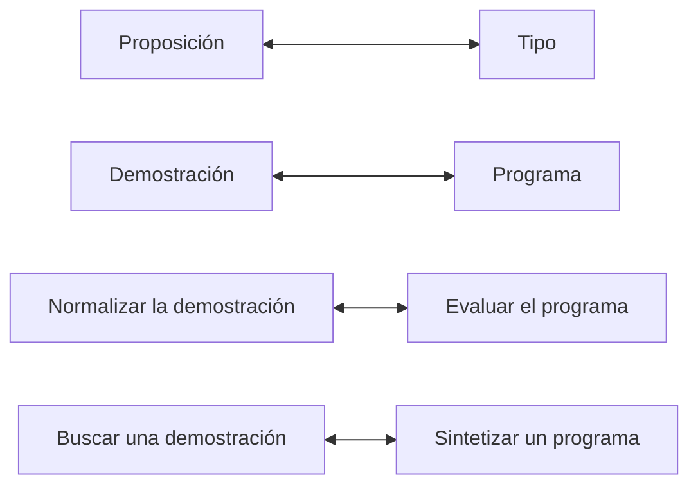

# Lógica Computacional - Extensiones y aplicaciones (opcional)

## 7.1 Introducción a los sistemas de tipos; la correspondencia de Curry-Howard.

---

Un **sistema de tipos** clasifica las expresiones de un programa según los valores que pueden producir, para rechazar antes de ejecutar los programas que harían operaciones sin sentido, como sumar una función a un número. La **correspondencia de Curry-Howard** observa que las reglas de un sistema de tipos son las reglas de un sistema deductivo: un tipo es una proposición, un programa de ese tipo es una demostración de ella, y ejecutar el programa es simplificar la demostración. Esta coincidencia, notada por Curry (1934) para los combinadores y por Howard (1969) para la deducción natural, es el fundamento de los asistentes de demostración como Coq, Lean y Agda.

### Sistemas de tipos

Un sistema de tipos se define con **juicios** $\Gamma \vdash M : T,$ que se leen: en el contexto $\Gamma,$ que asigna tipos a las variables libres, el término $M$ tiene tipo $T.$ Los juicios se derivan con reglas, igual que los secuentes del tema 5.3.

**El cálculo lambda simplemente tipado.** Los tipos y los términos son

$$ T ::= \alpha \mid T \to T \mid T \times T \mid T + T \mid \bot $$

$$ M ::= x \mid \lambda x{:}T.\, M \mid M\, N \mid \langle M, N \rangle \mid \text{fst}\, M \mid \text{snd}\, M \mid \text{inl}\, M \mid \text{inr}\, M \mid \text{caso}\, M \mid \text{abort}\, M $$

donde $\lambda x{:}T.\, M$ es la función que a cada $x$ de tipo $T$ le asocia $M,$ $M\, N$ es la aplicación, $\langle M, N \rangle$ es un par, $\text{inl}$ e $\text{inr}$ inyectan en una suma (un valor de uno de dos tipos, etiquetado) y $\text{caso}$ analiza una suma por casos. Las reglas principales son

$$ \frac{x : T \in \Gamma}{\Gamma \vdash x : T} \qquad \frac{\Gamma, x : T \vdash M : U}{\Gamma \vdash \lambda x{:}T.\, M : T \to U} \qquad \frac{\Gamma \vdash M : T \to U \quad \Gamma \vdash N : T}{\Gamma \vdash M\, N : U} $$

$$ \frac{\Gamma \vdash M : T \quad \Gamma \vdash N : U}{\Gamma \vdash \langle M, N \rangle : T \times U} \qquad \frac{\Gamma \vdash M : T \times U}{\Gamma \vdash \text{fst}\, M : T} \qquad \frac{\Gamma \vdash M : T \times U}{\Gamma \vdash \text{snd}\, M : U} $$

**Seguridad.** Un sistema de tipos es **seguro** si los programas bien tipados no "se atoran": la **preservación** dice que la evaluación conserva el tipo, y el **progreso**, que un término cerrado bien tipado es un valor o puede dar un paso. En palabras de Milner (1978): los programas bien tipados no pueden fallar. Además, en el cálculo lambda simplemente tipado todo término bien tipado **termina** (normalización fuerte, Tait, 1967), lo que lo hace incapaz de expresar ciclos infinitos y, por tanto, no es un lenguaje de propósito general; los lenguajes reales añaden recursión.

### La correspondencia de Curry-Howard

Si se borran los términos de las reglas de tipado, quedan **exactamente** las reglas de la deducción natural intuicionista (tema 5.3): la regla de la abstracción es $\to I,$ la de aplicación es $\to E$ (modus ponens), la de pares es $\land I,$ y así sucesivamente.

| Lógica | Programación |
| --- | --- |
| proposición $A$ | tipo $A$ |
| demostración de $A$ | programa (término) de tipo $A$ |
| hipótesis $A$ | variable de tipo $A$ |
| implicación $A \to B$ | tipo de las funciones $A \to B$ |
| conjunción $A \land B$ | tipo de los pares $A \times B$ |
| disyunción $A \lor B$ | suma etiquetada $A + B$ |
| falso $\bot$ | tipo vacío, sin valores |
| negación $\lnot A$ | $A \to \bot$ |
| introducir $\to$ | definir una función |
| eliminar $\to$ (modus ponens) | aplicar una función |
| demostración por casos | análisis por casos (`case`, `match`) |
| normalización de demostraciones | evaluación de programas |
| proposición demostrable | tipo habitado |

**Ejemplos.**

- $\lambda x{:}A.\, \lambda y{:}B.\, x$ tiene tipo $A \to (B \to A):$ es la demostración del axioma A1 de Hilbert (tema 5.1). Como programa, es la función que ignora su segundo argumento.
- $\lambda f.\, \lambda g.\, \lambda x.\, g\, (f\, x)$ tiene tipo $(A \to B) \to (B \to C) \to (A \to C):$ el silogismo hipotético es la **composición** de funciones.
- $\lambda p.\, \langle \text{snd}\, p, \text{fst}\, p \rangle$ tiene tipo $A \times B \to B \times A:$ la conmutatividad de la conjunción es intercambiar los componentes de un par.

**Normalización es evaluación.** Una demostración que introduce un conectivo y lo elimina de inmediato tiene un **rodeo**: por ejemplo, demostrar $A \land B$ con $\land I$ y luego usar $\land E$ para obtener $A.$ Eliminar el rodeo es el paso de evaluación $\text{fst}\, \langle a, b \rangle \to a.$ Para la implicación, el rodeo $\to I$ seguido de $\to E$ es la reducción β, $(\lambda x.\, M)\, N \to M[x := N]$ (tema 3.3). El teorema de normalización de Prawitz (1965) para la deducción natural es, visto así, el teorema de terminación de Tait.

**La lógica es intuicionista.** No hay ningún programa de tipo $((A \to B) \to A) \to A$ (ley de Peirce) ni de tipo $A + (A \to \bot)$ (tercero excluido) para tipos $A$ y $B$ arbitrarios: no se puede construir un valor sin información. Añadir operadores de control como `call/cc` corresponde a añadir la lógica clásica (Griffin, 1990).

### Más allá: cuantificadores y tipos dependientes

La correspondencia se extiende a la lógica de primer orden con **tipos dependientes**, en los que un tipo puede depender de un valor:

| Lógica | Tipos dependientes |
| --- | --- |
| $\forall x{:}A.\, P(x)$ | $\Pi_{x : A}\, P(x),$ funciones que a cada $x$ le dan una prueba de $P(x)$ |
| $\exists x{:}A.\, P(x)$ | $\Sigma_{x : A}\, P(x),$ pares formados por un testigo $x$ y una prueba de $P(x)$ |

Una demostración constructiva de $\forall x\, \exists y\, P(x, y)$ es una **función** que calcula $y$ a partir de $x,$ y de ella se puede **extraer** un programa certificado. Es la base de Coq, Lean y Agda: el asistente comprueba una demostración comprobando su tipo. Con ellos se verificó el compilador CompCert y la demostración del teorema de los cuatro colores (Gonthier, 2005).



### Proposiciones como tipos en TypeScript

Los lenguajes con genéricos permiten experimentar con la correspondencia. En TypeScript, `[A, B]` es la conjunción, una unión etiquetada es la disyunción y `never`, el tipo sin valores, es $\bot.$ Una función genérica de cierto tipo, escrita sin trucos, es una demostración de la fórmula correspondiente para todas las proposiciones $A,$ $B,$ $C.$ El código siguiente compila con `tsc --strict`:

```typescript
// Proposiciones como tipos en TypeScript
type Y<A, B> = [A, B];                                          // A ∧ B
type O<A, B> = { lado: 'izq'; valor: A } | { lado: 'der'; valor: B };  // A ∨ B
type Falso = never;                                             // ⊥
type No<A> = (a: A) => Falso;                                   // ¬A = A → ⊥

// A → (B → A)
const k = <A, B>(a: A) => (_b: B): A => a;

// (A → B) → (B → C) → (A → C)
const componer = <A, B, C>(f: (a: A) => B, g: (b: B) => C) => (a: A): C => g(f(a));

// A ∧ B → B ∧ A
const conmutarY = <A, B>([a, b]: Y<A, B>): Y<B, A> => [b, a];

// A ∧ (B ∨ C) → (A ∧ B) ∨ (A ∧ C)
const distribuir = <A, B, C>([a, bc]: Y<A, O<B, C>>): O<Y<A, B>, Y<A, C>> =>
  bc.lado === 'izq' ? { lado: 'izq', valor: [a, bc.valor] } : { lado: 'der', valor: [a, bc.valor] };

// (A → B) → (¬B → ¬A): la contrapositiva
const contrapositiva = <A, B>(f: (a: A) => B) => (nb: No<B>): No<A> => (a: A) => nb(f(a));

// A → ¬¬A
const dobleNegacion = <A>(a: A): No<No<A>> => (na: No<A>) => na(a);

// ⊥ → A: de un valor imposible se obtiene cualquier cosa
const exFalso = <A>(z: Falso): A => z;

export { k, componer, conmutarY, distribuir, contrapositiva, dobleNegacion, exFalso };
```

En cambio, el intento de demostrar la eliminación de la doble negación no compila:

```typescript
type No<A> = (a: A) => never;
const eliminarDobleNegacion = <A>(nna: No<No<A>>): A => nna;
// error TS2322: Type 'No<No<A>>' is not assignable to type 'A'.
```

TypeScript no es un sistema lógico consistente: con `any`, `throw` o un ciclo infinito se puede "demostrar" cualquier cosa. Los asistentes de demostración prohíben esas construcciones.

### Implementación en Python

El programa implementa el verificador de tipos del cálculo lambda simplemente tipado: cada caso de la función `tipo` es una regla de la deducción natural. Verifica las demostraciones de varias leyes lógicas y rechaza un término mal formado. Después normaliza una demostración con un rodeo, paso a paso, y finalmente **busca** demostraciones de fórmulas implicativas: encontrar un término de un tipo es encontrar una demostración, y el resultado es un programa.

```python
# Tipos: átomo 'A', ('→', T, U), ('×', T, U), ('+', T, U), '⊥'
# Términos: ('var', x), ('lam', x, T, M), ('app', M, N), ('par', M, N), ('fst', M), ('snd', M),
#           ('inl', M, U), ('inr', T, M), ('caso', M, x, N1, y, N2), ('abort', M, T)

def tt(t):
    if isinstance(t, str): return t
    return '(' + tt(t[1]) + ' ' + t[0] + ' ' + tt(t[2]) + ')'

def tm(m):
    k = m[0]
    if k == 'var': return m[1]
    if k == 'lam': return f'λ{m[1]}:{tt(m[2])}. {tm(m[3])}'
    if k == 'app': return f'({tm(m[1])} {tm(m[2])})'
    if k == 'par': return f'⟨{tm(m[1])}, {tm(m[2])}⟩'
    if k in ('fst', 'snd'): return f'{k}({tm(m[1])})'
    if k == 'inl': return f'inl({tm(m[1])})'
    if k == 'inr': return f'inr({tm(m[2])})'
    if k == 'caso': return f'caso {tm(m[1])} de inl {m[2]} ⇒ {tm(m[3])} | inr {m[4]} ⇒ {tm(m[5])}'
    if k == 'abort': return f'abort({tm(m[1])})'

class ErrorDeTipo(Exception): pass

def tipo(G, m):
    """Reglas de tipado: cada una es una regla de la deducción natural (tema 5.3)."""
    k = m[0]
    if k == 'var':                                     # hipótesis
        if m[1] not in G: raise ErrorDeTipo(f'variable libre {m[1]}')
        return G[m[1]]
    if k == 'lam':                                     # →I
        return ('→', m[2], tipo({**G, m[1]: m[2]}, m[3]))
    if k == 'app':                                     # →E (modus ponens)
        f, a = tipo(G, m[1]), tipo(G, m[2])
        if f[0] != '→' or f[1] != a: raise ErrorDeTipo(f'no se puede aplicar {tt(f)} a {tt(a)}')
        return f[2]
    if k == 'par':                                     # ∧I
        return ('×', tipo(G, m[1]), tipo(G, m[2]))
    if k in ('fst', 'snd'):                            # ∧E
        p = tipo(G, m[1])
        if p[0] != '×': raise ErrorDeTipo('se esperaba un par')
        return p[1] if k == 'fst' else p[2]
    if k == 'inl': return ('+', tipo(G, m[1]), m[2])   # ∨I
    if k == 'inr': return ('+', m[1], tipo(G, m[2]))
    if k == 'caso':                                    # ∨E
        s = tipo(G, m[1])
        if s[0] != '+': raise ErrorDeTipo('se esperaba una suma')
        t1, t2 = tipo({**G, m[2]: s[1]}, m[3]), tipo({**G, m[4]: s[2]}, m[5])
        if t1 != t2: raise ErrorDeTipo('las ramas tienen tipos distintos')
        return t1
    if k == 'abort':                                   # ⊥E
        if tipo(G, m[1]) != '⊥': raise ErrorDeTipo('se esperaba ⊥')
        return m[2]

V = lambda x: ('var', x)
L = lambda x, T, M: ('lam', x, T, M)
A = lambda M, N: ('app', M, N)
imp = lambda T, U: ('→', T, U)

pruebas = {
    'K': L('x', 'A', L('y', 'B', V('x'))),
    'S': L('f', imp('A', imp('B', 'C')), L('g', imp('A', 'B'), L('x', 'A',
          A(A(V('f'), V('x')), A(V('g'), V('x')))))),
    'composición': L('f', imp('A', 'B'), L('g', imp('B', 'C'), L('x', 'A', A(V('g'), A(V('f'), V('x')))))),
    'conmutar ∧': L('p', ('×', 'A', 'B'), ('par', ('snd', V('p')), ('fst', V('p')))),
    'conmutar ∨': L('s', ('+', 'A', 'B'), ('caso', V('s'), 'a', ('inr', 'B', V('a')), 'b', ('inl', V('b'), 'A'))),
    'ex falso': L('z', '⊥', ('abort', V('z'), 'A')),
    'contrapositiva': L('f', imp('A', 'B'), L('nb', imp('B', '⊥'), L('a', 'A', A(V('nb'), A(V('f'), V('a')))))),
    'mal formado': L('x', 'A', A(V('x'), V('x'))),
}
for nombre, m in pruebas.items():
    try:
        print(f'{nombre:15} {tm(m)}\n{"":15} : {tt(tipo({}, m))}')
    except ErrorDeTipo as e:
        print(f'{nombre:15} {tm(m)}\n{"":15} error de tipo: {e}')

# Normalización de pruebas = evaluación: un rodeo →I seguido de →E es un β-redex
def sust(m, x, n):
    k = m[0]
    if k == 'var': return n if m[1] == x else m
    if k == 'lam': return m if m[1] == x else ('lam', m[1], m[2], sust(m[3], x, n))
    return (k,) + tuple(sust(c, x, n) if isinstance(c, tuple) and c and c[0] in
                        ('var', 'lam', 'app', 'par', 'fst', 'snd', 'inl', 'inr', 'caso', 'abort') else c
                        for c in m[1:])

def paso(m):
    """Un paso de reducción (β para funciones y pares), de afuera hacia adentro."""
    if m[0] == 'app' and m[1][0] == 'lam': return sust(m[1][3], m[1][1], m[2])
    if m[0] in ('fst', 'snd') and m[1][0] == 'par': return m[1][1] if m[0] == 'fst' else m[1][2]
    for i, c in enumerate(m):
        if isinstance(c, tuple) and c and isinstance(c[0], str) and c[0] in ('lam', 'app', 'par', 'fst', 'snd'):
            r = paso(c)
            if r is not None: return m[:i] + (r,) + m[i + 1:]
    return None

rodeo = A(L('p', ('×', 'A', 'B'), ('fst', V('p'))), ('par', V('a'), V('b')))
G = {'a': 'A', 'b': 'B'}
print('\nnormalización de una prueba con rodeo:')
while rodeo is not None:
    print('  ', tm(rodeo), ':', tt(tipo(G, rodeo)))
    rodeo = paso(rodeo)

# Búsqueda de pruebas = búsqueda de programas (fragmento implicativo)
contador = [0]
def habitante(G, T, prof=0):
    """Busca un término cerrado de tipo T con hipótesis G (lista de (variable, tipo))."""
    if prof > 6: return None
    if isinstance(T, tuple):                           # para A → B, suponer A
        contador[0] += 1; x = f'x{contador[0]}'
        cuerpo = habitante(G + [(x, T[1])], T[2], prof + 1)
        return None if cuerpo is None else L(x, T[1], cuerpo)
    for x, H in reversed(G):                           # para un átomo, usar una hipótesis A1 → ... → T
        args, R = [], H
        while isinstance(R, tuple): args.append(R[1]); R = R[2]
        if R != T: continue
        terminos = [habitante(G, a, prof + 1) for a in args]
        if all(t is not None for t in terminos):
            m = V(x)
            for t in terminos: m = A(m, t)
            return m
    return None

print('\nbúsqueda de habitantes:')
for nombre, T in [('K', imp('A', imp('B', 'A'))),
                  ('S', imp(imp('A', imp('B', 'C')), imp(imp('A', 'B'), imp('A', 'C')))),
                  ('Peirce', imp(imp(imp('A', 'B'), 'A'), 'A')),
                  ('A → B', imp('A', 'B'))]:
    contador[0] = 0
    m = habitante([], T)
    print(f'  {nombre:7} {tt(T)}:', tm(m) if m else 'sin habitante encontrado')
```

Salida:

```text
K               λx:A. λy:B. x
                : (A → (B → A))
S               λf:(A → (B → C)). λg:(A → B). λx:A. ((f x) (g x))
                : ((A → (B → C)) → ((A → B) → (A → C)))
composición     λf:(A → B). λg:(B → C). λx:A. (g (f x))
                : ((A → B) → ((B → C) → (A → C)))
conmutar ∧      λp:(A × B). ⟨snd(p), fst(p)⟩
                : ((A × B) → (B × A))
conmutar ∨      λs:(A + B). caso s de inl a ⇒ inr(a) | inr b ⇒ inl(b)
                : ((A + B) → (B + A))
ex falso        λz:⊥. abort(z)
                : (⊥ → A)
contrapositiva  λf:(A → B). λnb:(B → ⊥). λa:A. (nb (f a))
                : ((A → B) → ((B → ⊥) → (A → ⊥)))
mal formado     λx:A. (x x)
                error de tipo: no se puede aplicar A a A

normalización de una prueba con rodeo:
   (λp:(A × B). fst(p) ⟨a, b⟩) : A
   fst(⟨a, b⟩) : A
   a : A

búsqueda de habitantes:
  K       (A → (B → A)): λx1:A. λx2:B. x1
  S       ((A → (B → C)) → ((A → B) → (A → C))): λx1:(A → (B → C)). λx2:(A → B). λx3:A. ((x1 x3) (x2 x3))
  Peirce  (((A → B) → A) → A): sin habitante encontrado
  A → B   (A → B): sin habitante encontrado
```

El término $\lambda x{:}A.\, x\, x$ no tiene tipo: aplicar $x$ a sí mismo exigiría que $A$ fuera a la vez $A$ y $A \to B.$ La búsqueda encuentra los programas de K y S, que son los axiomas A1 y A2 del sistema de Hilbert, y no encuentra ninguno para la ley de Peirce, que es válida clásicamente pero no intuicionistamente, ni para $A \to B,$ que no es válida.

### Ejercicios Propuestos

1. **Programas como pruebas.** Escribe términos de tipo $A \to (B \to A),$ $(A \to (B \to C)) \to ((A \to B) \to (A \to C))$ y $A \times B \to A.$

2. **Distributividad.** Escribe un programa de tipo $A \times (B + C) \to (A \times B) + (A \times C)$ e interprétalo lógicamente.

3. **Currificación.** Demuestra $(A \land B \to C) \leftrightarrow (A \to (B \to C))$ escribiendo los dos programas.

4. **Negación.** Escribe un programa de tipo $A \to \lnot \lnot A,$ con $\lnot A = A \to \bot.$ ¿Por qué no existe uno de tipo $\lnot \lnot A \to A?$

5. **Inconsistencia.** En Haskell, `prueba :: a -> b` con `prueba x = undefined` compila. ¿Por qué no contradice la correspondencia?

6. **Normalización.** Reduce $(\lambda f{:}A \to A.\, \lambda x{:}A.\, f\, (f\, x))\, (\lambda y{:}A.\, y)$ e interpreta el resultado.

### Soluciones

**Ejercicio 1.** $\lambda x{:}A.\, \lambda y{:}B.\, x;$ $\lambda f.\, \lambda g.\, \lambda x.\, f\, x\, (g\, x);$ $\lambda p{:}A \times B.\, \text{fst}\, p.$ Los dos primeros son los que encuentra el programa.

**Ejercicio 2.** Es `distribuir` en el código de TypeScript: se separa el par y se analiza la suma; en cada caso se forma el par correspondiente y se inyecta. Lógicamente, es la distributividad de $\land$ sobre $\lor,$ demostrada por casos.

**Ejercicio 3.** De izquierda a derecha, $\lambda f.\, \lambda a.\, \lambda b.\, f\, \langle a, b \rangle$ (**currificar**); de derecha a izquierda, $\lambda g.\, \lambda p.\, g\, (\text{fst}\, p)\, (\text{snd}\, p).$ Por eso en los lenguajes funcionales las funciones de dos argumentos se representan como funciones que devuelven funciones.

**Ejercicio 4.** $\lambda a.\, \lambda k.\, k\, a,$ `dobleNegacion` en el código. Para $\lnot \lnot A \to A$ habría que producir un valor de $A$ teniendo solo una función que consume funciones $A \to \bot;$ no hay ninguna manera de obtener un $A$ de ella. El programa de búsqueda y el compilador de TypeScript coinciden en que no existe.

**Ejercicio 5.** `undefined` es un valor de todo tipo porque su evaluación no termina (o lanza un error). Haskell, como TypeScript, es un lenguaje de propósito general con recursión arbitraria, y su lógica es inconsistente. La correspondencia vale para fragmentos **totales**, donde todo programa termina, como el cálculo lambda simplemente tipado o los lenguajes de los asistentes de demostración.

**Ejercicio 6.** $(\lambda f.\, \lambda x.\, f\, (f\, x))\, (\lambda y.\, y) \to \lambda x.\, (\lambda y.\, y)\, ((\lambda y.\, y)\, x) \to \lambda x.\, (\lambda y.\, y)\, x \to \lambda x.\, x.$ Lógicamente: una demostración de $A \to A$ que aplica dos veces la demostración trivial de $A \to A$ tiene rodeos, y al normalizarla queda la demostración directa, la identidad.

### Referencias

1. Sørensen, M. H., and Urzyczyn, P., _Lectures on the Curry-Howard Isomorphism_. Elsevier, 2006. Capítulos 3 y 4.
2. Pierce, B. C., _Types and Programming Languages_. MIT Press, 2002. Capítulos 8, 9 y 11.
3. Wadler, P. (2015). Propositions as types. _Communications of the ACM_, 58(12), 75-84.
4. Howard, W. A. (1980). The formulae-as-types notion of construction. En _To H. B. Curry: Essays on Combinatory Logic, Lambda Calculus and Formalism_, Academic Press, 479-490.
5. Girard, J.-Y., Lafont, Y., and Taylor, P., _Proofs and Types_. Cambridge University Press, 1989.
