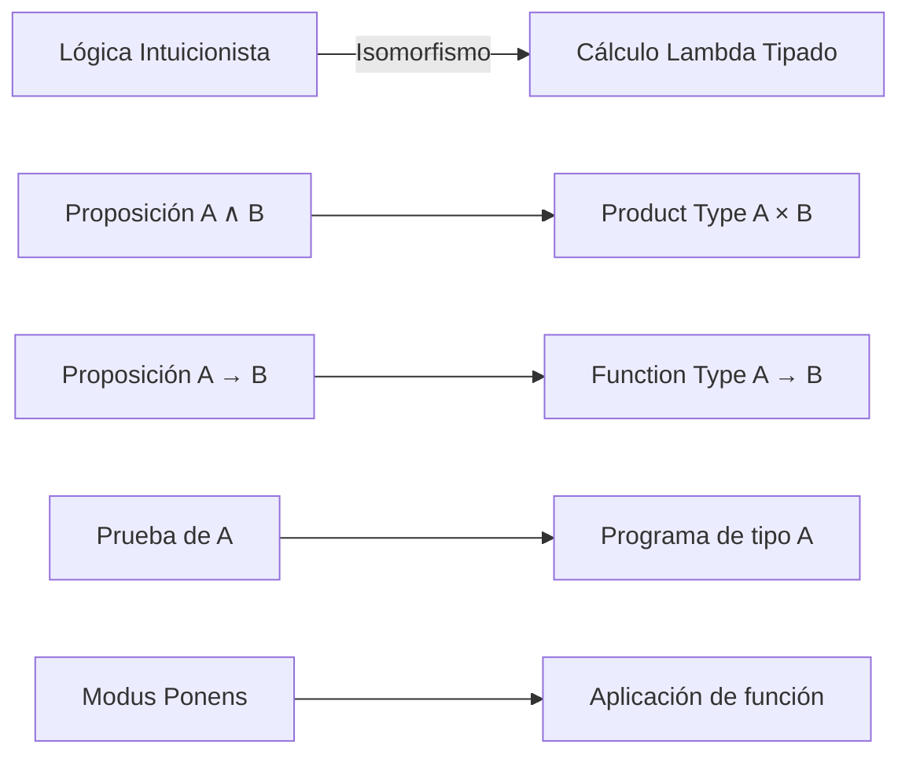

# Lógica Computacional - Extensiones y aplicaciones (opcional)

## 7.1 Introducción a los sistemas de tipos; la correspondencia de Curry-Howard.

---

La **Correspondencia de Curry-Howard** establece una profunda conexión entre la lógica y la teoría de tipos, revelando que las pruebas matemáticas y los programas computacionales son esencialmente la misma estructura. Esta isomorfismo constituye uno de los pilares fundamentales de la teoría de lenguajes de programación y la verificación formal.

### Definiciones Fundamentales

#### Sistema de Tipos

Un **sistema de tipos** es un conjunto de reglas formales que asignan tipos a las construcciones de un lenguaje de programación, permitiendo detectar ciertos tipos de errores en tiempo de compilación.

#### Correspondencia de Curry-Howard

Es un **isomorfismo** entre:

- **Sistemas de tipos** en lenguajes de programación
- **Sistemas lógicos** en lógica matemática

$$ \text{Proposición} \cong \text{Tipo} $$

$$ \text{Prueba} \cong \text{Programa} $$

$$ \text{Simplificación de pruebas} \cong \text{Evaluación de programas} $$

### Correspondencia Básica



### Tabla de Correspondencias

| Concepto Lógico         | Concepto Computacional | Notación             |
| ----------------------- | ---------------------- | -------------------- |
| Proposición             | Tipo                   | $A$, $B$, $C$        |
| Implicación             | Función                | $A \rightarrow B$    |
| Conjunción              | Producto               | $A \times B$         |
| Disyunción              | Suma                   | $A + B$              |
| Falso                   | Tipo vacío             | $\bot$ o $\emptyset$ |
| Prueba                  | Programa               | $\lambda x.M$        |
| Suposición              | Variable               | $x:A$                |
| Eliminación del implica | Aplicación             | $f\ a$               |

### Fundamentos Formales

#### Cálculo Lambda Simplemente Tipado

El sistema formal que captura la correspondencia:

**Tipos:**
$$ A, B ::= \alpha\ |\ A \rightarrow B\ |\ A \times B\ |\ A + B\ |\ \bot $$

**Términos:**
$$ M, N ::= x\ |\ \lambda x:A.M\ |\ M\ N\ |\ (M, N)\ |\ \text{fst}(M)\ |\ \text{snd}(M) $$

**Reglas de tipado:**
$$ \frac{\Gamma \vdash M : A \rightarrow B \quad \Gamma \vdash N : A}{\Gamma \vdash M\ N : B} \quad \text{(Aplicación)} $$

$$ \frac{\Gamma, x:A \vdash M : B}{\Gamma \vdash \lambda x:A.M : A \rightarrow B} \quad \text{(Abstracción)} $$

### Ejemplos de Código

#### Ejemplo 1: Conjunción como Producto

```haskell
-- Tipo correspondiente a A ∧ B
type Conjunction a b = (a, b)

-- Prueba de A → B → (A ∧ B)
andIntroduction :: a -> b -> (a, b)
andIntroduction x y = (x, y)

-- Prueba de (A ∧ B) → A
andEliminationLeft :: (a, b) -> a
andEliminationLeft (x, y) = x
```

#### Ejemplo 2: Implicación como Función

```haskell
-- Modus Ponens: (A → B) → A → B
modusPonens :: (a -> b) -> a -> b
modusPonens f x = f x

-- Silogismo hipotético: (A → B) → (B → C) → (A → C)
hypotheticalSyllogism :: (a -> b) -> (b -> c) -> (a -> c)
hypotheticalSyllogism f g = g . f
```

### Ejercicios Propuestos

#### Ejercicio 1: Traducción Lógica-Tipos

Traduce las siguientes proposiciones lógicas a tipos y escribe programas que los habiten:

1. $A \rightarrow (B \rightarrow A)$
2. $(A \rightarrow (B \rightarrow C)) \rightarrow ((A \rightarrow B) \rightarrow (A \rightarrow C))$
3. $(A \times B) \rightarrow A$

#### Ejercicio 2: Pruebas como Programas

Implementa en Haskell o TypeScript las siguientes pruebas lógicas:

```haskell
-- 1. Conmutatividad de la conjunción: A ∧ B → B ∧ A
conjComm :: (a, b) -> (b, a)

-- 2. Distributividad: A ∧ (B ∨ C) → (A ∧ B) ∨ (A ∧ C)
distrib :: (a, Either b c) -> Either (a, b) (a, c)
```

#### Ejercicio 3: Identificación de Errores

¿Por qué el siguiente "programa/prueba" es incorrecto según Curry-Howard?

```haskell
falseProof :: a -> b
falseProof x = undefined  -- ¿Qué principio lógico viola?
```

### Ejemplo Avanzado: Lógica de Primer Orden

#### Cuantificadores como Tipos Dependientes

En sistemas más avanzados, los cuantificadores lógicos corresponden a tipos dependientes:

$$ \forall x:A. B(x) \cong \Pi_{x:A} B(x) $$

$$ \exists x:A. B(x) \cong \Sigma_{x:A} B(x) $$

**Ejemplo en Agda:**

```agda
-- Para todo natural n, n + 0 = n
+0-right-identity : (n : ℕ) → n + 0 ≡ n
+0-right-identity zero = refl
+0-right-identity (suc n) = cong suc (+0-right-identity n)
```

### Aplicaciones Prácticas

#### 1. **Verificación Formal de Programas**

Los assistants de prueba (Coq, Agda, Lean) utilizan directamente la correspondencia para verificar la corrección de programas.

#### 2. **Extracción de Programas desde Pruebas**

Se pueden extraer programas ejecutables a partir de pruebas constructivas de existencia.

#### 3. **Desarrollo Guiado por Tipos**

La programación se convierte en un proceso de construcción de pruebas.

### Referencias

#### Bibliografía Básica

1. **Huth M., Ryan M.** _Logic in Computer Science_ - Capítulo 2 (lógica proposicional) y apéndices sobre λ-cálculo
2. **Nerode A., Shore R.A.** _Logic for Applications_ - Capítulo 6 (lógica intuicionista)

#### Bibliografía Complementaria

1. **Sørensen M., Urzyczyn P.** _Lectures on the Curry-Howard Isomorphism_ (Texto especializado)
2. **Pierce B.** _Types and Programming Languages_ - Capítulos 9-11
3. **Thompson S.** _Type Theory and Functional Programming_

#### Recursos Online

- [Proofs and Types](http://www.paultaylor.eu/stable/prot.pdf) de Girard, Taylor y Lafont
- [Learn You an Agda](https://plfa.github.io/) - Tutorial interactivo
- [Coq'Art](https://www.labri.fr/perso/casteran/CoqArt/) - Libro sobre Coq

### Conclusión

La Correspondencia de Curry-Howard no es solo un resultado teórico elegante, sino una herramienta práctica que:

1. **Unifica** lógica y computación
2. **Proporciona** fundamentos para verificación formal
3. **Inspira** nuevos paradigmas de programación
4. **Conecta** matemáticas puras con ciencias de la computación

Esta correspondencia muestra que programar es, en esencia, construir pruebas matemáticas, y viceversa.

_"De la misma manera que los programas son pruebas, las pruebas son programas"_ - Philip Wadler
