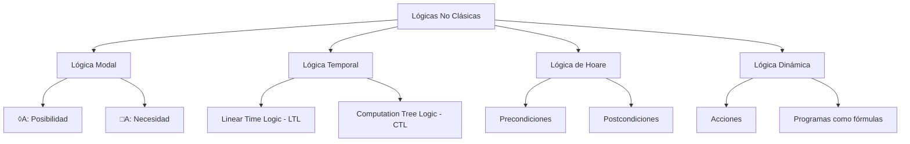

# Lógica Computacional - Extensiones y aplicaciones (opcional)

## 7.2 Lógicas no clásicas: modal, temporal, de Hoare, dinámica, etcétera.

---

Las **lógicas no clásicas** extienden o modifican la lógica clásica para capturar aspectos del razonamiento que van más allá de la verdad proposicional estática. En computación, estas lógicas son esenciales para modelar y verificar sistemas complejos.



### Lógica Modal

#### Definición Formal

La **lógica modal** extiende la lógica clásica con operadores modales que expresan **necesidad** y **posibilidad**.

**Sintaxis:**

$$
\phi ::= p \mid \neg \phi \mid \phi \land \psi \mid \phi \lor \psi \mid \phi \rightarrow \psi \mid \Box \phi \mid \Diamond \phi
$$

**Semántica de Kripke:**
Un modelo de Kripke es una tripleta $M = (W, R, V)$ donde:

- $W$ es un conjunto de mundos posibles
- $R \subseteq W \times W$ es una relación de accesibilidad
- $V: \text{Var} \rightarrow 2^W$ es una función de valuación

**Verdad en un mundo:**

$$
M, w \Vdash \Box \phi \quad \text{iff} \quad \forall v \in W : wRv \Rightarrow M, v \Vdash \phi
$$

$$
M, w \Vdash \Diamond \phi \quad \text{iff} \quad \exists v \in W : wRv \land M, v \Vdash \phi
$$

#### Ejemplo: Sistema de Seguridad

```javascript
// Modelando permisos de usuario con lógica modal
const sistema = {
  mundos: ['admin', 'usuario', 'invitado'],
  accesibilidad: {
    admin: ['admin', 'usuario', 'invitado'],
    usuario: ['usuario', 'invitado'],
    invitado: ['invitado'],
  },
  valuacion: {
    puedeLeer: ['admin', 'usuario'],
    puedeEscribir: ['admin'],
    puedeEliminar: ['admin'],
  },
};

// □puedeLeer: ¿Todos los mundos accesibles tienen permiso de lectura?
```

### Lógica Temporal

#### Lógica Temporal Lineal (LTL)

Extiende la lógica proposicional con operadores temporales:

**Sintaxis LTL:**

$$
\phi ::= p \mid \neg \phi \mid \phi \land \psi \mid \mathbf{X}\phi \mid \mathbf{F}\phi \mid \mathbf{G}\phi \mid \phi\mathbf{U}\psi
$$

**Semántica:**

- $\mathbf{X}\phi$: $\phi$ será verdadero en el **próximo** estado
- $\mathbf{F}\phi$: $\phi$ será verdadero en **algún** estado futuro
- $\mathbf{G}\phi$: $\phi$ será verdadero en **todos** los estados futuros
- $\phi\mathbf{U}\psi$: $\phi$ será verdadero **hasta que** $\psi$ sea verdadero

#### Ejemplo: Especificación de Propiedades

```python
# Especificación de propiedades para un sistema de reservas
propiedades = {
    "G(reservar → F(confirmar ∨ cancelar))":
        "Si se hace una reserva, eventualmente será confirmada o cancelada",

    "G(confirmar → X(¬disponible U liberar))":
        "Al confirmar, el recurso deja de estar disponible hasta que se libere",

    "G(¬(reservar ∧ disponible < 1))":
        "Nunca se puede reservar cuando no hay disponibilidad"
}
```

#### Lógica Temporal Computacional (CTL)

Añade cuantificadores de camino a los operadores temporales:

**Operadores CTL:**

- $\mathbf{A}\phi$: $\phi$ es verdadero en **todos** los caminos
- $\mathbf{E}\phi$: $\phi$ es verdadero en **algún** camino
- $\mathbf{AX}\phi$, $\mathbf{EX}\phi$, $\mathbf{AF}\phi$, $\mathbf{EF}\phi$, etc.

### Lógica de Hoare

#### Triplas de Hoare

La **lógica de Hoare** proporciona un sistema formal para verificar la corrección de programas mediante triplas:

$$
\{P\} C \{Q\}
$$

Donde:

- $P$: Precondición
- $C$: Comando/programa
- $Q$: Postcondición

**Reglas de Inferencia:**

1. **Asignación:** $\dfrac{}{\{Q[e/x]\} x := e \{Q\}}$
2. **Composición:** $\dfrac{\{P\} C_1 \{R\} \quad \{R\} C_2 \{Q\}}{\{P\} C_1; C_2 \{Q\}}$
3. **Condicional:** $\dfrac{\{P \land b\} C_1 \{Q\} \quad \{P \land \neg b\} C_2 \{Q\}}{\{P\} \text{ if } b \text{ then } C_1 \text{ else } C_2 \{Q\}}$
4. **Iteración:** $\dfrac{\{I \land b\} C \{I\}}{\{I\} \text{ while } b \text{ do } C \{I \land \neg b\}}$

#### Ejemplo: Verificación de Programa

```java
// Programa para calcular el factorial
int factorial(int n) {
    int i = 1;
    int result = 1;
    while (i <= n) {
        result = result * i;
        i = i + 1;
    }
    return result;
}

// Triplas de Hoare:
{ n ≥ 0 }
factorial(n)
{ result = n! }
```

### Lógica Dinámica

#### Definición

La **lógica dinámica** une programas y fórmulas lógicas, permitiendo razonar sobre la ejecución de programas.

**Sintaxis:**

$$
\phi ::= p \mid \neg \phi \mid \phi \land \psi \mid [\alpha]\phi \mid \langle\alpha\rangle\phi
$$

$$
\alpha ::= a \mid \phi? \mid \alpha;\beta \mid \alpha \cup \beta \mid \alpha*
$$

**Semántica:**

- $[\alpha]\phi$: Después de **todas** las ejecuciones de $\alpha$, $\phi$ se cumple
- $\langle\alpha\rangle\phi$: Existe **alguna** ejecución de $\alpha$ tras la cual $\phi$ se cumple

#### Ejemplo: Verificación de Acciones

```
[if (usuario.autenticado) then
    (acceder_recurso;
     [acceder_recurso]recurso_accedido)
 else
    (denegar_acceso;
     [denegar_acceso]acceso_denegado)
]
→ (acceso_apropiado)
```

### Ejercicios Propuestos

#### Ejercicio 1: Lógica Modal

Modela el siguiente sistema usando lógica modal:

- Un sistema de archivos con permisos de lectura (r), escritura (w) y ejecución (x)
- Los archivos tienen dueños y grupos
- Define las relaciones de accesibilidad apropiadas

#### Ejercicio 2: Lógica Temporal

Expresa en LTL las siguientes propiedades de un sistema de semáforos:

1. "El semáforo nunca está en verde y rojo simultáneamente"
2. "Después de rojo, eventualmente llegará a verde"
3. "El semáforo permanece en amarillo por exactamente un ciclo antes de cambiar a rojo"

#### Ejercicio 3: Lógica de Hoare

Demuestra la corrección parcial del siguiente programa:

```python
# Programa para encontrar el máximo de dos números
{True}
if a > b:
    max = a
else:
    max = b
{max = max(a, b)}
```

#### Ejercicio 4: Lógica Dinámica

Traduce a lógica dinámica: "Si el usuario tiene permisos, entonces después de intentar acceder al recurso, tendrá acceso o se le denegará explícitamente".

### Aplicaciones Prácticas

#### Verificación de Modelos

Las lógicas temporales se usan en verificación formal de hardware y software mediante model checking.

#### Análisis de Seguridad

La lógica modal se aplica en análisis de políticas de seguridad y control de acceso.

#### Verificación de Programas

La lógica de Hoare es fundamental en métodos formales para verificar la corrección de programas.

#### Planificación Automática

La lógica dinámica se utiliza en sistemas de planificación y razonamiento sobre acciones.

### Referencias Bibliográficas

#### Bibliografía Básica

1. **Huth M., Ryan M.** _Logic in Computer Science_ - Capítulos 3-4 (lógica modal y temporal)
2. **Nerode A., Shore R.A.** _Logic for Applications_ - Capítulo 12 (lógicas modales)

#### Bibliografía Complementaria

1. **Ben-Ari M.** _Mathematical Logic for Computer Science_ - Capítulos 5-6 (lógicas no clásicas)
2. **Fitting M.** _First-Order Logic and Automated Theorem Proving_ - Capítulos 9-10 (lógicas modales)
3. **Winskel G.** _The Formal Semantics of Programming Languages_ (para lógica de Hoare)
4. **Harel D., Kozen D., Tiuryn J.** _Dynamic Logic_ (texto especializado)

#### Recursos Adicionales

- **Model Checking**: Clarke E., Grumberg O., Peled D. _Model Checking_
- **Temporal Logic**: Manna Z., Pnueli A. _The Temporal Logic of Reactive and Concurrent Systems_
- **Verification Tools**: SPIN, NuSMV, PVS, Coq

### Conclusión

Las lógicas no clásicas proporcionan herramientas esenciales para la informática teórica y práctica:

- Permiten **especificar formalmente** propiedades de sistemas complejos
- Facilitan la **verificación automática** de hardware y software
- Proporcionan **fundamentos formales** para análisis de seguridad y concurrencia
- Conectan la **teoría de programas** con la lógica matemática

Estas lógicas representan una de las aplicaciones más fructíferas de la lógica formal en la resolución de problemas computacionales del mundo real.
