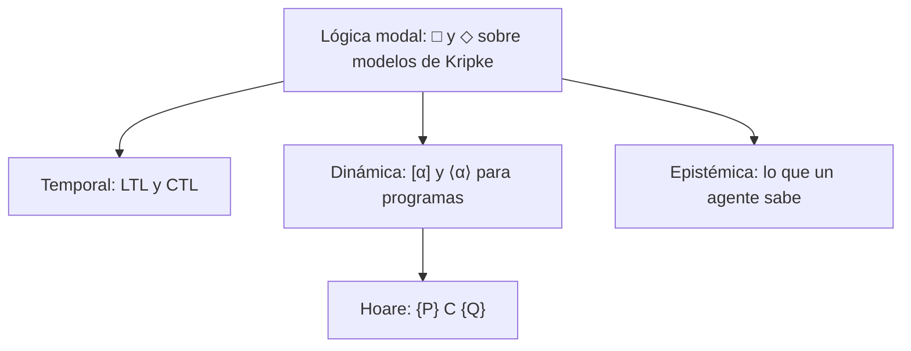

# Lógica Computacional - Extensiones y aplicaciones (opcional)

## 7.2 Lógicas no clásicas: modal, temporal, de Hoare, dinámica, etcétera.

---

La lógica clásica habla de verdades fijas. Muchos problemas de computación necesitan hablar de verdades que **dependen** de algo: del estado del sistema, del momento, de lo que un agente sabe, o de lo que ocurre después de ejecutar un programa. Las **lógicas modales** añaden operadores para eso, y comparten una misma semántica, la de los **modelos de Kripke**: un conjunto de estados con una relación entre ellos. Este tema presenta la lógica modal básica y tres de sus descendientes en computación: la lógica temporal, la lógica de Hoare y la lógica dinámica.



### Lógica modal

**Sintaxis.** A la lógica proposicional se añaden $\Box \varphi,$ que se lee necesariamente $\varphi,$ y $\Diamond \varphi,$ que se lee posiblemente $\varphi,$ con $\Diamond \varphi \equiv \lnot \Box \lnot \varphi.$

**Semántica de Kripke (1963).** Un **marco** es un par $(W, R)$ con un conjunto de **mundos** $W$ y una relación de **accesibilidad** $R \subseteq W \times W.$ Un **modelo** $\mathcal{M} = (W, R, V)$ añade una valuación que dice en qué mundos es verdadera cada variable. La verdad se define en cada mundo:

$$ \mathcal{M}, w \Vdash \Box \varphi \iff \mathcal{M}, v \Vdash \varphi \text{ para todo } v \text{ con } w R v \qquad \mathcal{M}, w \Vdash \Diamond \varphi \iff \mathcal{M}, v \Vdash \varphi \text{ para algún } v \text{ con } w R v $$

y los conectivos como en la lógica proposicional, mundo por mundo. Una fórmula es **válida en un marco** si es verdadera en todos sus mundos con todas las valuaciones.

**Lecturas.** Según qué representen los mundos y la relación, $\Box$ significa cosas distintas. En computación, "en todos los estados alcanzables". En la lógica epistémica, "el agente sabe que", donde $w R v$ significa que, estando en $w,$ el agente considera posible $v.$ En la lógica deóntica, "es obligatorio que".

**Axiomas y propiedades de los marcos.** El axioma $\mathbf{K}:$ $\Box (\varphi \to \psi) \to (\Box \varphi \to \Box \psi)$ es válido en todos los marcos. Otros axiomas **corresponden** a propiedades de $R:$

| Axioma | Fórmula | Válido exactamente en los marcos | Lectura epistémica |
| --- | --- | --- | --- |
| T | $\Box p \to p$ | reflexivos | lo que se sabe es verdad |
| 4 | $\Box p \to \Box \Box p$ | transitivos | si se sabe, se sabe que se sabe |
| B | $p \to \Box \Diamond p$ | simétricos | |
| 5 | $\Diamond p \to \Box \Diamond p$ | euclidianos | si no se sabe, se sabe que no se sabe |
| D | $\Box p \to \Diamond p$ | seriales | lo obligatorio es permitido |

**Demostración para T.** Si $R$ es reflexiva y $w \Vdash \Box p,$ como $w R w,$ $w \Vdash p.$ Si $R$ no es reflexiva, hay un $w$ con $\lnot w R w;$ con la valuación en la que $p$ es verdadera en todos los mundos menos $w,$ se tiene $w \Vdash \Box p$ y $w \not\Vdash p.$ $\blacksquare$

El sistema **S4** (K, T y 4) es la lógica de los marcos reflexivos y transitivos; **S5** (K, T y 5) la de las relaciones de equivalencia, la lógica del conocimiento. La lógica intuicionista se traduce a S4 interpretando "es demostrable" como $\Box$ (Gödel, 1933), y sus modelos de Kripke (tema 5.3) son de este tipo.

### Lógica temporal

En la lógica temporal los mundos son **instantes** de la ejecución de un sistema y la relación es "el estado siguiente". Pnueli (1977) la propuso para especificar programas concurrentes y reactivos, que no terminan; recibió por ello el premio Turing en 1996.

**LTL (lógica temporal lineal).** Las fórmulas se evalúan sobre una **traza** infinita de estados $s_0 s_1 s_2 \cdots,$ en la posición $i:$

| Operador | Significado en la posición $i$ |
| --- | --- |
| $\mathbf{X}\, \varphi$ | $\varphi$ vale en $i + 1$ |
| $\mathbf{F}\, \varphi$ | $\varphi$ vale en algún $j \geq i$ |
| $\mathbf{G}\, \varphi$ | $\varphi$ vale en todo $j \geq i$ |
| $\varphi\, \mathbf{U}\, \psi$ | $\psi$ vale en algún $j \geq i,$ y $\varphi$ en todos los anteriores, de $i$ a $j - 1$ |

Un sistema satisface una fórmula si **todas** sus trazas la satisfacen. Dos clases de propiedades son fundamentales:

- **Seguridad,** "nunca pasa nada malo": $\mathbf{G}\, \lnot (c_1 \land c_2),$ los dos procesos nunca están a la vez en la sección crítica. Una violación se observa en un prefijo finito.
- **Vivacidad,** "algo bueno termina por pasar": $\mathbf{G}\, (e_1 \to \mathbf{F}\, c_1),$ todo proceso que espera entra alguna vez. Una violación requiere una traza infinita.

**CTL (lógica de árbol de cómputo).** Ve las ejecuciones como un árbol y combina cada operador temporal con un cuantificador de caminos: $\mathbf{A}$ (en todos los caminos) o $\mathbf{E}$ (en algún camino). Por ejemplo, $\mathbf{AG}\, \lnot (c_1 \land c_2)$ y $\mathbf{EF}\, c_1.$ La ventaja de CTL es que se verifica en tiempo lineal en el tamaño del modelo, calculando los conjuntos de estados que satisfacen cada subfórmula con **puntos fijos**:

$$ \mathbf{EF}\, \varphi = \mu Z.\, \varphi \lor \mathbf{EX}\, Z, \qquad \mathbf{AF}\, \varphi = \mu Z.\, \varphi \lor \mathbf{AX}\, Z, \qquad \mathbf{AG}\, \varphi = \lnot \mathbf{EF}\, \lnot \varphi $$

Es el algoritmo de **model checking** de Clarke y Emerson (1981), que el programa de este tema implementa.

### Lógica de Hoare

Para programas secuenciales que terminan, Hoare (1969) propuso razonar con **tripletas** $\{P\}\ C\ \{Q\}:$ si $C$ se ejecuta en un estado que satisface la precondición $P$ y termina, el estado final satisface la postcondición $Q.$ Es **corrección parcial**; la **total** exige además que $C$ termine.

**Reglas.**

$$ \frac{}{\{Q[x := e]\}\ x := e\ \{Q\}}\ \text{asignación} \qquad \frac{\{P\}\ C_1\ \{R\} \quad \{R\}\ C_2\ \{Q\}}{\{P\}\ C_1; C_2\ \{Q\}}\ \text{composición} $$

$$ \frac{\{P \land b\}\ C_1\ \{Q\} \quad \{P \land \lnot b\}\ C_2\ \{Q\}}{\{P\}\ \textbf{if}\ b\ \textbf{then}\ C_1\ \textbf{else}\ C_2\ \{Q\}}\ \text{condicional} \qquad \frac{\{I \land b\}\ C\ \{I\}}{\{I\}\ \textbf{while}\ b\ \textbf{do}\ C\ \{I \land \lnot b\}}\ \text{ciclo} $$

$$ \frac{P \to P' \quad \{P'\}\ C\ \{Q'\} \quad Q' \to Q}{\{P\}\ C\ \{Q\}}\ \text{consecuencia} $$

La regla de asignación se lee hacia atrás: para que después de $x := e$ valga $Q,$ antes debe valer $Q$ con $e$ en lugar de $x.$ Por ejemplo, $\{y + 1 > 0\}\ x := y + 1\ \{x > 0\}.$ La fórmula $I$ de la regla del ciclo es un **invariante**: se conserva en cada vuelta.

**Ejemplo: el factorial.**

```python
i = 1
r = 1
while i <= n:
    r = r * i
    i = i + 1
```

Con precondición $n \geq 0,$ postcondición $r = n!$ e invariante $I \equiv r = (i - 1)! \land 1 \leq i \leq n + 1:$

1. **Inicio.** Tras $i := 1;$ $r := 1,$ se tiene $r = 1 = 0! = (i - 1)!$ y $1 \leq 1 \leq n + 1$ porque $n \geq 0.$
2. **Conservación.** Si $I$ y $i \leq n,$ después de $r := r \cdot i;$ $i := i + 1$ el nuevo $r$ es $(i - 1)! \cdot i = i!,$ que es $(i' - 1)!$ con $i' = i + 1 \leq n + 1.$
3. **Salida.** Si $I$ y $\lnot (i \leq n),$ entonces $i = n + 1$ y $r = n!.$

Por la regla del ciclo y la de consecuencia, $\{n \geq 0\}$ factorial $\{r = n!\}.$ Para la corrección total se añade una **función de cota**, $n + 1 - i,$ que decrece en cada vuelta y no es negativa.

**Precondición más débil.** Dijkstra (1975) definió $\text{wp}(C, Q),$ la condición más débil que garantiza $Q$ tras $C.$ Para asignaciones, $\text{wp}(x := e, Q) = Q[x := e],$ y para secuencias, $\text{wp}(C_1; C_2, Q) = \text{wp}(C_1, \text{wp}(C_2, Q)).$ Así se calculan mecánicamente las **condiciones de verificación** que luego prueban los demostradores automáticos; es lo que hacen herramientas como Dafny o Frama-C.

### Lógica dinámica

La lógica dinámica proposicional (Pratt, 1976; Fischer y Ladner, 1979) es una lógica modal con **un operador por programa**: $[\alpha]\, \varphi$ dice que tras toda ejecución de $\alpha$ vale $\varphi,$ y $\langle \alpha \rangle\, \varphi$ que alguna ejecución termina en un estado donde vale $\varphi.$ Los programas se construyen con

$$ \alpha ::= a \mid \alpha; \beta \mid \alpha \cup \beta \mid \alpha^* \mid \varphi? $$

(acciones atómicas, secuencia, elección no determinista, iteración y prueba). Los programas usuales se definen: $\textbf{if}\ b\ \textbf{then}\ \alpha\ \textbf{else}\ \beta$ es $(b?; \alpha) \cup (\lnot b?; \beta),$ y $\textbf{while}\ b\ \textbf{do}\ \alpha$ es $(b?; \alpha)^*; \lnot b?.$ La tripleta de Hoare $\{P\}\ C\ \{Q\}$ es la fórmula $P \to [C]\, Q,$ así que la lógica de Hoare es un fragmento de la dinámica, que además permite anidar y combinar afirmaciones sobre programas.

### Implementación en Python

El programa tiene tres partes. Primero, un evaluador de fórmulas modales que comprueba, revisando todas las valuaciones, la correspondencia entre los axiomas T y 4 y la reflexividad y transitividad del marco. Segundo, un verificador de CTL por puntos fijos aplicado a un protocolo de exclusión mutua con turno: construye los estados alcanzables y verifica una propiedad de seguridad y una de vivacidad. Tercero, con SymPy, calcula precondiciones más débiles por sustitución y verifica las condiciones del invariante del factorial.

```python
from itertools import product
import sympy as sp

# ---------- 1. Lógica modal: modelos de Kripke ----------
def fuerza(M, w, f):
    W, R, V = M
    if isinstance(f, str): return w in V.get(f, set())
    op = f[0]
    if op == '¬': return not fuerza(M, w, f[1])
    if op == '∧': return fuerza(M, w, f[1]) and fuerza(M, w, f[2])
    if op == '∨': return fuerza(M, w, f[1]) or fuerza(M, w, f[2])
    if op == '→': return (not fuerza(M, w, f[1])) or fuerza(M, w, f[2])
    if op == '□': return all(fuerza(M, v, f[1]) for v in W if (w, v) in R)
    if op == '◇': return any(fuerza(M, v, f[1]) for v in W if (w, v) in R)

def valida_en_marco(W, R, f, atomos=('p',)):
    """f es válida en el marco (W, R) si es verdadera en todo mundo con toda valuación."""
    subconjuntos = [frozenset(w for w, b in zip(W, bits) if b) for bits in product([0, 1], repeat=len(W))]
    return all(fuerza((W, R, dict(zip(atomos, V))), w, f)
               for V in product(subconjuntos, repeat=len(atomos)) for w in W)

T = ('→', ('□', 'p'), 'p')
CUATRO = ('→', ('□', 'p'), ('□', ('□', 'p')))
W = [0, 1, 2]
marcos = {
    'reflexivo y transitivo': {(0, 0), (1, 1), (2, 2), (0, 1), (1, 2), (0, 2)},
    'reflexivo, no transitivo': {(0, 0), (1, 1), (2, 2), (0, 1), (1, 2)},
    'transitivo, no reflexivo': {(0, 1), (1, 2), (0, 2)},
}
for nombre, R in marcos.items():
    print(f'{nombre:26} T: {valida_en_marco(W, R, T)!s:5}  4: {valida_en_marco(W, R, CUATRO)}')

# ---------- 2. CTL: model checking con puntos fijos ----------
# Exclusión mutua con turno: estados (proceso 1, proceso 2, turno); n = no crítico, e = espera, c = crítico
def siguientes(s):
    p1, p2, t = s
    res = []
    for i, (p, otro) in enumerate([(p1, p2), (p2, p1)]):
        nuevo = {'n': 'e', 'e': 'c' if (otro != 'c' and t == i + 1) else 'e', 'c': 'n'}[p]
        turno = (2 if i == 0 else 1) if p == 'c' else t       # al salir cede el turno
        res.append((nuevo, p2, turno) if i == 0 else (p1, nuevo, turno))
    return res

estados, frontera = set(), [('n', 'n', 1)]
while frontera:
    s = frontera.pop()
    if s in estados: continue
    estados.add(s); frontera.extend(siguientes(s))

def EX(S): return {s for s in estados if any(t in S for t in siguientes(s))}
def AX(S): return {s for s in estados if all(t in S for t in siguientes(s))}
def EU(A, B):                                   # E[A U B]: menor punto fijo de B ∪ (A ∩ EX Z)
    Z = set()
    while True:
        nuevo = B | (A & EX(Z))
        if nuevo == Z: return Z
        Z = nuevo
def EF(S): return EU(estados, S)
def AG(S): return estados - EF(estados - S)
def AF(S):                                      # menor punto fijo de S ∪ AX Z
    Z = set()
    while True:
        nuevo = S | AX(Z)
        if nuevo == Z: return Z
        Z = nuevo

inicial = ('n', 'n', 1)
ambos_criticos = {s for s in estados if s[0] == 'c' and s[1] == 'c'}
espera1 = {s for s in estados if s[0] == 'e'}
critico1 = {s for s in estados if s[0] == 'c'}
print('estados alcanzables:', len(estados))
print('AG ¬(c1 ∧ c2):', inicial in AG(estados - ambos_criticos))
print('AG (e1 → AF c1):', inicial in AG((estados - espera1) | AF(critico1)))
print('EF c1:', inicial in EF(critico1))

# ---------- 3. Lógica de Hoare: precondición más débil ----------
x, y, n, i, r, a, b, m = sp.symbols('x y n i r a b m', integer=True)

def wp(programa, Q):
    """wp de una secuencia de asignaciones: se sustituye de atrás hacia adelante."""
    for var, expr in reversed(programa):
        Q = Q.subs(var, expr)
    return Q

intercambio = [(x, x + y), (y, x - y), (x, x - y)]
print('wp(intercambio, x = a ∧ y = b):', wp(intercambio, sp.And(sp.Eq(x, a), sp.Eq(y, b))))

# Factorial: i := 1; r := 1; while i ≤ n do (r := r·i; i := i + 1). Invariante: r = (i − 1)! ∧ 1 ≤ i ≤ n + 1
cuerpo = [(r, r * i), (i, i + 1)]
inv = lambda I, R, N: R == sp.factorial(I - 1) and 1 <= I <= N + 1
ok_inicio = all(inv(1, 1, N) for N in range(0, 30))
ok_paso = all(inv(I + 1, sp.factorial(I - 1) * I, N) for N in range(0, 30) for I in range(1, N + 1))
ok_salida = all(sp.factorial(I - 1) == sp.factorial(N) for N in range(0, 30) for I in range(1, N + 2)
                if inv(I, sp.factorial(I - 1), N) and not I <= N)
print('condiciones de verificación del factorial (n < 30):', ok_inicio, ok_paso, ok_salida)
# El paso del invariante, simbólicamente: wp(cuerpo, r = (i − 1)!) con r = (i − 1)!
paso_simbolico = wp(cuerpo, sp.Eq(r, sp.factorial(i - 1))).subs(r, sp.factorial(i - 1))
print('wp(cuerpo, r = (i - 1)!) bajo el invariante:', paso_simbolico, '->', sp.simplify(paso_simbolico))
```

Salida:

```text
reflexivo y transitivo     T: True   4: True
reflexivo, no transitivo   T: True   4: False
transitivo, no reflexivo   T: False  4: True
estados alcanzables: 12
AG ¬(c1 ∧ c2): True
AG (e1 → AF c1): False
EF c1: True
wp(intercambio, x = a ∧ y = b): Eq(x, b) & Eq(y, a)
condiciones de verificación del factorial (n < 30): True True True
wp(cuerpo, r = (i - 1)!) bajo el invariante: Eq(i*factorial(i - 1), factorial(i)) -> True
```

La propiedad de seguridad se cumple, pero la de vivacidad **falla**: hay una ejecución en la que el planificador elige siempre al proceso 2 mientras espera, y el proceso 1 nunca avanza. Es un contraejemplo legítimo; para excluirlo hay que suponer **equidad** (todo proceso que puede avanzar avanza alguna vez), una hipótesis que los verificadores reales permiten declarar. La precondición más débil del intercambio de variables dice que, para terminar con $x = a$ y $y = b,$ hay que empezar con $x = b$ y $y = a.$

### Ejercicios Propuestos

1. **Correspondencia.** Demuestra que el axioma 4, $\Box p \to \Box \Box p,$ es válido en los marcos transitivos, y da un marco no transitivo donde falle.

2. **LTL.** Escribe en LTL, para un semáforo con átomos $v,$ $a$ y $r$ (verde, ámbar, rojo): (a) nunca está en verde y rojo a la vez; (b) después de rojo llega alguna vez el verde; (c) después de ámbar viene rojo en el siguiente instante.

3. **Hoare.** Demuestra $\{\text{verdadero}\}\ \textbf{if}\ a > b\ \textbf{then}\ m := a\ \textbf{else}\ m := b\ \{m \geq a \land m \geq b \land (m = a \lor m = b)\}.$

4. **Precondición más débil.** Calcula $\text{wp}(x := x + 1;\ y := 2x,\ y > 10).$

5. **Invariante.** Encuentra un invariante para demostrar que $s := 0;\ i := 0;\ \textbf{while}\ i \lt n\ \textbf{do}\ (i := i + 1;\ s := s + i)$ termina con $s = n(n + 1)/2,$ si $n \geq 0.$

6. **Lógica dinámica.** Escribe en lógica dinámica: "si el usuario tiene permiso, tras intentar acceder al recurso o tiene acceso o se le notificó el rechazo".

### Soluciones

**Ejercicio 1.** Si $R$ es transitiva y $w \Vdash \Box p,$ sean $w R v$ y $v R u;$ por transitividad $w R u,$ así que $u \Vdash p.$ Entonces $v \Vdash \Box p$ para todo $v$ accesible, es decir, $w \Vdash \Box \Box p.$ En el marco con $0 R 1$ y $1 R 2$ (no transitivo) y $p$ verdadera solo en 1, $0 \Vdash \Box p$ pero $0 \not\Vdash \Box \Box p.$ El programa confirma que 4 falla en el marco reflexivo no transitivo.

**Ejercicio 2.** (a) $\mathbf{G}\, \lnot (v \land r);$ (b) $\mathbf{G}\, (r \to \mathbf{F}\, v);$ (c) $\mathbf{G}\, (a \to \mathbf{X}\, r).$

**Ejercicio 3.** Por la regla del condicional. En la rama $a \gt b,$ la regla de asignación pide $a \geq a \land a \geq b \land (a = a \lor a = b),$ que se sigue de $a \gt b.$ En la otra, con $\lnot (a \gt b),$ es decir $a \leq b,$ pide $b \geq a \land b \geq b \land (b = a \lor b = b),$ que también se cumple. Se concluye con la regla de consecuencia.

**Ejercicio 4.** $\text{wp}(y := 2x, y > 10) = 2x > 10,$ y $\text{wp}(x := x + 1, 2x > 10) = 2(x + 1) > 10,$ es decir, $x > 4.$

**Ejercicio 5.** $I \equiv s = i(i + 1)/2 \land 0 \leq i \leq n.$ Vale al inicio con $i = s = 0.$ Si vale e $i \lt n,$ tras $i := i + 1;$ $s := s + i$ se tiene $s = (i - 1)i/2 + i = i(i + 1)/2$ con el nuevo $i \leq n.$ A la salida, $i = n$ y $s = n(n + 1)/2.$

**Ejercicio 6.** $\text{permiso} \to [\text{intentar}]\, (\text{acceso} \lor \text{rechazo\_notificado}).$

### Referencias

1. Huth, M., and Ryan, M., _Logic in Computer Science_. Cambridge University Press, 2004. Capítulos 3, 4 y 5.
2. Blackburn, P., de Rijke, M., and Venema, Y., _Modal Logic_. Cambridge University Press, 2001. Capítulos 1 a 3.
3. Baier, C., and Katoen, J.-P., _Principles of Model Checking_. MIT Press, 2008. Capítulos 5 y 6.
4. Hoare, C. A. R. (1969). An axiomatic basis for computer programming. _Communications of the ACM_, 12(10), 576-580.
5. Harel, D., Kozen, D., and Tiuryn, J., _Dynamic Logic_. MIT Press, 2000.
