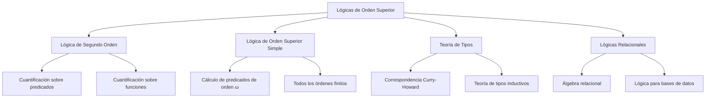

# Lógica Computacional - Extensiones y aplicaciones (opcional)

## 7.3 Lógicas de orden superior: lógica de segundo orden, lógicas relacionales

---

Las **lógicas de orden superior** extienden la lógica de primer orden permitiendo la cuantificación sobre predicados y funciones, no solo sobre individuos. Esta capacidad expresiva adicional las hace especialmente útiles en fundamentos de matemáticas y ciencias de la computación.



### Lógica de Segundo Orden (SOL)

#### Definición Formal

La **lógica de segundo orden** extiende la lógica de primer orden permitiendo cuantificación sobre relaciones y funciones.

**Sintaxis:**

- **Términos:** $t ::= x \mid c \mid f(t_1, \ldots, t_n)$
- **Fórmulas:** $\phi ::= P(t_1, \ldots, t_n) \mid \neg \phi \mid \phi \land \psi \mid \forall x \phi \mid \forall X \phi$
- **Cuantificación de segundo orden:** $\forall X \phi$ donde $X$ es una variable relacional

**Semántica:**
Un modelo de segundo orden es una estructura $M = (D, I)$ donde:

- $D$ es el dominio de individuos
- $I$ asigna:
  - A constantes: elementos de $D$
  - A símbolos de función: $f: D^n \rightarrow D$
  - A símbolos de predicado: $P \subseteq D^n$

Para cuantificadores de segundo orden:

$$ M \vDash \forall X \phi \quad \text{iff} \quad \text{para toda relación } R \subseteq D^n, M[X/R] \vDash \phi $$

#### Ejemplo: Inducción Matemática

En lógica de segundo orden, el principio de inducción se expresa elegantemente:

$$ \forall P \subseteq \mathbb{N} \cdot [P(0) \land \forall n (P(n) \rightarrow P(n+1))] \rightarrow \forall n P(n) $$

Comparemos con la versión de primer orden (esquema axiomático):

$$ [\phi(0) \land \forall n (\phi(n) \rightarrow \phi(n+1))] \rightarrow \forall n \phi(n) \quad \text{para cada fórmula } \phi $$

### Lógicas Relacionales

#### Álgebra Relacional

Las **lógicas relacionales** formalizan el razonamiento sobre relaciones, fundamentales en bases de datos y teoría de conjuntos.

**Operaciones básicas:**

- **Unión:** $R \cup S = \{x \mid R(x) \lor S(x)\}$
- **Intersección:** $R \cap S = \{x \mid R(x) \land S(x)\}$
- **Diferencia:** $R - S = \{x \mid R(x) \land \neg S(x)\}$
- **Composición:** $R \circ S = \{(x,z) \mid \exists y (R(x,y) \land S(y,z))\}$
- **Transpuesta:** $R^\top = \{(y,x) \mid R(x,y)\}$

**Cálculo relacional:**

$$ \{x \mid \phi(x)\} \quad \text{donde } \phi \text{ puede contener cuantificadores sobre relaciones} $$

#### Ejemplo: Bases de Datos

```sql
-- Consulta SQL y su equivalente en lógica relacional
SELECT nombre FROM Empleados WHERE departamento = 'Ventas';

-- Equivalente en lógica relacional:
{ x | ∃e (Empleados(e) ∧ nombre(e, x) ∧ departamento(e, 'Ventas')) }
```

### Teoría de Tipos como Lógica de Orden Superior

#### Correspondencia Curry-Howard Extendida

La correspondencia entre pruebas y programas se extiende a lógicas de orden superior:

| Concepto Lógico           | Concepto Computacional        |
| ------------------------- | ----------------------------- |
| Predicado                 | Tipo dependiente              |
| Cuantificador universal   | Producto dependiente (Π-type) |
| Cuantificador existencial | Suma dependiente (Σ-type)     |
| Prueba de ∀X.ϕ            | Función polimórfica           |

#### Ejemplo en Teoría de Tipos Dependientes

```agda
-- Definición del principio de inducción en Agda
induction-principle : {P : ℕ → Set}
                    → P zero
                    → (∀ n → P n → P (suc n))
                    → ∀ n → P n
induction-principle base step zero = base
induction-principle base step (suc n) = step n (induction-principle base step n)
```

### Comparación entre Lógicas

| Propiedad           | Primer Orden            | Segundo Orden              | Orden Superior                |
| ------------------- | ----------------------- | -------------------------- | ----------------------------- |
| **Cuantificación**  | Sobre individuos        | Sobre predicados/funciones | Sobre todos los tipos         |
| **Completitud**     | Sí (Gödel)              | No (Gödel)                 | No                            |
| **Compacidad**      | Sí                      | No                         | No                            |
| **Power expresivo** | Limitado                | Alto                       | Muy alto                      |
| **Aplicaciones**    | Matemáticas básicas, CS | Análisis, fundamentos      | Teoría de tipos, verificación |

### Implementación y Aplicaciones

#### Verificación de Programas

Las lógicas de orden superior son esenciales en verificación formal:

```coq
(* Verificación de un programa con invariantes en Coq *)
Definition maximum (a b : nat) : nat :=
  if a <= b then b else a.

Theorem maximum_correct : forall a b,
  maximum a b >= a /\ maximum a b >= b.
Proof.
  intros a b. unfold maximum.
  destruct (a <= b) eqn:H.
  - split; auto with arith.
  - split; auto with arith.
Qed.
```

#### Teoría de Conjuntos

La lógica de segundo orden puede axiomatizar la teoría de conjuntos:

**Axioma de extensionalidad:**

$$ \forall X \forall Y [\forall z (z \in X \leftrightarrow z \in Y) \rightarrow X = Y] $$

**Esquema de comprensión:**

$$ \exists X \forall y [y \in X \leftrightarrow \phi(y)] $$

### Ejercicios Propuestos

#### Ejercicio 1: Expresividad de Segundo Orden

Expresa en lógica de segundo orden las siguientes propiedades:

1. "El dominio es finito y tiene exactamente 3 elementos"
2. "La relación R es una relación de equivalencia"
3. "Cada subconjunto no vacío de números naturales tiene un elemento mínimo"

#### Ejercicio 2: Traducción a Primer Orden

Intenta expresar las siguientes propiedades de segundo orden en primer orden (si es posible) y discute las limitaciones:

1. $\forall P \forall x [P(x) \rightarrow \exists y P(y)]$
2. $\exists R \forall x \forall y [R(x,y) \leftrightarrow \neg R(y,x)]$

#### Ejercicio 3: Álgebra Relacional

Demuestra usando álgebra relacional que:

1. $(R \cup S)^\top = R^\top \cup S^\top$
2. $R \circ (S \circ T) = (R \circ S) \circ T$
3. $R \subseteq S$ implica $R \circ T \subseteq S \circ T$

#### Ejercicio 4: Teoría de Tipos

Implementa en un lenguaje de tu elección (Haskell, TypeScript, etc.) los siguientes conceptos de orden superior:

1. Una función polimórfica que represente $\forall X. (X \rightarrow X)$
2. Un tipo que represente $\exists X. (X \times (X \rightarrow \text{Bool}))$

### Aplicaciones Prácticas

#### Bases de Datos y Knowledge Graphs

Las lógicas relacionales son fundamentales en:

- Lenguajes de consulta (SQL, SPARQL)
- Sistemas de reglas (Datalog)
- Reasoners para ontologías (OWL, Description Logics)

#### Verificación Formal

Las lógicas de orden superior permiten:

- Especificar invariantes complejos de programas
- Verificar propiedades de sistemas concurrentes
- Demostrar teoremas matemáticos formalizados

#### Inteligencia Artificial

- Representación del conocimiento
- Razonamiento automático
- Sistemas expertos

### Referencias Bibliográficas

#### Bibliografía Básica

1. **Huth M., Ryan M.** _Logic in Computer Science_ - Capítulo 2.5 (lógicas modales y temporales)
2. **Nerode A., Shore R.A.** _Logic for Applications_ - Capítulo 6.2 (lógica de segundo orden)

#### Bibliografía Complementaria

1. **Enderton H.B.** _A Mathematical Introduction to Logic_ - Capítulos 4.4 (teoría de modelos de segundo orden)
2. **van Dalen D.** _Logic and Structure_ - Capítulo 5 (lógicas de orden superior)
3. **Girard J.-Y., Taylor P., Lafont Y.** _Proofs and Types_ (teoría de tipos y lógica)
4. **Abramsky S., Gabbay D.M., Maibaum T.S.E.** _Handbook of Logic in Computer Science_ (volúmenes 1-5)

#### Recursos Especializados

- **Teoría de Tipos**: Pierce B.C. _Types and Programming Languages_
- **Lógicas Relacionales**: Tarski A., Givant S. _A Formalization of Set Theory Without Variables_
- **Verificación Formal**: Nipkow T., Klein G. _Concrete Semantics with Isabelle/HOL_

### Conclusión

Las lógicas de orden superior representan una poderosa extensión de la lógica clásica que:

1. **Amplía significativamente** el poder expresivo para capturar conceptos matemáticos fundamentales
2. **Proporciona bases formales** para la teoría de tipos y la verificación formal de programas
3. **Conecta profundamente** la lógica, la teoría de conjuntos y la teoría de categorías
4. **Habilita aplicaciones** avanzadas en bases de datos, inteligencia artificial y razonamiento automático

Aunque pierden algunas propiedades metateóricas deseables (como completitud y compacidad), ganan la capacidad de expresar concepts que son fundamentales en matemáticas y ciencias de la computación.
