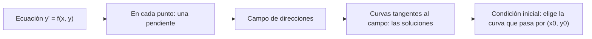

# Matemáticas para Ciencias Aplicadas IV - Ecuaciones Diferenciales de 1er Orden

## 1.1 Definición y significado geométrico.

---

Una **ecuación diferencial** relaciona una función desconocida con sus derivadas. Es el lenguaje natural de cualquier fenómeno en el que se conoce cómo **cambia** una cantidad, pero no la cantidad misma: la velocidad de enfriamiento de un cuerpo, el crecimiento de una población, la corriente en un circuito. Este tema define las ecuaciones de primer orden, qué significa resolverlas y cómo leerlas geométricamente como un **campo de pendientes**, una idea que permite entender sus soluciones incluso cuando no se pueden calcular.

### Definiciones

Una **ecuación diferencial ordinaria** (EDO) involucra una función de **una** variable y sus derivadas; si hay varias variables y derivadas parciales, es una ecuación en **derivadas parciales** (temas 6 a 8). El **orden** es el de la derivada más alta que aparece.

**Definición.** Una EDO de primer orden es una relación $F(x, y, y') = 0.$ Está en **forma normal** si la derivada está despejada:

$$ y' = f(x, y) $$

Es **lineal** si se puede escribir $y' + p(x)\, y = q(x),$ es decir, si $y$ y $y'$ aparecen solo a la primera potencia y sin multiplicarse entre sí. Por ejemplo, $y' = x + y$ es lineal; $y' = y^2$ y $y' = \sin y$ no lo son.

**Definición.** Una función $\phi$ es **solución** de $y' = f(x, y)$ en un intervalo $I$ si es derivable en $I,$ el punto $(x, \phi(x))$ está en el dominio de $f$ para todo $x \in I,$ y

$$ \phi'(x) = f(x, \phi(x)) \quad \text{para todo } x \in I. $$

El intervalo es parte de la solución: $\phi(x) = 1/x$ resuelve $y' = -y^2,$ pero en $(0, \infty)$ o en $(-\infty, 0),$ no en toda la recta, porque no está definida en 0.

**Ejemplo.** $\phi(x) = e^x - x - 1$ resuelve $y' = x + y$ en $\mathbb{R}:$ $\phi'(x) = e^x - 1,$ y $x + \phi(x) = x + e^x - x - 1 = e^x - 1.$

**Tipos de soluciones.**

- Una **solución general** es una familia con una constante arbitraria que describe todas (o casi todas) las soluciones: para $y' = x + y,$ $y = C e^x - x - 1.$
- Una **solución particular** es un miembro de la familia, con un valor de $C.$
- Una **solución singular** es una solución que no se obtiene de la familia para ningún $C.$ Para $y' = \sqrt{y}$ la familia es $y = (x + C)^2/4$ con $x \geq -C,$ y $y = 0$ es una solución singular.
- Una **solución implícita** es una relación $G(x, y) = 0$ que define $y$ como función derivable de $x$ y la satisface. Para $y' = -x/y,$ las circunferencias $x^2 + y^2 = C$ son soluciones implícitas: derivando, $2x + 2y\, y' = 0.$

### Significado geométrico: el campo de pendientes

La ecuación $y' = f(x, y)$ asigna a cada punto $(x, y)$ del plano un número: la **pendiente** que debe tener una solución que pase por ese punto. Dibujando en cada punto de una malla un pequeño segmento con esa pendiente se obtiene el **campo de direcciones** (o de pendientes). Una solución es una curva que, en cada uno de sus puntos, es tangente al segmento del campo: una **curva integral**.



**Isóclinas.** Una **isóclina** es una curva en la que todas las pendientes son iguales: el conjunto $f(x, y) = c$ para una constante $c.$ Dibujar unas cuantas isóclinas con sus pendientes es la forma rápida de esbozar el campo a mano.

**Primer ejemplo.** Para $y' = x + y,$ las isóclinas son las rectas $x + y = c.$ Sobre la recta $x + y = -1$ la pendiente es $-1,$ igual a la de la propia recta, así que $y = -x - 1$ es una solución: es la solución particular con $C = 0.$ Por encima de esa recta, las pendientes son mayores y las soluciones se separan de ella hacia arriba como $Ce^x;$ por debajo, hacia abajo.

**Segundo ejemplo.** Para $y' = -x/y,$ las isóclinas son las rectas por el origen $y = -x/c.$ En cada punto, la pendiente $-x/y$ es la de la recta **perpendicular** al radio que va del origen al punto, cuya pendiente es $y/x.$ Una curva siempre perpendicular al radio es una circunferencia centrada en el origen: las soluciones son las semicircunferencias $y = \pm \sqrt{C - x^2}.$

**Tercer ejemplo: la ecuación logística.** En $y' = y(1 - y)$ la pendiente no depende de $x,$ así que las isóclinas son rectas horizontales. Las rectas $y = 0$ y $y = 1,$ donde la pendiente es cero, son soluciones constantes: **equilibrios**. Entre ellas la pendiente es positiva y las soluciones suben hacia $y = 1;$ arriba de 1 es negativa y bajan hacia 1. Sin resolver la ecuación ya se sabe que toda solución con $y(0) > 0$ tiende a 1.

### Problemas de valor inicial

Un **problema de valor inicial** (PVI) añade una condición que selecciona una curva:

$$ y' = f(x, y), \qquad y(x_0) = y_0 $$

Geométricamente, se busca la curva integral que pasa por $(x_0, y_0).$ El teorema de existencia y unicidad (tema 2.1) garantiza que, si $f$ y $\partial f / \partial y$ son continuas cerca de $(x_0, y_0),$ hay exactamente una solución en algún intervalo alrededor de $x_0:$ las curvas integrales **no se cruzan**. Cuando la hipótesis falla, puede haber varias: $y' = \sqrt{y},$ $y(0) = 0$ tiene las soluciones $y = 0$ y $y = x^2/4,$ con $x \geq 0,$ porque $\partial f / \partial y = 1/(2\sqrt{y})$ no está definida en $y = 0.$

**Ejemplo.** $y' = 2x,$ $y(0) = 1.$ Integrando, $y = x^2 + C;$ la condición da $C = 1,$ así que $y = x^2 + 1.$

### Implementación en Python

SymPy permite **verificar** soluciones sustituyéndolas en la ecuación y **resolver** ecuaciones con `dsolve`. El programa verifica las soluciones de los ejemplos y del ejercicio 1, resuelve los problemas de valor inicial, comprueba las dos soluciones de $y' = \sqrt{y},$ $y(0) = 0,$ y escribe el campo de pendientes de $y' = x + y$ como una tabla de números.

```python
import sympy as sp

x = sp.symbols('x')
C = sp.symbols('C')
y = sp.Function('y')

# Verificar una solución: sustituir y comprobar que el residuo se anula
def verificar(sol, edo):
    residuo = edo.lhs.subs(y(x), sol).doit() - edo.rhs.subs(y(x), sol).doit()
    return sp.simplify(residuo) == 0

print('y = e^x - x - 1 resuelve y\' = x + y:',
      verificar(sp.exp(x) - x - 1, sp.Eq(y(x).diff(x), x + y(x))))
print('y = C e^(-2x) + e^x/3 resuelve y\' + 2y = e^x:',
      verificar(C * sp.exp(-2 * x) + sp.exp(x) / 3, sp.Eq(y(x).diff(x) + 2 * y(x), sp.exp(x))))
print('y = C e^(-2x) + e^x/2 resuelve y\' + 2y = e^x:',
      verificar(C * sp.exp(-2 * x) + sp.exp(x) / 2, sp.Eq(y(x).diff(x) + 2 * y(x), sp.exp(x))))

# Solución general y problemas de valor inicial con dsolve
print('y\' = x + y:', sp.dsolve(sp.Eq(y(x).diff(x), x + y(x))))
print('y\' = 2x, y(0) = 1:', sp.dsolve(sp.Eq(y(x).diff(x), 2 * x), ics={y(0): 1}))
print('y\' = cos x, y(π) = 0:', sp.dsolve(sp.Eq(y(x).diff(x), sp.cos(x)), ics={y(sp.pi): 0}))
print('y\' = -x/y:', sp.dsolve(sp.Eq(y(x).diff(x), -x / y(x))))

# Dos soluciones distintas del PVI y' = √y, y(0) = 0 (sin unicidad)
t = sp.symbols('t', nonnegative=True)
for sol in [sp.Integer(0), t**2 / 4]:
    print(f'y = {sol}: residuo', sp.simplify(sol.diff(t) - sp.sqrt(sol)), ' y(0) =', sol.subs(t, 0))

# Campo de direcciones de y' = x + y en una malla pequeña: pendiente en cada punto
print('pendientes de y\' = x + y (filas: y = 2, 1, 0, -1, -2; columnas: x = -2..2)')
for yy in [2, 1, 0, -1, -2]:
    print('  ', ' '.join(f'{xx + yy:3d}' for xx in [-2, -1, 0, 1, 2]))
```

Salida:

```text
y = e^x - x - 1 resuelve y' = x + y: True
y = C e^(-2x) + e^x/3 resuelve y' + 2y = e^x: True
y = C e^(-2x) + e^x/2 resuelve y' + 2y = e^x: False
y' = x + y: Eq(y(x), C1*exp(x) - x - 1)
y' = 2x, y(0) = 1: Eq(y(x), x**2 + 1)
y' = cos x, y(π) = 0: Eq(y(x), sin(x))
y' = -x/y: [Eq(y(x), -sqrt(C1 - x**2)), Eq(y(x), sqrt(C1 - x**2))]
y = 0: residuo 0  y(0) = 0
y = t**2/4: residuo 0  y(0) = 0
pendientes de y' = x + y (filas: y = 2, 1, 0, -1, -2; columnas: x = -2..2)
     0   1   2   3   4
    -1   0   1   2   3
    -2  -1   0   1   2
    -3  -2  -1   0   1
    -4  -3  -2  -1   0
```

La tabla es el campo de direcciones en forma numérica: las pendientes son constantes a lo largo de las diagonales $x + y = c,$ las isóclinas, y la pendiente $-1$ aparece sobre la recta $y = -x - 1,$ que es una solución.

### Ejercicios Propuestos

1. **Verificación.** Determina para qué valor de $k$ la familia $y = Ce^{-2x} + k\, e^x$ resuelve $y' + 2y = e^x.$

2. **Isóclinas.** Para $y' = y - x,$ dibuja las isóclinas con $c = -1, 0, 1, 2$ y encuentra una solución que sea una recta.

3. **Valor inicial.** Resuelve $y' = \cos x,$ $y(\pi) = 0.$

4. **Unicidad.** ¿Tiene solución única el PVI $y' = \sqrt{y},$ $y(0) = 0?$ ¿Y $y' = \sqrt{y},$ $y(0) = 1?$

5. **Geometría.** Explica por qué las soluciones de $y' = -x/y$ son semicircunferencias centradas en el origen y en qué intervalo está definida la que pasa por $(0, 2).$

6. **Equilibrios.** Sin resolver la ecuación, describe el comportamiento de las soluciones de $y' = y(1 - y)$ con $y(0) = 0.5,$ $y(0) = 2$ y $y(0) = -0.5.$

### Soluciones

**Ejercicio 1.** $y' + 2y = -2Ce^{-2x} + k e^x + 2Ce^{-2x} + 2k e^x = 3k e^x,$ que es $e^x$ si y solo si $k = 1/3.$ El programa confirma que $k = 1/3$ funciona y $k = 1/2$ no.

**Ejercicio 2.** Las isóclinas son las rectas $y = x + c.$ Para $c = 1$ la pendiente es 1, la de la propia recta: $y = x + 1$ es una solución. Las demás son $y = x + 1 + Ce^x.$

**Ejercicio 3.** $y = \sin x + C$ y $0 = \sin \pi + C$ da $C = 0:$ $y = \sin x.$

**Ejercicio 4.** El primero no: son soluciones $y = 0,$ $y = x^2/4$ y también la que vale $0$ hasta un $a > 0$ y luego $(x - a)^2/4.$ El segundo sí: cerca de $(0, 1),$ $f = \sqrt{y}$ y $\partial f / \partial y$ son continuas, y la solución es $y = (x + 2)^2/4$ cerca de $x = 0.$

**Ejercicio 5.** La pendiente $-x/y$ es perpendicular a la del radio, $y/x;$ equivalentemente, $\frac{d}{dx}(x^2 + y^2) = 2x + 2y\, y' = 0.$ Por $(0, 2)$ pasa $x^2 + y^2 = 4$ con $y > 0,$ es decir $y = \sqrt{4 - x^2},$ definida en $(-2, 2):$ en $x = \pm 2$ la pendiente se vuelve infinita y la solución no se puede extender.

**Ejercicio 6.** Con $0.5,$ la solución crece y tiende a 1. Con 2, decrece y tiende a 1. Con $-0.5,$ la pendiente es negativa y cada vez más, así que la solución decrece sin cota (de hecho explota en tiempo finito). Los equilibrios dividen el plano en franjas que las soluciones no pueden cruzar.

### Referencias

1. Boyce, W. E., DiPrima, R. C., and Meade, D. B., _Elementary Differential Equations and Boundary Value Problems_. Wiley, 2017. Capítulo 1 y sección 2.1.
2. Zill, D. G., _Ecuaciones diferenciales con aplicaciones de modelado_. Cengage, 2018. Capítulos 1 y 2.
3. Hubbard, J. H., and West, B. H., _Differential Equations: A Dynamical Systems Approach_. Springer, 1991. Capítulo 1.
4. Edwards, C. H., and Penney, D. E., _Ecuaciones diferenciales y problemas con valores en la frontera_. Pearson, 2009. Capítulo 1.
