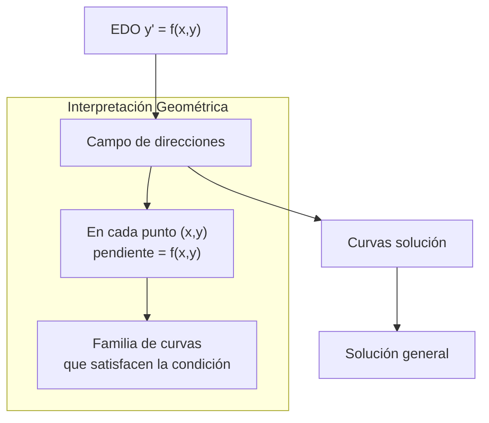
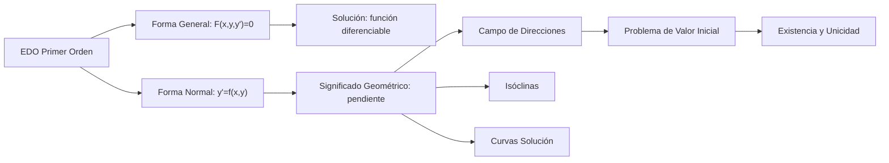

# Matemáticas para Ciencias Aplicadas IV - Ecuaciones Diferenciales de 1er Orden

## 1.1 Definición y significado geométrico.

---

### 1. Definición Fundamental

**Definición:** Una **ecuación diferencial ordinaria de primer orden** es una relación de la forma:

$$F(x, y, y') = 0$$

donde:

- $x$ es la variable independiente
- $y$ es la variable dependiente
- $y' = \frac{dy}{dx}$ es la primera derivada de $y$ con respecto a $x$

**Forma normal:** Cuando podemos despejar $y'$, la ecuación toma la forma:

$$y' = f(x, y)$$

**Ejemplo:** La ecuación $y' = 2x + y$ es una EDO de primer orden donde $f(x, y) = 2x + y$.

### 2. Solución de una EDO de Primer Orden

**Definición:** Una función $\phi(x)$ definida en un intervalo $I$ es **solución** de la EDO $y' = f(x, y)$ si:

1. $\phi(x)$ es diferenciable en $I$
2. $\phi'(x) = f(x, \phi(x))$ para todo $x$ en $I$

**Ejemplo:** Verificar que $y = e^x - x - 1$ es solución de $y' = x + y$

**Solución:**

- Calculamos $y' = e^x - 1$
- Sustituimos: $e^x - 1 = x + (e^x - x - 1)$
- Simplificamos: $e^x - 1 = e^x - 1$ ✓

### 3. Significado Geométrico

#### 3.1. Campo de Direcciones

El significado geométrico fundamental de $y' = f(x, y)$ es que en cada punto $(x, y)$ del plano, la ecuación nos da la **pendiente** de la recta tangente a la curva solución que pasa por ese punto.



#### 3.2. Isóclinas

**Definición:** Las **isóclinas** son curvas en el plano donde todas las pendientes son iguales. Para una constante $c$, la isóclina correspondiente está dada por:

$$f(x, y) = c$$

**Ejemplo:** Para $y' = x + y$, la isóclina para pendiente $c$ es la recta $x + y = c$

### 4. Problema de Valor Inicial (PVI)

Un **problema de valor inicial** consiste en encontrar una solución de la EDO que satisfaga una condición inicial:

$$y' = f(x, y), \quad y(x_0) = y_0$$

Geométricamente, esto significa encontrar la **única curva solución** que pasa por el punto $(x_0, y_0)$.

**Teorema de Existencia y Unicidad:** Si $f(x, y)$ y $\frac{\partial f}{\partial y}$ son continuas en un rectángulo que contiene a $(x_0, y_0)$, entonces existe una **única solución** del PVI en algún intervalo alrededor de $x_0$.

### 5. Ejemplos Resueltos

#### Ejemplo 1: Campo de direcciones

Analizar geométricamente $y' = -x/y$

**Solución:**

- Las isóclinas son hipérbolas $-x/y = c$ ⇒ $y = -x/c$
- Las pendientes son perpendiculares a los radios vectores
- Las soluciones son circunferencias: $x^2 + y^2 = C$

#### Ejemplo 2: PVI

Resolver el problema de valor inicial:

$$y' = 2x, \quad y(0) = 1$$

**Solución:**

- Integramos: $y = \int 2x  dx = x^2 + C$
- Aplicamos condición inicial: $1 = 0^2 + C$ ⇒ $C = 1$
- Solución: $y = x^2 + 1$

### 6. Ejercicios Propuestos

1. **Verificación de soluciones:** Demuestre que $y = Ce^{-2x} + \frac{1}{2}e^x$ es solución de $y' + 2y = e^x$

2. **Campo de direcciones:** Para $y' = y - x$, dibuje las isóclinas para $c = -1, 0, 1, 2$

3. **Problema de valor inicial:** Resuelva $y' = \cos x$ con $y(\pi) = 0$

4. **Existencia y unicidad:** Determine si el PVI $y' = \sqrt{y}$, $y(0) = 0$ tiene solución única

5. **Interpretación geométrica:** Explique por qué las soluciones de $y' = -\frac{x}{y}$ son circunferencias centradas en el origen

### 7. Código de Visualización (Python)

```python
import numpy as np
import matplotlib.pyplot as plt

# Campo de direcciones para y' = x + y
x = np.linspace(-3, 3, 20)
y = np.linspace(-3, 3, 20)
X, Y = np.meshgrid(x, y)
U = 1  # dx/dx = 1
V = X + Y  # dy/dx = x + y

plt.quiver(X, Y, U, V, scale=20, color='blue', alpha=0.6)
plt.title('Campo de direcciones: $y\' = x + y$')
plt.xlabel('x')
plt.ylabel('y')
plt.grid(True)
plt.show()
```

### 8. Resumen Conceptual



### 9. Referencias Bibliográficas

**Bibliografía básica:**

1. Boyce, W., DiPrima, R. (2004). _Elementary Differential Equations and Boundary Value Problems_. Wiley. (Capítulo 1)
2. Edwards, C. H., Penney, D. E. (2002). _Ecuaciones diferenciales elementales y problemas con condiciones a la frontera_. Prentice Hall. (Capítulo 1)

**Bibliografía complementaria:**

1. Zill, D. G., Wright, W. S. (1995). _Differential Equations with Computer Lab Experiments_. PWS Publishing. (Capítulo 1)
2. Hubbard, J. H., West, B. H. (1995). _Differential Equations: A Dynamical Systems Approach_. Springer-Verlag. (Capítulo 1)
