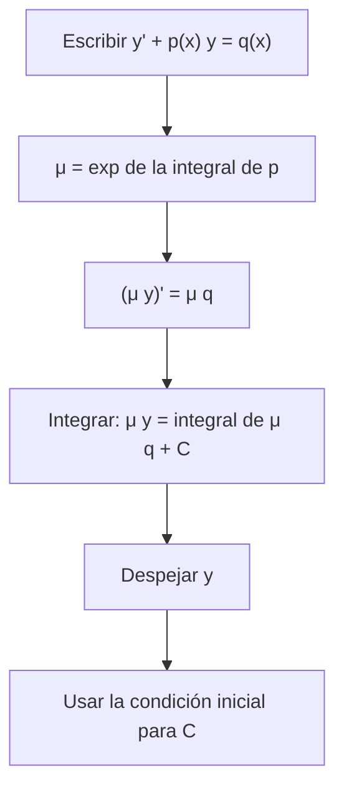

# Matemáticas para Ciencias Aplicadas IV - Ecuaciones Diferenciales de 1er Orden

## 1.2 Ecuaciones lineales (aplicaciones).

---

Las ecuaciones lineales de primer orden son las únicas ecuaciones de primer orden con un método de solución que funciona **siempre**: el factor integrante. Además modelan una gran cantidad de fenómenos en los que una cantidad cambia a una tasa que depende linealmente de ella misma: enfriamiento, mezclas, circuitos, desintegración radiactiva. Este tema deduce la fórmula general, estudia la estructura de las soluciones y la aplica a esos modelos.

### Forma estándar y factor integrante

**Definición.** Una ecuación lineal de primer orden en **forma estándar** es

$$ y' + p(x)\, y = q(x) $$

con $p$ y $q$ continuas en un intervalo $I.$ Es **homogénea** si $q = 0.$

**La idea.** El lado izquierdo se parece a la derivada de un producto. Si se multiplica por una función $\mu(x) > 0$ elegida para que $\mu' = \mu p,$ queda

$$ \mu y' + \mu p\, y = \mu y' + \mu' y = (\mu y)' $$

La condición $\mu' = \mu p$ se cumple con el **factor integrante**

$$ \mu(x) = e^{\int p(x)\, dx} $$

(cualquier primitiva sirve). Entonces $(\mu y)' = \mu q,$ e integrando:

$$ y(x) = \frac{1}{\mu(x)} \left( \int \mu(x)\, q(x)\, dx + C \right) $$

**Teorema.** Si $p$ y $q$ son continuas en $I,$ para cada $x_0 \in I$ y cada $y_0$ el problema $y' + p\, y = q,$ $y(x_0) = y_0$ tiene exactamente una solución, y está definida en **todo** $I:$

$$ y(x) = \frac{1}{\mu(x)} \left( y_0 + \int_{x_0}^{x} \mu(s)\, q(s)\, ds \right), \qquad \mu(x) = e^{\int_{x_0}^{x} p(s)\, ds} $$

**Demostración.** Toda solución cumple $(\mu y)' = \mu q,$ así que $\mu y$ es una primitiva de $\mu q,$ y la condición inicial fija la constante. Recíprocamente, la fórmula define una función derivable en $I$ que satisface la ecuación. $\blacksquare$

A diferencia de las ecuaciones no lineales, las soluciones no "explotan" dentro de $I:$ el intervalo de existencia lo determinan solo los coeficientes.

**Estructura.** La solución general tiene la forma

$$ y = C\, y_h(x) + y_p(x), \qquad y_h = \frac{1}{\mu} = e^{-\int p} $$

donde $C y_h$ es la solución general de la **homogénea** y $y_p$ es una solución **particular** de la completa. Es la misma estructura que tienen los sistemas de ecuaciones lineales y que reaparece en el tema 3.2.

**Ejemplo.** $y' + 2xy = x.$ Con $\mu = e^{x^2},$ $(e^{x^2} y)' = x e^{x^2},$ de donde $e^{x^2} y = \tfrac{1}{2} e^{x^2} + C$ y

$$ y = \tfrac{1}{2} + C e^{-x^2} $$

Todas las soluciones tienden al equilibrio $y = 1/2.$



### Aplicaciones

**Crecimiento y decaimiento.** Si una cantidad cambia a una tasa proporcional a sí misma, $y' = k y,$ entonces $y = y_0 e^{kt}.$ Con $k > 0$ es crecimiento exponencial (bacterias, interés compuesto continuo); con $k < 0,$ decaimiento. En la desintegración radiactiva se usa la **vida media** $T_{1/2},$ el tiempo en que queda la mitad: $k = -\ln 2 / T_{1/2}.$

**Ley de enfriamiento de Newton.** Un cuerpo a temperatura $T$ en un ambiente a $T_a$ cambia de temperatura a una tasa proporcional a la diferencia:

$$ T' = k (T - T_a), \qquad T(t) = T_a + (T_0 - T_a)\, e^{kt}, \quad k < 0 $$

**Mezclas.** En un tanque entra una solución con concentración $c_e$ a razón $r_e$ y sale la mezcla, bien agitada, a razón $r_s.$ Si $x(t)$ es la cantidad de soluto y $V(t) = V_0 + (r_e - r_s) t$ el volumen,

$$ x' = \underbrace{c_e r_e}_{\text{entra}} - \underbrace{\frac{x}{V(t)}\, r_s}_{\text{sale}} $$

Es lineal en $x,$ con coeficiente variable si $r_e \neq r_s.$

**Circuitos.** Por la ley de voltajes de Kirchhoff, un circuito con resistencia $R,$ inductancia $L$ y fuerza electromotriz $E(t)$ cumple $L i' + R i = E(t);$ uno con resistencia y capacitancia $C_e,$ $R q' + q / C_e = E(t),$ donde $q$ es la carga del capacitor e $i = q'.$ Con $E$ constante, la corriente o la carga se acercan exponencialmente a su valor de equilibrio, con **constante de tiempo** $L/R$ o $R C_e.$

### Ejemplos resueltos

**Circuito RL.** Con $L = 1$ H, $R = 2$ Ω, $E = 10$ V e $i(0) = 0:$ $i' + 2i = 10,$ $\mu = e^{2t},$ $(e^{2t} i)' = 10 e^{2t},$ así que $e^{2t} i = 5 e^{2t} + C$ e $i = 5 + C e^{-2t}.$ La condición da $C = -5:$

$$ i(t) = 5\, (1 - e^{-2t}) $$

La corriente tiende a $E/R = 5$ A, y tras una constante de tiempo, $L/R = 0.5$ s, alcanza el $63\,\%$ de ese valor.

**Tanque con volumen variable.** Un tanque tiene 100 L de agua con 10 kg de sal. Entra salmuera con 0.2 kg/L a 5 L/min y sale la mezcla a 3 L/min. El volumen es $V = 100 + 2t$ y

$$ x' + \frac{3}{100 + 2t}\, x = 1, \qquad x(0) = 10 $$

El factor integrante es $\mu = e^{\int 3/(100 + 2t)\, dt} = (100 + 2t)^{3/2}.$ Integrando $(\mu x)' = \mu$ se obtiene $\mu x = \tfrac{1}{5} (100 + 2t)^{5/2} + C,$ y la condición inicial da $C = 10 \cdot 1000 - \tfrac{1}{5} \cdot 10^5 = -10\,000.$ Así,

$$ x(t) = \frac{100 + 2t}{5} - 10 \left( \frac{100}{100 + 2t} \right)^{3/2} $$

El primer término es la sal que habría si la concentración fuera la de entrada, 0.2 kg/L; el segundo, el efecto de las condiciones iniciales, que se desvanece.

### Implementación en Python

El programa implementa el método del factor integrante con SymPy: calcula $\mu,$ integra y aplica la condición inicial. Resuelve los ejemplos y los ejercicios, y compara una de las soluciones con la de `dsolve`.

```python
import sympy as sp

t = sp.symbols('t', nonnegative=True)
x, k = sp.symbols('x k')
y = sp.Function('y')

def lineal(P, Q, var, f, ic=None):
    """Resuelve f' + P f = Q con el factor integrante μ = e^{∫P}."""
    mu = sp.exp(sp.integrate(P, var))
    C = sp.symbols('C')
    sol = sp.simplify((sp.integrate(mu * Q, var) + C) / mu)
    if ic is not None:
        x0, y0 = ic
        sol = sol.subs(C, sp.solve(sp.Eq(sol.subs(var, x0), y0), C)[0])
    return sp.simplify(mu), sp.simplify(sol)

# Ejemplo: y' + 2xy = x
mu, sol = lineal(2 * x, x, x, y)
print('y\' + 2xy = x:  μ =', mu, '  y =', sol)

# Circuito RL: L i' + R i = E con L = 1, R = 2, E = 10, i(0) = 0
mu, i_t = lineal(2, 10, t, None, (0, 0))
print('circuito RL: i(t) =', i_t, '  límite =', sp.limit(i_t, t, sp.oo))

# Tanque: x' + 3x/(100 + 2t) = 1, x(0) = 10
mu, sal = lineal(3 / (100 + 2 * t), 1, t, None, (0, 10))
print('tanque: x(t) =', sp.simplify(sal), '  x(50) =', sp.N(sal.subs(t, 50), 6))

# Ejercicio 1: circuito RC, 5 q' + q/0.1 = 20, q(0) = 0
mu, q = lineal(2, 4, t, None, (0, 0))
print('circuito RC: q(t) =', q, '  corriente i = q\' =', sp.diff(q, t))

# Ejercicio 2: Newton, T' = k (T - 21), T(0) = 95, T(2) = 85
kval = sp.log(sp.Rational(64, 74)) / 2
T = 21 + 74 * sp.exp(kval * t)
t50 = sp.solve(sp.Eq(T, 50), t)[0]
print('Newton: k =', sp.N(kval, 5), '  T = 50 en t =', sp.N(t50, 5), 'min')

# Ejercicio 3: tanque de 200 gal, V = 100 + 2t, entra 5 lb/min, x' + 3x/(100 + 2t) = 5, x(0) = 2
mu, sal3 = lineal(3 / (100 + 2 * t), 5, t, None, (0, 2))
print('tanque lleno en t = 50: x(50) =', sp.nsimplify(sp.simplify(sal3.subs(t, 50))), '≈', sp.N(sal3.subs(t, 50), 6), 'lb')

# Ejercicio 4: P(0) = 100, P(1) = 150
print('bacterias en t = 5:', 100 * sp.Rational(3, 2)**5)

# Ejercicio 5: carbono 14, vida media 5730 años, queda 30 %
edad = 5730 * sp.log(sp.Rational(3, 10)) / sp.log(sp.Rational(1, 2))
print('edad de la muestra:', sp.N(edad, 5), 'años')

# Comprobación con dsolve
print('dsolve tanque:', sp.dsolve(sp.Eq(y(t).diff(t) + 3 * y(t) / (100 + 2 * t), 1), ics={y(0): 10}).rhs.equals(sal))
```

Salida:

```text
y' + 2xy = x:  μ = exp(x**2)   y = C*exp(-x**2) + 1/2
circuito RL: i(t) = 5 - 5*exp(-2*t)   límite = 5
tanque: x(t) = 2*t/5 + 20 - 2500*sqrt(2)/(t + 50)**(3/2)   x(50) = 36.4645
circuito RC: q(t) = 2 - 2*exp(-2*t)   corriente i = q' = 4*exp(-2*t)
Newton: k = -0.072591   T = 50 en t = 12.905 min
tanque lleno en t = 50: x(50) = 200 - 49*sqrt(2)/2 ≈ 165.352 lb
bacterias en t = 5: 6075/8
edad de la muestra: 9952.8 años
dsolve tanque: True
```

### Ejercicios Propuestos

1. **Circuito RC.** Con $R = 5$ Ω, $C_e = 0.1$ F, $E = 20$ V y $q(0) = 0,$ encuentra la carga y la corriente.

2. **Enfriamiento.** Un café a 95 °C se enfría en una habitación a 21 °C; a los 2 minutos está a 85 °C. ¿Cuándo llega a 50 °C?

3. **Mezclas.** Un tanque de 200 galones contiene 100 galones de agua con 2 lb de sal. Entra salmuera con 1 lb/gal a 5 gal/min y sale la mezcla a 3 gal/min. ¿Cuánta sal hay cuando el tanque se llena?

4. **Bacterias.** Una población crece a una tasa proporcional a su tamaño. Hay 100 bacterias al inicio y 150 después de una hora. ¿Cuántas hay a las 5 horas?

5. **Carbono 14.** El carbono 14 tiene una vida media de 5730 años. Una muestra conserva el $30\,\%$ del original. ¿Qué edad tiene?

6. **Teoría.** Demuestra que si $y_1$ y $y_2$ son soluciones de $y' + p y = q,$ entonces $y_1 - y_2$ es solución de la homogénea. ¿Qué dice esto sobre la estructura de la solución general?

### Soluciones

**Ejercicio 1.** $5q' + 10q = 20,$ es decir $q' + 2q = 4.$ Con $\mu = e^{2t}:$ $q = 2 + Ce^{-2t},$ y $q(0) = 0$ da $q(t) = 2(1 - e^{-2t})$ C. La corriente es $i = q' = 4 e^{-2t}$ A: al principio el capacitor descargado deja pasar 4 A y la corriente decae a cero cuando se carga.

**Ejercicio 2.** $T = 21 + 74 e^{kt}.$ De $85 = 21 + 74 e^{2k},$ $k = \tfrac{1}{2} \ln(64/74) \approx -0.0726$ por minuto. De $50 = 21 + 74 e^{kt},$ $t = \ln(29/74)/k \approx 12.9$ minutos.

**Ejercicio 3.** El tanque se llena cuando $100 + 2t = 200,$ en $t = 50$ min. Ahora $x' + \frac{3x}{100 + 2t} = 5,$ con el mismo $\mu = (100 + 2t)^{3/2}:$ $x = (100 + 2t) - C (100 + 2t)^{-3/2},$ y $x(0) = 2$ da $C = 98\,000.$ Entonces $x(50) = 200 - 98\,000 / 200^{3/2} = 200 - \tfrac{49\sqrt{2}}{2} \approx 165.35$ lb.

**Ejercicio 4.** $P = 100 e^{kt}$ con $e^k = 3/2,$ así que $P(5) = 100 \cdot (3/2)^5 = 759.375,$ unas 759 bacterias.

**Ejercicio 5.** $A = A_0 (1/2)^{t/5730}.$ De $0.3 = (1/2)^{t/5730},$ $t = 5730 \ln 0.3 / \ln 0.5 \approx 9953$ años.

**Ejercicio 6.** $(y_1 - y_2)' + p\, (y_1 - y_2) = q - q = 0.$ Así, si $y_p$ es una solución particular, toda solución es $y_p$ más una solución de la homogénea, es decir, $y = y_p + C e^{-\int p}:$ la estructura "particular más homogénea".

### Referencias

1. Boyce, W. E., DiPrima, R. C., and Meade, D. B., _Elementary Differential Equations and Boundary Value Problems_. Wiley, 2017. Secciones 2.1 y 2.3.
2. Zill, D. G., _Ecuaciones diferenciales con aplicaciones de modelado_. Cengage, 2018. Secciones 2.3 y 3.1.
3. Edwards, C. H., and Penney, D. E., _Ecuaciones diferenciales y problemas con valores en la frontera_. Pearson, 2009. Secciones 1.5 y 2.1.
4. Simmons, G. F., _Ecuaciones diferenciales con aplicaciones y notas históricas_. McGraw-Hill, 1993. Capítulo 2.
