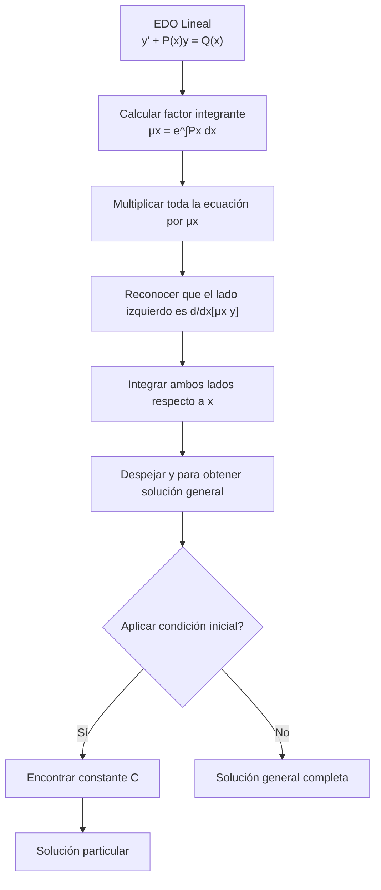

# Matemáticas para Ciencias Aplicadas IV - Ecuaciones Diferenciales de 1er Orden

## 1.2 Ecuaciones lineales (aplicaciones).

---

### 1. Definición y Forma Estándar

**Definición:** Una **ecuación diferencial lineal de primer orden** es aquella que puede escribirse en la forma:

$$\frac{dy}{dx} + P(x)y = Q(x)$$

donde:

- $P(x)$ y $Q(x)$ son funciones continuas en un intervalo $I$
- $y$ es la función desconocida
- La ecuación es "lineal" porque tanto $y$ como $y'$ aparecen elevados a la primera potencia

**Forma alternativa:** $y' + P(x)y = Q(x)$

### 2. Método de Solución: Factor Integrante

Para resolver ecuaciones lineales de primer orden, utilizamos el **método del factor integrante**:

#### 2.1. Factor Integrante

El factor integrante $\mu(x)$ está dado por:

$$\mu(x) = e^{\int P(x) dx}$$

#### 2.2. Solución General

Multiplicando ambos lados de la ecuación por $\mu(x):$

$$\mu(x)y' + \mu(x)P(x)y = \mu(x)Q(x)$$

El lado izquierdo es la derivada de $\mu(x)y,$ por lo que:

$$\frac{d}{dx}[\mu(x)y] = \mu(x)Q(x)$$

Integrando ambos lados:

$$\mu(x)y = \int \mu(x)Q(x) dx + C$$

Finalmente, la solución general es:

$$y = \frac{1}{\mu(x)} \left[ \int \mu(x)Q(x) dx + C \right]$$

### 3. Aplicaciones Prácticas

#### 3.1. Modelos de Crecimiento y Decaimiento

**Ley de enfriamiento/calentamiento de Newton:**

$$\frac{dT}{dt} = k(T - T_a)$$

donde:

- $T:$ temperatura del objeto
- $T_a:$ temperatura ambiente
- $k:$ constante de proporcionalidad

**Crecimiento poblacional:**

$$\frac{dP}{dt} = kP$$

**Decaimiento radiactivo:**

$$\frac{dA}{dt} = -kA$$

#### 3.2. Circuitos Eléctricos

**Circuito RL:**

$$L\frac{di}{dt} + Ri = E(t)$$

**Circuito RC:**

$$R\frac{dq}{dt} + \frac{1}{C}q = E(t)$$

#### 3.3. Mezclas en Tanques

$$\frac{dx}{dt} = \text{tasa de entrada} - \text{tasa de salida}$$

### 4. Ejemplos Resueltos

#### Ejemplo 1: Circuito RL

Resolver el circuito RL con $L = 1$ H, $R = 2$ Ω, $E(t) = 10$ V y $i(0) = 0$

**Solución:**

$$\frac{di}{dt} + 2i = 10$$

- Factor integrante: $\mu(t) = e^{\int 2 dt} = e^{2t}$
- Multiplicamos: $e^{2t}\frac{di}{dt} + 2e^{2t}i = 10e^{2t}$
- Lado izquierdo: $\frac{d}{dt}[e^{2t}i] = 10e^{2t}$
- Integramos: $e^{2t}i = \int 10e^{2t} dt = 5e^{2t} + C$
- Solución general: $i(t) = 5 + Ce^{-2t}$
- Aplicamos condición inicial: $0 = 5 + C$ ⇒ $C = -5$
- Solución particular: $i(t) = 5(1 - e^{-2t})$

#### Ejemplo 2: Mezclas en Tanques

Un tanque contiene 100 L de agua con 10 kg de sal. Se añade salmuera con 0.2 kg/L a 5 L/min y la mezcla sale a 3 L/min. Hallar la cantidad de sal en el tanque en función del tiempo.

**Solución:**

- Volumen en el tanque: $V(t) = 100 + (5 - 3)t = 100 + 2t$ L
- Tasa de entrada: $5 \times 0.2 = 1$ kg/min
- Tasa de salida: $3 \times \frac{x}{100 + 2t}$ kg/min
- EDO: $\frac{dx}{dt} = 1 - \frac{3x}{100 + 2t}$
- Reorganizando: $\frac{dx}{dt} + \frac{3}{100 + 2t}x = 1$
- Resolvemos con factor integrante

### 5. Diagrama de Flujo para Resolver Ecuaciones Lineales



### 6. Ejercicios Propuestos

1. **Circuito RC:** Resuelva el circuito RC con $R = 5$ Ω, $C = 0.1$ F, $E(t) = 20$ V y $q(0) = 0$

2. **Ley de Newton:** Una taza de café a 95°C se enfría en una habitación a 21°C. Si se enfría a 85°C en 2 minutos, ¿cuánto tardará en llegar a 50°C?

3. **Mezclas:** Un tanque de 200 galones contiene inicialmente 100 galones de agua con 2 lb de sal. Se añade salmuera con 1 lb/gal a 5 gal/min y la mezcla sale a 3 gal/min. Encuentre la cantidad de sal cuando el tanque está lleno.

4. **Crecimiento poblacional:** Una población de bacterias crece a una tasa proporcional a su tamaño. Si inicialmente hay 100 bacterias y después de 1 hora hay 150, ¿cuántas habrá después de 5 horas?

5. **Decaimiento radiactivo:** El carbono-14 tiene una vida media de 5730 años. Si se encuentra que una muestra tiene el 30% de carbono-14 original, ¿qué edad tiene la muestra?

### 7. Código de Simulación (Python)

```python
import numpy as np
import matplotlib.pyplot as plt
from scipy.integrate import odeint

# Simulación de circuito RL
def circuito_RL(i, t, R, L, E):
    di_dt = (E - R*i)/L
    return di_dt

# Parámetros
R = 2  # Ohms
L = 1  # Henrios
E = 10  # Voltios
i0 = 0  # Condición inicial

# Tiempo
t = np.linspace(0, 5, 100)

# Resolver
solucion = odeint(circuito_RL, i0, t, args=(R, L, E))

# Graficar
plt.figure(figsize=(10, 6))
plt.plot(t, solucion, 'b-', label='Corriente i(t)')
plt.title('Circuito RL: $L\\frac{di}{dt} + Ri = E$')
plt.xlabel('Tiempo (s)')
plt.ylabel('Corriente (A)')
plt.grid(True)
plt.legend()
plt.show()
```

### 8. Referencias Bibliográficas

**Bibliografía básica:**

1. Boyce, W., DiPrima, R. (2004). _Elementary Differential Equations and Boundary Value Problems_. Wiley. (Capítulo 2)
2. Edwards, C. H., Penney, D. E. (2002). _Ecuaciones diferenciales elementales y problemas con condiciones a la frontera_. Prentice Hall. (Capítulo 2)

**Bibliografía complementaria:**

1. Zill, D. G., Wright, W. S. (1995). _Differential Equations with Computer Lab Experiments_. PWS Publishing. (Capítulo 2)
2. Cooper, J. M. (1998). _Introduction to Partial Differential Equations with MatLab_. Birkhäuser. (Capítulo 1)

### 9. Resumen de Fórmulas Importantes

| Aplicación   | Ecuación Diferencial                | Solución                            |
| ------------ | ----------------------------------- | ----------------------------------- |
| Crecimiento  | $\frac{dP}{dt} = kP$                | $P(t) = P_0e^{kt}$                  |
| Decaimiento  | $\frac{dA}{dt} = -kA$               | $A(t) = A_0e^{-kt}$                 |
| Enfriamiento | $\frac{dT}{dt} = k(T - T_a)$        | $T(t) = T_a + (T_0 - T_a)e^{kt}$    |
| Circuito RL  | $L\frac{di}{dt} + Ri = E$           | $i(t) = \frac{E}{R} + Ce^{-(R/L)t}$ |
| Circuito RC  | $R\frac{dq}{dt} + \frac{1}{C}q = E$ | $q(t) = CE + Ce^{-t/(RC)}$          |
