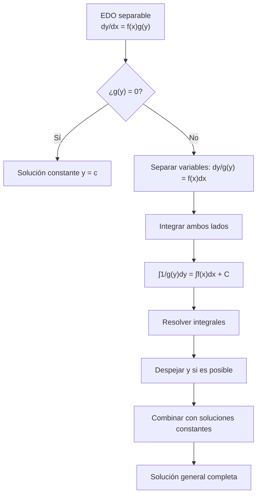

# Matemáticas para Ciencias Aplicadas IV - Ecuaciones Diferenciales de 1er Orden

## 1.3 Variables separables (aplicaciones)

---

### 1. Definición y Forma General

**Definición:** Una **ecuación diferencial de variables separables** es aquella que puede escribirse en la forma:

$$\frac{dy}{dx} = f(x)g(y)$$

donde:

- $f(x)$ es una función que depende solamente de $x$
- $g(y)$ es una función que depende solamente de $y$

**Forma alternativa:** La ecuación también puede expresarse como:

$$M(x)N(y)dx + P(x)Q(y)dy = 0$$

### 2. Método de Solución

El método para resolver ecuaciones de variables separables consiste en:

1. Separar las variables:

   $$\frac{dy}{g(y)} = f(x)dx$$

2. Integrar ambos lados:

   $$\int \frac{1}{g(y)} dy = \int f(x) dx + C$$

3. Resolver las integrales (si es posible)
4. Despejar $y$ en términos de $x$ (si es posible)

**Nota:** Es importante verificar si $g(y) = 0$ produce soluciones constantes.

### 3. Aplicaciones Prácticas

#### 3.1. Modelos de Crecimiento y Decaimiento

**Crecimiento exponencial:**

$$\frac{dP}{dt} = kP$$

Solución: $P(t) = P_0e^{kt}$

**Decaimiento exponencial:**

$$\frac{dA}{dt} = -kA$$

Solución: $A(t) = A_0e^{-kt}$

#### 3.2. Ley de Enfriamiento de Newton

$$\frac{dT}{dt} = k(T - T_a)$$

Solución: $T(t) = T_a + (T_0 - T_a)e^{kt}$

#### 3.3. Reacciones Químicas de Primer Orden

$$\frac{dC}{dt} = -kC$$

Solución: $C(t) = C_0e^{-kt}$

#### 3.4. Movimiento con Resistencia Proporcional a la Velocidad

$$\frac{dv}{dt} = g - kv$$

Solución: $v(t) = \frac{g}{k} + (v_0 - \frac{g}{k})e^{-kt}$

### 4. Ejemplos Resueltos

#### Ejemplo 1: Crecimiento Poblacional

Resolver: $\frac{dP}{dt} = 0.05P$ con $P(0) = 1000$

**Solución:**

- Separar variables: $\frac{dP}{P} = 0.05dt$
- Integrar: $\int \frac{1}{P} dP = \int 0.05 dt$
- Resultado: $\ln|P| = 0.05t + C$
- Aplicar exponencial: $P(t) = e^{0.05t + C} = e^C e^{0.05t}$
- Condición inicial: $1000 = e^C \Rightarrow e^C = 1000$
- Solución: $P(t) = 1000e^{0.05t}$

#### Ejemplo 2: Ley de Enfriamiento

Un objeto a 100°C se coloca en un ambiente a 25°C. Si después de 10 minutos la temperatura es 70°C, ¿cuál será la temperatura después de 30 minutos?

**Solución:**

- EDO: $\frac{dT}{dt} = k(T - 25)$
- Separar: $\frac{dT}{T - 25} = kdt$
- Integrar: $\ln|T - 25| = kt + C$
- Solución general: $T(t) = 25 + Ce^{kt}$
- Condiciones: $T(0) = 100 = 25 + C \Rightarrow C = 75$
- $T(10) = 70 = 25 + 75e^{10k} \Rightarrow e^{10k} = \frac{45}{75} = 0.6$
- $k = \frac{\ln(0.6)}{10} \approx -0.05108$
- $T(30) = 25 + 75e^{30k} = 25 + 75(e^{10k})^3 = 25 + 75(0.6)^3 = 25 + 75(0.216) = 41.2°C$

### 5. Diagrama de Flujo para Resolver Ecuaciones Separables



### 6. Ejercicios Propuestos

1. **Decaimiento radiactivo:** El radio-226 tiene una vida media de 1600 años. Si inicialmente hay 100 mg, ¿cuánto tiempo tardará en reducirse a 30 mg?

2. **Mezclas:** Un tanque contiene 1000 L de agua con 20 kg de sal disuelta. Se bombea agua pura al tanque a 10 L/min y la mezcla sale a la misma tasa. Encuentre la cantidad de sal en el tanque en función del tiempo.

3. **Movimiento con resistencia:** Un paracaidista de 80 kg salta desde un avión. La resistencia del aire es proporcional a la velocidad con constante k = 20 kg/s. Encuentre la velocidad límite y el tiempo para alcanzar el 90% de esta velocidad.

4. **Crecimiento logístico:** Resuelva la ecuación logística $\frac{dP}{dt} = kP(1 - \frac{P}{M})$ con P(0) = P₀.

5. **Reacción química:** En una reacción de primer orden, la concentración disminuye a la mitad en 30 minutos. ¿Cuál es la constante de velocidad k y cuánto tiempo tardará en reducirse al 10% de la concentración inicial?

### 7. Código de Simulación (Python)

```python
import numpy as np
import matplotlib.pyplot as plt
from scipy.integrate import odeint

# Simulación de crecimiento poblacional
def crecimiento(P, t, k):
    dPdt = k * P
    return dPdt

# Parámetros
k = 0.05  # tasa de crecimiento
P0 = 1000  # población inicial
t = np.linspace(0, 50, 100)  # tiempo de 0 a 50 unidades

# Resolver
solucion = odeint(crecimiento, P0, t, args=(k,))

# Graficar
plt.figure(figsize=(10, 6))
plt.plot(t, solucion, 'b-', label='P(t) = 1000e^{0.05t}')
plt.title('Crecimiento Exponencial Poblacional')
plt.xlabel('Tiempo')
plt.ylabel('Población')
plt.grid(True)
plt.legend()
plt.show()

# Simulación de enfriamiento
def enfriamiento(T, t, k, Ta):
    dTdt = k * (T - Ta)
    return dTdt

# Parámetros
k = -0.05108  # constante de enfriamiento
Ta = 25  # temperatura ambiente
T0 = 100  # temperatura inicial
t = np.linspace(0, 60, 100)  # tiempo de 0 a 60 minutos

# Resolver
solucion = odeint(enfriamiento, T0, t, args=(k, Ta))

# Graficar
plt.figure(figsize=(10, 6))
plt.plot(t, solucion, 'r-', label='T(t) = 25 + 75e^{-0.05108t}')
plt.title('Ley de Enfriamiento de Newton')
plt.xlabel('Tiempo (minutos)')
plt.ylabel('Temperatura (°C)')
plt.grid(True)
plt.legend()
plt.show()
```

### 8. Resumen de Fórmulas Importantes

| Aplicación                 | Ecuación Diferencial         | Solución                                          |
| -------------------------- | ---------------------------- | ------------------------------------------------- |
| Crecimiento exponencial    | $\frac{dP}{dt} = kP$         | $P(t) = P_0e^{kt}$                                |
| Decaimiento exponencial    | $\frac{dA}{dt} = -kA$        | $A(t) = A_0e^{-kt}$                               |
| Ley de enfriamiento        | $\frac{dT}{dt} = k(T - T_a)$ | $T(t) = T_a + (T_0 - T_a)e^{kt}$                  |
| Movimiento con resistencia | $\frac{dv}{dt} = g - kv$     | $v(t) = \frac{g}{k} + (v_0 - \frac{g}{k})e^{-kt}$ |
| Vida media                 | -                            | $t_{1/2} = \frac{\ln 2}{k}$                       |

### 9. Referencias Bibliográficas

**Bibliografía básica:**

1. Boyce, W., DiPrima, R. (2004). _Elementary Differential Equations and Boundary Value Problems_. Wiley. (Capítulo 2)
2. Edwards, C. H., Penney, D. E. (2002). _Ecuaciones diferenciales elementales y problemas con condiciones a la frontera_. Prentice Hall. (Capítulo 2)

**Bibliografía complementaria:**

1. Zill, D. G., Wright, W. S. (1995). _Differential Equations with Computer Lab Experiments_. PWS Publishing. (Capítulo 2)
2. Hubbard, J. H., West, B. H. (1995). _Differential Equations: A Dynamical Systems Approach_. Springer-Verlag. (Capítulo 1)
