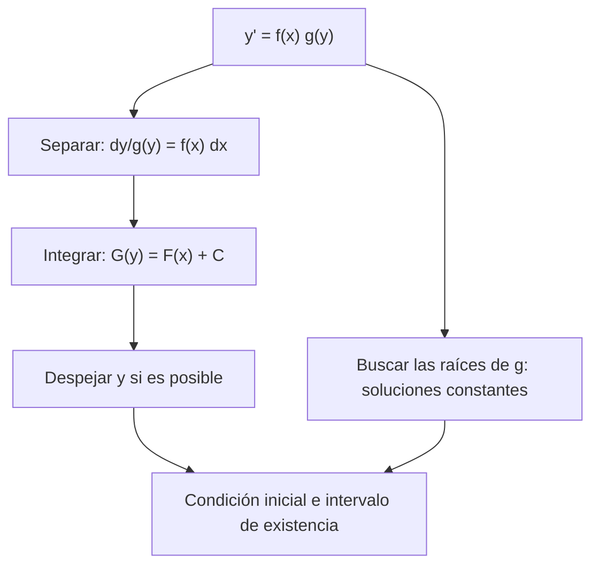

# Matemáticas para Ciencias Aplicadas IV - Ecuaciones Diferenciales de 1er Orden

## 1.3 Variables separables (aplicaciones)

---

Cuando la derivada es el producto de una función de $x$ por una función de $y,$ la ecuación se puede **separar**: todo lo que depende de $y$ de un lado y todo lo que depende de $x$ del otro, e integrar. Es el método más antiguo y el que resuelve muchos modelos **no lineales** importantes: la ecuación logística, el vaciado de un tanque, la caída con resistencia del aire. Este tema justifica el método, muestra sus trampas (soluciones que se pierden, soluciones que explotan) y lo aplica.

### Ecuaciones separables

**Definición.** Una ecuación de primer orden es **separable** si se puede escribir

$$ \frac{dy}{dx} = f(x)\, g(y) $$

Por ejemplo, $y' = x y^2,$ $y' = e^{x + y} = e^x e^y$ y $y' = y(1 - y);$ no lo es $y' = x + y.$

**Método.** Donde $g(y) \neq 0:$

$$ \int \frac{dy}{g(y)} = \int f(x)\, dx + C $$

**Justificación.** Sea $y(x)$ una solución con $g(y(x)) \neq 0.$ Dividiendo, $\frac{y'(x)}{g(y(x))} = f(x).$ Si $G$ es una primitiva de $1/g$ y $F$ una de $f,$ por la regla de la cadena $\frac{d}{dx} G(y(x)) = \frac{y'(x)}{g(y(x))} = f(x) = F'(x),$ así que $G(y(x)) = F(x) + C.$ El manejo de $dy$ y $dx$ como fracciones es una abreviatura de este argumento. $\blacksquare$

El resultado es en general una **solución implícita** $G(y) = F(x) + C,$ que a veces se puede despejar.

**Soluciones constantes.** Si $g(c) = 0,$ la función constante $y = c$ es solución (un **equilibrio**), y al dividir entre $g(y)$ se pierde. Hay que buscarlas aparte: en $y' = y^2$ la familia $y = -1/(x + C)$ no incluye a $y = 0,$ que también es solución.

**Ejemplo (solución implícita).** $y' = x/y,$ $y(0) = 2.$ Separando, $\int y\, dy = \int x\, dx,$ así que $y^2/2 = x^2/2 + C;$ la condición da $C = 2.$ La solución es $y = \sqrt{x^2 + 4}$ (la raíz positiva, por la condición inicial): la rama superior de la hipérbola $y^2 - x^2 = 4.$

**Ejemplo (explosión en tiempo finito).** $y' = y^2,$ $y(0) = 1.$ Separando, $-1/y = x + C,$ y la condición da $C = -1:$

$$ y = \frac{1}{1 - x} $$

La solución existe solo en $(-\infty, 1)$ y tiende a infinito cuando $x \to 1,$ aunque la ecuación es perfectamente regular en todo el plano. Las ecuaciones **no lineales** pueden tener soluciones que **explotan**; las lineales, no (tema 1.2).

### Aplicaciones

**Crecimiento logístico.** Una población con recursos limitados crece casi exponencialmente cuando es pequeña y se frena al acercarse a una **capacidad de carga** $M:$

$$ P' = k P \left( 1 - \frac{P}{M} \right), \qquad P(0) = P_0 $$

Separando y usando fracciones parciales, $\frac{1}{P(1 - P/M)} = \frac{1}{P} + \frac{1}{M - P},$ se obtiene $\ln \left| \frac{P}{M - P} \right| = kt + C,$ y despejando,

$$ P(t) = \frac{M P_0}{P_0 + (M - P_0)\, e^{-kt}} $$

Para todo $P_0 > 0,$ $P(t) \to M.$ Los equilibrios son $P = 0$ (inestable) y $P = M$ (estable). La curva tiene forma de S, con el crecimiento más rápido cuando $P = M/2.$

**Ley de Torricelli.** Un tanque cilíndrico de sección $A$ con un orificio de área $a$ en el fondo se vacía con velocidad de salida $\sqrt{2gh}$ (Torricelli, 1643), así que el volumen cumple $A h' = -a \sqrt{2gh},$ es decir,

$$ h' = -c \sqrt{h}, \qquad c = \frac{a}{A} \sqrt{2g} $$

Separando, $2\sqrt{h} = -ct + 2\sqrt{H},$ y $h(t) = (\sqrt{H} - ct/2)^2$ hasta que se vacía, en $t = 2\sqrt{H}/c.$ A partir de ahí $h = 0.$ Aquí falla la unicidad hacia atrás: desde $h = 0$ no se puede saber cuándo se vació el tanque, porque $\sqrt{h}$ no es derivable en 0.

**Caída con resistencia del aire.** Un cuerpo de masa $m$ que cae con resistencia proporcional a la velocidad cumple $m v' = mg - kv.$ Es separable (y lineal): $v(t) = \frac{mg}{k} + \left( v_0 - \frac{mg}{k} \right) e^{-kt/m}.$ La **velocidad límite** es $mg/k.$ Con resistencia cuadrática, $m v' = mg - k v^2,$ la ecuación es separable pero no lineal, y la solución es $v(t) = v_\infty \tanh(g t / v_\infty)$ con $v_\infty = \sqrt{mg/k},$ partiendo del reposo.

**Reacciones químicas.** En una reacción de primer orden la concentración cumple $C' = -kC,$ con decaimiento exponencial; en una de segundo orden, $C' = -kC^2,$ separable con solución $C(t) = \frac{C_0}{1 + k C_0 t},$ que decae mucho más lentamente.



### Implementación en Python

El programa resuelve con SymPy los ejemplos del tema (la explosión de $y' = y^2,$ la solución implícita de $y' = x/y,$ la logística y Torricelli), calcula las respuestas de los ejercicios y compara la solución exacta de la logística con una solución numérica de SciPy.

```python
import sympy as sp
import numpy as np
from scipy.integrate import solve_ivp

t, x = sp.symbols('t x')
y = sp.Function('y')

def separable(f, g, x0, y0, var=x):
    """Resuelve y' = f(x) g(y), y(x0) = y0 separando: ∫ dy/g(y) = ∫ f(x) dx, con integrales definidas."""
    Y, X = sp.symbols('Y X')
    izquierda = sp.integrate(1 / g(Y), (Y, y0, sp.Symbol('y')))
    derecha = sp.integrate(f(X), (X, x0, var))
    return sp.Eq(sp.simplify(izquierda), sp.simplify(derecha))

# y' = y², y(0) = 1: explota en x = 1
print('y\' = y², y(0) = 1:', sp.dsolve(sp.Eq(y(x).diff(x), y(x)**2), ics={y(0): 1}))

# y' = x/y (implícita): y² - x² = C
print('y\' = x/y, y(0) = 2, forma implícita:', separable(lambda X: X, lambda Y: 1 / Y, 0, 2))

# Logística: P' = k P (1 - P/M)
k, M, P0 = sp.symbols('k M P_0', positive=True)
P = sp.Function('P')
sol = sp.dsolve(sp.Eq(P(t).diff(t), k * P(t) * (1 - P(t) / M)), ics={P(0): P0})
print('logística:', sp.simplify(sol.rhs))
print('   límite cuando t → ∞:', sp.limit(sol.rhs, t, sp.oo))

# Torricelli: h' = -c √h, h(0) = H; se vacía en t = 2√H / c
c, H = sp.symbols('c H', positive=True)
h = sp.Function('h')
sol_h = (sp.sqrt(H) - c * t / 2)**2
print('Torricelli: h = (√H - ct/2)² satisface la ecuación:',
      sp.simplify(sol_h.diff(t) + c * sp.sqrt(H) - c**2 * t / 2) == 0, '  vaciado en t =', sp.solve(sp.sqrt(H) - c * t / 2, t)[0])

# Ejercicios
print('radio 226, de 100 a 30 mg:', sp.N(1600 * sp.log(sp.Rational(3, 10)) / sp.log(sp.Rational(1, 2)), 5), 'años')
print('tanque con agua pura: x(t) = 20 e^(-t/100), x(60) =', sp.N(20 * sp.exp(-sp.Rational(60, 100)), 5), 'kg')
m, kk, g = 80, 20, sp.Rational(98, 10)
vlim = m * g / kk
print('paracaidista: velocidad límite =', sp.N(vlim, 4), 'm/s;  90 % en t =', sp.N(m / kk * sp.log(10), 4), 's')
kr = sp.log(2) / 30
print('reacción: k =', sp.N(kr, 4), '/min;  10 % en t =', sp.N(sp.log(10) / kr, 5), 'min')

# Comprobación numérica de la logística con k = 0.5, M = 1000, P0 = 10
num = solve_ivp(lambda t, p: 0.5 * p * (1 - p / 1000), [0, 20], [10], rtol=1e-10, atol=1e-8)
exacta = sol.rhs.subs({k: 0.5, M: 1000, P0: 10, t: 20})
print('logística en t = 20: numérica', round(num.y[0, -1], 4), ' exacta', round(float(exacta), 4))
```

Salida:

```text
y' = y², y(0) = 1: Eq(y(x), -1/(x - 1))
y' = x/y, y(0) = 2, forma implícita: Eq(y**2/2 - 2, x**2/2)
logística: M*P_0*exp(k*t)/(M + P_0*exp(k*t) - P_0)
   límite cuando t → ∞: M
Torricelli: h = (√H - ct/2)² satisface la ecuación: True   vaciado en t = 2*sqrt(H)/c
radio 226, de 100 a 30 mg: 2779.1 años
tanque con agua pura: x(t) = 20 e^(-t/100), x(60) = 10.976 kg
paracaidista: velocidad límite = 39.20 m/s;  90 % en t = 9.210 s
reacción: k = 0.02310 /min;  10 % en t = 99.658 min
logística en t = 20: numérica 995.5255  exacta 995.5255
```

### Ejercicios Propuestos

1. **Radio 226.** El radio 226 tiene una vida media de 1600 años. ¿Cuánto tardan 100 mg en reducirse a 30 mg?

2. **Lavado de un tanque.** Un tanque contiene 1000 L de agua con 20 kg de sal. Entra agua pura a 10 L/min y sale la mezcla a la misma tasa. Encuentra la sal en función del tiempo.

3. **Paracaidista.** Un paracaidista de 80 kg cae con resistencia $kv,$ $k = 20$ kg/s, partiendo del reposo. Con $g = 9.8$ m/s², encuentra la velocidad límite y el tiempo para alcanzar el $90\,\%$ de ella.

4. **Logística.** Resuelve $P' = kP(1 - P/M),$ $P(0) = P_0,$ y demuestra que la tasa de crecimiento es máxima cuando $P = M/2.$

5. **Primer orden.** En una reacción de primer orden la concentración se reduce a la mitad en 30 minutos. Encuentra $k$ y el tiempo para llegar al $10\,\%.$

6. **Explosión.** Resuelve $y' = 1 + y^2,$ $y(0) = 0,$ y encuentra su intervalo de existencia.

### Soluciones

**Ejercicio 1.** $A = 100\, (1/2)^{t/1600};$ $30 = 100\, (1/2)^{t/1600}$ da $t = 1600 \ln 0.3 / \ln 0.5 \approx 2779$ años.

**Ejercicio 2.** $x' = -\frac{10}{1000} x,$ separable: $x(t) = 20\, e^{-t/100}$ kg. Por ejemplo, a la hora quedan $20 e^{-0.6} \approx 10.98$ kg.

**Ejercicio 3.** $v' = g - \frac{k}{m} v = 9.8 - v/4,$ con $v(0) = 0:$ $v = 39.2\, (1 - e^{-t/4}).$ La velocidad límite es $mg/k = 39.2$ m/s y el $90\,\%$ se alcanza cuando $e^{-t/4} = 0.1,$ en $t = 4 \ln 10 \approx 9.21$ s.

**Ejercicio 4.** La solución es la del texto. La tasa $P' = kP(1 - P/M)$ es una parábola en $P$ con máximo en $P = M/2,$ donde vale $kM/4.$

**Ejercicio 5.** $k = \ln 2 / 30 \approx 0.0231$ por minuto, y $0.1 = e^{-kt}$ da $t = \ln 10 / k = 30 \log_2 10 \approx 99.7$ minutos.

**Ejercicio 6.** $\int \frac{dy}{1 + y^2} = \int dx$ da $\arctan y = x + C,$ y $C = 0:$ $y = \tan x,$ definida en $(-\pi/2, \pi/2).$ Explota en $x = \pm \pi/2.$

### Referencias

1. Boyce, W. E., DiPrima, R. C., and Meade, D. B., _Elementary Differential Equations and Boundary Value Problems_. Wiley, 2017. Secciones 2.2, 2.3 y 2.5.
2. Zill, D. G., _Ecuaciones diferenciales con aplicaciones de modelado_. Cengage, 2018. Secciones 2.2 y 3.2.
3. Edwards, C. H., and Penney, D. E., _Ecuaciones diferenciales y problemas con valores en la frontera_. Pearson, 2009. Secciones 1.4 y 2.1 a 2.3.
4. Strogatz, S. H., _Nonlinear Dynamics and Chaos_. CRC Press, 2015. Capítulo 2.
