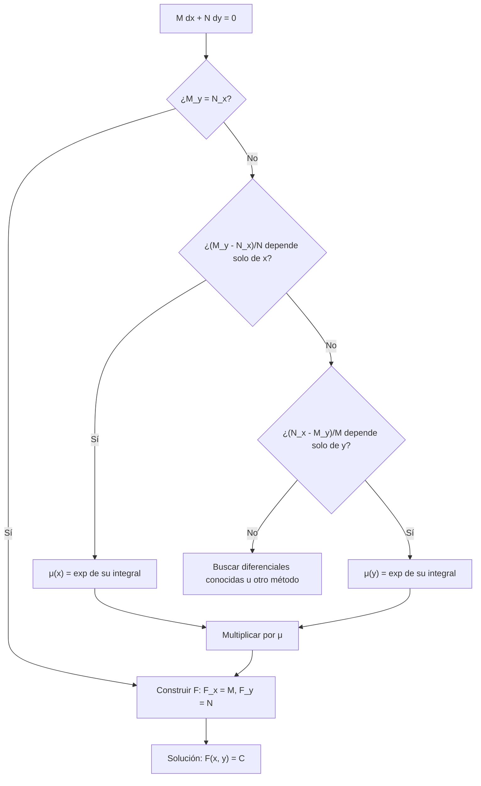

# Matemáticas para Ciencias Aplicadas IV - Ecuaciones Diferenciales de 1er Orden

## 1.4 Ecuaciones diferenciales exactas y factor de integración (aplicaciones).

---

Si una familia de curvas está dada por $F(x, y) = C,$ derivando implícitamente se obtiene una ecuación diferencial: $F_x\, dx + F_y\, dy = 0.$ Una ecuación **exacta** es una que proviene de esta manera de una función $F,$ el **potencial**, y resolverla es reconstruir $F.$ Cuando la ecuación no es exacta, a veces se vuelve exacta multiplicándola por un **factor integrante**, la misma idea que resolvió las ecuaciones lineales en el tema 1.2. La conexión con la física es directa: una ecuación exacta corresponde a un **campo conservativo**, y $F$ es su función potencial.

### Ecuaciones exactas

Una ecuación de primer orden se puede escribir en **forma diferencial**

$$ M(x, y)\, dx + N(x, y)\, dy = 0 $$

que equivale a $y' = -M/N,$ o a $x' = -N/M$ si se ve $x$ como función de $y.$

**Definición.** La ecuación es **exacta** en una región $R$ si existe $F$ con $F_x = M$ y $F_y = N$ en $R.$ Entonces las soluciones son las curvas de nivel $F(x, y) = C:$ si $y(x)$ es solución, por la regla de la cadena $\frac{d}{dx} F(x, y(x)) = M + N y' = 0.$

**Teorema (criterio de exactitud).** Si $M,$ $N,$ $M_y$ y $N_x$ son continuas en un rectángulo $R$ (o cualquier región simplemente conexa), la ecuación es exacta en $R$ si y solo si

$$ \frac{\partial M}{\partial y} = \frac{\partial N}{\partial x} $$

**Demostración.** Si es exacta, $M_y = F_{xy} = F_{yx} = N_x$ por el teorema de Schwarz. Recíprocamente, se construye $F:$ sea $F(x, y) = \int_{x_0}^{x} M(s, y)\, ds + g(y).$ Entonces $F_x = M,$ y

$$ F_y = \int_{x_0}^{x} M_y(s, y)\, ds + g'(y) = \int_{x_0}^{x} N_x(s, y)\, ds + g'(y) = N(x, y) - N(x_0, y) + g'(y) $$

Con $g'(y) = N(x_0, y)$ se obtiene $F_y = N.$ $\blacksquare$

**Método.**

1. Verificar $M_y = N_x.$
2. Integrar $M$ respecto a $x,$ con una "constante" que depende de $y:$ $F = \int M\, dx + g(y).$
3. Derivar respecto a $y,$ igualar a $N$ y despejar $g'(y),$ que no debe depender de $x.$
4. Integrar $g'$ y escribir la solución $F(x, y) = C.$

**Ejemplo.** $(2xy + y^2)\, dx + (x^2 + 2xy)\, dy = 0.$ $M_y = 2x + 2y = N_x.$ Integrando $M$ en $x,$ $F = x^2 y + x y^2 + g(y);$ $F_y = x^2 + 2xy + g'(y) = N$ da $g' = 0.$ La solución es $x^2 y + x y^2 = C.$

### Factores integrantes

Si la ecuación no es exacta, se busca $\mu(x, y)$ tal que $\mu M\, dx + \mu N\, dy = 0$ sí lo sea. La condición $(\mu M)_y = (\mu N)_x$ es una ecuación en derivadas parciales, en general tan difícil como la original, pero en dos casos se reduce a una ordinaria:

**Factor que depende solo de la primera variable.** Con $\mu = \mu(x),$ la condición es $\mu M_y = \mu' N + \mu N_x,$ es decir,

$$ \frac{\mu'}{\mu} = \frac{M_y - N_x}{N} $$

Si el lado derecho depende solo de $x,$ entonces $\mu(x) = \exp \int \frac{M_y - N_x}{N}\, dx.$

**Factor que depende solo de la segunda variable.** Análogamente, si $\frac{N_x - M_y}{M}$ depende solo de $y,$ entonces $\mu(y) = \exp \int \frac{N_x - M_y}{M}\, dy.$

**Las lineales como caso particular.** $y' + p(x) y = q(x)$ es $(p y - q)\, dx + dy = 0.$ Aquí $\frac{M_y - N_x}{N} = p(x),$ y el factor es $\mu = e^{\int p},$ el del tema 1.2.

**Ejemplo.** $(3xy + y^2)\, dx + (x^2 + xy)\, dy = 0.$ $M_y = 3x + 2y$ y $N_x = 2x + y,$ no es exacta. $\frac{M_y - N_x}{N} = \frac{x + y}{x(x + y)} = \frac{1}{x},$ así que $\mu = x.$ La ecuación $(3x^2 y + x y^2)\, dx + (x^3 + x^2 y)\, dy = 0$ es exacta, con $F = x^3 y + \tfrac{1}{2} x^2 y^2.$ La solución es $x^3 y + \tfrac{1}{2} x^2 y^2 = C.$

**Otros factores.** A veces el factor se encuentra reconociendo diferenciales conocidas: $x\, dy + y\, dx = d(xy),$ $\frac{x\, dy - y\, dx}{x^2} = d(y/x),$ $\frac{x\, dx + y\, dy}{x^2 + y^2} = d\big(\tfrac{1}{2} \ln (x^2 + y^2)\big).$ Por ejemplo, $(x^2 y + y^3)\, dx + (x^3 + x y^2)\, dy = (x^2 + y^2)(y\, dx + x\, dy),$ así que $\mu = 1/(x^2 + y^2)$ la convierte en $d(xy) = 0.$



### Aplicaciones

**Campos conservativos.** Un campo de fuerzas $\mathbf{F} = (M, N)$ es **conservativo** si $\mathbf{F} = \nabla \phi$ para un potencial $\phi;$ en una región simplemente conexa, esto ocurre si y solo si $M_y = N_x,$ que es la condición de exactitud. Las curvas $\phi = C$ son las **equipotenciales**, y las líneas de fuerza son perpendiculares a ellas.

**Trayectorias ortogonales.** Si una familia de curvas satisface $y' = f(x, y),$ la familia perpendicular satisface $y' = -1/f(x, y).$ Por ejemplo, las rectas por el origen $y = cx$ satisfacen $y' = y/x;$ sus trayectorias ortogonales satisfacen $y' = -x/y,$ es decir, $x\, dx + y\, dy = 0,$ exacta, con solución $x^2 + y^2 = C:$ las circunferencias concéntricas (tema 1.1). En electrostática, las equipotenciales y las líneas de campo forman familias ortogonales.

**Termodinámica.** Las variables de estado, como la energía interna o la entropía, tienen diferenciales exactas: su cambio depende solo de los estados inicial y final. El calor $\delta Q$ no es una diferencial exacta, pero $1/T$ es un factor integrante: $dS = \delta Q / T$ es exacta. Es la formulación matemática de la segunda ley.

### Implementación en Python

El programa verifica la exactitud, construye el potencial por el método del tema y busca factores integrantes de una variable. Resuelve los ejemplos y los ejercicios; para el ejercicio 5, donde no hay factor de una sola variable, usa el factor encontrado agrupando diferenciales.

```python
import sympy as sp

x, y = sp.symbols('x y')

def es_exacta(M, N):
    return sp.simplify(sp.diff(M, y) - sp.diff(N, x)) == 0

def potencial(M, N):
    """F con F_x = M y F_y = N: se integra M en x y se corrige con g(y)."""
    F = sp.integrate(M, x)
    g_prima = sp.simplify(N - sp.diff(F, y))
    assert x not in g_prima.free_symbols          # garantizado por la exactitud
    return sp.simplify(F + sp.integrate(g_prima, y))

def factor_integrante(M, N):
    """Busca μ(x) o μ(y). Devuelve None si ninguno funciona."""
    fx = sp.simplify((sp.diff(M, y) - sp.diff(N, x)) / N)
    if y not in fx.free_symbols:
        return sp.simplify(sp.exp(sp.integrate(fx, x)))
    gy = sp.simplify((sp.diff(N, x) - sp.diff(M, y)) / M)
    if x not in gy.free_symbols:
        return sp.simplify(sp.exp(sp.integrate(gy, y)))
    return None

def resolver(nombre, M, N, mu=None, inicial=None):
    if not es_exacta(M, N):
        mu = mu if mu is not None else factor_integrante(M, N)
        print(f'{nombre}: no es exacta; factor integrante μ = {mu}')
        M, N = sp.simplify(mu * M), sp.simplify(mu * N)
        assert es_exacta(M, N)
    F = potencial(M, N)
    texto = f'{nombre}: F = {F}'
    if inicial is not None:
        texto += f'  y la condición da F = {F.subs({x: inicial[0], y: inicial[1]})}'
    print(texto)

resolver('ejemplo 1', 2*x*y + y**2, x**2 + 2*x*y)
resolver('ejemplo 2', 3*x*y + y**2, x**2 + x*y)
resolver('ejercicio 1', 2*x + y, x + 2*y)
resolver('ejercicio 2', y**2 + 2*x*y, -x**2)
resolver('ejercicio 3', 2*x*y + sp.exp(y), x**2 + x*sp.exp(y))
resolver('ejercicio 4', 3*x**2*y + 2*x*y + y**3, x**2 + y**2, inicial=(0, 1))
print('ejercicio 5: factor de una sola variable:', factor_integrante(x**2*y + y**3, x**3 + x*y**2))
resolver('ejercicio 5', x**2*y + y**3, x**3 + x*y**2, mu=1 / (x**2 + y**2))

# Las ecuaciones lineales son un caso particular: y' + p y = q  es  (p y - q) dx + dy = 0
p, q = 2*x, x
print('lineal y\' + 2xy = x: μ =', factor_integrante(p*y - q, sp.Integer(1)))
```

Salida:

```text
ejemplo 1: F = x*y*(x + y)
ejemplo 2: no es exacta; factor integrante μ = x
ejemplo 2: F = x**2*y*(2*x + y)/2
ejercicio 1: F = x**2 + x*y + y**2
ejercicio 2: no es exacta; factor integrante μ = y**(-2)
ejercicio 2: F = x*(x + y)/y
ejercicio 3: F = x*(x*y + exp(y))
ejercicio 4: no es exacta; factor integrante μ = exp(3*x)
ejercicio 4: F = y*(3*x**2 + y**2)*exp(3*x)/3  y la condición da F = 1/3
ejercicio 5: factor de una sola variable: None
ejercicio 5: no es exacta; factor integrante μ = 1/(x**2 + y**2)
ejercicio 5: F = x*y
lineal y' + 2xy = x: μ = exp(x**2)
```

Las respuestas difieren de las del texto solo en la forma o en una constante multiplicativa: en el ejemplo 2, $F = \tfrac{1}{2} x^2 y (2x + y) = x^3 y + \tfrac{1}{2} x^2 y^2.$

### Ejercicios Propuestos

1. **Exacta.** Resuelve $(2x + y)\, dx + (x + 2y)\, dy = 0.$

2. **Factor en la segunda variable.** Resuelve $(y^2 + 2xy)\, dx - x^2\, dy = 0.$

3. **Campo conservativo.** Resuelve $(2xy + e^y)\, dx + (x^2 + x e^y)\, dy = 0$ y da el potencial.

4. **Valor inicial.** Resuelve $(3x^2 y + 2xy + y^3)\, dx + (x^2 + y^2)\, dy = 0$ con $y(0) = 1.$

5. **Agrupando.** Encuentra un factor integrante para $(x^2 y + y^3)\, dx + (x^3 + x y^2)\, dy = 0$ y resuélvela.

6. **Trayectorias ortogonales.** Encuentra las trayectorias ortogonales de las parábolas $y = c x^2.$

### Soluciones

**Ejercicio 1.** $M_y = 1 = N_x.$ $F = x^2 + xy + g(y),$ y $F_y = x + g' = x + 2y$ da $g = y^2:$ $x^2 + xy + y^2 = C,$ una familia de elipses.

**Ejercicio 2.** $M_y = 2y + 2x,$ $N_x = -2x.$ $\frac{N_x - M_y}{M} = \frac{-4x - 2y}{y(y + 2x)} = -\frac{2}{y},$ así que $\mu = y^{-2}.$ La ecuación $(1 + 2x/y)\, dx - (x^2/y^2)\, dy = 0$ es exacta con $F = x + x^2/y.$ La solución es $x + x^2/y = C,$ es decir $y = \frac{x^2}{C - x}.$ Además, $y = 0$ es solución y se perdió al dividir.

**Ejercicio 3.** Es exacta: $M_y = 2x + e^y = N_x.$ El potencial es $F = x^2 y + x e^y,$ y la solución $x^2 y + x e^y = C.$

**Ejercicio 4.** $\frac{M_y - N_x}{N} = \frac{3x^2 + 3y^2}{x^2 + y^2} = 3,$ así que $\mu = e^{3x}.$ El potencial es $F = e^{3x} (x^2 y + y^3/3)$ y la condición $y(0) = 1$ da $C = 1/3:$ $e^{3x} (3x^2 y + y^3) = 1.$

**Ejercicio 5.** Ningún factor de una sola variable funciona. Factorizando, la ecuación es $(x^2 + y^2)(y\, dx + x\, dy) = 0;$ con $\mu = 1/(x^2 + y^2)$ queda $d(xy) = 0$ y la solución es $xy = C.$

**Ejercicio 6.** De $y = cx^2,$ $c = y/x^2$ y $y' = 2cx = 2y/x.$ Las ortogonales cumplen $y' = -\frac{x}{2y},$ separable: $2y\, dy = -x\, dx,$ es decir $x^2 + 2y^2 = C,$ una familia de elipses.

### Referencias

1. Boyce, W. E., DiPrima, R. C., and Meade, D. B., _Elementary Differential Equations and Boundary Value Problems_. Wiley, 2017. Sección 2.6.
2. Zill, D. G., _Ecuaciones diferenciales con aplicaciones de modelado_. Cengage, 2018. Sección 2.4.
3. Edwards, C. H., and Penney, D. E., _Ecuaciones diferenciales y problemas con valores en la frontera_. Pearson, 2009. Sección 1.6.
4. Simmons, G. F., _Ecuaciones diferenciales con aplicaciones y notas históricas_. McGraw-Hill, 1993. Secciones 8 a 11.
