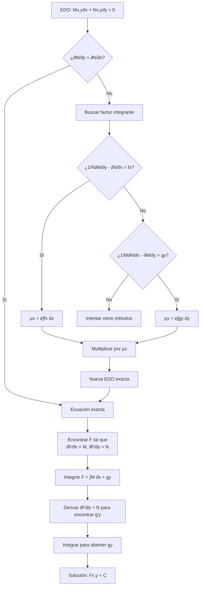

# Matemáticas para Ciencias Aplicadas IV - Ecuaciones Diferenciales de 1er Orden

## 1.4 Ecuaciones diferenciales exactas y factor de integración (aplicaciones).

---

### 1. Definición de Ecuación Diferencial Exacta

**Definición:** Una ecuación diferencial de la forma:

$$M(x, y)dx + N(x, y)dy = 0$$

se dice que es **exacta** si existe una función $F(x, y)$ tal que:

$$\frac{\partial F}{\partial x} = M(x, y) \quad \text{y} \quad \frac{\partial F}{\partial y} = N(x, y)$$

**Condición de exactitud:** La ecuación es exacta si y solo si:

$$\frac{\partial M}{\partial y} = \frac{\partial N}{\partial x}$$

### 2. Método de Solución para Ecuaciones Exactas

Si $M(x, y)dx + N(x, y)dy = 0$ es exacta, entonces:

1. Encontrar $F(x, y)$ tal que:

   $$\frac{\partial F}{\partial x} = M(x, y)$$

2. Integrar respecto a $x:$

   $$F(x, y) = \int M(x, y) dx + g(y)$$

3. Derivar respecto a $y$ e igualar a $N(x, y):$

   $$\frac{\partial F}{\partial y} = \frac{\partial}{\partial y} \left[ \int M(x, y) dx \right] + g'(y) = N(x, y)$$

4. Encontrar $g'(y)$ y luego $g(y)$
5. La solución general es:

   $$F(x, y) = C$$

### 3. Factor Integrante

Cuando una ecuación no es exacta, a veces podemos encontrar un **factor integrante** $\mu(x, y)$ que la convierta en exacta.

#### 3.1. Factor integrante que depende solo de $x:$

Si $\frac{1}{N}\left(\frac{\partial M}{\partial y} - \frac{\partial N}{\partial x}\right)$ es función solo de $x,$ entonces:

$$\mu(x) = e^{\int \frac{1}{N}\left(\frac{\partial M}{\partial y} - \frac{\partial N}{\partial x}\right) dx}$$

#### 3.2. Factor integrante que depende solo de $y:$

Si $\frac{1}{M}\left(\frac{\partial N}{\partial x} - \frac{\partial M}{\partial y}\right)$ es función solo de $y,$ entonces:

$$\mu(y) = e^{\int \frac{1}{M}\left(\frac{\partial N}{\partial x} - \frac{\partial M}{\partial y}\right) dy}$$

### 4. Aplicaciones Prácticas

#### 4.1. Termodinámica: Relaciones de Maxwell

Las ecuaciones diferenciales exactas aparecen naturalmente en termodinámica a través de las relaciones de Maxwell.

#### 4.2. Mecánica de Fluidos

En el estudio de flujos potenciales, la ecuación para el potencial de velocidad es exacta.

#### 4.3. Campos Conservativos

En física, un campo vectorial es conservativo si su rotacional es cero, lo que corresponde a una ecuación diferencial exacta.

### 5. Ejemplos Resueltos

#### Ejemplo 1: Ecuación Exacta

Resolver: $(2xy + y^2)dx + (x^2 + 2xy)dy = 0$

**Solución:**

- Verificar exactitud:
  $M = 2xy + y^2,$ $N = x^2 + 2xy$
  $\frac{\partial M}{\partial y} = 2x + 2y,$ $\frac{\partial N}{\partial x} = 2x + 2y$ ✓

- Encontrar $F(x, y):$  

  $\frac{\partial F}{\partial x} = 2xy + y^2$

  $F(x, y) = \int (2xy + y^2) dx = x^2y + xy^2 + g(y)$

- Derivar respecto a $y:$

  $\frac{\partial F}{\partial y} = x^2 + 2xy + g'(y) = N = x^2 + 2xy$   ⇒ $g'(y) = 0$ ⇒ $g(y) = C_1$

- Solución general:   

  $x^2y + xy^2 = C$

#### Ejemplo 2: Factor Integrante

Resolver: $(3xy + y^2)dx + (x^2 + xy)dy = 0$

**Solución:**

- Verificar exactitud:

  $M = 3xy + y^2,$ $N = x^2 + xy$

  $\frac{\partial M}{\partial y} = 3x + 2y,$ $\frac{\partial N}{\partial x} = 2x + y$   No es exacta.

- Buscar factor integrante:

  $\frac{1}{N}\left(\frac{\partial M}{\partial y} - \frac{\partial N}{\partial x}\right) = \frac{1}{x^2 + xy}[(3x + 2y) - (2x + y)] = \frac{x + y}{x(x + y)} = \frac{1}{x}$     ⇒ $\mu(x) = e^{\int \frac{1}{x} dx} = x$

- Multiplicar por el factor integrante:

  $(3x^2y + xy^2)dx + (x^3 + x^2y)dy = 0$

- Verificar nueva exactitud:

  $M' = 3x^2y + xy^2,$ $N' = x^3 + x^2y$

  $\frac{\partial M'}{\partial y} = 3x^2 + 2xy,$ $\frac{\partial N'}{\partial x} = 3x^2 + 2xy$ ✓

- Resolver como ecuación exacta...

### 6. Diagrama de Flujo para Resolver Ecuaciones Exactas



### 7. Ejercicios Propuestos

1. **Verificar exactitud y resolver:** $(2x + y)dx + (x + 2y)dy = 0$

2. **Encontrar factor integrante y resolver:** $(y^2 + 2xy)dx - x^2dy = 0$

3. **Aplicación física:** Resolver $(2xy + e^y)dx + (x^2 + xe^y)dy = 0$ que representa un campo conservativo.

4. **Problema de valor inicial:** $(3x^2y + 2xy + y^3)dx + (x^2 + y^2)dy = 0$ con $y(0) = 1$

5. **Factor integrante especial:** Encontrar un factor integrante para $(x^2y + y^3)dx + (x^3 + xy^2)dy = 0$ y resolver.

### 8. Código de Verificación (Python)

```python
import sympy as sp

# Verificar si una ecuación es exacta
def verificar_exactitud(M, N, x, y):
    # Calcular derivadas parciales
    dM_dy = sp.diff(M, y)
    dN_dx = sp.diff(N, x)

    # Verificar si son iguales
    return sp.simplify(dM_dy) == sp.simplify(dN_dx)

# Ejemplo de uso
x, y = sp.symbols('x y')
M = 2*x*y + y**2
N = x**2 + 2*x*y

es_exacta = verificar_exactitud(M, N, x, y)
print(f"¿La ecuación es exacta? {es_exacta}")

# Encontrar factor integrante que depende solo de x
def factor_integrante_x(M, N, x, y):
    expr = (sp.diff(M, y) - sp.diff(N, x)) / N
    # Simplificar y verificar si depende solo de x
    expr_simp = sp.simplify(expr)
    if y not in expr_simp.free_symbols:
        return sp.exp(sp.integrate(expr_simp, x))
    return None

# Ejemplo de uso
M2 = 3*x*y + y**2
N2 = x**2 + x*y
mu_x = factor_integrante_x(M2, N2, x, y)
print(f"Factor integrante μ(x): {mu_x}")
```

### 9. Referencias Bibliográficas

**Bibliografía básica:**

1. Boyce, W., DiPrima, R. (2004). _Elementary Differential Equations and Boundary Value Problems_. Wiley. (Capítulo 2.6)
2. Edwards, C. H., Penney, D. E. (2002). _Ecuaciones diferenciales elementales y problemas con condiciones a la frontera_. Prentice Hall. (Capítulo 1.6)

**Bibliografía complementaria:**

1. Zill, D. G., Wright, W. S. (1995). _Differential Equations with Computer Lab Experiments_. PWS Publishing. (Capítulo 2)
2. Hubbard, J. H., West, B. H. (1995). _Differential Equations: A Dynamical Systems Approach_. Springer-Verlag. (Capítulo 1)

### 10. Resumen de Fórmulas Importantes

| Concepto               | Fórmula                                                                                                      |
| ---------------------- | ------------------------------------------------------------------------------------------------------------ |
| Condición de exactitud | $\frac{\partial M}{\partial y} = \frac{\partial N}{\partial x}$                                              |
| Factor integrante μ(x) | $\mu(x) = e^{\int \frac{1}{N}\left(\frac{\partial M}{\partial y} - \frac{\partial N}{\partial x}\right) dx}$ |
| Factor integrante μ(y) | $\mu(y) = e^{\int \frac{1}{M}\left(\frac{\partial N}{\partial x} - \frac{\partial M}{\partial y}\right) dy}$ |
| Solución general       | $F(x, y) = \int M dx + g(y) = C$                                                                             |
