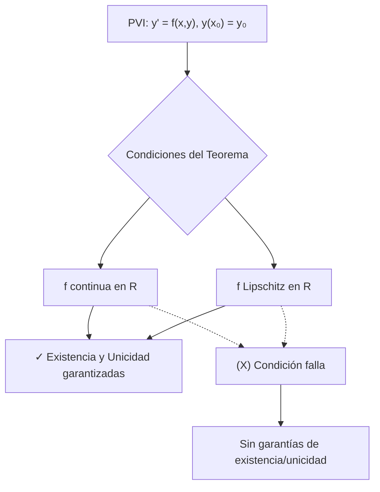

# Matemáticas para Ciencias Aplicadas IV - Existencia y unicidad de soluciones

## 2.1 Teorema de existencia y unicidad (sin demostración).

---

En ecuaciones diferenciales, determinar si una solución existe y es única es fundamental antes de intentar resolverlas. El **Teorema de Existencia y Unicidad** proporciona condiciones suficientes para garantizar que un problema de valor inicial (PVI) tiene exactamente una solución.

### Definiciones Básicas

#### Problema de Valor Inicial (PVI)

Un PVI de primer orden tiene la forma:

$$y' = f(x, y), \quad y(x_0) = y_0$$

#### Función Lipschitz

Una función $f(x, y)$ satisface una **condición de Lipschitz** respecto a $y$ en un dominio $D$ si existe una constante $L > 0$ (constante de Lipschitz) tal que:

$$|f(x, y_1) - f(x, y_2)| \leq L |y_1 - y_2|$$

para todo $(x, y_1), (x, y_2) \in D$.

### Teorema de Existencia y Unicidad (Picard-Lindelöf)

#### Enunciado del Teorema

Sea $R$ un rectángulo cerrado en el plano $xy$ definido por:

$$R = \{(x, y): |x - x_0| \leq a, |y - y_0| \leq b\}$$

con $a, b > 0$.

Si:

1. $f(x, y)$ es **continua** en $R$
2. $f(x, y)$ satisface una **condición de Lipschitz** respecto a $y$ en $R$

Entonces, existe un intervalo $|x - x_0| \leq h$ donde $h = \min\left(a, \frac{b}{M}\right)$ con $M = \max_{(x,y) \in R} |f(x, y)|$, y existe **exactamente una solución** $y = \phi(x)$ del problema de valor inicial:

$$y' = f(x, y), \quad y(x_0) = y_0$$

#### Diagrama Conceptual



### Condición más Fácil de Verificar

#### Teorema (Condición de Lipschitz con Derivada Parcial)

Si $\frac{\partial f}{\partial y}$ existe y es **continua** en $R$, entonces $f$ satisface una condición de Lipschitz en $R$.

### Ejemplos

#### Ejemplo 1: Existencia y Unicidad Garantizada

Considere el PVI:

$$y' = x^2 + y^2, \quad y(0) = 1$$

**Análisis:**

- $f(x, y) = x^2 + y^2$ es continua en todo $\mathbb{R}^2$
- $\frac{\partial f}{\partial y} = 2y$ es continua en todo $\mathbb{R}^2$
- **Conclusión:** Existe una única solución en algún intervalo alrededor de $x = 0$

#### Ejemplo 2: Unicidad no Garantizada

Considere el PVI:

$$y' = y^{1/3}, \quad y(0) = 0$$

**Análisis:**

- $f(x, y) = y^{1/3}$ es continua en todo $\mathbb{R}^2$
- $\frac{\partial f}{\partial y} = \frac{1}{3}y^{-2/3}$ no es continua en $y = 0$
- **Conclusión:** La solución existe pero **no es única**
- De hecho, tanto $y = 0$ como $y = \left(\frac{2x}{3}\right)^{3/2}$ son soluciones

### Aplicación con Python

```python
import numpy as np
import matplotlib.pyplot as plt
from scipy.integrate import solve_ivp

# Ejemplo: y' = x² + y², y(0) = 1
def ecuacion_diferencial(x, y):
    return x**2 + y**2

# Resolver numéricamente
solucion = solve_ivp(ecuacion_diferencial,
                    [0, 0.5],  # Intervalo [x₀, x_final]
                    [1],       # Condición inicial y(0)=1
                    method='RK45',
                    dense_output=True)

# Graficar
x_vals = np.linspace(0, 0.5, 100)
y_vals = solucion.sol(x_vals)[0]

plt.figure(figsize=(10, 6))
plt.plot(x_vals, y_vals, 'b-', linewidth=2, label='Solución única')
plt.xlabel('x')
plt.ylabel('y')
plt.title('Solución de $y\' = x^2 + y^2$, $y(0) = 1$')
plt.legend()
plt.grid(True)
plt.show()
```

### Ejercicios Propuestos

#### Ejercicio 1

Determine si el teorema garantiza existencia y unicidad para:

$$y' = \sqrt{x + y}, \quad y(1) = 2$$

#### Ejercicio 2

Analice el PVI:

$$y' = \frac{1}{x - 2}y + x, \quad y(0) = 1$$

¿En qué intervalo está garantizada la existencia y unicidad?

#### Ejercicio 3

Muestre que $f(x, y) = \frac{y}{x}$ satisface una condición de Lipschitz en cualquier rectángulo que no contenga puntos con $x = 0$.

#### Ejercicio 4

Para el PVI:

$$y' = \ln|y - 1|, \quad y(0) = 2$$

Determine si existe un intervalo alrededor de $x = 0$ donde la solución sea única.

#### Ejercicio 5

Implemente en Python una función que verifique las condiciones del teorema para un PVI dado.

### Casos Especiales y Limitaciones

#### Cuando el Teorema no Aplica

El teorema proporciona condiciones **suficientes pero no necesarias**. Una ecuación puede tener solución única incluso si no se satisfacen todas las condiciones.

#### Extensión de Soluciones

Las soluciones pueden extenderse más allá del intervalo inicial mientras permanezcan acotadas y $f$ mantenga sus propiedades.

### Referencias

#### Bibliografía Básica

1. **Boice, W., DiPrima, R.** (2004). _Elementary Differential Equations and Boundary Value Problems_. Wiley. (Capítulo 2)
2. **Edwards, C. H., Penney, D. E.** (2002). _Ecuaciones diferenciales elementales y problemas con condiciones a la frontera_. Prentice Hall. (Sección 2.4)

#### Bibliografía Complementaria

1. **Hubbard, J. H., West, B. H.** (1995). _Differential Equations: A Dynamical Systems Approach_. Springer-Verlag. (Capítulo 4)
2. **Zill, D. G., Wright, W. S.** (1995). _Differential Equations with Computer Lab Experiments_. PWS Publishing. (Sección 2.8)

### Resumen de Fórmulas

| Concepto                | Fórmula                                                          |
| ----------------------- | ---------------------------------------------------------------- |
| PVI                     | $y' = f(x, y), \quad y(x_0) = y_0$                               |
| Condición de Lipschitz  | $ \|f(x, y_1) - f(x, y_2)\| \leq L \|y_1 - y_2\|$                |
| Intervalo de existencia | $\|x - x_0\| \leq h$ donde $h = \min\left(a, \frac{b}{M}\right)$ |
| Cota de la derivada     | $M = \max_{(x,y) \in R} \|f(x, y)\|$                             |
