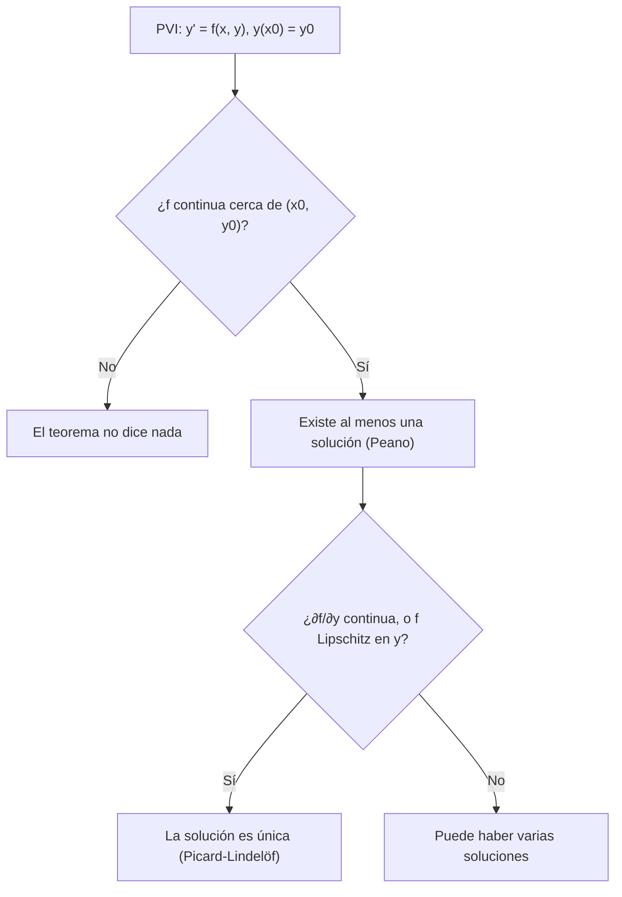

# Matemáticas para Ciencias Aplicadas IV - Existencia y unicidad de soluciones

## 2.1 Teorema de existencia y unicidad (sin demostración).

---

La mayoría de las ecuaciones diferenciales no se pueden resolver con fórmulas. Antes de calcular, numéricamente o con un modelo, conviene saber si el problema **tiene** solución y si es **única**: un modelo físico con dos soluciones distintas para las mismas condiciones iniciales no predice nada, y un método numérico aplicado a un problema sin solución produce números sin sentido. El teorema de existencia y unicidad da condiciones sencillas que garantizan ambas cosas. Este tema lo enuncia, explica la idea de su demostración (las iteraciones de Picard) y analiza qué pasa cuando sus hipótesis fallan.

### El problema de valor inicial

$$ y' = f(x, y), \qquad y(x_0) = y_0 $$

**Forma integral.** Integrando de $x_0$ a $x,$ una función continua $y$ es solución del PVI si y solo si satisface

$$ y(x) = y_0 + \int_{x_0}^{x} f(s, y(s))\, ds $$

Esta reformulación es la clave: transforma el problema en buscar un **punto fijo** de un operador integral.

### Condición de Lipschitz

**Definición.** $f$ es **Lipschitz** respecto a $y$ en una región $R$ si existe $L$ tal que

$$ |f(x, y_1) - f(x, y_2)| \leq L\, |y_1 - y_2| \quad \text{para todos } (x, y_1), (x, y_2) \in R $$

Es más que continuidad y menos que derivabilidad: limita qué tan rápido cambia $f$ con $y.$

**Proposición.** Si $\partial f / \partial y$ es continua en un rectángulo cerrado $R,$ entonces $f$ es Lipschitz respecto a $y$ en $R,$ con $L = \max_R |\partial f / \partial y|.$

**Demostración.** Por el teorema del valor medio, $f(x, y_1) - f(x, y_2) = \frac{\partial f}{\partial y}(x, \xi)\, (y_1 - y_2)$ para algún $\xi$ entre $y_1$ y $y_2,$ y $|\partial f / \partial y| \leq L$ en $R,$ que es compacto. $\blacksquare$

**Ejemplos.** $f = y^2$ es Lipschitz en cualquier rectángulo acotado, con $L = 2\max |y|,$ pero no en todo el plano. $f = |y|$ es Lipschitz con $L = 1$ aunque no es derivable en 0. $f = y^{1/3}$ no es Lipschitz cerca de $y = 0,$ porque $|f(x, y) - f(x, 0)|/|y| = |y|^{-2/3}$ no está acotado.

### El teorema

**Teorema (Picard-Lindelöf).** Sea $R = \{(x, y) : |x - x_0| \leq a,\ |y - y_0| \leq b\}.$ Si $f$ es continua en $R$ y Lipschitz respecto a $y$ en $R,$ y $M = \max_R |f|,$ entonces el PVI tiene **exactamente una** solución en el intervalo $|x - x_0| \leq h,$ con

$$ h = \min\left( a, \frac{b}{M} \right) $$

**Versión práctica.** Si $f$ y $\partial f / \partial y$ son continuas en un rectángulo abierto que contiene a $(x_0, y_0),$ el PVI tiene una única solución en algún intervalo alrededor de $x_0.$

**Teorema de Peano.** Si $f$ solo es continua, sigue existiendo al menos una solución, pero puede no ser única.

**El significado del intervalo garantizado.** La solución no puede salir del rectángulo por arriba o por abajo antes de $x_0 \pm b/M,$ porque su pendiente está acotada por $M.$ Por eso el intervalo garantizado puede ser mucho más pequeño que el rectángulo.



### La idea de la demostración: iteraciones de Picard

Se parte de $\phi_0(x) = y_0$ y se itera la forma integral:

$$ \phi_{k + 1}(x) = y_0 + \int_{x_0}^{x} f(s, \phi_k(s))\, ds $$

La condición de Lipschitz implica, por inducción, $|\phi_{k + 1}(x) - \phi_k(x)| \leq \frac{M L^k |x - x_0|^{k + 1}}{(k + 1)!},$ así que la serie $\sum (\phi_{k + 1} - \phi_k)$ converge uniformemente, como la de la exponencial, a una función continua $\phi$ que satisface la forma integral. Para la unicidad, si $\phi$ y $\psi$ son dos soluciones, $|\phi - \psi|$ satisface $u(x) \leq L \int_{x_0}^{x} u(s)\, ds,$ y la **desigualdad de Gronwall** obliga a $u = 0.$

**Ejemplo.** Para $y' = y,$ $y(0) = 1:$ $\phi_1 = 1 + x,$ $\phi_2 = 1 + x + x^2/2,$ y en general $\phi_k$ es el polinomio de Taylor de grado $k$ de $e^x.$ Las iteraciones construyen la solución.

### Cuando las hipótesis fallan

**Falta de unicidad.** $y' = y^{1/3},$ $y(0) = 0.$ $f$ es continua, pero $\partial f / \partial y = \frac{1}{3} y^{-2/3}$ no está definida en $y = 0.$ Son soluciones $y = 0,$ $y = \left( \frac{2x}{3} \right)^{3/2}$ para $x \geq 0$ (y 0 antes), y también cualquier función que valga 0 hasta un $c > 0$ y luego $\left( \frac{2(x - c)}{3} \right)^{3/2}:$ hay **infinitas**. Físicamente, el sistema puede "decidir" en cualquier momento abandonar el equilibrio.

**Intervalo de existencia.** El teorema es **local**. Para $y' = x^2 + y^2,$ $y(0) = 1,$ las hipótesis se cumplen en todo el plano, pero la solución explota cerca de $x \approx 0.97$ (comparar con $y' = y^2,$ tema 1.3). La solución se puede extender mientras permanezca en la región donde valen las hipótesis; si deja de existir en un punto finito, es porque se vuelve no acotada o se acerca a la frontera de la región. Para las ecuaciones **lineales** con coeficientes continuos en $I,$ la solución existe en todo $I$ (tema 1.2).

**Las curvas integrales no se cruzan.** Si dos soluciones coinciden en un punto donde valen las hipótesis, coinciden en un intervalo: dos curvas integrales distintas no pueden tocarse. Por ejemplo, una solución de la logística que empieza entre 0 y 1 nunca puede alcanzar los equilibrios $y = 0$ ni $y = 1$ en tiempo finito.

### Implementación en Python

El programa calcula iteraciones de Picard con SymPy, busca el mejor intervalo garantizado $h = \min(a, b/M)$ para $y' = x^2 + y^2,$ $y(0) = 1,$ variando el rectángulo, y compara con el punto donde la solución numérica explota. También verifica dos soluciones distintas de $y' = y^{1/3}$ y revisa las hipótesis en los ejercicios.

```python
import sympy as sp
import numpy as np
from scipy.integrate import solve_ivp

x, s = sp.symbols('x s')

def picard(f, x0, y0, n):
    """Iteraciones de Picard: φ_{k+1}(x) = y0 + ∫_{x0}^{x} f(s, φ_k(s)) ds."""
    phi = sp.Integer(y0)
    for _ in range(n):
        phi = sp.expand(y0 + sp.integrate(f(s, phi.subs(x, s)), (s, x0, x)))
    return phi

print('y\' = y, y(0) = 1:')
for n in range(1, 5):
    print(f'   φ{n} =', picard(lambda s, y: y, 0, 1, n))
print('y\' = x² + y², y(0) = 1, tercera iteración (términos hasta x^4):')
print('   ', sp.series(picard(lambda s, y: s**2 + y**2, 0, 1, 3), x, 0, 5).removeO())

# Intervalo garantizado h = min(a, b/M) para y' = x² + y², y(0) = 1 en |x| ≤ a, |y - 1| ≤ b
mejor = max(((min(a, b / (a**2 + (1 + b)**2)), a, b)
             for a in np.linspace(0.05, 2, 40) for b in np.linspace(0.05, 5, 100)))
print(f'mejor h = {mejor[0]:.4f} con a = {mejor[1]:.2f}, b = {mejor[2]:.2f}')

# La solución explota: se integra hasta que y es enorme
explota = lambda x, y: y[0] - 1e6
explota.terminal = True
sol = solve_ivp(lambda x, y: x**2 + y**2, [0, 2], [1], events=explota, rtol=1e-10, atol=1e-10)
print(f'la solución supera 10^6 en x ≈ {sol.t_events[0][0]:.4f}')

# No unicidad: y' = y^(1/3), y(0) = 0
t = sp.symbols('t', nonnegative=True)
for phi in [sp.Integer(0), (2 * t / 3)**sp.Rational(3, 2)]:
    print(f'φ = {phi}: residuo', sp.simplify(phi.diff(t) - phi**sp.Rational(1, 3)))

# Ejercicios: continuidad de f y de ∂f/∂y en el punto inicial
X, Y = sp.symbols('X Y', real=True)
casos = {'√(x + y), (1, 2)': (sp.sqrt(X + Y), 1, 2),
         'y/(x - 2) + x, (0, 1)': (Y / (X - 2) + X, 0, 1),
         'ln(y - 1), (0, 2)': (sp.log(Y - 1), 0, 2),
         'y^(1/3), (0, 0)': (Y**sp.Rational(1, 3), 0, 0)}
for nombre, (f, a, b) in casos.items():
    df = sp.diff(f, Y)
    print(f'{nombre:24} ∂f/∂y = {df},  en el punto: {df.subs({X: a, Y: b})}')
```

Salida:

```text
y' = y, y(0) = 1:
   φ1 = x + 1
   φ2 = x**2/2 + x + 1
   φ3 = x**3/6 + x**2/2 + x + 1
   φ4 = x**4/24 + x**3/6 + x**2/2 + x + 1
y' = x² + y², y(0) = 1, tercera iteración (términos hasta x^4):
    5*x**4/6 + 4*x**3/3 + x**2 + x + 1
mejor h = 0.2462 con a = 0.25, b = 1.05
la solución supera 10^6 en x ≈ 0.9698
φ = 0: residuo 0
φ = 2*sqrt(6)*t**(3/2)/9: residuo 0
√(x + y), (1, 2)         ∂f/∂y = 1/(2*sqrt(X + Y)),  en el punto: sqrt(3)/6
y/(x - 2) + x, (0, 1)    ∂f/∂y = 1/(X - 2),  en el punto: -1/2
ln(y - 1), (0, 2)        ∂f/∂y = 1/(Y - 1),  en el punto: 1
y^(1/3), (0, 0)          ∂f/∂y = 1/(3*Y**(2/3)),  en el punto: zoo
```

El teorema solo garantiza la solución en $|x| \leq 0.246,$ mientras que existe hasta $x \approx 0.97:$ la estimación es conservadora, pero honesta. El valor `zoo` (infinito complejo de SymPy) indica que $\partial f / \partial y$ no está definida en el último caso.

### Ejercicios Propuestos

1. **Raíz.** ¿Garantiza el teorema existencia y unicidad para $y' = \sqrt{x + y},$ $y(1) = 2?$ ¿Y para $y(1) = -1?$

2. **Lineal.** Para $y' = \frac{y}{x - 2} + x,$ $y(0) = 1,$ ¿en qué intervalo está garantizada la solución?

3. **Lipschitz.** Demuestra que $f(x, y) = y/x$ es Lipschitz en $y$ en cualquier rectángulo que no toque la recta $x = 0.$

4. **Logaritmo.** ¿Tiene solución única $y' = \ln |y - 1|,$ $y(0) = 2?$ ¿Y con $y(0) = 1?$

5. **Picard.** Calcula las tres primeras iteraciones de Picard para $y' = 2xy,$ $y(0) = 1,$ y reconoce la solución.

6. **No unicidad.** Encuentra dos soluciones distintas de $y' = 2\sqrt{|y|},$ $y(0) = 0.$

### Soluciones

**Ejercicio 1.** En $(1, 2),$ $x + y = 3 > 0,$ así que $\sqrt{x + y}$ y $\frac{1}{2\sqrt{x + y}}$ son continuas cerca: hay solución única. En $(1, -1),$ $x + y = 0$ y $f$ no está definida a la izquierda de la recta $x + y = 0$ ni su derivada en ella: el teorema no se aplica.

**Ejercicio 2.** Es lineal con coeficientes continuos salvo en $x = 2.$ El intervalo que contiene a $x_0 = 0$ es $(-\infty, 2),$ y ahí la solución existe y es única (tema 1.2).

**Ejercicio 3.** Si en el rectángulo $|x| \geq \delta > 0,$ entonces $|y_1/x - y_2/x| \leq \frac{1}{\delta} |y_1 - y_2|:$ es Lipschitz con $L = 1/\delta.$

**Ejercicio 4.** Cerca de $(0, 2),$ $f = \ln(y - 1)$ y $\partial f / \partial y = 1/(y - 1)$ son continuas: solución única. Con $y(0) = 1,$ $f$ no está definida en $y = 1,$ donde el logaritmo tiende a $-\infty:$ el teorema no se aplica.

**Ejercicio 5.** $\phi_1 = 1 + x^2,$ $\phi_2 = 1 + x^2 + x^4/2,$ $\phi_3 = 1 + x^2 + x^4/2 + x^6/6.$ Son los polinomios de Taylor de $e^{x^2},$ que es la solución.

**Ejercicio 6.** $y = 0$ y la función que vale $x^2$ para $x \geq 0$ y $0$ para $x \lt 0.$ Para $x \geq 0,$ $y' = 2x = 2\sqrt{x^2}.$ La función $\sqrt{|y|}$ no es Lipschitz cerca de 0.

### Referencias

1. Boyce, W. E., DiPrima, R. C., and Meade, D. B., _Elementary Differential Equations and Boundary Value Problems_. Wiley, 2017. Secciones 2.4 y 2.8.
2. Edwards, C. H., and Penney, D. E., _Ecuaciones diferenciales y problemas con valores en la frontera_. Pearson, 2009. Sección 1.3 y apéndice A.
3. Hubbard, J. H., and West, B. H., _Differential Equations: A Dynamical Systems Approach_. Springer, 1991. Capítulo 4.
4. Coddington, E. A., _An Introduction to Ordinary Differential Equations_. Dover, 1989. Capítulo 5.
