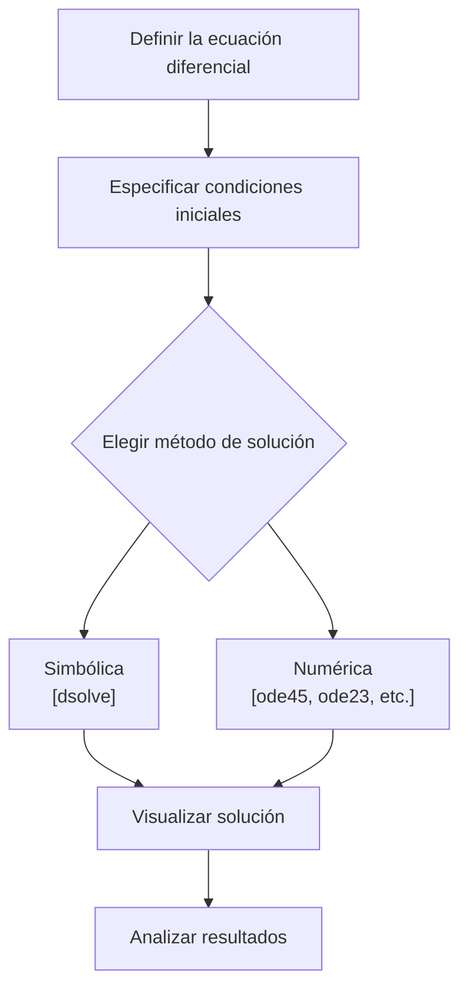

# Matemáticas para Ciencias Aplicadas IV - Existencia y unicidad de soluciones

## 2.2 Introducción a Matlab.

---

MATLAB (MATrix LABoratory) es un entorno de computación técnica y lenguaje de programación ampliamente utilizado en ciencias aplicadas e ingeniería. Es especialmente útil para resolver ecuaciones diferenciales numéricamente y visualizar sus soluciones.

### Conceptos Básicos de MATLAB

#### Interfaz y Comandos Fundamentales

MATLAB tiene una interfaz que incluye:

- **Command Window**: Para ejecutar comandos directamente
- **Editor**: Para crear y modificar scripts (archivos .m)
- **Workspace**: Muestra variables actuales
- **Current Folder**: Navegador de archivos

#### Sintaxis Básica

```matlab
% Esto es un comentario
x = 5;          % Asignación de variable (punto y coma suprime salida)
y = sin(pi/2);  % Función matemática
A = [1 2; 3 4]; % Definición de matriz
```

#### Funciones Matemáticas Esenciales

| Función             | Descripción                  | Ejemplo     |
| ------------------- | ---------------------------- | ----------- |
| `sin`, `cos`, `tan` | Funciones trigonométricas    | `sin(pi/2)` |
| `exp`               | Exponencial                  | `exp(1)`    |
| `log`, `log10`      | Logaritmos natural y base 10 | `log(10)`   |
| `sqrt`              | Raíz cuadrada                | `sqrt(25)`  |

### Resolución de Ecuaciones Diferenciales en MATLAB

#### Función `dsolve` para Soluciones Simbólicas

```matlab
% Resolver y' = y
syms y(t)
eqn = diff(y,t) == y;
cond = y(0) == 1;
sol = dsolve(eqn, cond)
```

#### Función `ode45` para Soluciones Numéricas

```matlab
% Definir la ecuación diferencial
function dydt = myODE(t, y)
    dydt = t^2 + y^2;  % y' = t² + y²
end

% Resolver numéricamente
[t, y] = ode45(@myODE, [0 1], 0);  % Intervalo [0,1], condición inicial y(0)=0

% Graficar
plot(t, y)
xlabel('t')
ylabel('y(t)')
title('Solución de y'' = t^2 + y^2')
```

### Visualización de Soluciones

#### Diagrama de Flujo para Resolución de PVI



#### Gráficas Avanzadas

```matlab
% Campo de direcciones y solución
[t, y] = meshgrid(-2:0.2:2, -2:0.2:2);
dy = t.^2 + y.^2;
dt = ones(size(dy));

% Normalizar flechas
L = sqrt(dt.^2 + dy.^2);
dyu = dy./L;
dtu = dt./L;

% Graficar campo de direcciones
quiver(t, y, dtu, dyu, 0.5, 'r')
hold on

% Graficar solución particular
[t_sol, y_sol] = ode45(@(t,y) t^2 + y^2, [0 1], 0);
plot(t_sol, y_sol, 'b-', 'LineWidth', 2)

xlabel('t')
ylabel('y')
title('Campo de direcciones y solución')
legend('Campo de direcciones', 'Solución')
hold off
```

### Ejemplos Resueltos

#### Ejemplo 1: Ecuación Lineal

Resolver y graficar: $y' = -2y + 3,$ con $y(0) = 1$

```matlab
% Solución numérica
f = @(t, y) -2*y + 3;
[t, y] = ode45(f, [0 3], 1);

% Solución analítica para comparación
y_analitica = 1.5 - 0.5*exp(-2*t);

% Graficar ambas soluciones
plot(t, y, 'b-', t, y_analitica, 'ro')
legend('Solución numérica', 'Solución analítica')
title('Comparación de soluciones: y'' = -2y + 3')
```

#### Ejemplo 2: Sistema de Ecuaciones

Resolver el sistema:

$$\frac{dx}{dt} = y, \quad \frac{dy}{dt} = -x$$

con condiciones iniciales $x(0) = 0,$ $y(0) = 1$

```matlab
function dydt = sistema(t, Y)
    % Y = [x; y]
    dydt = [Y(2);     % dx/dt = y
            -Y(1)];   % dy/dt = -x
end

[t, Y] = ode45(@sistema, [0 10], [0; 1]);
plot(t, Y(:,1), t, Y(:,2))
legend('x(t)', 'y(t)')
title('Solución del sistema: dx/dt = y, dy/dt = -x')
```

### Ejercicios Propuestos

#### Ejercicio 1

Implemente en MATLAB la solución de:

$$y' = \frac{y}{x} + x^2, \quad y(1) = 2$$

para $x \in [1, 3].$ Grafique la solución.

#### Ejercicio 2

Resuelva numéricamente y grafique la ecuación logística:

$$\frac{dP}{dt} = rP\left(1 - \frac{P}{K}\right)$$

con $r = 0.5,$ $K = 100,$ y $P(0) = 10$ para $t \in [0, 20].$

#### Ejercicio 3

Para el sistema:

$$\frac{dx}{dt} = x - y, \quad \frac{dy}{dt} = x + y$$

con $x(0) = 1,$ $y(0) = 0:$
a) Resuelva numéricamente para $t \in [0, 5]$
b) Grafique $x$ vs $t$ y $y$ vs $t$ en la misma figura
c) Grafique $y$ vs $x$ (plano fase)

#### Ejercicio 4

Implemente una función que reciba una ecuación diferencial, condiciones iniciales e intervalo, y devuelva la solución numérica y gráfica.

#### Ejercicio 5

Investigue cómo usar las funciones `ode23` y `ode113` y compare sus resultados con `ode45` para la ecuación:

$$y' = -10y, \quad y(0) = 1$$

en el intervalo $[0, 5].$

#### Recursos Adicionales

- Documentación oficial de MATLAB: `doc ode45`
- Tutoriales interactivos de MathWorks
- MATLAB Onramp (curso introductorio gratuito)

### Consejos para Trabajar con MATLAB

1. **Scripts y funciones**: Organice su código en archivos .m
2. **Debugging**: Use puntos de interrupción y la herramienta debug
3. **Vectorización**: Evite bucles cuando sea posible
4. **Help**: Use `help [función]` o `doc [función]` para obtener ayuda
5. **Precisión**: Para problemas stiff, considere usar `ode15s` en lugar de `ode45`

### Referencias

#### Bibliografía Básica

1. **Boice, W., DiPrima, R.** (2004). _Elementary Differential Equations and Boundary Value Problems_. Wiley. (Apéndice sobre MATLAB)
2. **Edwards, C. H., Penney, D. E.** (2002). _Ecuaciones diferenciales elementales y problemas con condiciones a la frontera_. Prentice Hall. (Capítulo sobre métodos numéricos)

#### Bibliografía Complementaria

1. **Cooper, J. M.** (1998). _Introduction to Partial Differential Equations with MATLAB_. Birkhäuser. (Excelente recurso específico para PDEs con MATLAB)
2. **Zill, D. G., Wright, W. S.** (1995). _Differential Equations with Computer Lab Experiments_. PWS Publishing Company. (Ejercicios prácticos con software)
