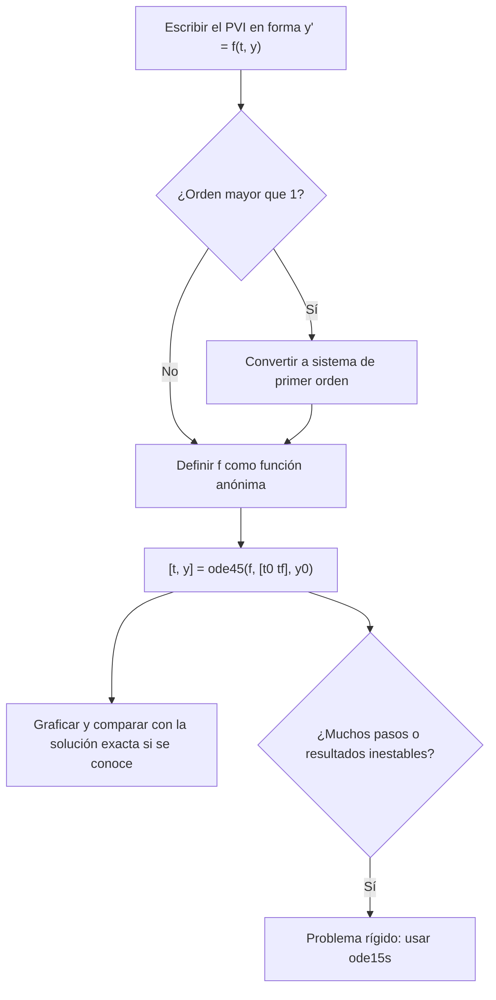

# Matemáticas para Ciencias Aplicadas IV - Existencia y unicidad de soluciones

## 2.2 Introducción a Matlab.

---

**MATLAB** (de *MATrix LABoratory*, creado por Cleve Moler a fines de los años setenta) es un lenguaje y entorno para cálculo numérico basado en matrices. Es una herramienta estándar en ingeniería para resolver ecuaciones diferenciales, porque incluye integradores numéricos robustos y facilidades para graficar. **GNU Octave** es una alternativa libre con sintaxis prácticamente idéntica; todos los ejemplos de este tema se ejecutaron en Octave 8 y funcionan igual en MATLAB. Este tema presenta lo indispensable del lenguaje y su uso para resolver problemas de valor inicial.

### El entorno

- La **ventana de comandos** ejecuta instrucciones una por una y muestra el resultado. Un punto y coma al final suprime la salida.
- Un **script** es un archivo `.m` con instrucciones; se ejecuta escribiendo su nombre.
- Una **función** es un archivo `.m` que empieza con `function`; en versiones recientes también se pueden definir al final de un script.
- `help nombre` y `doc nombre` muestran la documentación. El **espacio de trabajo** guarda las variables definidas.

### Lo básico del lenguaje

**Todo es una matriz.** Un número es una matriz de $1 \times 1;$ un vector, de $1 \times n$ o $n \times 1.$

| Instrucción | Resultado |
| --- | --- |
| `v = [1 2 3]` | vector fila |
| `w = [1; 2; 3]` | vector columna |
| `A = [2 1; 1 3]` | matriz de $2 \times 2$ |
| `0:0.1:1` | de 0 a 1 con paso 0.1 |
| `linspace(0, 1, 5)` | 5 puntos equiespaciados de 0 a 1 |
| `A'` | transpuesta |
| `A \ b` | solución de $A x = b$ |
| `A(2, 1)`, `v(end)` | elementos (los índices empiezan en 1) |

**Operaciones elemento a elemento.** `*`, `/` y `^` son operaciones **matriciales**; con punto, `.*`, `./` y `.^`, operan elemento a elemento. Para evaluar $x^2$ en un vector se escribe `x.^2`; escribir `x^2` intenta multiplicar la matriz por sí misma y falla si no es cuadrada. Es el error más común de quien empieza.

**Funciones anónimas.** `f = @(t, y) -2*y + 3` define una función de dos argumentos sin necesidad de un archivo. Es la forma usual de pasar una ecuación diferencial a un integrador.

**Control de flujo.** `for k = 1:n ... end`, `while condicion ... end` e `if ... elseif ... else ... end`, como en otros lenguajes. Siempre que sea posible conviene **vectorizar**, es decir, operar con vectores completos en lugar de ciclos.

**Gráficas.** `plot(t, y)` dibuja una curva; `hold on` permite superponer varias; `xlabel`, `ylabel`, `title` y `legend` las rotulan; `quiver(X, Y, U, V)` dibuja un campo de vectores, útil para campos de direcciones (tema 1.1), con `meshgrid` para generar la malla.

### Ecuaciones diferenciales con ode45

`[t, y] = ode45(f, [t0 tf], y0)` resuelve $y' = f(t, y),$ $y(t_0) = y_0$ en $[t_0, t_f].$ Devuelve un vector de tiempos `t` y los valores `y` en esos tiempos, que el integrador elige automáticamente: usa un método de Runge-Kutta de órdenes 4 y 5 (Dormand-Prince) y ajusta el paso para mantener el error bajo una tolerancia (tema 2.3). Las tolerancias se cambian con `odeset('RelTol', 1e-8, 'AbsTol', 1e-10)`.

**Sistemas.** Para un sistema, `y0` es un vector columna y `f` devuelve un vector columna. Una ecuación de segundo orden se convierte en sistema: $x'' = -x$ es $x' = v,$ $v' = -x,$ y se escribe `@(t, Y) [Y(2); -Y(1)]`. En la salida, cada columna de `Y` es una componente.

**Otros integradores.** `ode23` usa órdenes 2 y 3 (más barato y menos preciso); `ode15s` y `ode23s` son para problemas **rígidos**, en los que hay escalas de tiempo muy distintas y los métodos explícitos necesitan pasos minúsculos para no volverse inestables.

**Cálculo simbólico.** Con el Symbolic Math Toolbox de MATLAB, o el paquete `symbolic` de Octave, `syms y(t)` y `dsolve(diff(y, t) == -2*y + 3, y(0) == 1)` dan la solución exacta, como `dsolve` de SymPy (tema 1.1).



### Un script completo

El script siguiente recorre las ideas del tema: operaciones con matrices y vectores, una función anónima con un ciclo que implementa el método de Euler, `ode45` para una ecuación lineal y los ejercicios, un sistema, la comparación de integradores y la solución simbólica. Cada resultado numérico se compara con la solución exacta.

```matlab
% ---------- Vectores, matrices y operaciones elemento a elemento ----------
x = linspace(0, 1, 5)            % 5 puntos equiespaciados entre 0 y 1
A = [2 1; 1 3];
b = [3; 5];
sol = A \ b                      % resuelve A*sol = b
cuadrados = x.^2                 % .^ opera elemento a elemento; ^ sería potencia de matrices

% ---------- Funciones anónimas y ciclos ----------
f = @(t, y) -2*y + 3;            % y' = -2y + 3
h = 0.1; t = 0; y = 1;
for k = 1:10                     % método de Euler hasta t = 1
  y = y + h*f(t, y);
  t = t + h;
end
fprintf('Euler en t = 1: %.6f   exacta: %.6f\n', y, 1.5 - 0.5*exp(-2));

% ---------- ode45: solución numérica ----------
[t, y] = ode45(f, [0 3], 1);
fprintf('ode45 en t = 3: %.6f   exacta: %.6f   puntos: %d\n', y(end), 1.5 - 0.5*exp(-6), numel(t) - 1);

% Ejercicio 1: y' = y/x + x^2, y(1) = 2; la solución exacta es y = x^3/2 + 3x/2
opciones = odeset('RelTol', 1e-8, 'AbsTol', 1e-10);
[x1, y1] = ode45(@(x, y) y/x + x^2, [1 3], 2, opciones);
fprintf('ejercicio 1: y(3) = %.6f   exacta: %.6f\n', y1(end), 3^3/2 + 3*3/2);

% Ejercicio 2: logística con r = 0.5, K = 100, P(0) = 10
[t2, P] = ode45(@(t, P) 0.5*P*(1 - P/100), [0 20], 10, opciones);
fprintf('ejercicio 2: P(20) = %.4f   exacta: %.4f\n', P(end), 100*10/(10 + 90*exp(-10)));

% Ejemplo y ejercicio 3: sistemas, con el estado como vector columna
[t3, Y] = ode45(@(t, Y) [Y(2); -Y(1)], [0 10], [0; 1], opciones);
fprintf('oscilador en t = 10: x = %.6f (sin 10 = %.6f)\n', Y(end, 1), sin(10));
[t4, Z] = ode45(@(t, Z) [Z(1) - Z(2); Z(1) + Z(2)], [0 5], [1; 0], opciones);
fprintf('ejercicio 3 en t = 5: x = %.4f, y = %.4f  (exactas %.4f, %.4f)\n', ...
       Z(end, 1), Z(end, 2), exp(5)*cos(5), exp(5)*sin(5));

% Ejercicio 5: y' = -10y con distintos métodos
for metodo = {@ode45, @ode23}
  [t5, y5] = metodo{1}(@(t, y) -10*y, [0 5], 1);
  fprintf('%s: %3d puntos, y(5) = %.3e (exacta %.3e)\n', func2str(metodo{1}), numel(t5) - 1, y5(end), exp(-50));
end

% ---------- Cálculo simbólico (paquete symbolic de Octave; Symbolic Math Toolbox en MATLAB) ----------
pkg load symbolic
syms y(t)
s = dsolve(diff(y, t) == -2*y + 3, y(0) == 1)
```

Salida en Octave:

```text
x =
        0   0.2500   0.5000   0.7500   1.0000
sol =
   0.8000
   1.4000
cuadrados =
        0   0.0625   0.2500   0.5625   1.0000
Euler en t = 1: 1.446313   exacta: 1.432332
ode45 en t = 3: 1.498760   exacta: 1.498761   puntos: 52
ejercicio 1: y(3) = 18.000000   exacta: 18.000000
ejercicio 2: P(20) = 99.9592   exacta: 99.9592
oscilador en t = 10: x = -0.544021 (sin 10 = -0.544021)
ejercicio 3 en t = 5: x = 42.0992, y = -142.3170  (exactas 42.0992, -142.3170)
ode45: 104 puntos, y(5) = 7.195e-07 (exacta 1.929e-22)
ode23:  49 puntos, y(5) = -2.614e-07 (exacta 1.929e-22)
s = (sym)
       -2⋅t
  3   ℯ    
  ─ - ─────
  2     2  
```

Con un paso de 0.1, el método de Euler comete un error de 0.014, mientras que `ode45` coincide con la solución exacta en seis cifras. En $y' = -10y,$ ambos integradores dan valores del orden de $10^{-7}$ en lugar de $10^{-22}:$ el error absoluto está controlado por `AbsTol`, que por defecto vale $10^{-6},$ así que valores menores que la tolerancia no son confiables. MATLAB elige otros puntos de salida, así que el número de puntos puede variar ligeramente.

### Ejercicios Propuestos

1. **Lineal.** Resuelve con `ode45` el problema $y' = y/x + x^2,$ $y(1) = 2$ en $[1, 3]$ y compara con la solución exacta.

2. **Logística.** Resuelve $P' = rP(1 - P/K)$ con $r = 0.5,$ $K = 100$ y $P(0) = 10$ en $[0, 20].$

3. **Sistema.** Resuelve $x' = x - y,$ $y' = x + y,$ con $x(0) = 1,$ $y(0) = 0,$ en $[0, 5].$ Grafica $x$ y $y$ contra $t$ y la trayectoria en el plano $(x, y).$

4. **Función propia.** Escribe una función `[t, y] = resolver(f, intervalo, y0)` que llame a `ode45`, grafique la solución y la devuelva.

5. **Rigidez.** Compara `ode45` y `ode23` en $y' = -10y,$ $y(0) = 1,$ en $[0, 5],$ y prueba `ode15s`.

6. **Euler vectorizado.** ¿Por qué no se puede vectorizar el ciclo del método de Euler del script?

### Soluciones

**Ejercicio 1.** Es lineal: $y' - y/x = x^2,$ con factor integrante $1/x:$ $(y/x)' = x,$ así que $y = x^3/2 + Cx,$ y $y(1) = 2$ da $C = 3/2.$ En $x = 3,$ $y = 18,$ que es lo que da `ode45`.

**Ejercicio 2.** $P(t) = \frac{1000}{10 + 90 e^{-t/2}},$ y $P(20) \approx 99.959.$ El script lo confirma.

**Ejercicio 3.** La solución exacta es $x = e^t \cos t,$ $y = e^t \sin t,$ que se verifica derivando. En el plano $(x, y)$ es una **espiral** que se aleja del origen (tema 5.3). Las gráficas se obtienen con `plot(t4, Z(:,1), t4, Z(:,2))` y `plot(Z(:,1), Z(:,2))`.

**Ejercicio 4.**

```matlab
function [t, y] = resolver(f, intervalo, y0)
  [t, y] = ode45(f, intervalo, y0);
  plot(t, y);
  xlabel('t'); ylabel('y'); grid on;
end
```

**Ejercicio 5.** La solución decae muy rápido y luego es casi cero; los métodos explícitos siguen dando pasos limitados por la estabilidad, no por la precisión. `ode15s`, implícito, da pasos mucho más grandes una vez que la solución es plana. Para $y' = -10y$ la rigidez es leve. Con $y' = -1000(y - \cos t)$ en $[0, 5]$ la diferencia es dramática: un Runge-Kutta explícito con control de paso necesita unos 1500 pasos, y un método implícito como `ode15s` (o el método BDF de SciPy, con el que se hizo esta comparación) unas decenas.

**Ejercicio 6.** Cada paso usa el valor calculado en el paso anterior: es una **recurrencia**, y el valor $k$ no se puede calcular sin los anteriores. Lo que sí se vectoriza es la evaluación de la solución exacta en todos los tiempos.

### Referencias

1. Moler, C., _Numerical Computing with MATLAB_. SIAM, 2004. Capítulos 1 y 7. Disponible en mathworks.com/moler.
2. Eaton, J. W., Bateman, D., Hauberg, S., and Wehbring, R., _GNU Octave Manual_. 2023. Disponible en octave.org/doc.
3. Shampine, L. F., and Reichelt, M. W. (1997). The MATLAB ODE suite. _SIAM Journal on Scientific Computing_, 18(1), 1-22.
4. Higham, D. J., and Higham, N. J., _MATLAB Guide_. SIAM, 2017.
