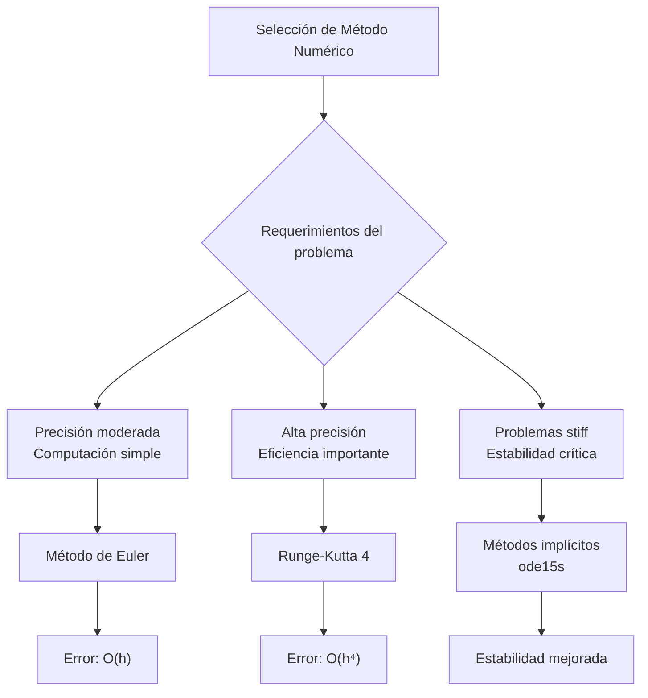

# Matemáticas para Ciencias Aplicadas IV - Existencia y unicidad de soluciones

## 2.3 Métodos Numéricos.

---

Cuando las ecuaciones diferenciales no pueden resolverse analíticamente, los métodos numéricos proporcionan herramientas poderosas para obtener soluciones aproximadas. Estos métodos son esenciales en ciencias aplicadas donde la mayoría de los problemas reales no tienen soluciones cerradas.

### Problema de Valor Inicial (PVI)

Un PVI de primer orden tiene la forma:

$$y' = f(x, y), \quad y(x_0) = y_0$$

Nuestro objetivo es aproximar la solución en puntos $x_0, x_1, ..., x_n$ con $x_{i+1} = x_i + h$, donde $h$ es el tamaño de paso.

### Método de Euler

#### Formulación del Método

El método de Euler es el más simple de los métodos numéricos para resolver PVI:

$$y_{n+1} = y_n + h f(x_n, y_n)$$

donde $h$ es el tamaño de paso.

#### Implementación en MATLAB

```matlab
function [x, y] = euler_method(f, x0, y0, h, x_final)
    % f: función dy/dx = f(x,y)
    % x0, y0: condición inicial
    % h: tamaño de paso
    % x_final: valor final de x

    x = x0:h:x_final;
    n = length(x);
    y = zeros(1, n);
    y(1) = y0;

    for i = 1:n-1
        y(i+1) = y(i) + h * f(x(i), y(i));
    end
end

% Ejemplo de uso
f = @(x, y) x + y;  % y' = x + y
[x, y_euler] = euler_method(f, 0, 1, 0.1, 2);
```

### Métodos de Runge-Kutta

#### Runge-Kutta de Segundo Orden (Método del Punto Medio)

$$y_{n+1} = y_n + h f\left(x_n + \frac{h}{2}, y_n + \frac{h}{2} f(x_n, y_n)\right)$$

#### Runge-Kutta de Cuarto Orden (RK4)

El método RK4 es ampliamente utilizado por su equilibrio entre precisión y eficiencia:

$$ \begin{aligned} k_1 &= h f(x_n, y_n) \\\ k_2 &= h f(x_n + \frac{h}{2}, y_n + \frac{k_1}{2}) \\\ k_3 &= h f(x_n + \frac{h}{2}, y_n + \frac{k_2}{2}) \\\ k_4 &= h f(x_n + h, y_n + k_3) \\\ y_{n+1} &= y_n + \frac{1}{6}(k_1 + 2k_2 + 2k_3 + k_4) \end{aligned} $$

#### Implementación de RK4 en MATLAB

```matlab
function [x, y] = rk4_method(f, x0, y0, h, x_final)
    x = x0:h:x_final;
    n = length(x);
    y = zeros(1, n);
    y(1) = y0;

    for i = 1:n-1
        k1 = h * f(x(i), y(i));
        k2 = h * f(x(i) + h/2, y(i) + k1/2);
        k3 = h * f(x(i) + h/2, y(i) + k2/2);
        k4 = h * f(x(i) + h, y(i) + k3);

        y(i+1) = y(i) + (k1 + 2*k2 + 2*k3 + k4)/6;
    end
end
```

### Análisis de Error

#### Error Local de Truncamiento

El error cometido en un solo paso:

- Euler: $O(h^2)$
- RK2: $O(h^3)$
- RK4: $O(h^5)$

#### Error Global

El error acumulado después de varios pasos:

- Euler: $O(h)$
- RK2: $O(h^2)$
- RK4: $O(h^4)$

### Métodos de Pasos Múltiples

#### Método de Adams-Bashforth (2 pasos)

$$y_{n+2} = y_{n+1} + \frac{h}{2}[3f(x_{n+1}, y_{n+1}) - f(x_n, y_n)]$$

#### Método Predictor-Corrector

Combinación de Adams-Bashforth (predictor) y Adams-Moulton (corrector):

```matlab
% Predictor (Adams-Bashforth de 2 pasos)
y_pred = y(i+1) + h/2 * (3*f(x(i+1), y(i+1)) - f(x(i), y(i)));

% Corrector (Adams-Moulton de 2 pasos)
y_corr = y(i+1) + h/2 * (f(x(i+2), y_pred) + f(x(i+1), y(i+1)));
```

### Comparación de Métodos



### Estabilidad de Métodos Numéricos

#### Ecuación Test

Para analizar estabilidad, consideramos:

$$y' = \lambda y, \quad \text{Re}(\lambda) < 0$$

#### Región de Estabilidad

- Euler: $|1 + h\lambda| \leq 1$
- RK4: Mayor región de estabilidad que Euler

### Ejemplos Resueltos

#### Ejemplo 1: Comparación de Métodos

Resolver $y' = -2y + 3$, $y(0) = 1$ en [0, 2] con diferentes métodos:

```matlab
f = @(x, y) -2*y + 3;
% Solución exacta
y_exact = @(x) 1.5 - 0.5*exp(-2*x);

% Diferentes métodos
h = 0.1;
[x, y_euler] = euler_method(f, 0, 1, h, 2);
[x, y_rk4] = rk4_method(f, 0, 1, h, 2);

% Cálculo de errores
error_euler = max(abs(y_euler - y_exact(x)));
error_rk4 = max(abs(y_rk4 - y_exact(x)));
```

#### Ejemplo 2: Sistema de Ecuaciones con RK4

```matlab
function dy = sistema_ode(x, y)
    % y = [y1; y2]
    dy = zeros(2,1);
    dy(1) = y(2);          % y1' = y2
    dy(2) = -y(1) - 0.1*y(2); % y2' = -y1 - 0.1*y2
end

% Resolver con RK4 adaptado para sistemas
[x, y] = rk4_system(@sistema_ode, 0, [1; 0], 0.1, 10);
```

### Ejercicios Propuestos

#### Ejercicio 1

Implemente el método de Euler modificado (Heun):

$$y_{n+1} = y_n + \frac{h}{2}[f(x_n, y_n) + f(x_{n+1}, y_n + h f(x_n, y_n))]$$

y compárelo con Euler simple para $y' = x - y$, $y(0) = 1$ en [0, 2].

#### Ejercicio 2

Resuelva numéricamente la ecuación logística:

$$\frac{dP}{dt} = 0.5P(1 - P/100), \quad P(0) = 10$$

usando RK4 con h = 0.5 y h = 0.1. Compare los resultados.

#### Ejercicio 3

Implemente el método de Adams-Bashforth de 3 pasos:

$$y_{n+3} = y_{n+2} + \frac{h}{12}[23f(x_{n+2}, y_{n+2}) - 16f(x_{n+1}, y_{n+1}) + 5f(x_n, y_n)]$$

#### Ejercicio 4

Analice la estabilidad del método de Euler para la ecuación:

$$y' = -10y, \quad y(0) = 1$$

¿Qué tamaño de paso máximo garantiza estabilidad?

#### Ejercicio 5

Resuelva el sistema:

$$ \begin{aligned} y_1' &= y_2 \\\ y_2' &= -y_1 - 0.2y_2 \end{aligned} $$

con $y_1(0) = 0$, $y_2(0) = 1$ usando RK4 para sistemas.

### Implementación de RK4 para Sistemas

```matlab
function [x, Y] = rk4_system(f, x0, y0, h, x_final)
    % f: función que devuelve vector derivada
    % y0: vector de condiciones iniciales
    x = x0:h:x_final;
    n = length(x);
    m = length(y0);
    Y = zeros(m, n);
    Y(:, 1) = y0;

    for i = 1:n-1
        k1 = h * f(x(i), Y(:, i));
        k2 = h * f(x(i) + h/2, Y(:, i) + k1/2);
        k3 = h * f(x(i) + h/2, Y(:, i) + k2/2);
        k4 = h * f(x(i) + h, Y(:, i) + k3);

        Y(:, i+1) = Y(:, i) + (k1 + 2*k2 + 2*k3 + k4)/6;
    end
    Y = Y'; % Transponer para consistencia
end
```

### Referencias

#### Bibliografía Básica

1. **Boice, W., DiPrima, R.** (2004). _Elementary Differential Equations and Boundary Value Problems_. Wiley. (Capítulo 8: Métodos Numéricos)
2. **Edwards, C. H., Penney, D. E.** (2002). _Ecuaciones diferenciales elementales y problemas con condiciones a la frontera_. Prentice Hall. (Capítulo 6: Métodos Numéricos)

#### Bibliografía Complementaria

1. **Hubbard, J. H., West, B. H.** (1995). _Differential Equations: A Dynamical Systems Approach_. Springer-Verlag. (Capítulo sobre métodos numéricos)
2. **Zill, D. G., Wright, W. S.** (1995). _Differential Equations with Computer Lab Experiments_. PWS Publishing Company. (Implementaciones computacionales)

#### Recursos Adicionales

- "Numerical Methods for Ordinary Differential Equations" by J. C. Butcher
- "A First Course in the Numerical Analysis of Differential Equations" by A. Iserles
