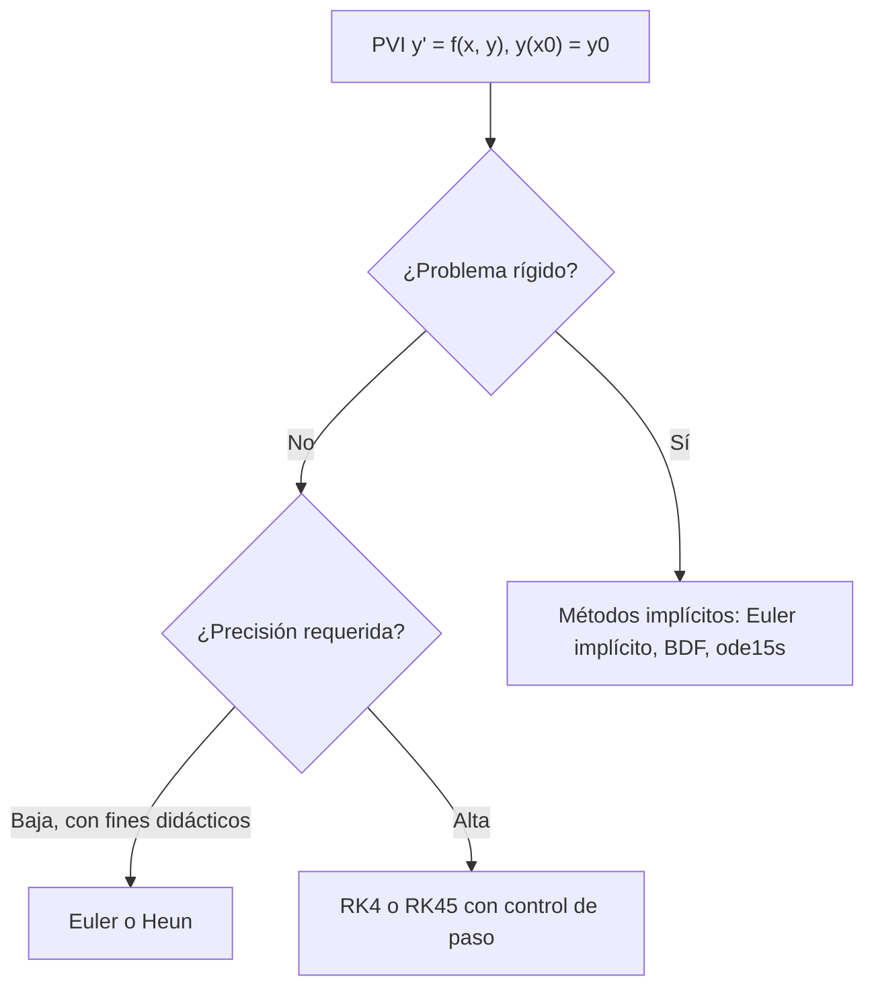

# Matemáticas para Ciencias Aplicadas IV - Existencia y unicidad de soluciones

## 2.3 Métodos Numéricos.

---

El teorema de existencia y unicidad (tema 2.1) garantiza que un problema de valor inicial tiene solución, pero casi nunca da una fórmula. Los **métodos numéricos** calculan aproximaciones $y_n \approx y(x_n)$ en puntos $x_n = x_0 + nh$ avanzando paso a paso. Este tema presenta los métodos de Euler, de Runge-Kutta y de pasos múltiples, y las dos preguntas que deciden su utilidad: qué tan rápido disminuye el error al reducir el paso (**orden**) y si los errores se amplifican o se amortiguan (**estabilidad**).

### El método de Euler

Por el teorema de Taylor, $y(x + h) = y(x) + h\, y'(x) + \frac{h^2}{2} y''(\xi).$ Como $y' = f(x, y),$ despreciando el último término:

$$ y_{n + 1} = y_n + h\, f(x_n, y_n) $$

Geométricamente, se avanza un paso $h$ sobre la recta tangente del campo de direcciones (tema 1.1).

**Errores.** El **error local de truncamiento** es el que se comete en un paso partiendo del valor exacto: para Euler, $\frac{h^2}{2} y''(\xi) = O(h^2).$ El **error global** $e_n = y(x_n) - y_n$ acumula unos $(x - x_0)/h$ errores locales, más su propagación.

**Teorema.** Si $f$ es Lipschitz en $y$ con constante $L$ y $|y''| \leq M_2,$ el error global de Euler en $[x_0, X]$ cumple

$$ |e_n| \leq \frac{M_2 h}{2L} \left( e^{L (X - x_0)} - 1 \right) $$

**Idea de la demostración.** Restando la fórmula de Euler del desarrollo de Taylor, $|e_{n + 1}| \leq (1 + hL) |e_n| + \frac{M_2}{2} h^2.$ Resolviendo esta desigualdad recursiva y usando $(1 + hL)^n \leq e^{nhL},$ se obtiene la cota. $\blacksquare$

El error global es $O(h):$ Euler es un método de **orden 1**. Reducir el paso a la mitad reduce el error a la mitad, lo que es muy lento: para ganar un dígito hay que hacer diez veces más pasos.

### Métodos de Runge-Kutta

La idea de Runge (1895) y Kutta (1901) es evaluar $f$ en varios puntos dentro del paso y combinar las pendientes para cancelar términos del error de Taylor.

**Heun (Euler mejorado), orden 2.** Se predice con Euler y se promedia la pendiente inicial con la del punto predicho:

$$ k_1 = f(x_n, y_n), \qquad k_2 = f(x_n + h, y_n + h k_1), \qquad y_{n + 1} = y_n + \frac{h}{2}(k_1 + k_2) $$

**Punto medio, orden 2.** $y_{n + 1} = y_n + h\, f\!\left(x_n + \frac{h}{2},\ y_n + \frac{h}{2} f(x_n, y_n)\right).$

**Runge-Kutta clásico (RK4), orden 4.**

$$ \begin{aligned} k_1 &= f(x_n, y_n), & k_2 &= f\!\left(x_n + \tfrac{h}{2},\ y_n + \tfrac{h}{2} k_1\right), \\ k_3 &= f\!\left(x_n + \tfrac{h}{2},\ y_n + \tfrac{h}{2} k_2\right), & k_4 &= f(x_n + h,\ y_n + h k_3), \end{aligned} \qquad y_{n + 1} = y_n + \frac{h}{6}(k_1 + 2k_2 + 2k_3 + k_4) $$

Si $f$ no depende de $y,$ RK4 se reduce a la regla de Simpson para $\int f.$ Con cuatro evaluaciones de $f$ por paso tiene error global $O(h^4):$ reducir $h$ a la mitad divide el error entre 16.

| Método | Evaluaciones de $f$ por paso | Error local | Error global |
| --- | :-: | :-: | :-: |
| Euler | 1 | $O(h^2)$ | $O(h)$ |
| Heun, punto medio | 2 | $O(h^3)$ | $O(h^2)$ |
| RK4 | 4 | $O(h^5)$ | $O(h^4)$ |

**Control del paso.** Los integradores como `ode45` (tema 2.2) o `solve_ivp` de SciPy usan **pares encajados**: dos fórmulas de órdenes 4 y 5 que comparten evaluaciones. La diferencia entre ambas estima el error local, y el paso se agranda o se achica para mantenerlo bajo una tolerancia.

### Métodos de pasos múltiples

Los Runge-Kutta descartan la información de los pasos anteriores. Los métodos de **pasos múltiples** la reutilizan: interpolan $f$ en los puntos ya calculados e integran el polinomio. Los de **Adams-Bashforth** son explícitos:

$$ \text{AB2:} \quad y_{n + 1} = y_n + \frac{h}{2} \left( 3 f_n - f_{n - 1} \right), \qquad \text{AB3:} \quad y_{n + 1} = y_n + \frac{h}{12} \left( 23 f_n - 16 f_{n - 1} + 5 f_{n - 2} \right) $$

con $f_k = f(x_k, y_k).$ Tienen orden 2 y 3 con **una sola** evaluación nueva por paso, pero necesitan arrancar con otro método. Los de **Adams-Moulton** son implícitos, porque $y_{n + 1}$ aparece también a la derecha, y se usan como **correctores** en esquemas predictor-corrector: se predice con AB y se corrige con AM. El de un paso es la regla del trapecio, $y_{n + 1} = y_n + \frac{h}{2}(f_n + f_{n + 1}).$

### Estabilidad

**La ecuación de prueba.** Se analiza $y' = \lambda y$ con $\lambda \lt 0,$ cuya solución decae. Euler da $y_{n + 1} = (1 + h\lambda)\, y_n,$ así que $y_n = (1 + h\lambda)^n y_0.$ La aproximación decae solo si $|1 + h\lambda| \lt 1,$ es decir, si

$$ h \lt \frac{2}{|\lambda|} $$

Con pasos mayores, la aproximación oscila y crece sin control aunque la solución exacta tienda a cero. La **región de estabilidad absoluta** de un método es el conjunto de valores $z = h\lambda$ (complejos, para sistemas) para los que los errores no crecen. Para Euler es el disco $|1 + z| \leq 1;$ para RK4 es mayor, y en el eje real llega hasta $z \approx -2.79.$

**Métodos implícitos.** Euler **implícito**, $y_{n + 1} = y_n + h f(x_{n + 1}, y_{n + 1}),$ da $y_{n + 1} = y_n / (1 - h\lambda),$ que decae para **todo** $h > 0:$ es incondicionalmente estable. El precio es resolver una ecuación (no lineal, en general) en cada paso.

**Rigidez.** Un problema es **rígido** cuando contiene escalas de tiempo muy distintas, como $\lambda = -1000$ junto a una variación lenta. Un método explícito necesita $h \lt 2/1000$ por estabilidad, aunque la precisión permitiría pasos mucho mayores; los métodos implícitos (BDF, `ode15s`) evitan esa restricción.



### Implementación en Python

El programa implementa Euler, Heun, RK4 y Adams-Bashforth de 3 pasos para escalares o sistemas (con arreglos de NumPy). Mide el **orden observado** dividiendo el paso entre dos y calculando $\log_2$ del cociente de los errores, que debe acercarse al orden teórico. Después resuelve los ejercicios y muestra la inestabilidad de Euler para $y' = -10y$ cuando $h$ supera $2/10 = 0.2,$ frente a la estabilidad de Euler implícito.

```python
import numpy as np

def euler(f, x0, y0, h, n):
    x, y = x0, np.array(y0, dtype=float)
    for _ in range(n):
        y = y + h * f(x, y); x += h
    return y

def heun(f, x0, y0, h, n):
    x, y = x0, np.array(y0, dtype=float)
    for _ in range(n):
        k1 = f(x, y); k2 = f(x + h, y + h * k1)
        y = y + h / 2 * (k1 + k2); x += h
    return y

def rk4(f, x0, y0, h, n):
    x, y = x0, np.array(y0, dtype=float)
    for _ in range(n):
        k1 = f(x, y)
        k2 = f(x + h / 2, y + h / 2 * k1)
        k3 = f(x + h / 2, y + h / 2 * k2)
        k4 = f(x + h, y + h * k3)
        y = y + h / 6 * (k1 + 2 * k2 + 2 * k3 + k4); x += h
    return y

def adams_bashforth3(f, x0, y0, h, n):
    """AB3, arrancando con dos pasos de RK4."""
    xs = [x0 + i * h for i in range(n + 1)]
    ys = [np.array(y0, dtype=float)]
    for i in range(2):
        ys.append(rk4(f, xs[i], ys[i], h, 1))
    for i in range(2, n):
        ys.append(ys[i] + h / 12 * (23 * f(xs[i], ys[i]) - 16 * f(xs[i - 1], ys[i - 1]) + 5 * f(xs[i - 2], ys[i - 2])))
    return ys[n]

def euler_implicito_lineal(lam, y0, h, n):
    """Euler implícito para y' = λy: y_{n+1} = y_n / (1 - hλ)."""
    return y0 / (1 - h * lam) ** n

# Orden de convergencia: error en x = 2 para y' = -2y + 3, y(0) = 1
f = lambda x, y: -2 * y + 3
exacta = 1.5 - 0.5 * np.exp(-4)
print('   h        Euler       Heun        RK4         AB3')
anteriores = None
for h in [0.2, 0.1, 0.05, 0.025]:
    n = round(2 / h)
    errores = [abs(m(f, 0, 1, h, n) - exacta) for m in (euler, heun, rk4, adams_bashforth3)]
    print(f'{h:6.3f}  ' + '  '.join(f'{e:10.3e}' for e in errores))
    if anteriores:
        ordenes = [np.log2(a / e) for a, e in zip(anteriores, errores)]
    anteriores = errores
print('orden observado (log2 del cociente de errores al dividir h entre 2):',
      ', '.join(f'{o:.2f}' for o in ordenes))

# Ejercicio 1: Euler frente a Heun para y' = x - y, y(0) = 1; exacta y = x - 1 + 2e^{-x}
g = lambda x, y: x - y
ex = 2 - 1 + 2 * np.exp(-2)
print(f'y\' = x - y en x = 2 con h = 0.1: Euler {euler(g, 0, 1, 0.1, 20):.6f}, Heun {heun(g, 0, 1, 0.1, 20):.6f}, exacta {ex:.6f}')

# Ejercicio 2: logística con RK4
P = lambda t, p: 0.5 * p * (1 - p / 100)
Pex = 1000 / (10 + 90 * np.exp(-10))
for h in [0.5, 0.1]:
    print(f'logística, h = {h}: P(20) = {rk4(P, 0, 10, h, round(20 / h)):.6f}   (exacta {Pex:.6f})')

# Ejercicio 4: estabilidad de Euler para y' = -10y: |1 - 10h| ≤ 1, h ≤ 0.2
for h in [0.05, 0.15, 0.19, 0.21, 0.25]:
    y_e = euler(lambda x, y: -10 * y, 0, 1, h, round(5 / h))
    y_i = euler_implicito_lineal(-10, 1, h, round(5 / h))
    print(f'h = {h:4.2f}: factor 1 + hλ = {1 - 10 * h:5.2f};  Euler explícito y(5) ≈ {y_e:10.3e};  implícito {y_i:9.3e}')

# Ejercicio 5: sistema y1' = y2, y2' = -y1 - 0.2 y2, con RK4
F = lambda x, Y: np.array([Y[1], -Y[0] - 0.2 * Y[1]])
Y10 = rk4(F, 0, [0, 1], 0.01, 1000)
w = np.sqrt(1 - 0.01)
y1_exacta = np.exp(-0.1 * 10) * np.sin(w * 10) / w
print(f'sistema en x = 10: y1 = {Y10[0]:.8f} (exacta {y1_exacta:.8f}), y2 = {Y10[1]:.8f}')
```

Salida:

```text
   h        Euler       Heun        RK4         AB3
 0.200   6.135e-03   1.412e-03   1.093e-05   1.032e-03
 0.100   3.393e-03   2.882e-04   5.772e-07   1.231e-04
 0.050   1.767e-03   6.605e-05   3.318e-08   1.454e-05
 0.025   9.001e-04   1.586e-05   1.989e-09   1.767e-06
orden observado (log2 del cociente de errores al dividir h entre 2): 0.97, 2.06, 4.06, 3.04
y' = x - y en x = 2 con h = 0.1: Euler 1.243153, Heun 1.271645, exacta 1.270671
logística, h = 0.5: P(20) = 99.959147   (exacta 99.959157)
logística, h = 0.1: P(20) = 99.959157   (exacta 99.959157)
h = 0.05: factor 1 + hλ =  0.50;  Euler explícito y(5) ≈  7.889e-31;  implícito 2.460e-18
h = 0.15: factor 1 + hλ = -0.50;  Euler explícito y(5) ≈ -1.164e-10;  implícito 7.379e-14
h = 0.19: factor 1 + hλ = -0.90;  Euler explícito y(5) ≈  6.461e-02;  implícito 9.498e-13
h = 0.21: factor 1 + hλ = -1.10;  Euler explícito y(5) ≈  9.850e+00;  implícito 1.612e-12
h = 0.25: factor 1 + hλ = -1.50;  Euler explícito y(5) ≈  3.325e+03;  implícito 1.314e-11
sistema en x = 10: y1 = -0.18534571 (exacta -0.18534571), y2 = -0.29978254
```

Los órdenes observados son 0.97, 2.06, 4.06 y 3.04, prácticamente los teóricos. Con $h = 0.21$ y $h = 0.25,$ Euler explícito produce valores que crecen, aunque la solución exacta, $e^{-50},$ es prácticamente cero; con $h = 0.19$ la aproximación decae, pero oscila y muy lentamente. Euler implícito decae con cualquier paso.

### Ejercicios Propuestos

1. **Heun.** Compara Euler y Heun para $y' = x - y,$ $y(0) = 1$ en $[0, 2]$ con $h = 0.1.$ La solución exacta es $y = x - 1 + 2e^{-x}.$

2. **Logística.** Resuelve $P' = 0.5P(1 - P/100),$ $P(0) = 10$ con RK4, con $h = 0.5$ y $h = 0.1,$ y compara con la solución exacta en $t = 20.$

3. **Adams-Bashforth.** Implementa AB3 y verifica que su orden es 3.

4. **Estabilidad.** ¿Cuál es el paso máximo para que Euler sea estable en $y' = -10y?$ ¿Qué pasa con $h = 0.25?$

5. **Sistema.** Resuelve $y_1' = y_2,$ $y_2' = -y_1 - 0.2 y_2,$ con $y_1(0) = 0,$ $y_2(0) = 1,$ usando RK4, y compara con la solución exacta $y_1 = e^{-0.1x} \sin(\omega x)/\omega,$ con $\omega = \sqrt{0.99}.$

6. **Orden de Heun.** Demuestra que el error local de Heun es $O(h^3),$ comparando su desarrollo en potencias de $h$ con el de Taylor de la solución.

### Soluciones

**Ejercicio 1.** En $x = 2,$ Euler da $1.2432$ y Heun $1.2716,$ frente a la exacta $1.2707:$ errores de $0.028$ y $0.001.$ Con el mismo $h,$ Heun es unas 30 veces más preciso a costa de duplicar las evaluaciones.

**Ejercicio 2.** Con $h = 0.5,$ RK4 da $99.959147$ y con $h = 0.1,$ $99.959157,$ que coincide con la exacta en todas las cifras mostradas.

**Ejercicio 3.** Es la función `adams_bashforth3` del programa; el orden observado es 3.04. Para arrancar se usan dos pasos de RK4, de orden mayor, para no contaminar el orden.

**Ejercicio 4.** $|1 - 10h| \lt 1$ exige $h \lt 0.2.$ Con $h = 0.25,$ el factor es $1 - 2.5 = -1.5,$ y $y_n = (-1.5)^n$ oscila con amplitud creciente: tras 20 pasos, unos $3.3 \times 10^3.$

**Ejercicio 5.** Con $h = 0.01,$ RK4 coincide con la solución exacta en ocho decimales en $x = 10.$ Es un oscilador amortiguado (tema 3.3).

**Ejercicio 6.** Desarrollando, $k_2 = f + h(f_x + f f_y) + O(h^2),$ así que $y_{n + 1} = y_n + h f + \frac{h^2}{2}(f_x + f f_y) + O(h^3).$ Por otro lado $y(x + h) = y + h y' + \frac{h^2}{2} y'' + O(h^3),$ con $y' = f$ y $y'' = f_x + f f_y.$ Coinciden hasta $h^2,$ así que el error local es $O(h^3)$ y el global $O(h^2).$

### Referencias

1. Burden, R. L., Faires, J. D., and Burden, A. M., _Análisis numérico_. Cengage, 2017. Capítulo 5.
2. Boyce, W. E., DiPrima, R. C., and Meade, D. B., _Elementary Differential Equations and Boundary Value Problems_. Wiley, 2017. Capítulo 8.
3. Iserles, A., _A First Course in the Numerical Analysis of Differential Equations_. Cambridge University Press, 2009. Capítulos 1 a 4.
4. Butcher, J. C., _Numerical Methods for Ordinary Differential Equations_. Wiley, 2016.
