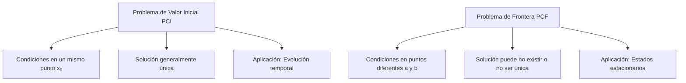

# Matemáticas para Ciencias Aplicadas IV - Ecuaciones Diferenciales de 2o Orden

## 3.1 Problemas de condiciones iniciales y problemas de condiciones en la frontera.

---

### 1. Introducción

Las ecuaciones diferenciales de segundo orden son fundamentales en ciencias aplicadas, ya que modelan fenómenos como vibraciones mecánicas, circuitos eléctricos y procesos de difusión. La forma general es:

$$a(x)y'' + b(x)y' + c(x)y = f(x)$$

Donde $y'' = \frac{d^2y}{dx^2},$ $y' = \frac{dy}{dx},$ y $y$ es la función desconocida.

### 2. Definiciones Fundamentales

#### 2.1 Problema de Condiciones Iniciales (PCI)

Un **problema de condiciones iniciales** para una EDO de segundo orden consiste en:

- La ecuación diferencial: $y'' + p(x)y' + q(x)y = g(x)$
- Condiciones especificadas en un **mismo punto** $x_0:$
  - $y(x_0) = y_0$ (posición inicial)
  - $y'(x_0) = y_1$ (velocidad inicial)

**Forma general:**

$$ \begin{cases} y'' + p(x)y' + q(x)y = g(x) \\\ y(x_0) = y_0 \\\ y'(x_0) = y_1 \end{cases} $$

#### 2.2 Problema de Condiciones en la Frontera (PCF)

Un **problema de condiciones en la frontera** para una EDO de segundo orden consiste en:

- La ecuación diferencial: $y'' + p(x)y' + q(x)y = g(x)$
- Condiciones especificadas en **diferentes puntos** $x=a$ y $x=b:$
  - $y(a) = \alpha$
  - $y(b) = \beta$

**Forma general:**

$$ \begin{cases} y'' + p(x)y' + q(x)y = g(x) \\\ y(a) = \alpha \\\ y(b) = \beta \end{cases} $$

### 3. Diferencias Clave entre PCI y PCF



### 4. Teorema de Existencia y Unicidad para PCI

**Teorema:** Si $p(x),$ $q(x)$ y $g(x)$ son continuas en un intervalo abierto $I$ que contiene a $x_0,$ entonces para cualesquiera números reales $y_0$ e $y_1,$ el PCI tiene una solución única definida en todo $I.$

### 5. Ejemplos Resueltos

#### Ejemplo 1: PCI (Vibraciones Armónicas)

Resolver: $ \begin{cases} y'' + 4y = 0 \\\ y(0) = 1 \\\ y'(0) = 2 \end{cases} $

**Solución:**
Ecuación característica: $r^2 + 4 = 0$ → $r = \pm 2i$

Solución general: $y(x) = C_1 \cos(2x) + C_2 \sin(2x)$

Aplicando condiciones iniciales:

- $y(0) = C_1 = 1$
- $y'(0) = -2C_1 \sin(0) + 2C_2 \cos(0) = 2C_2 = 2$ → $C_2 = 1$

Solución única: $y(x) = \cos(2x) + \sin(2x)$

#### Ejemplo 2: PCF (Problema de Dirichlet)

Resolver: $\begin{cases} y'' + y = 0 \\\ y(0) = 0 \\\ y(\pi/2) = 1 \end{cases}$

**Solución:**
Ecuación característica: $r^2 + 1 = 0$ → $r = \pm i$

Solución general: $y(x) = C_1 \cos(x) + C_2 \sin(x)$

Aplicando condiciones de frontera:

- $y(0) = C_1 = 0$
- $y(\pi/2) = C_2 = 1$

Solución única: $y(x) = \sin(x)$

#### Ejemplo 3: PCF sin solución única

Analizar: $\begin{cases} y'' + y = 0 \\\ y(0) = 0 \\\ y(\pi) = 1 \end{cases}$

**Solución:**
Solución general: $y(x) = C_1 \cos(x) + C_2 \sin(x)$

Aplicando condiciones:

- $y(0) = C_1 = 0$
- $y(\pi) = -C_1 = 1$ → $0 = 1$ (contradicción)

**No existe solución** para este problema de frontera.

### 6. Casos Especiales de PCF

#### 6.1 Problema de Sturm-Liouville

Forma general:

$$\frac{d}{dx}\left[p(x)\frac{dy}{dx}\right] + [q(x) + \lambda w(x)]y = 0$$

Con condiciones de frontera:

- Dirichlet: $y(a) = 0,$ $y(b) = 0$
- Neumann: $y'(a) = 0,$ $y'(b) = 0$
- Robin (mixtas): $\alpha_1 y(a) + \beta_1 y'(a) = 0,$ $\alpha_2 y(b) + \beta_2 y'(b) = 0$

### 7. Implementación Computacional (Python)

```python
import numpy as np
from scipy.integrate import solve_ivp
import matplotlib.pyplot as plt

# Problema de condiciones iniciales
def pci_edo(t, y):
    return [y[1], -4*y[0]]  # y'' + 4y = 0

# Condiciones iniciales: y(0)=1, y'(0)=2
t_span = [0, 5]
y0 = [1, 2]

# Resolver
sol = solve_ivp(pci_edo, t_span, y0, t_eval=np.linspace(0, 5, 100))

# Graficar
plt.figure(figsize=(10, 4))
plt.plot(sol.t, sol.y[0], label='y(x)')
plt.plot(sol.t, sol.y[1], label="y'(x)")
plt.title('Solución de PCI: y\" + 4y = 0')
plt.xlabel('x')
plt.ylabel('y')
plt.legend()
plt.grid(True)
plt.show()
```

### 8. Ejercicios Propuestos

#### Ejercicio 1

Resolver el PCI:

$\begin{cases} y'' - 3y' + 2y = 0 \\\ y(0) = 1 \\\ y'(0) = 0 \end{cases}$

#### Ejercicio 2

Analizar la existencia y unicidad de soluciones para el PCF:

$\begin{cases} y'' + k^2 y = 0 \\\ y(0) = 0 \\\ y(L) = 0 \end{cases}$

para diferentes valores de $k.$

#### Ejercicio 3

Resolver el PCF con condiciones mixtas:

$\begin{cases} y'' + 4y = 0 \\\ y(0) = 1 \\\ y'(\pi/4) = 0 \end{cases}$

#### Ejercicio 4

Implementar en Python la solución del PCI:

$\begin{cases} y'' + 2y' + 5y = 0 \\\ y(0) = 0 \\\ y'(0) = 1 \end{cases}$

#### Ejercicio 5

Probar que el PCF:

$\begin{cases} y'' + y = x \\\ y(0) = 0 \\\ y(\pi) = \pi \end{cases}$

tiene solución única y encontrarla.

### 9. Aplicaciones en Ciencias

#### 9.1 Vibraciones Mecánicas

PCI: Posición y velocidad iniciales determinan el movimiento completo.

#### 9.2 Conducción de Calor en Barra

PCF: Temperaturas fijas en los extremos determinan distribución de temperatura.

#### 9.3 Deflexión de Vigas

PCF: Condiciones de apoyo en los extremos determinan la deflexión.

### 10. Referencias

**Bibliografía básica:**

1. Boyce, W., DiPrima, R. (2004). _Elementary Differential Equations and Boundary Value Problems_. Wiley. (Capítulos 3 y 10)
2. Edwards, C. H., Penney, D. E. (2002). _Ecuaciones diferenciales elementales y problemas con condiciones a la frontera_. Prentice Hall. (Capítulos 3 y 9)

**Bibliografía complementaria:**

1. Cooper, J. M. (1998). _Introduction to Partial Differential Equations with MatLab_. Birkhäuser.
2. Hubbard, J. H., West, B. H. (1995). _Differential Equations: A Dynamical Systems Approach_. Springer-Verlag.
3. Zill, D. G., Wright, W. S. (1995). _Differential Equations with Computer Lab Experiments_. PWS Publishing.

### 11. Consejos de Estudio

1. **Dominar primero las EDO lineales homogéneas** con coeficientes constantes
2. **Practicar la determinación de existencia y unicidad** antes de resolver
3. **Visualizar las soluciones** gráficamente para entender el comportamiento
4. **Implementar soluciones numéricas** para verificar resultados analíticos
5. **Relacionar cada problema** con aplicaciones físicas concretas
