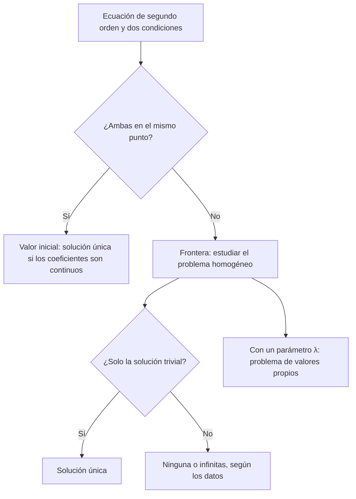

# Matemáticas para Ciencias Aplicadas IV - Ecuaciones Diferenciales de 2o Orden

## 3.1 Problemas de condiciones iniciales y problemas de condiciones en la frontera.

---

Una ecuación de segundo orden necesita **dos** condiciones para determinar una solución, porque su solución general tiene dos constantes. Dónde se imponen esas condiciones cambia radicalmente el problema. Si ambas se dan en un mismo punto (posición y velocidad iniciales), se tiene un **problema de valor inicial**, que bajo hipótesis razonables siempre tiene solución única. Si se dan en dos puntos distintos (temperatura en los dos extremos de una barra), se tiene un **problema de valores en la frontera**, que puede tener una solución, ninguna o infinitas. Este tema compara ambos y explica de qué depende la diferencia.

### Ecuaciones lineales de segundo orden

La forma general es

$$ y'' + p(x)\, y' + q(x)\, y = g(x) $$

Es **homogénea** si $g = 0.$ Modela, por ejemplo, un resorte amortiguado, $m x'' + c x' + k x = F(t),$ o un circuito RLC, $L q'' + R q' + q/C = E(t),$ y aparece al separar variables en las ecuaciones en derivadas parciales de los temas 6 a 8. El tema 3.2 estudia la estructura de sus soluciones; aquí basta saber que la solución general de la homogénea es una combinación $C_1 y_1 + C_2 y_2$ de dos soluciones independientes.

### Problemas de valor inicial

$$ y'' + p(x)\, y' + q(x)\, y = g(x), \qquad y(x_0) = y_0, \qquad y'(x_0) = v_0 $$

**Teorema.** Si $p,$ $q$ y $g$ son continuas en un intervalo abierto $I$ que contiene a $x_0,$ el problema tiene **exactamente una** solución, y está definida en todo $I.$

Es el teorema de Picard-Lindelöf (tema 2.1) aplicado al sistema de primer orden $y' = v,$ $v' = g - p v - q y,$ que es lineal; por ser lineal, la solución existe en todo $I$ (como en el tema 1.2). Físicamente: la posición y la velocidad iniciales determinan todo el movimiento.

**Ejemplo.** $y'' + 4y = 0,$ $y(0) = 1,$ $y'(0) = 2.$ La solución general es $y = C_1 \cos 2x + C_2 \sin 2x$ (tema 3.3). $y(0) = C_1 = 1$ y $y'(0) = 2C_2 = 2:$ $y = \cos 2x + \sin 2x = \sqrt{2} \sin(2x + \pi/4).$

### Problemas de valores en la frontera

$$ y'' + p(x)\, y' + q(x)\, y = g(x), \qquad y(a) = \alpha, \qquad y(b) = \beta $$

Las condiciones pueden ser de **Dirichlet**, que fijan $y;$ de **Neumann**, que fijan $y';$ o de **Robin**, que fijan una combinación $c_1 y + c_2 y'.$ Imponerlas lleva a un sistema lineal para $C_1$ y $C_2,$ que, como todo sistema lineal, puede tener una, ninguna o infinitas soluciones.

**Tres ejemplos con la misma ecuación.** Para $y'' + y = 0,$ cuya solución general es $y = C_1 \cos x + C_2 \sin x,$ y con $y(0) = 0,$ que da $C_1 = 0:$

| Segunda condición | Lo que impone | Resultado |
| --- | --- | --- |
| $y(\pi/2) = 1$ | $C_2 = 1$ | una solución: $y = \sin x$ |
| $y(\pi) = 1$ | $0 = 1$ | ninguna solución |
| $y(\pi) = 0$ | $0 = 0$ | infinitas: $y = C_2 \sin x$ |

**La alternativa de Fredholm.** El comportamiento lo decide el problema **homogéneo** asociado, con $g = 0$ y condiciones $y(a) = y(b) = 0:$

**Teorema.** Si el problema homogéneo solo tiene la solución $y = 0,$ el problema no homogéneo tiene solución única para todo $g$ y todos $\alpha,$ $\beta.$ Si el homogéneo tiene soluciones no triviales, el no homogéneo tiene, según los datos, ninguna solución o infinitas.

**Demostración.** Sean $y_1,$ $y_2$ una base de soluciones de la homogénea y $y_p$ una solución particular. Las condiciones dan un sistema de $2 \times 2$ para $C_1,$ $C_2$ con matriz $\begin{pmatrix} y_1(a) & y_2(a) \\ y_1(b) & y_2(b) \end{pmatrix}.$ El problema homogéneo tiene solo la solución trivial si y solo si esa matriz es invertible, y entonces el sistema tiene solución única. Si es singular, el sistema no homogéneo es incompatible o tiene infinitas soluciones. $\blacksquare$

En la tabla, el homogéneo $y(0) = y(\pi) = 0$ tiene la solución $\sin x,$ y por eso con $y(\pi) = 1$ no hay solución; en cambio, $y(0) = y(\pi/2) = 0$ solo tiene la trivial.

### Problemas de valores propios

El caso más importante de no unicidad es deliberado. En

$$ y'' + \lambda y = 0, \qquad y(0) = 0, \qquad y(L) = 0 $$

siempre está la solución trivial, y la pregunta es para qué valores del parámetro $\lambda$ hay **otras**. Esos $\lambda$ son los **valores propios** y las soluciones no triviales las **funciones propias**.

- Si $\lambda \lt 0,$ con $\lambda = -\mu^2,$ la solución general es $C_1 \cosh \mu x + C_2 \sinh \mu x;$ $y(0) = 0$ da $C_1 = 0$ y $y(L) = C_2 \sinh \mu L = 0$ da $C_2 = 0.$ Solo la trivial.
- Si $\lambda = 0,$ $y = C_1 + C_2 x,$ y las condiciones dan $C_1 = C_2 = 0.$
- Si $\lambda = \mu^2 > 0,$ $y = C_1 \cos \mu x + C_2 \sin \mu x;$ $C_1 = 0$ y $C_2 \sin \mu L = 0.$ Hay soluciones no triviales si y solo si $\mu L = n\pi.$

$$ \lambda_n = \left( \frac{n\pi}{L} \right)^2, \qquad y_n(x) = \sin \frac{n\pi x}{L}, \qquad n = 1, 2, 3, \ldots $$

Son los modos de vibración de una cuerda fija en sus extremos (tema 6.2), y la base de las **series de Fourier** con las que se resuelven las ecuaciones de onda, de calor y de Laplace por separación de variables (temas 6.5, 7.4 y 8.5). El marco general, con $(p y')' + (q + \lambda w) y = 0,$ es la teoría de **Sturm-Liouville**.

### Métodos numéricos para problemas de frontera

Un problema de valor inicial se resuelve avanzando desde el punto inicial (tema 2.3). Un problema de frontera no se puede resolver así, porque falta $y'(a).$ Dos estrategias:

- **Disparo.** Se resuelve el problema de valor inicial con $y(a) = \alpha$ y $y'(a) = s,$ y se ajusta $s$ (con bisección o el método de la secante) hasta que $y(b) = \beta.$ Como apuntar con un cañón cambiando el ángulo.
- **Diferencias finitas o colocación.** Se discretiza el intervalo y se resuelve un sistema de ecuaciones para los valores en todos los nodos a la vez. Es lo que hace `solve_bvp` de SciPy (o `bvp4c` en MATLAB).



### Implementación en Python

El programa resuelve con SymPy los problemas de los ejemplos y de los ejercicios, imponiendo las condiciones a la solución general e indicando si la solución es única, si hay infinitas (queda una constante libre) o si no hay ninguna. Después calcula por **disparo** los tres primeros valores propios de $y'' + \lambda y = 0,$ $y(0) = y(1) = 0,$ buscando los $\lambda$ en que la solución con $y'(0) = 1$ termina en cero, y resuelve un problema de frontera no lineal con `solve_bvp`.

```python
import sympy as sp
import numpy as np
from scipy.integrate import solve_ivp, solve_bvp
from scipy.optimize import brentq

x = sp.symbols('x')
y = sp.Function('y')

def resolver(edo, condiciones):
    """Solución general con dsolve y sistema lineal para las constantes."""
    general = sp.dsolve(edo).rhs
    constantes = sorted(general.free_symbols - {x}, key=str)
    ecuaciones = [c(general) for c in condiciones]
    sols = sp.solve(ecuaciones, constantes, dict=True)
    if not sols:
        return 'no tiene solución'
    s = general.subs(sols[0])
    libres = s.free_symbols - {x}
    return f'{sp.simplify(s)}' + ('   (infinitas soluciones)' if libres else '   (única)')

y0 = lambda a, v: (lambda g: g.subs(x, a) - v)
dy0 = lambda a, v: (lambda g: sp.diff(g, x).subs(x, a) - v)

casos = [
    ('PVI y\'\' + 4y = 0, y(0) = 1, y\'(0) = 2', sp.Eq(y(x).diff(x, 2) + 4 * y(x), 0), [y0(0, 1), dy0(0, 2)]),
    ('PVF y\'\' + y = 0, y(0) = 0, y(π/2) = 1', sp.Eq(y(x).diff(x, 2) + y(x), 0), [y0(0, 0), y0(sp.pi / 2, 1)]),
    ('PVF y\'\' + y = 0, y(0) = 0, y(π) = 1', sp.Eq(y(x).diff(x, 2) + y(x), 0), [y0(0, 0), y0(sp.pi, 1)]),
    ('PVF y\'\' + y = 0, y(0) = 0, y(π) = 0', sp.Eq(y(x).diff(x, 2) + y(x), 0), [y0(0, 0), y0(sp.pi, 0)]),
    ('ej. 1: y\'\' - 3y\' + 2y = 0, y(0) = 1, y\'(0) = 0', sp.Eq(y(x).diff(x, 2) - 3 * y(x).diff(x) + 2 * y(x), 0), [y0(0, 1), dy0(0, 0)]),
    ('ej. 3: y\'\' + 4y = 0, y(0) = 1, y\'(π/4) = 0', sp.Eq(y(x).diff(x, 2) + 4 * y(x), 0), [y0(0, 1), dy0(sp.pi / 4, 0)]),
    ('ej. 4: y\'\' + 2y\' + 5y = 0, y(0) = 0, y\'(0) = 1', sp.Eq(y(x).diff(x, 2) + 2 * y(x).diff(x) + 5 * y(x), 0), [y0(0, 0), dy0(0, 1)]),
    ('ej. 5: y\'\' + y = x, y(0) = 0, y(π) = π', sp.Eq(y(x).diff(x, 2) + y(x), x), [y0(0, 0), y0(sp.pi, sp.pi)]),
    ('ej. 5\': y\'\' + y = x, y(0) = 0, y(π) = 0', sp.Eq(y(x).diff(x, 2) + y(x), x), [y0(0, 0), y0(sp.pi, 0)]),
]
for nombre, edo, cond in casos:
    print(f'{nombre:48} {resolver(edo, cond)}')

# Método de disparo: valores propios de y'' + λy = 0, y(0) = y(1) = 0 (exactos: (nπ)²)
def y_en_1(lam):
    s = solve_ivp(lambda t, Y: [Y[1], -lam * Y[0]], [0, 1], [0, 1], rtol=1e-10, atol=1e-12)
    return s.y[0, -1]
malla = np.linspace(1, 120, 400)
valores = [y_en_1(l) for l in malla]
propios = [brentq(y_en_1, a, b) for a, b, va, vb in zip(malla, malla[1:], valores, valores[1:]) if va * vb < 0]
print('valores propios por disparo:', [round(l, 6) for l in propios])
print('exactos (nπ)²:            ', [round((n * np.pi)**2, 6) for n in range(1, len(propios) + 1)])

# Un problema de frontera no lineal con solve_bvp: y'' = -e^y (ecuación de Bratu con λ = 1), y(0) = y(1) = 0
xs = np.linspace(0, 1, 11)
sol = solve_bvp(lambda t, Y: np.vstack([Y[1], -np.exp(Y[0])]), lambda a, b: np.array([a[0], b[0]]),
                xs, np.zeros((2, xs.size)))
print(f'Bratu: converge = {sol.success}, y(1/2) = {sol.sol(0.5)[0]:.6f}')
```

Salida:

```text
PVI y'' + 4y = 0, y(0) = 1, y'(0) = 2            sqrt(2)*sin(2*x + pi/4)   (única)
PVF y'' + y = 0, y(0) = 0, y(π/2) = 1            sin(x)   (única)
PVF y'' + y = 0, y(0) = 0, y(π) = 1              no tiene solución
PVF y'' + y = 0, y(0) = 0, y(π) = 0              C1*sin(x)   (infinitas soluciones)
ej. 1: y'' - 3y' + 2y = 0, y(0) = 1, y'(0) = 0   (2 - exp(x))*exp(x)   (única)
ej. 3: y'' + 4y = 0, y(0) = 1, y'(π/4) = 0       no tiene solución
ej. 4: y'' + 2y' + 5y = 0, y(0) = 0, y'(0) = 1   exp(-x)*sin(2*x)/2   (única)
ej. 5: y'' + y = x, y(0) = 0, y(π) = π           C1*sin(x) + x   (infinitas soluciones)
ej. 5': y'' + y = x, y(0) = 0, y(π) = 0          no tiene solución
valores propios por disparo: [9.869604, 39.478418, 88.82644]
exactos (nπ)²:             [9.869604, 39.478418, 88.82644]
Bratu: converge = True, y(1/2) = 0.140539
```

### Ejercicios Propuestos

1. **Valor inicial.** Resuelve $y'' - 3y' + 2y = 0,$ $y(0) = 1,$ $y'(0) = 0.$

2. **Valores propios.** ¿Para qué valores de $k$ tiene soluciones no triviales $y'' + k^2 y = 0,$ $y(0) = y(L) = 0?$

3. **Condición mixta.** Resuelve $y'' + 4y = 0,$ $y(0) = 1,$ $y'(\pi/4) = 0.$

4. **Oscilación amortiguada.** Resuelve $y'' + 2y' + 5y = 0,$ $y(0) = 0,$ $y'(0) = 1.$

5. **No homogéneo.** Analiza $y'' + y = x$ con $y(0) = 0$ y $y(\pi) = \pi,$ y luego con $y(\pi) = 0.$

6. **Neumann.** Encuentra los valores propios de $y'' + \lambda y = 0,$ $y'(0) = y'(L) = 0.$

### Soluciones

**Ejercicio 1.** Las raíces de $r^2 - 3r + 2$ son 1 y 2: $y = C_1 e^x + C_2 e^{2x}.$ Las condiciones dan $C_1 + C_2 = 1$ y $C_1 + 2C_2 = 0,$ así que $C_1 = 2,$ $C_2 = -1:$ $y = 2e^x - e^{2x}.$

**Ejercicio 2.** Si $k \neq 0,$ $y = C_1 \cos kx + C_2 \sin kx$ y las condiciones dan $C_1 = 0$ y $C_2 \sin kL = 0.$ Hay soluciones no triviales si y solo si $kL = n\pi,$ es decir, $k = n\pi/L$ con $n \neq 0$ entero, y son $y = C \sin(n\pi x/L).$ Para los demás valores de $k,$ incluido $k = 0,$ solo está la trivial.

**Ejercicio 3.** $y = \cos 2x + C \sin 2x$ por la primera condición, y $y' = -2 \sin 2x + 2C \cos 2x$ vale $-2$ en $\pi/4$ sin importar $C:$ **no hay solución**. Es consistente con Fredholm: el homogéneo $y(0) = 0,$ $y'(\pi/4) = 0$ tiene la solución no trivial $\sin 2x.$

**Ejercicio 4.** Las raíces son $-1 \pm 2i:$ $y = e^{-x}(C_1 \cos 2x + C_2 \sin 2x).$ $y(0) = C_1 = 0$ y $y'(0) = 2C_2 = 1:$ $y = \tfrac{1}{2} e^{-x} \sin 2x.$

**Ejercicio 5.** Una solución particular es $y_p = x,$ así que $y = C_1 \cos x + C_2 \sin x + x.$ $y(0) = 0$ da $C_1 = 0,$ y entonces $y(\pi) = \pi$ para **todo** $C_2:$ hay infinitas soluciones, $y = x + C \sin x.$ Con $y(\pi) = 0$ se obtendría $\pi = 0:$ ninguna. En ambos casos el homogéneo tiene la solución $\sin x,$ así que no puede haber unicidad.

**Ejercicio 6.** Para $\lambda = 0,$ $y = C_1 + C_2 x$ y las condiciones dan $C_2 = 0:$ las constantes son funciones propias. Para $\lambda = \mu^2 > 0,$ $y' = \mu(-C_1 \sin \mu x + C_2 \cos \mu x);$ $y'(0) = 0$ da $C_2 = 0$ y $y'(L) = -C_1 \mu \sin \mu L = 0$ da $\mu L = n\pi.$ Los valores propios son $\lambda_n = (n\pi/L)^2$ con $n = 0, 1, 2, \ldots,$ y las funciones propias $\cos(n\pi x/L).$ Para $\lambda \lt 0$ no hay.

### Referencias

1. Boyce, W. E., DiPrima, R. C., and Meade, D. B., _Elementary Differential Equations and Boundary Value Problems_. Wiley, 2017. Secciones 3.2 y 10.1.
2. Zill, D. G., _Ecuaciones diferenciales con aplicaciones de modelado_. Cengage, 2018. Secciones 4.1 y 5.2.
3. Edwards, C. H., and Penney, D. E., _Ecuaciones diferenciales y problemas con valores en la frontera_. Pearson, 2009. Secciones 3.1 y 3.8.
4. Ascher, U. M., Mattheij, R. M. M., and Russell, R. D., _Numerical Solution of Boundary Value Problems for Ordinary Differential Equations_. SIAM, 1995.
