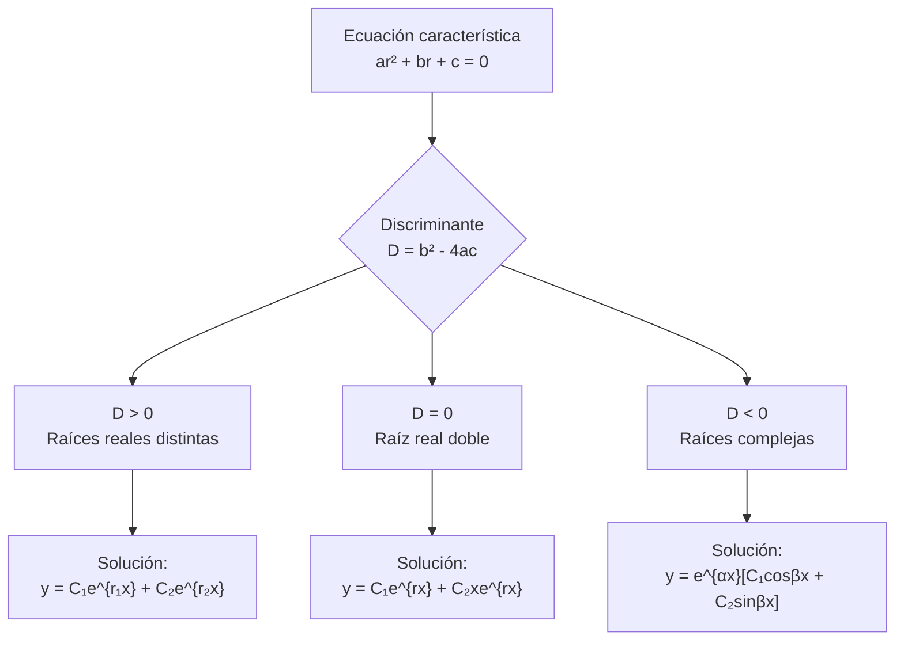

# Matemáticas para Ciencias Aplicadas IV - Ecuaciones Diferenciales de 2o Orden

## 3.2 Ecuaciones lineales de 2o Orden.

---

### 1. Introducción

Las ecuaciones diferenciales lineales de segundo orden son fundamentales en ciencias aplicadas, ya que modelan fenómenos como vibraciones mecánicas, circuitos eléctricos RLC y sistemas masa-resorte. Su forma general es:

$$a(x)\frac{d^2y}{dx^2} + b(x)\frac{dy}{dx} + c(x)y = f(x)$$

### 2. Definiciones Fundamentales

#### 2.1 Forma General

Una ecuación diferencial lineal de segundo orden tiene la forma:

$$P(x)y'' + Q(x)y' + R(x)y = G(x)$$

Donde $P(x)$, $Q(x)$, $R(x)$ y $G(x)$ son funciones continuas en algún intervalo $I$.

#### 2.2 Ecuación Homogénea

Cuando $G(x) = 0$, la ecuación se denomina **homogénea**:

$$P(x)y'' + Q(x)y' + R(x)y = 0$$

#### 2.3 Principio de Superposición

Si $y_1$ e $y_2$ son soluciones de la ecuación homogénea, entonces cualquier combinación lineal:

$$y(x) = C_1y_1(x) + C_2y_2(x)$$

también es solución, donde $C_1$ y $C_2$ son constantes arbitrarias.

#### 2.4 Wronskiano

El Wronskiano de dos funciones $y_1$ e $y_2$ se define como:

$$ W(y_1, y_2) = \begin{vmatrix} y_1 & y_2 \\\ y_1' & y_2' \end{vmatrix} = y_1y_2' - y_2y_1'$$

Si $W(y_1, y_2) \neq 0$ en un intervalo $I$, entonces $y_1$ e $y_2$ forman un conjunto fundamental de soluciones.

### 3. Ecuaciones con Coeficientes Constantes

#### 3.1 Forma General

$$ay'' + by' + cy = 0$$

donde $a$, $b$ y $c$ son constantes reales con $a \neq 0$.

#### 3.2 Solución mediante Ecuación Característica

La ecuación característica es:

$$ar^2 + br + c = 0$$

##### Caso 1: Raíces reales y distintas $(b^2 - 4ac > 0)$

$$r_1, r_2 = \frac{-b \pm \sqrt{b^2 - 4ac}}{2a}$$

Solución general:

$$y(x) = C_1e^{r_1x} + C_2e^{r_2x}$$

##### Caso 2: Raíces reales iguales $(b^2 - 4ac = 0)$

$$r = -\frac{b}{2a}$$

Solución general:

$$y(x) = C_1e^{rx} + C_2xe^{rx}$$

##### Caso 3: Raíces complejas conjugadas $(b^2 - 4ac < 0)$

$$r = \alpha \pm i\beta$$

donde $\alpha = -\frac{b}{2a}$ y $\beta = \frac{\sqrt{4ac - b^2}}{2a}$

Solución general:

$$y(x) = e^{\alpha x}[C_1\cos(\beta x) + C_2\sin(\beta x)]$$



### 4. Método de Reducción de Orden

Si se conoce una solución $y_1(x)$ de la ecuación homogénea, una segunda solución linealmente independiente se puede encontrar mediante:

$$y_2(x) = y_1(x) \int \frac{e^{-\int P(x)dx}}{[y_1(x)]^2} dx$$

donde $P(x) = \frac{Q(x)}{P(x)}$ (en forma estándar).

### 5. Ecuaciones No Homogéneas: Método de Coeficientes Indeterminados

Para ecuaciones de la forma:

$$ay'' + by' + cy = G(x)$$

donde $G(x)$ es una función exponencial, polinómica, seno o coseno.

#### 5.1 Tabla de Soluciones Particulares

| Forma de G(x) | Forma de y_p(x) |
|---------------|-----------------|
| $e^{kx}$ | $Ae^{kx}$ |
| $\sin(kx)$ o $\cos(kx)$ | $A\sin(kx) + B\cos(kx)$ |
| $x^n$ | $A_nx^n + A_{n-1}x^{n-1} + \cdots + A_0$ |
| $e^{kx}\sin(mx)$ o $e^{kx}\cos(mx)$ | $e^{kx}[A\sin(mx) + B\cos(mx)]$ |

### 6. Ejemplos Resueltos

#### Ejemplo 1: Raíces reales distintas

Resolver: $y'' - 3y' + 2y = 0$

**Solución:**
Ecuación característica: $r^2 - 3r + 2 = 0$
Raíces: $r = 1, 2$
Solución general: $y(x) = C_1e^x + C_2e^{2x}$

#### Ejemplo 2: Raíz real doble

Resolver: $y'' - 4y' + 4y = 0$

**Solución:**
Ecuación característica: $r^2 - 4r + 4 = 0$
Raíz doble: $r = 2$
Solución general: $y(x) = C_1e^{2x} + C_2xe^{2x}$

#### Ejemplo 3: Raíces complejas

Resolver: $y'' + 4y' + 13y = 0$

**Solución:**
Ecuación característica: $r^2 + 4r + 13 = 0$
Raíces: $r = -2 \pm 3i$
Solución general: $y(x) = e^{-2x}[C_1\cos(3x) + C_2\sin(3x)]$

#### Ejemplo 4: Ecuación no homogénea

Resolver: $y'' - y' - 2y = 4x^2$

**Solución:**
1. Ecuación homogénea: $y'' - y' - 2y = 0$
   Ecuación característica: $r^2 - r - 2 = 0$
   Raíces: $r = -1, 2$
   Solución homogénea: $y_h(x) = C_1e^{-x} + C_2e^{2x}$

2. Solución particular: $y_p(x) = Ax^2 + Bx + C$
   Sustituir: $-2Ax^2 + (4A - 2B)x + (2A - B - 2C) = 4x^2$
   Resolver sistema:
   $-2A = 4$, $4A - 2B = 0$, $2A - B - 2C = 0$
   Solución: $A = -2$, $B = -4$, $C = 0$
   $y_p(x) = -2x^2 - 4x$

3. Solución general: $y(x) = C_1e^{-x} + C_2e^{2x} - 2x^2 - 4x$

### 7. Implementación Computacional (Python)

```python
import numpy as np
import matplotlib.pyplot as plt
from scipy.integrate import solve_ivp

# Resolver ecuación diferencial lineal de segundo orden
def edo_lineal(t, y, a, b, c):
    return [y[1], (-b*y[1] - c*y[0])/a]

# Parámetros: ay'' + by' + cy = 0
a, b, c = 1, -3, 2  # y'' - 3y' + 2y = 0

# Condiciones iniciales: y(0)=1, y'(0)=0
t_span = [0, 5]
y0 = [1, 0]

# Resolver
sol = solve_ivp(lambda t, y: edo_lineal(t, y, a, b, c),
                t_span, y0, t_eval=np.linspace(0, 5, 100))

# Graficar
plt.figure(figsize=(10, 6))
plt.plot(sol.t, sol.y[0], label='y(x)')
plt.plot(sol.t, sol.y[1], label="y'(x)")
plt.title('Solución de $y\'\' - 3y\' + 2y = 0$ con $y(0)=1, y\'(0)=0$')
plt.xlabel('x')
plt.ylabel('y')
plt.legend()
plt.grid(True)
plt.show()
```

### 8. Ejercicios Propuestos

#### Ejercicio 1
Resolver: $y'' + 4y' + 4y = 0$

#### Ejercicio 2
Encontrar la solución general de: $y'' + 9y = 0$

#### Ejercicio 3
Resolver el problema de valor inicial:

$\begin{cases} y'' - 5y' + 6y = 0 \\\ y(0) = 1 \\\ y'(0) = 0 \end{cases}$

#### Ejercicio 4
Encontrar una solución particular de: $y'' + y = 2\sin(x)$

#### Ejercicio 5
Resolver: $y'' - 2y' + y = e^x$

#### Ejercicio 6
Implementar en Python la solución de:

$\begin{cases} y'' + 2y' + 5y = 0 \\\ y(0) = 1 \\\ y'(0) = 0 \end{cases}$
y graficar la solución.

### 9. Aplicaciones en Ciencias

#### 9.1 Sistema Masa-Resorte

$$m\frac{d^2x}{dt^2} + c\frac{dx}{dt} + kx = F(t)$$

#### 9.2 Circuitos Eléctricos RLC

$$L\frac{d^2q}{dt^2} + R\frac{dq}{dt} + \frac{1}{C}q = E(t)$$

#### 9.3 Vibraciones Mecánicas

$$I\frac{d^2\theta}{dt^2} + \beta\frac{d\theta}{dt} + \kappa\theta = \tau(t)$$

### 10. Referencias

**Bibliografía básica:**
1. Boyce, W., DiPrima, R. (2004). *Elementary Differential Equations and Boundary Value Problems*. Wiley. (Capítulos 3 y 4)
2. Edwards, C. H., Penney, D. E. (2002). *Ecuaciones diferenciales elementales y problemas con condiciones a la frontera*. Prentice Hall. (Capítulos 3 y 4)

**Bibliografía complementaria:**
1. Hubbard, J. H., West, B. H. (1995). *Differential Equations: A Dynamical Systems Approach*. Springer-Verlag. (Capítulo 4)
2. Zill, D. G., Wright, W. S. (1995). *Differential Equations with Computer Lab Experiments*. PWS Publishing Company. (Capítulo 4)

### 11. Consejos de Estudio

1. **Dominar la solución de ecuaciones características** y los tres casos posibles
2. **Practicar la identificación de la forma correcta** para la solución particular
3. **Verificar soluciones** mediante sustitución en la ecuación original
4. **Utilizar software** para visualizar soluciones y comprender su comportamiento
5. **Relacionar cada tipo de ecuación** con aplicaciones físicas concretas

