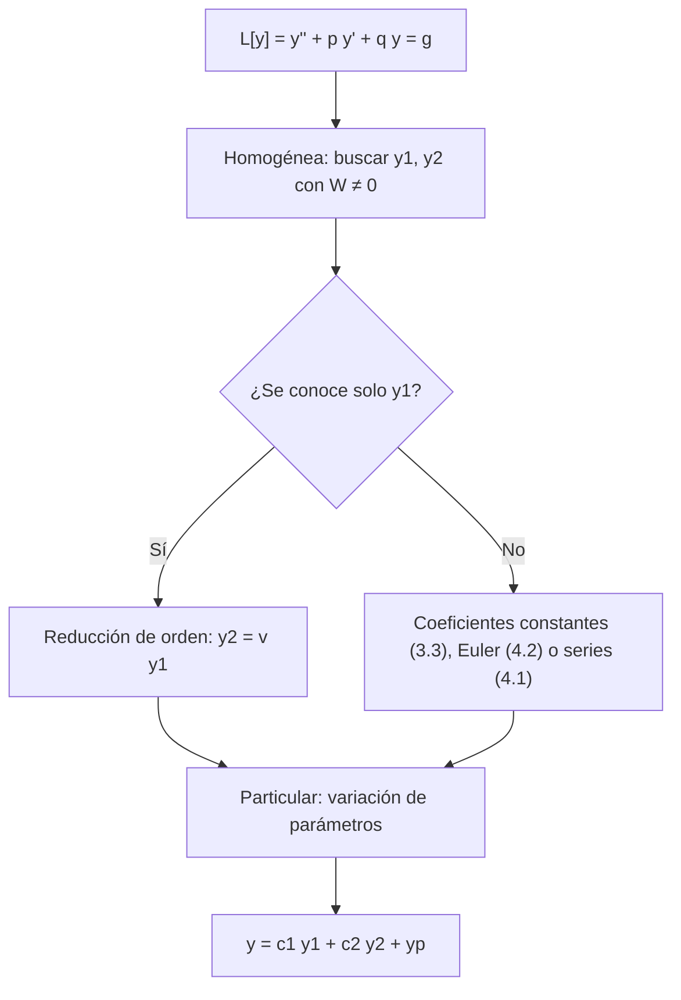

# Matemáticas para Ciencias Aplicadas IV - Ecuaciones Diferenciales de 2o Orden

## 3.2 Ecuaciones lineales de 2o Orden.

---

Las ecuaciones lineales de segundo orden tienen una estructura algebraica muy precisa: las soluciones de la ecuación homogénea forman un **espacio vectorial de dimensión 2**, y las de la no homogénea son una solución particular más ese espacio. Este tema desarrolla esa teoría, válida para coeficientes variables: el principio de superposición, el wronskiano como prueba de independencia, la fórmula de Abel, la reducción de orden y la variación de parámetros. El tema 3.3 la aplica al caso de coeficientes constantes, donde las soluciones se calculan explícitamente.

### Forma estándar y operador lineal

Se escribe la ecuación en **forma estándar**

$$ L[y] = y'' + p(x)\, y' + q(x)\, y = g(x) $$

con $p,$ $q$ y $g$ continuas en un intervalo $I.$ Si la ecuación viene como $P y'' + Q y' + R y = G,$ se divide entre $P$ donde $P \neq 0;$ los puntos donde $P = 0$ son **singulares** (tema 4.3). La aplicación $L$ es **lineal**: $L[c_1 y_1 + c_2 y_2] = c_1 L[y_1] + c_2 L[y_2].$ De ahí sale toda la teoría.

### Superposición

**Principio de superposición.** Si $y_1$ y $y_2$ son soluciones de la homogénea $L[y] = 0,$ también lo es $c_1 y_1 + c_2 y_2$ para todas las constantes. Si $y_p$ resuelve $L[y] = g$ y $y_h$ resuelve $L[y] = 0,$ entonces $y_p + y_h$ resuelve $L[y] = g.$ Y si $L[y_1] = g_1$ y $L[y_2] = g_2,$ entonces $L[y_1 + y_2] = g_1 + g_2.$

Las tres afirmaciones son la linealidad de $L.$ Para ecuaciones no lineales fallan: $y_1 = 1/(1 - x)$ resuelve $y' = y^2,$ pero $2y_1$ no.

### Independencia y el wronskiano

Dos funciones son **linealmente independientes** en $I$ si $c_1 y_1 + c_2 y_2 = 0$ en todo $I$ implica $c_1 = c_2 = 0;$ para dos funciones, equivale a que ninguna sea múltiplo constante de la otra.

**Definición.** El **wronskiano** de $y_1$ y $y_2$ es

$$ W(y_1, y_2)(x) = \begin{vmatrix} y_1 & y_2 \\ y_1' & y_2' \end{vmatrix} = y_1 y_2' - y_1' y_2 $$

**Fórmula de Abel.** Si $y_1$ y $y_2$ son soluciones de $L[y] = 0,$ entonces

$$ W(x) = W(x_0)\, \exp\left( -\int_{x_0}^{x} p(s)\, ds \right) $$

**Demostración.** $W' = y_1 y_2'' - y_1'' y_2.$ Sustituyendo $y_i'' = -p y_i' - q y_i,$ los términos con $q$ se cancelan y queda $W' = -p\, (y_1 y_2' - y_1' y_2) = -pW,$ una ecuación lineal de primer orden. $\blacksquare$

**Consecuencia.** El wronskiano de dos soluciones es **idénticamente cero o nunca cero** en $I,$ porque la exponencial no se anula.

**Teorema.** Para dos soluciones de $L[y] = 0$ en $I,$ son equivalentes: (a) son linealmente independientes; (b) $W \neq 0$ en algún punto; (c) $W \neq 0$ en todo punto.

**Demostración.** Si $W(x_0) = 0,$ el sistema $c_1 y_1(x_0) + c_2 y_2(x_0) = 0,$ $c_1 y_1'(x_0) + c_2 y_2'(x_0) = 0$ tiene una solución no trivial $(c_1, c_2).$ Entonces $c_1 y_1 + c_2 y_2$ es solución con valor y derivada nulos en $x_0;$ por unicidad (tema 3.1) es la función cero, y las soluciones son dependientes. Recíprocamente, si $c_1 y_1 + c_2 y_2 = 0$ con coeficientes no nulos, derivando se ve que $(c_1, c_2)$ es solución no trivial del sistema en cada punto, así que $W = 0.$ $\blacksquare$

### La solución general

**Teorema.** Si $y_1,$ $y_2$ son soluciones independientes de $L[y] = 0$ en $I$ (un **conjunto fundamental**), toda solución es de la forma $c_1 y_1 + c_2 y_2.$ El espacio de soluciones tiene dimensión exactamente 2.

**Demostración.** Sea $y$ una solución y $x_0 \in I.$ Como $W(x_0) \neq 0,$ el sistema $c_1 y_1(x_0) + c_2 y_2(x_0) = y(x_0),$ $c_1 y_1'(x_0) + c_2 y_2'(x_0) = y'(x_0)$ tiene solución. Entonces $c_1 y_1 + c_2 y_2$ y $y$ resuelven el mismo problema de valor inicial y, por unicidad, son iguales. $\blacksquare$

Para la ecuación no homogénea, si $y_p$ es una solución particular,

$$ y = c_1 y_1 + c_2 y_2 + y_p $$

es la solución general: la diferencia de dos soluciones de $L[y] = g$ resuelve la homogénea.

### Reducción de orden

Si se conoce una solución $y_1$ de la homogénea, se busca otra de la forma $y_2 = v(x)\, y_1(x).$ Sustituyendo, los términos con $v$ sin derivar se cancelan (porque $y_1$ es solución) y queda una ecuación de **primer orden** para $v'.$ Resolviéndola,

$$ y_2 = y_1 \int \frac{e^{-\int p(x)\, dx}}{y_1^2}\, dx $$

**Ejemplo.** $x^2 y'' - 3x y' + 4y = 0$ en $x > 0$ tiene la solución $y_1 = x^2.$ En forma estándar, $p = -3/x,$ y $e^{-\int p} = x^3.$ Entonces $y_2 = x^2 \int \frac{x^3}{x^4}\, dx = x^2 \ln x.$ Es una ecuación de Euler (tema 4.2).

### Variación de parámetros

Para la no homogénea $L[y] = g,$ conocido un conjunto fundamental $y_1,$ $y_2,$ se busca $y_p = u_1 y_1 + u_2 y_2$ con funciones $u_1,$ $u_2.$ Imponiendo la condición adicional $u_1' y_1 + u_2' y_2 = 0,$ que simplifica $y_p',$ la ecuación se reduce al sistema

$$ u_1' y_1 + u_2' y_2 = 0, \qquad u_1' y_1' + u_2' y_2' = g $$

cuyo determinante es el wronskiano. Por la regla de Cramer,

$$ y_p = -y_1 \int \frac{y_2\, g}{W}\, dx + y_2 \int \frac{y_1\, g}{W}\, dx $$

A diferencia de los coeficientes indeterminados (tema 3.3), funciona para cualquier $g$ continua y para coeficientes variables.

**Ejemplo.** $y'' + y = \sec x.$ Con $y_1 = \cos x,$ $y_2 = \sin x,$ $W = 1:$ $y_p = -\cos x \int \tan x\, dx + \sin x \int 1\, dx = \cos x \ln |\cos x| + x \sin x.$



### Implementación en Python

El programa verifica con SymPy conjuntos fundamentales y sus wronskianos, comprueba la fórmula de Abel en una ecuación de Euler, implementa la reducción de orden y la variación de parámetros, y las aplica a los ejemplos y a ecuaciones con coeficientes variables. Cada solución particular se verifica sustituyéndola en la ecuación.

```python
import sympy as sp

x = sp.symbols('x', positive=True)
y = sp.Function('y')

def wronskiano(y1, y2):
    return sp.simplify(y1 * sp.diff(y2, x) - y2 * sp.diff(y1, x))

def es_solucion(f, p, q, g=0):
    return sp.simplify(sp.diff(f, x, 2) + p * sp.diff(f, x) + q * f - g) == 0

# Conjuntos fundamentales y wronskianos
for y1, y2, p, q in [(sp.exp(x), sp.exp(2 * x), -3, 2),
                     (sp.cos(3 * x), sp.sin(3 * x), 0, 9),
                     (sp.exp(2 * x), x * sp.exp(2 * x), -4, 4)]:
    print(f'{str(y1):10} {str(y2):12} soluciones: {es_solucion(y1, p, q) and es_solucion(y2, p, q)},  W = {wronskiano(y1, y2)}')

# Fórmula de Abel: W(x) = W(x0) exp(-∫ p) para x² y'' - 3x y' + 4y = 0, es decir p = -3/x
y1, y2 = x**2, x**2 * sp.log(x)
p, q = -3 / x, 4 / x**2
print('x², x² ln x resuelven la ecuación de Euler:', es_solucion(y1, p, q), es_solucion(y2, p, q))
print('W =', wronskiano(y1, y2), '   Abel predice C·exp(-∫p) =', sp.simplify(sp.exp(-sp.integrate(p, x))))

# Reducción de orden: y2 = y1 ∫ exp(-∫p) / y1² dx
def reduccion(y1, p):
    return sp.simplify(y1 * sp.integrate(sp.exp(-sp.integrate(p, x)) / y1**2, x))
print('reducción de orden con y1 = x²:', reduccion(x**2, p))
print('reducción de orden con y1 = e^(2x) en y\'\' - 4y\' + 4y = 0:', reduccion(sp.exp(2 * x), -4))

# Variación de parámetros: y_p = -y1 ∫ y2 g / W + y2 ∫ y1 g / W
def variacion(y1, y2, g):
    W = wronskiano(y1, y2)
    return sp.simplify(-y1 * sp.integrate(sp.simplify(y2 * g / W), x) + y2 * sp.integrate(sp.simplify(y1 * g / W), x))

yp = variacion(sp.cos(x), sp.sin(x), 1 / sp.cos(x))
print('y\'\' + y = sec x:  y_p =', yp, '  verifica:', es_solucion(yp, 0, 1, 1 / sp.cos(x)))
yp = variacion(sp.exp(-x), sp.exp(2 * x), 4 * x**2)
print('y\'\' - y\' - 2y = 4x²:  y_p =', sp.expand(yp), '  verifica:', es_solucion(yp, -1, -2, 4 * x**2))
yp = variacion(sp.exp(x), x * sp.exp(x), sp.exp(x))
print('y\'\' - 2y\' + y = e^x:  y_p =', yp, '  verifica:', es_solucion(yp, -2, 1, sp.exp(x)))
# Ecuación con coeficientes variables: x y'' - (x + 1) y' + y = x², con y1 = x + 1, y2 = e^x
p, q, g = -(x + 1) / x, 1 / x, x
print('x + 1 y e^x son soluciones:', es_solucion(x + 1, p, q), es_solucion(sp.exp(x), p, q))
yp = variacion(x + 1, sp.exp(x), g)
print('x y\'\' - (x + 1) y\' + y = x²:  y_p =', sp.expand(yp), '  verifica:', es_solucion(yp, p, q, g))
```

Salida:

```text
exp(x)     exp(2*x)     soluciones: True,  W = exp(3*x)
cos(3*x)   sin(3*x)     soluciones: True,  W = 3
exp(2*x)   x*exp(2*x)   soluciones: True,  W = exp(4*x)
x², x² ln x resuelven la ecuación de Euler: True True
W = x**3    Abel predice C·exp(-∫p) = x**3
reducción de orden con y1 = x²: x**2*log(x)
reducción de orden con y1 = e^(2x) en y'' - 4y' + 4y = 0: x*exp(2*x)
y'' + y = sec x:  y_p = x*sin(x) + log(cos(x))*cos(x)   verifica: True
y'' - y' - 2y = 4x²:  y_p = -2*x**2 + 2*x - 3   verifica: True
y'' - 2y' + y = e^x:  y_p = x**2*exp(x)/2   verifica: True
x + 1 y e^x son soluciones: True True
x y'' - (x + 1) y' + y = x²:  y_p = -x**2 - 2*x - 2   verifica: True
```

### Ejercicios Propuestos

1. **Conjunto fundamental.** Verifica que $\cos 3x$ y $\sin 3x$ forman un conjunto fundamental para $y'' + 9y = 0$ y escribe la solución general.

2. **Abel.** Sin resolver la ecuación, calcula el wronskiano de dos soluciones de $x^2 y'' - 3x y' + 4y = 0$ que cumplen $W(1) = 1.$

3. **Reducción de orden.** Sabiendo que $y_1 = e^{2x}$ resuelve $y'' - 4y' + 4y = 0,$ encuentra $y_2.$

4. **Variación de parámetros.** Resuelve $y'' + y = \sec x$ en $(-\pi/2, \pi/2).$

5. **No homogénea.** Encuentra la solución general de $y'' - y' - 2y = 4x^2.$

6. **Coeficientes variables.** Verifica que $x + 1$ y $e^x$ resuelven $x y'' - (x + 1) y' + y = 0$ en $x > 0$ y resuelve $x y'' - (x + 1) y' + y = x^2.$

### Soluciones

**Ejercicio 1.** Ambas cumplen $y'' = -9y$ y $W = 3 \cos^2 3x + 3 \sin^2 3x = 3 \neq 0.$ La solución general es $y = c_1 \cos 3x + c_2 \sin 3x.$

**Ejercicio 2.** $p = -3/x,$ así que $W = W(1) \exp \int_1^x \frac{3}{s}\, ds = x^3.$ El programa lo confirma con $x^2$ y $x^2 \ln x.$

**Ejercicio 3.** $p = -4,$ $e^{-\int p} = e^{4x},$ y $y_2 = e^{2x} \int \frac{e^{4x}}{e^{4x}}\, dx = x e^{2x}.$ Es el caso de raíz doble del tema 3.3.

**Ejercicio 4.** $y = c_1 \cos x + c_2 \sin x + x \sin x + \cos x \ln (\cos x),$ con el valor absoluto innecesario porque $\cos x > 0$ en el intervalo.

**Ejercicio 5.** Las raíces de $r^2 - r - 2$ son $-1$ y 2. Con $y_p = Ax^2 + Bx + C,$ $y_p'' - y_p' - 2y_p = -2Ax^2 + (-2A - 2B)x + (2A - B - 2C),$ que igualado a $4x^2$ da $A = -2,$ $B = 2,$ $C = -3.$ La solución general es $y = c_1 e^{-x} + c_2 e^{2x} - 2x^2 + 2x - 3.$ La variación de parámetros da lo mismo.

**Ejercicio 6.** La sustitución lo verifica. En forma estándar $g = x,$ y la variación de parámetros da $y_p = -x^2 - 2x - 2,$ así que $y = c_1 (x + 1) + c_2 e^x - x^2 - 2x - 2.$ Como $x + 1$ es solución de la homogénea, sumándole $2(x + 1)$ se obtiene una particular más simple, $y_p = -x^2.$

### Referencias

1. Boyce, W. E., DiPrima, R. C., and Meade, D. B., _Elementary Differential Equations and Boundary Value Problems_. Wiley, 2017. Secciones 3.2, 3.4 y 3.6.
2. Zill, D. G., _Ecuaciones diferenciales con aplicaciones de modelado_. Cengage, 2018. Secciones 4.1, 4.2 y 4.6.
3. Coddington, E. A., _An Introduction to Ordinary Differential Equations_. Dover, 1989. Capítulo 3.
4. Simmons, G. F., _Ecuaciones diferenciales con aplicaciones y notas históricas_. McGraw-Hill, 1993. Capítulo 3.
