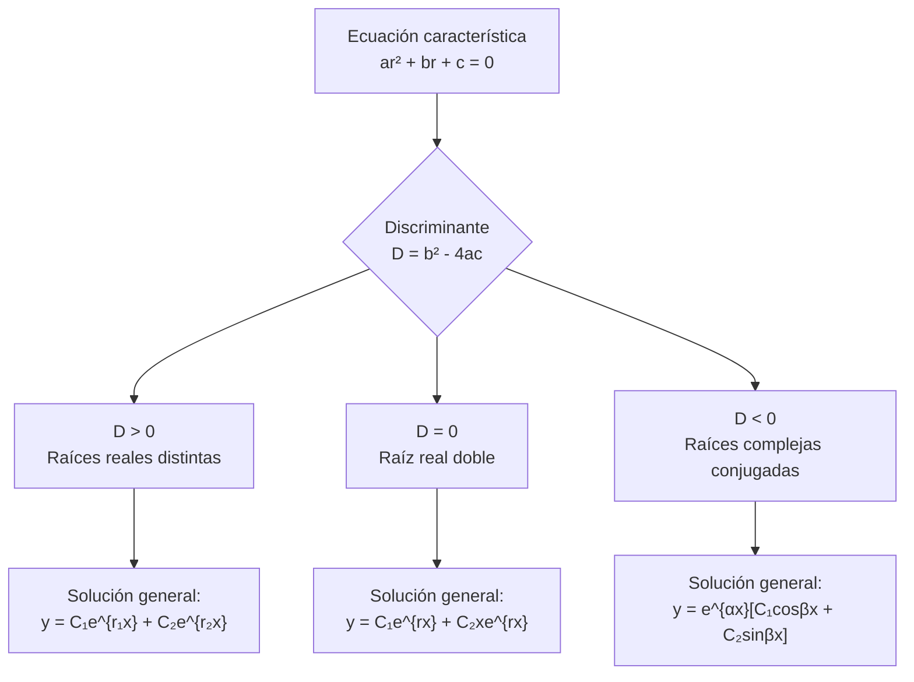

# Matemáticas para Ciencias Aplicadas IV - Ecuaciones Diferenciales de 2o Orden

## 3.3 Coeficientes constantes.

---

### 1. Introducción

Las ecuaciones diferenciales lineales de segundo orden con **coeficientes constantes** son fundamentales en ciencias aplicadas por su amplia aplicabilidad en modelado de sistemas físicos. Su forma general es:

$$a\frac{d^2y}{dx^2} + b\frac{dy}{dx} + cy = f(x)$$

donde $a$, $b$ y $c$ son constantes reales con $a \neq 0$.

### 2. Clasificación y Formas

#### 2.1 Ecuación Homogénea

Cuando $f(x) = 0$:

$$ay'' + by' + cy = 0$$

#### 2.2 Ecuación No Homogénea

Cuando $f(x) \neq 0$:

$$ay'' + by' + cy = f(x)$$

### 3. Solución de Ecuaciones Homogéneas

#### 3.1 Método de la Ecuación Característica

Suponemos una solución de la forma $y = e^{rx}$:

$$ar^2e^{rx} + bre^{rx} + ce^{rx} = 0$$

$$e^{rx}(ar^2 + br + c) = 0$$

Como $e^{rx} \neq 0$, obtenemos la **ecuación característica**:

$$ar^2 + br + c = 0$$

#### 3.2 Casos de Soluciones



##### Caso 1: Raíces reales y distintas $(b^2 - 4ac > 0)$

$$r_1, r_2 = \frac{-b \pm \sqrt{b^2 - 4ac}}{2a}$$

Solución general:

$$y(x) = C_1e^{r_1x} + C_2e^{r_2x}$$

##### Caso 2: Raíz real doble $(b^2 - 4ac = 0)$

$$r = -\frac{b}{2a}$$

Solución general:

$$y(x) = C_1e^{rx} + C_2xe^{rx}$$

##### Caso 3: Raíces complejas conjugadas $(b^2 - 4ac < 0)$

$$r = \alpha \pm i\beta$$

donde $\alpha = -\frac{b}{2a}$ y $\beta = \frac{\sqrt{4ac - b^2}}{2a}$

Solución general:

$$y(x) = e^{\alpha x}[C_1\cos(\beta x) + C_2\sin(\beta x)]$$

### 4. Solución de Ecuaciones No Homogéneas

#### 4.1 Estructura de la Solución

$$y(x) = y_h(x) + y_p(x)$$

donde:

- $y_h(x)$: solución de la ecuación homogénea
- $y_p(x)$: solución particular de la ecuación no homogénea

#### 4.2 Método de Coeficientes Indeterminados

Para encontrar $y_p(x)$ cuando $f(x)$ tiene forma específica:

| Forma de $f(x)$                     | Forma de $y_p(x)$                        |
| ----------------------------------- | ---------------------------------------- |
| $e^{kx}$                            | $Ae^{kx}$                                |
| $\sin(kx)$ o $\cos(kx)$             | $A\sin(kx) + B\cos(kx)$                  |
| $x^n$                               | $A_nx^n + A_{n-1}x^{n-1} + \cdots + A_0$ |
| $e^{kx}\sin(mx)$ o $e^{kx}\cos(mx)$ | $e^{kx}[A\sin(mx) + B\cos(mx)]$          |

**Nota:** Si algún término de $y_p$ coincide con términos de $y_h$, multiplicar por $x$ o $x^2$.

### 5. Ejemplos Resueltos

#### Ejemplo 1: Raíces reales distintas

Resolver: $y'' - 5y' + 6y = 0$

**Solución:**
Ecuación característica: $r^2 - 5r + 6 = 0$
Raíces: $r = 2, 3$
Solución general: $y(x) = C_1e^{2x} + C_2e^{3x}$

#### Ejemplo 2: Raíz real doble

Resolver: $y'' - 4y' + 4y = 0$

**Solución:**
Ecuación característica: $r^2 - 4r + 4 = 0$
Raíz doble: $r = 2$
Solución general: $y(x) = C_1e^{2x} + C_2xe^{2x}$

#### Ejemplo 3: Raíces complejas

Resolver: $y'' + 4y' + 13y = 0$

**Solución:**
Ecuación característica: $r^2 + 4r + 13 = 0$
Raíces: $r = -2 \pm 3i$
Solución general: $y(x) = e^{-2x}[C_1\cos(3x) + C_2\sin(3x)]$

#### Ejemplo 4: Ecuación no homogénea

Resolver: $y'' - 3y' + 2y = 4e^{3x}$

**Solución:**

1. Ecuación homogénea: $y'' - 3y' + 2y = 0$
   Raíces: $r = 1, 2$
   $y_h(x) = C_1e^{x} + C_2e^{2x}$

2. Solución particular: $y_p(x) = Ae^{3x}$
   Sustituir: $9Ae^{3x} - 9Ae^{3x} + 2Ae^{3x} = 4e^{3x}$
   $2A = 4$ ⇒ $A = 2$
   $y_p(x) = 2e^{3x}$

3. Solución general: $y(x) = C_1e^{x} + C_2e^{2x} + 2e^{3x}$

### 6. Implementación Computacional (Python)

```python
import numpy as np
import matplotlib.pyplot as plt
from scipy.integrate import solve_ivp

# Resolver EDO con coeficientes constantes
def resolver_edo_coef_constantes(a, b, c, f, y0, y_prime0, x_range):
    """
    Resuelve ay'' + by' + cy = f(x)
    """
    def edo_system(x, y):
        return [y[1], (f(x) - b*y[1] - c*y[0])/a]

    sol = solve_ivp(edo_system, x_range, [y0, y_prime0],
                   t_eval=np.linspace(x_range[0], x_range[1], 1000))
    return sol

# Ejemplo: y'' - 3y' + 2y = 4e^{3x}, y(0)=1, y'(0)=0
a, b, c = 1, -3, 2
f = lambda x: 4*np.exp(3*x)
y0, y_prime0 = 1, 0
x_range = [0, 5]

sol = resolver_edo_coef_constantes(a, b, c, f, y0, y_prime0, x_range)

# Graficar
plt.figure(figsize=(10, 6))
plt.plot(sol.t, sol.y[0], label='y(x)')
plt.plot(sol.t, sol.y[1], label="y'(x)")
plt.title('Solución de $y\'\' - 3y\' + 2y = 4e^{3x}$')
plt.xlabel('x')
plt.ylabel('y')
plt.legend()
plt.grid(True)
plt.show()
```

### 7. Aplicaciones Físicas

#### 7.1 Sistema Masa-Resorte

$$m\frac{d^2x}{dt^2} + c\frac{dx}{dt} + kx = F(t)$$

#### 7.2 Circuito RLC

$$L\frac{d^2q}{dt^2} + R\frac{dq}{dt} + \frac{1}{C}q = E(t)$$

#### 7.3 Péndulo Amortiguado

$$ml\frac{d^2\theta}{dt^2} + \beta\frac{d\theta}{dt} + mg\sin\theta = 0$$

### 8. Ejercicios Propuestos

#### Ejercicio 1

Resolver: $y'' + 4y' + 4y = 0$

#### Ejercicio 2

Encontrar la solución general de: $y'' + 9y = 0$

#### Ejercicio 3

Resolver el problema de valor inicial:

$\begin{cases} y'' - 5y' + 6y = 0 \\\ y(0) = 1 \\\ y'(0) = 0 \end{cases}$

#### Ejercicio 4

Encontrar una solución particular de: $y'' + y = 2\sin(x)$

#### Ejercicio 5

Resolver: $y'' - 2y' + y = e^x$

#### Ejercicio 6

Implementar en Python la solución de:

$\begin{cases} y'' + 2y' + 5y = 0 \\\ y(0) = 1 \\\ y'(0) = 0 \end{cases}$

y graficar la solución.

### 9. Referencias

**Bibliografía básica:**

1. Boyce, W., DiPrima, R. (2004). _Elementary Differential Equations and Boundary Value Problems_. Wiley. (Capítulo 3)
2. Edwards, C. H., Penney, D. E. (2002). _Ecuaciones diferenciales elementales y problemas con condiciones a la frontera_. Prentice Hall. (Capítulo 3)

**Bibliografía complementaria:**

1. Hubbard, J. H., West, B. H. (1995). _Differential Equations: A Dynamical Systems Approach_. Springer-Verlag. (Capítulo 4)
2. Zill, D. G., Wright, W. S. (1995). _Differential Equations with Computer Lab Experiments_. PWS Publishing Company. (Capítulo 4)

### 10. Consejos de Estudio

1. **Memorizar los tres casos** de la ecuación característica
2. **Practicar la identificación** de la forma correcta de solución particular
3. **Verificar soluciones** mediante sustitución en la ecuación original
4. **Utilizar software** para visualizar soluciones y comprender su comportamiento
5. **Relacionar cada tipo de ecuación** con aplicaciones físicas concretas
