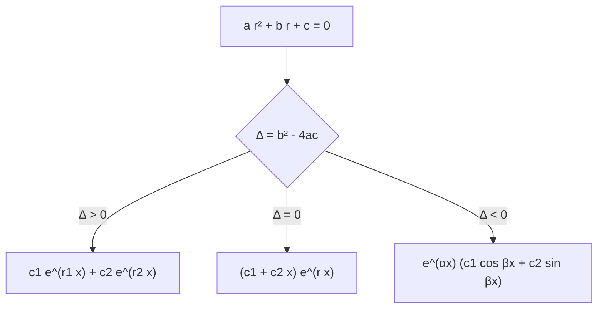

# Matemáticas para Ciencias Aplicadas IV - Ecuaciones Diferenciales de 2o Orden

## 3.3 Coeficientes constantes.

---

Cuando los coeficientes son constantes, $a y'' + b y' + c y = g(x),$ las soluciones de la homogénea se calculan con álgebra: basta resolver una ecuación cuadrática. Es el caso más importante en las aplicaciones, porque describe cualquier sistema lineal que no cambia con el tiempo: un resorte, un circuito RLC, la suspensión de un auto. Este tema obtiene la solución general de la homogénea en sus tres casos, el método de coeficientes indeterminados para la no homogénea y el análisis del oscilador amortiguado y forzado, incluida la **resonancia**.

### La ecuación característica

Se busca una solución $y = e^{rx}.$ Sustituyendo,

$$ a r^2 e^{rx} + b r e^{rx} + c e^{rx} = e^{rx} (a r^2 + b r + c) = 0 $$

y como $e^{rx} \neq 0,$ $y = e^{rx}$ es solución si y solo si $r$ es raíz de la **ecuación característica**

$$ a r^2 + b r + c = 0 $$

Según el discriminante $\Delta = b^2 - 4ac$ hay tres casos. En cada uno se obtienen dos soluciones con wronskiano no nulo, así que forman un conjunto fundamental (tema 3.2).

**Raíces reales distintas,** si $\Delta > 0.$ Entonces $y = c_1 e^{r_1 x} + c_2 e^{r_2 x},$ con $W = (r_2 - r_1) e^{(r_1 + r_2) x} \neq 0.$

**Raíz doble,** si $\Delta = 0.$ La raíz $r = -b/(2a)$ da solo $e^{rx}.$ Por reducción de orden (tema 3.2), con $p = b/a = -2r,$ se obtiene $y_2 = e^{rx} \int \frac{e^{2rx}}{e^{2rx}}\, dx = x e^{rx}:$

$$ y = (c_1 + c_2 x)\, e^{rx} $$

**Raíces complejas,** si $\Delta \lt 0.$ Son $r = \alpha \pm i\beta$ con $\alpha = -b/(2a)$ y $\beta = \sqrt{4ac - b^2}/(2a).$ Por la fórmula de Euler, $e^{(\alpha + i\beta) x} = e^{\alpha x} (\cos \beta x + i \sin \beta x),$ y como los coeficientes son reales, la parte real y la imaginaria son soluciones por separado:

$$ y = e^{\alpha x} (c_1 \cos \beta x + c_2 \sin \beta x) $$

Equivalentemente, $y = A e^{\alpha x} \cos(\beta x - \varphi),$ una oscilación de frecuencia $\beta$ con amplitud que crece o decae según el signo de $\alpha.$



**Ejemplos.** $y'' - 5y' + 6y = 0$ tiene raíces 2 y 3: $y = c_1 e^{2x} + c_2 e^{3x}.$ $y'' - 4y' + 4y = 0$ tiene raíz doble 2: $y = (c_1 + c_2 x) e^{2x}.$ $y'' + 4y' + 13y = 0$ tiene raíces $-2 \pm 3i:$ $y = e^{-2x} (c_1 \cos 3x + c_2 \sin 3x).$

### Coeficientes indeterminados

Para $a y'' + b y' + c y = g(x)$ con $g$ formada por polinomios, exponenciales, senos y cosenos (y productos de ellos), la solución particular tiene la **misma forma** que $g,$ con coeficientes por determinar:

| $g(x)$ | Forma de $y_p$ |
| --- | --- |
| polinomio de grado $n$ | $A_n x^n + \cdots + A_0$ |
| $e^{kx}$ | $A e^{kx}$ |
| $\cos \omega x$ o $\sin \omega x$ | $A \cos \omega x + B \sin \omega x$ |
| $e^{kx} \cos \omega x$ o $e^{kx} \sin \omega x$ | $e^{kx} (A \cos \omega x + B \sin \omega x)$ |
| polinomio por $e^{kx}$ | polinomio del mismo grado por $e^{kx}$ |

**Regla de modificación.** Si algún término de la forma propuesta es solución de la **homogénea**, se multiplica la propuesta por $x$ (o por $x^2,$ si la raíz es doble). La razón: $L[e^{kx}] = (a k^2 + b k + c)\, e^{kx},$ que es cero si $k$ es raíz, así que ninguna constante $A$ sirve.

**Ejemplos.**

- $y'' - 3y' + 2y = 4e^{3x}.$ Las raíces son 1 y 2, y 3 no lo es: $y_p = A e^{3x}$ da $(9 - 9 + 2) A = 4,$ $A = 2.$ Solución general: $y = c_1 e^x + c_2 e^{2x} + 2 e^{3x}.$
- $y'' - 3y' + 2y = e^{2x}.$ Ahora 2 es raíz simple: $y_p = A x e^{2x},$ y se obtiene $A = 1.$
- $y'' + y = 2 \sin x.$ $\pm i$ son raíces: $y_p = x (A \cos x + B \sin x),$ y resulta $y_p = -x \cos x.$ La amplitud **crece linealmente**: es resonancia sin amortiguamiento.

Si $g$ no tiene esa forma, como $\sec x$ o $\ln x,$ se usa variación de parámetros (tema 3.2) o la transformada de Laplace (tema 3.4).

### El oscilador armónico

Una masa $m$ unida a un resorte de constante $k,$ con amortiguamiento $c$ y fuerza externa $F(t),$ cumple por la segunda ley de Newton

$$ m x'' + c x' + k x = F(t) $$

y un circuito RLC cumple la ecuación análoga $L q'' + R q' + q/C = E(t).$ Se definen la **frecuencia natural** $\omega_0 = \sqrt{k/m}$ y el **discriminante** $c^2 - 4mk.$

**Oscilaciones libres,** con $F = 0:$

| Caso | Condición | Raíces | Comportamiento |
| --- | --- | --- | --- |
| Sin amortiguamiento | $c = 0$ | $\pm i \omega_0$ | oscila para siempre con frecuencia $\omega_0$ |
| Subamortiguado | $c^2 \lt 4mk$ | complejas | oscila con amplitud que decae como $e^{-ct/2m}$ |
| Crítico | $c^2 = 4mk$ | doble | vuelve al equilibrio lo más rápido posible, sin oscilar |
| Sobreamortiguado | $c^2 > 4mk$ | reales negativas | vuelve lentamente, sin oscilar |

Los amortiguadores de un automóvil se diseñan cerca del caso crítico.

**Oscilaciones forzadas.** Con $F(t) = F_0 \cos \omega t$ y $c > 0,$ la solución es $x = x_h + x_p:$ la parte homogénea $x_h$ decae (**transitorio**) y queda la respuesta **estacionaria** $x_p = A(\omega) \cos(\omega t - \delta),$ con

$$ A(\omega) = \frac{F_0}{\sqrt{(k - m\omega^2)^2 + (c\omega)^2}} $$

La amplitud es máxima en $\omega_r = \sqrt{\omega_0^2 - c^2/(2m^2)},$ siempre que $c^2 \lt 2mk,$ y ese máximo crece sin límite cuando $c \to 0:$ es la **resonancia**. Con $c = 0$ y $\omega = \omega_0$ la solución crece como $t \sin \omega_0 t,$ como en el ejemplo $y'' + y = 2 \sin x.$ La resonancia explica tanto la sintonía de un radio (un circuito RLC que amplifica una frecuencia) como el riesgo de que un puente oscile peligrosamente.

### Implementación en Python

El programa resuelve con SymPy las ecuaciones homogéneas de los ejemplos y ejercicios, obtiene soluciones particulares por coeficientes indeterminados (incluidos los casos con regla de modificación), resuelve los problemas de valor inicial, clasifica el oscilador $x'' + c x' + 4x = 0$ según $c,$ y localiza numéricamente el pico de resonancia comparándolo con la fórmula.

```python
import sympy as sp
import numpy as np

x, t = sp.symbols('x t', real=True)
y = sp.Function('y')
r = sp.symbols('r')

def caracteristica(a, b, c):
    raices = sp.roots(a * r**2 + b * r + c, r)
    return raices

# La solución general según las raíces
for a, b, c in [(1, -5, 6), (1, -4, 4), (1, 4, 13), (1, 4, 4), (1, 0, 9)]:
    edo = sp.Eq(a * y(x).diff(x, 2) + b * y(x).diff(x) + c * y(x), 0)
    print(f'{a}y\'\' + ({b})y\' + ({c})y = 0  raíces {caracteristica(a, b, c)}  ->  {sp.dsolve(edo).rhs}')

# Coeficientes indeterminados, con y sin resonancia
def particular(a, b, c, g):
    sol = sp.dsolve(sp.Eq(a * y(x).diff(x, 2) + b * y(x).diff(x) + c * y(x), g)).rhs
    return sp.simplify(sol.subs({sp.Symbol('C1'): 0, sp.Symbol('C2'): 0}))
for a, b, c, g in [(1, -3, 2, 4 * sp.exp(3 * x)), (1, -3, 2, sp.exp(2 * x)), (1, 0, 1, 2 * sp.sin(x)),
                   (1, -2, 1, sp.exp(x)), (1, 0, 4, 3 * sp.cos(x) + x)]:
    print(f'g = {g}:  y_p = {particular(a, b, c, g)}')

# Valores iniciales de los ejercicios
pvi = [(sp.Eq(y(x).diff(x, 2) - 5 * y(x).diff(x) + 6 * y(x), 0), {y(0): 1, y(x).diff(x).subs(x, 0): 0}),
       (sp.Eq(y(x).diff(x, 2) + 2 * y(x).diff(x) + 5 * y(x), 0), {y(0): 1, y(x).diff(x).subs(x, 0): 0})]
for edo, ics in pvi:
    print('PVI:', sp.dsolve(edo, ics=ics).rhs)

# Oscilador amortiguado m x'' + c x' + k x = 0 con m = 1, k = 4: tipo de amortiguamiento según c
for c in [0, 1, 4, 5]:
    disc = c**2 - 16
    tipo = 'sin amortiguamiento' if c == 0 else ('subamortiguado' if disc < 0 else 'crítico' if disc == 0 else 'sobreamortiguado')
    sol = sp.dsolve(sp.Eq(y(t).diff(t, 2) + c * y(t).diff(t) + 4 * y(t), 0),
                    ics={y(0): 1, y(t).diff(t).subs(t, 0): 0}).rhs
    print(f'c = {c}: {tipo:20} x(t) = {sp.simplify(sol)}')

# Resonancia: amplitud de la respuesta estacionaria de x'' + c x' + 4x = cos(ω t)
def amplitud(w, c):
    return 1 / np.sqrt((4 - w**2)**2 + (c * w)**2)
for c in [0.1, 0.5, 2.0]:
    ws = np.linspace(0.01, 4, 4000)
    A = amplitud(ws, c)
    print(f'c = {c}: amplitud máxima {A.max():.3f} en ω = {ws[A.argmax()]:.3f}  (teoría: ω = {np.sqrt(4 - c**2 / 2):.3f})')
```

Salida:

```text
1y'' + (-5)y' + (6)y = 0  raíces {3: 1, 2: 1}  ->  (C1 + C2*exp(x))*exp(2*x)
1y'' + (-4)y' + (4)y = 0  raíces {2: 2}  ->  (C1 + C2*x)*exp(2*x)
1y'' + (4)y' + (13)y = 0  raíces {-2 - 3*I: 1, -2 + 3*I: 1}  ->  (C1*sin(3*x) + C2*cos(3*x))*exp(-2*x)
1y'' + (4)y' + (4)y = 0  raíces {-2: 2}  ->  (C1 + C2*x)*exp(-2*x)
1y'' + (0)y' + (9)y = 0  raíces {-3*I: 1, 3*I: 1}  ->  C1*sin(3*x) + C2*cos(3*x)
g = 4*exp(3*x):  y_p = 2*exp(3*x)
g = exp(2*x):  y_p = x*exp(2*x)
g = 2*sin(x):  y_p = -x*cos(x)
g = exp(x):  y_p = x**2*exp(x)/2
g = x + 3*cos(x):  y_p = x/4 + cos(x)
PVI: (3 - 2*exp(x))*exp(2*x)
PVI: (sin(2*x)/2 + cos(2*x))*exp(-x)
c = 0: sin amortiguamiento  x(t) = cos(2*t)
c = 1: subamortiguado       x(t) = (sqrt(15)*sin(sqrt(15)*t/2)/15 + cos(sqrt(15)*t/2))*exp(-t/2)
c = 4: crítico              x(t) = (2*t + 1)*exp(-2*t)
c = 5: sobreamortiguado     x(t) = (4*exp(3*t) - 1)*exp(-4*t)/3
c = 0.1: amplitud máxima 5.002 en ω = 1.999  (teoría: ω = 1.999)
c = 0.5: amplitud máxima 1.008 en ω = 1.969  (teoría: ω = 1.969)
c = 2.0: amplitud máxima 0.289 en ω = 1.414  (teoría: ω = 1.414)
```

Con $c = 0.1$ la amplitud máxima es unas 20 veces la de $c = 2,$ y el pico se acerca a la frecuencia natural $\omega_0 = 2.$

### Ejercicios Propuestos

1. **Raíz doble.** Resuelve $y'' + 4y' + 4y = 0.$

2. **Complejas.** Encuentra la solución general de $y'' + 9y = 0.$

3. **Valor inicial.** Resuelve $y'' - 5y' + 6y = 0,$ $y(0) = 1,$ $y'(0) = 0.$

4. **Resonancia.** Encuentra una solución particular de $y'' + y = 2 \sin x.$

5. **Modificación doble.** Resuelve $y'' - 2y' + y = e^x.$

6. **Oscilador.** Resuelve $y'' + 2y' + 5y = 0,$ $y(0) = 1,$ $y'(0) = 0,$ e indica el tipo de amortiguamiento.

### Soluciones

**Ejercicio 1.** Raíz doble $-2:$ $y = (c_1 + c_2 x) e^{-2x}.$

**Ejercicio 2.** Raíces $\pm 3i:$ $y = c_1 \cos 3x + c_2 \sin 3x.$

**Ejercicio 3.** $y = c_1 e^{2x} + c_2 e^{3x},$ con $c_1 + c_2 = 1$ y $2c_1 + 3c_2 = 0:$ $c_1 = 3,$ $c_2 = -2,$ y $y = 3e^{2x} - 2e^{3x}.$

**Ejercicio 4.** $\pm i$ son raíces, así que $y_p = x (A \cos x + B \sin x).$ Sustituyendo, $y_p'' + y_p = -2A \sin x + 2B \cos x = 2 \sin x,$ de donde $A = -1,$ $B = 0:$ $y_p = -x \cos x.$

**Ejercicio 5.** 1 es raíz doble, así que $y_p = A x^2 e^x.$ Se obtiene $2A = 1:$ $y = (c_1 + c_2 x) e^x + \tfrac{1}{2} x^2 e^x.$

**Ejercicio 6.** Raíces $-1 \pm 2i:$ subamortiguado. Con las condiciones, $y = e^{-x} \left( \cos 2x + \tfrac{1}{2} \sin 2x \right).$

### Referencias

1. Boyce, W. E., DiPrima, R. C., and Meade, D. B., _Elementary Differential Equations and Boundary Value Problems_. Wiley, 2017. Secciones 3.1, 3.3 a 3.5, 3.7 y 3.8.
2. Zill, D. G., _Ecuaciones diferenciales con aplicaciones de modelado_. Cengage, 2018. Secciones 4.3, 4.4 y 5.1.
3. Edwards, C. H., and Penney, D. E., _Ecuaciones diferenciales y problemas con valores en la frontera_. Pearson, 2009. Secciones 3.3 a 3.6.
4. French, A. P., _Vibraciones y ondas_. Reverté, 1974. Capítulos 3 y 4.
