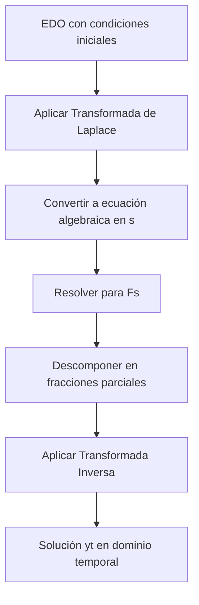

# Matemáticas para Ciencias Aplicadas IV - Ecuaciones Diferenciales de 2o Orden

## 3.4 Transformada de Laplace.

---

### 1. Introducción

La **Transformada de Laplace** es una poderosa herramienta para resolver ecuaciones diferenciales lineales con coeficientes constantes, especialmente cuando se tienen condiciones iniciales. Convierte problemas diferenciales en problemas algebraicos más simples.

### 2. Definición Fundamental

#### 2.1 Transformada de Laplace

La transformada de Laplace de una función $f(t)$ definida para $t \geq 0$ es:

$$\mathcal{L}\{f(t)\} = F(s) = \int_{0}^{\infty} e^{-st}f(t)dt$$

donde $s$ es un parámetro complejo.

#### 2.2 Transformada Inversa

Si $F(s)$ es la transformada de Laplace de $f(t)$, entonces:

$$\mathcal{L}^{-1}\{F(s)\} = f(t)$$

### 3. Propiedades Principales

#### 3.1 Linealidad

$$\mathcal{L}\{af(t) + bg(t)\} = a\mathcal{L}\{f(t)\} + b\mathcal{L}\{g(t)\}$$

#### 3.2 Transformada de Derivadas

Para una función $f(t)$ con derivadas continuas:

- $\mathcal{L}\{f'(t)\} = sF(s) - f(0)$
- $\mathcal{L}\{f''(t)\} = s^2F(s) - sf(0) - f'(0)$
- $\mathcal{L}\{f^{(n)}(t)\} = s^nF(s) - s^{n-1}f(0) - \cdots - f^{(n-1)}(0)$

#### 3.3 Traslación en el Dominio s

$$\mathcal{L}\{e^{at}f(t)\} = F(s-a)$$

#### 3.4 Transformada de Funciones Periódicas

Si $f(t)$ es periódica con período $T$:

$$\mathcal{L}\{f(t)\} = \frac{1}{1-e^{-sT}}\int_{0}^{T} e^{-st}f(t)dt$$

### 4. Transformadas de Funciones Elementales

| Función $f(t)$ | Transformada $F(s)$           |
| -------------- | ----------------------------- |
| $1$            | $\frac{1}{s}$                 |
| $t^n$          | $\frac{n!}{s^{n+1}}$          |
| $e^{at}$       | $\frac{1}{s-a}$               |
| $\sin(at)$     | $\frac{a}{s^2+a^2}$           |
| $\cos(at)$     | $\frac{s}{s^2+a^2}$           |
| $t\sin(at)$    | $\frac{2as}{(s^2+a^2)^2}$     |
| $t\cos(at)$    | $\frac{s^2-a^2}{(s^2+a^2)^2}$ |

### 5. Proceso de Solución de EDOs con Laplace



### 6. Método de Fracciones Parciales

Para encontrar la transformada inversa, often necesitamos descomponer:

$$F(s) = \frac{P(s)}{Q(s)}$$

en fracciones más simples:

- Factores lineales: $\frac{A}{s-a}$
- Factores repetidos: $\frac{A}{(s-a)^n} + \frac{B}{(s-a)^{n-1}} + \cdots$
- Factores cuadráticos: $\frac{As+B}{s^2+bs+c}$

### 7. Ejemplos Resueltos

#### Ejemplo 1: Ecuación homogénea

Resolver: $\begin{cases} y'' - 3y' + 2y = 0 \\\ y(0) = 1 \\\ y'(0) = 0 \end{cases}$

**Solución:**
Aplicamos Laplace:

$$\mathcal{L}\{y''\} - 3\mathcal{L}\{y'\} + 2\mathcal{L}\{y\} = 0$$

$$[s^2Y(s) - sy(0) - y'(0)] - 3[sY(s) - y(0)] + 2Y(s) = 0$$

$$(s^2 - 3s + 2)Y(s) - s + 3 = 0$$

$$Y(s) = \frac{s-3}{s^2-3s+2} = \frac{s-3}{(s-1)(s-2)}$$

Descomponemos en fracciones parciales:

$$Y(s) = \frac{2}{s-2} - \frac{1}{s-1}$$

Aplicamos transformada inversa:

$$y(t) = 2e^{2t} - e^{t}$$

#### Ejemplo 2: Ecuación no homogénea

Resolver: $\begin{cases} y'' + 4y = \sin(2t) \\\ y(0) = 0 \\\ y'(0) = 1 \end{cases}$

**Solución:**
Aplicamos Laplace:

$$s^2Y(s) - sy(0) - y'(0) + 4Y(s) = \frac{2}{s^2+4}$$

$$(s^2+4)Y(s) - 1 = \frac{2}{s^2+4}$$

$$Y(s) = \frac{1}{s^2+4} + \frac{2}{(s^2+4)^2}$$

Aplicamos transformada inversa:

$$y(t) = \frac{1}{2}\sin(2t) + \frac{1}{8}[\sin(2t) - 2t\cos(2t)]$$

#### Ejemplo 3: Función escalón unitario

Resolver: $\begin{cases} y'' + y = u(t-1) \\\ y(0) = 0 \\\ y'(0) = 0 \end{cases}$

**Solución:**
Aplicamos Laplace:

$$s^2Y(s) + Y(s) = \frac{e^{-s}}{s}$$

$$Y(s) = \frac{e^{-s}}{s(s^2+1)}$$

Descomponemos:

$$\frac{1}{s(s^2+1)} = \frac{1}{s} - \frac{s}{s^2+1}$$

Aplicamos transformada inversa:

$$y(t) = u(t-1)[1 - \cos(t-1)]$$

### 8. Implementación Computacional (Python)

```python
import numpy as np
import matplotlib.pyplot as plt
import sympy as sp
from sympy.integrals.transforms import laplace_transform, inverse_laplace_transform

# Definir símbolos
t, s = sp.symbols('t s')
y = sp.Function('y')(t)

# Ejemplo: Resolver y'' - 3y' + 2y = 0, y(0)=1, y'(0)=0
# Aplicar transformada de Laplace
edo = sp.Eq(y.diff(t, t) - 3*y.diff(t) + 2*y, 0)
laplace_edo = laplace_transform(edo.lhs - edo.rhs, t, s, noconds=True)

# Aplicar condiciones iniciales
laplace_edo = laplace_edo.subs({y.subs(t, 0): 1,
                               y.diff(t).subs(t, 0): 0,
                               laplace_transform(y, t, s, noconds=True): sp.Symbol('Y')})

# Resolver para Y(s)
Y_s = sp.solve(laplace_edo, sp.Symbol('Y'))[0]

# Aplicar transformada inversa
solucion = inverse_laplace_transform(Y_s, s, t)
print("Solución:", solucion)

# Graficar la solución
t_vals = np.linspace(0, 5, 100)
y_vals = [solucion.subs(t, val).evalf() for val in t_vals]

plt.figure(figsize=(10, 6))
plt.plot(t_vals, y_vals)
plt.title('Solución de $y\'\' - 3y\' + 2y = 0$')
plt.xlabel('t')
plt.ylabel('y(t)')
plt.grid(True)
plt.show()
```

### 9. Aplicaciones en Ingeniería

#### 9.1 Circuitos Eléctricos

Análisis de circuitos RLC con fuentes variables en el tiempo.

#### 9.2 Sistemas Mecánicos

Vibraciones forzadas y amortiguadas en sistemas masa-resorte.

#### 9.3 Teoría de Control

Análisis de sistemas de control y estabilidad.

### 10. Ejercicios Propuestos

#### Ejercicio 1

Calcular la transformada de Laplace de:
a) $f(t) = t^2 e^{-3t}$
b) $f(t) = \cos(2t) + 3\sin(2t)$
c) $f(t) = e^{-t}\sin(3t)$

#### Ejercicio 2

Resolver usando transformada de Laplace:

$\begin{cases} y'' + 4y' + 4y = 0 \\\ y(0) = 1 \\\ y'(0) = 2 \end{cases}$

#### Ejercicio 3

Resolver:

$\begin{cases} y'' + 9y = \cos(2t) \\\ y(0) = 0 \\\ y'(0) = 0 \end{cases}$

#### Ejercicio 4

Resolver con función escalón:

$\begin{cases} y'' + y = u(t-2) \\\ y(0) = 0 \\\ y'(0) = 1 \end{cases}$

#### Ejercicio 5

Implementar en Python la solución de:

$\begin{cases} y'' + 2y' + 5y = e^{-t} \\\ y(0) = 0 \\\ y'(0) = 1 \end{cases}$

### 11. Referencias

**Bibliografía básica:**

1. Boyce, W., DiPrima, R. (2004). _Elementary Differential Equations and Boundary Value Problems_. Wiley. (Capítulo 6)
2. Edwards, C. H., Penney, D. E. (2002). _Ecuaciones diferenciales elementales y problemas con condiciones a la frontera_. Prentice Hall. (Capítulo 7)

**Bibliografía complementaria:**

1. Zill, D. G., Wright, W. S. (1995). _Differential Equations with Computer Lab Experiments_. PWS Publishing Company. (Capítulo 7)
2. Cooper, J. M. (1998). _Introduction to Partial Differential Equations with MatLab_. Birkhäuser. (Capítulo 4)

### 12. Consejos de Estudio

1. **Memorizar las transformadas básicas** y propiedades principales
2. **Practicar la descomposición en fracciones parciales**
3. **Entender el significado físico** de la variable $s$ en el dominio de Laplace
4. **Utilizar software** para verificar resultados y visualizar soluciones
5. **Relacionar con aplicaciones prácticas** en ingeniería y física
