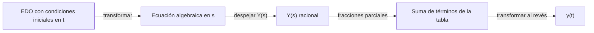

# Matemáticas para Ciencias Aplicadas IV - Ecuaciones Diferenciales de 2o Orden

## 3.4 Transformada de Laplace.

---

La **transformada de Laplace** convierte una ecuación diferencial lineal con coeficientes constantes en una ecuación **algebraica**: las derivadas se vuelven multiplicaciones por $s$ y las condiciones iniciales entran automáticamente. Se resuelve la ecuación algebraica y se regresa con la transformada inversa. El método es especialmente útil cuando el término forzante es discontinuo o impulsivo (tema 3.5), y es la base del análisis de sistemas en ingeniería eléctrica y de control.

### Definición

**Definición.** La transformada de Laplace de una función $f(t)$ definida para $t \geq 0$ es

$$ F(s) = \mathcal{L}\{f\}(s) = \int_0^\infty e^{-st} f(t)\, dt $$

para los valores de $s$ en que la integral converge.

**Existencia.** Si $f$ es continua por tramos en cada intervalo $[0, T]$ y es de **orden exponencial**, es decir, $|f(t)| \leq M e^{ct}$ para $t$ grande, entonces $\mathcal{L}\{f\}(s)$ existe para $s > c.$ Por ejemplo, $e^{t^2}$ no tiene transformada, pero todos los polinomios, exponenciales, senos y cosenos sí.

**Ejemplos.**

$$ \mathcal{L}\{1\} = \int_0^\infty e^{-st}\, dt = \frac{1}{s}, \qquad \mathcal{L}\{e^{at}\} = \int_0^\infty e^{-(s - a) t}\, dt = \frac{1}{s - a} \quad (s > a) $$

Con $a = i\omega$ y la fórmula de Euler, $\mathcal{L}\{\cos \omega t + i \sin \omega t\} = \frac{1}{s - i\omega} = \frac{s + i\omega}{s^2 + \omega^2},$ y separando parte real e imaginaria se obtienen las transformadas del coseno y del seno.

| $f(t)$ | $F(s)$ | | $f(t)$ | $F(s)$ |
| --- | --- | --- | --- | --- |
| $1$ | $\dfrac{1}{s}$ | | $\cos \omega t$ | $\dfrac{s}{s^2 + \omega^2}$ |
| $t^n$ | $\dfrac{n!}{s^{n + 1}}$ | | $\sin \omega t$ | $\dfrac{\omega}{s^2 + \omega^2}$ |
| $e^{at}$ | $\dfrac{1}{s - a}$ | | $t \sin \omega t$ | $\dfrac{2\omega s}{(s^2 + \omega^2)^2}$ |
| $t^n e^{at}$ | $\dfrac{n!}{(s - a)^{n + 1}}$ | | $e^{at} \cos \omega t$ | $\dfrac{s - a}{(s - a)^2 + \omega^2}$ |

### Propiedades

**Linealidad.** $\mathcal{L}\{a f + b g\} = a F + b G,$ porque la integral es lineal.

**Derivadas.** Si $f$ es continua y de orden exponencial y $f'$ es continua por tramos,

$$ \mathcal{L}\{f'\} = s F(s) - f(0), \qquad \mathcal{L}\{f''\} = s^2 F(s) - s f(0) - f'(0) $$

**Demostración.** Integrando por partes, $\int_0^\infty e^{-st} f'(t)\, dt = \left[ e^{-st} f(t) \right]_0^\infty + s \int_0^\infty e^{-st} f(t)\, dt = -f(0) + s F(s),$ porque $e^{-st} f(t) \to 0$ para $s$ grande. Aplicándolo a $f'$ se obtiene la segunda. $\blacksquare$

Esta es la propiedad clave: derivar en $t$ es multiplicar por $s$ en el dominio de la transformada, más términos con las condiciones iniciales.

**Traslación en la variable de la transformada.** $\mathcal{L}\{e^{at} f(t)\} = F(s - a).$ Por ejemplo, $\mathcal{L}\{e^{-t} \sin 3t\} = \frac{3}{(s + 1)^2 + 9}.$

**Multiplicación por la variable.** $\mathcal{L}\{t f(t)\} = -F'(s),$ derivando bajo la integral. Así se obtiene $\mathcal{L}\{t \sin \omega t\}.$

**Convolución.** La convolución de $f$ y $g$ es $(f * g)(t) = \int_0^t f(t - \tau)\, g(\tau)\, d\tau,$ y

$$ \mathcal{L}\{f * g\} = F(s)\, G(s) $$

En particular, la solución de $a y'' + b y' + c y = g$ con condiciones nulas es $y = h * g,$ donde $h = \mathcal{L}^{-1}\{1/(a s^2 + b s + c)\}$ es la **respuesta al impulso** del sistema (tema 3.5), y $H(s) = 1/(a s^2 + b s + c)$ es su **función de transferencia**.

**La inversa.** Si $f$ y $g$ son continuas y tienen la misma transformada, son iguales (teorema de Lerch). Por eso $\mathcal{L}^{-1}$ está bien definida y se calcula leyendo la tabla al revés, después de descomponer en **fracciones parciales**: factores lineales $\frac{A}{s - a},$ repetidos $\frac{A_k}{(s - a)^k}$ y cuadráticos irreducibles $\frac{A s + B}{(s - \alpha)^2 + \beta^2},$ que se invierten completando el cuadrado y usando la traslación.

### Resolución de problemas de valor inicial



**Ejemplo 1.** $y'' - 3y' + 2y = 0,$ $y(0) = 1,$ $y'(0) = 0.$ Transformando,

$$ [s^2 Y - s] - 3[sY - 1] + 2Y = 0 \quad \Rightarrow \quad Y(s) = \frac{s - 3}{(s - 1)(s - 2)} = \frac{2}{s - 1} - \frac{1}{s - 2} $$

Los coeficientes se obtienen evaluando: $A = \frac{1 - 3}{1 - 2} = 2$ y $B = \frac{2 - 3}{2 - 1} = -1.$ Por lo tanto $y(t) = 2e^t - e^{2t}.$ Se comprueba: $y(0) = 1$ y $y'(0) = 2 - 2 = 0.$

**Ejemplo 2 (resonancia).** $y'' + 4y = \sin 2t,$ $y(0) = 0,$ $y'(0) = 1.$

$$ (s^2 + 4) Y - 1 = \frac{2}{s^2 + 4} \quad \Rightarrow \quad Y = \frac{1}{s^2 + 4} + \frac{2}{(s^2 + 4)^2} $$

Con $\mathcal{L}^{-1}\left\{ \frac{1}{(s^2 + \omega^2)^2} \right\} = \frac{\sin \omega t - \omega t \cos \omega t}{2\omega^3},$

$$ y(t) = \frac{1}{2} \sin 2t + \frac{1}{8} (\sin 2t - 2t \cos 2t) = \frac{5}{8} \sin 2t - \frac{t}{4} \cos 2t $$

El término $t \cos 2t$ es la resonancia: la frecuencia forzante coincide con la natural.

**Ventajas.** No hay que encontrar primero la solución general y luego ajustar constantes; las condiciones iniciales entran desde el principio. Y el término forzante puede ser discontinuo, lo que estudia el tema 3.5.

### Implementación en Python

SymPy calcula transformadas con `laplace_transform` y sus inversas con `inverse_laplace_transform`; `apart` hace la descomposición en fracciones parciales. El programa reproduce la tabla, calcula las transformadas del ejercicio 1, resuelve los problemas de valor inicial siguiendo el método (transformar, despejar, descomponer, invertir) y compara con `dsolve`. Al final verifica el teorema de convolución en un ejemplo.

```python
import sympy as sp

t, tau = sp.symbols('t tau', positive=True)
s = sp.symbols('s', positive=True)
a = sp.symbols('a', positive=True)
Y = sp.symbols('Y')

L = lambda f: sp.laplace_transform(f, t, s, noconds=True)
Linv = lambda F: sp.inverse_laplace_transform(F, s, t)

# Tabla básica
for f in [sp.Integer(1), t**3, sp.exp(a * t), sp.sin(a * t), sp.cos(a * t), t * sp.sin(a * t)]:
    print(f'L{{{f}}} = {sp.simplify(L(f))}')

# Ejercicio 1
for f in [t**2 * sp.exp(-3 * t), sp.cos(2 * t) + 3 * sp.sin(2 * t), sp.exp(-t) * sp.sin(3 * t)]:
    print(f'L{{{f}}} = {sp.simplify(L(f))}')

def laplace_pvi(a2, a1, a0, g, y0, v0):
    """Resuelve a2 y'' + a1 y' + a0 y = g, y(0) = y0, y'(0) = v0 por Laplace."""
    G = L(g) if g != 0 else 0
    ecuacion = sp.Eq(a2 * (s**2 * Y - s * y0 - v0) + a1 * (s * Y - y0) + a0 * Y, G)
    Ys = sp.solve(ecuacion, Y)[0]
    fracciones = sp.apart(sp.simplify(Ys), s)
    return sp.simplify(Ys), fracciones, sp.simplify(Linv(Ys))

casos = [('y\'\' - 3y\' + 2y = 0, y(0) = 1, y\'(0) = 0', (1, -3, 2, 0, 1, 0)),
         ('y\'\' + 4y = sin 2t, y(0) = 0, y\'(0) = 1', (1, 0, 4, sp.sin(2 * t), 0, 1)),
         ('y\'\' + 4y\' + 4y = 0, y(0) = 1, y\'(0) = 2', (1, 4, 4, 0, 1, 2)),
         ('y\'\' + 9y = cos 2t, y(0) = 0, y\'(0) = 0', (1, 0, 9, sp.cos(2 * t), 0, 0)),
         ('y\'\' + 2y\' + 5y = e^(-t), y(0) = 0, y\'(0) = 1', (1, 2, 5, sp.exp(-t), 0, 1))]
yf = sp.Function('y')
for nombre, (a2, a1, a0, g, y0, v0) in casos:
    Ys, frac, sol = laplace_pvi(a2, a1, a0, g, y0, v0)
    comprobacion = sp.dsolve(sp.Eq(a2 * yf(t).diff(t, 2) + a1 * yf(t).diff(t) + a0 * yf(t), g),
                             ics={yf(0): y0, yf(t).diff(t).subs(t, 0): v0}).rhs
    print(f'{nombre}\n   Y(s) = {frac}\n   y(t) = {sol}   coincide con dsolve: {sp.simplify(sol - comprobacion) == 0}')

# Teorema de convolución: L{f * g} = F G, con f = e^{-t}, g = sin t
conv = sp.integrate(sp.exp(-(t - tau)) * sp.sin(tau), (tau, 0, t))
print('f * g =', sp.simplify(conv), '  L{f * g} = F·G:', sp.simplify(L(conv) - L(sp.exp(-t)) * L(sp.sin(t))) == 0)
```

Salida:

```text
L{1} = 1/s
L{t**3} = 6/s**4
L{exp(a*t)} = 1/(-a + s)
L{sin(a*t)} = a/(a**2 + s**2)
L{cos(a*t)} = s/(a**2 + s**2)
L{t*sin(a*t)} = 2*a*s/(a**4 + 2*a**2*s**2 + s**4)
L{t**2*exp(-3*t)} = 2/(s + 3)**3
L{3*sin(2*t) + cos(2*t)} = (s + 6)/(s**2 + 4)
L{exp(-t)*sin(3*t)} = 3/((s + 1)**2 + 9)
y'' - 3y' + 2y = 0, y(0) = 1, y'(0) = 0
   Y(s) = 2/(s - 1) - 1/(s - 2)
   y(t) = (2 - exp(t))*exp(t)   coincide con dsolve: True
y'' + 4y = sin 2t, y(0) = 0, y'(0) = 1
   Y(s) = 1/(s**2 + 4) + 2/(s**2 + 4)**2
   y(t) = -t*cos(2*t)/4 + 5*sin(2*t)/8   coincide con dsolve: True
y'' + 4y' + 4y = 0, y(0) = 1, y'(0) = 2
   Y(s) = 1/(s + 2) + 4/(s + 2)**2
   y(t) = (4*t + 1)*exp(-2*t)   coincide con dsolve: True
y'' + 9y = cos 2t, y(0) = 0, y'(0) = 0
   Y(s) = -s/(5*(s**2 + 9)) + s/(5*(s**2 + 4))
   y(t) = cos(2*t)/5 - cos(3*t)/5   coincide con dsolve: True
y'' + 2y' + 5y = e^(-t), y(0) = 0, y'(0) = 1
   Y(s) = -(s - 3)/(4*(s**2 + 2*s + 5)) + 1/(4*(s + 1))
   y(t) = (2*sin(2*t) - cos(2*t) + 1)*exp(-t)/4   coincide con dsolve: True
f * g = -sqrt(2)*cos(t + pi/4)/2 + exp(-t)/2   L{f * g} = F·G: True
```

### Ejercicios Propuestos

1. **Transformadas.** Calcula $\mathcal{L}\{t^2 e^{-3t}\},$ $\mathcal{L}\{\cos 2t + 3 \sin 2t\}$ y $\mathcal{L}\{e^{-t} \sin 3t\}.$

2. **Raíz doble.** Resuelve $y'' + 4y' + 4y = 0,$ $y(0) = 1,$ $y'(0) = 2.$

3. **Batimiento.** Resuelve $y'' + 9y = \cos 2t,$ $y(0) = y'(0) = 0,$ y escribe la solución como producto de senos.

4. **Forzado amortiguado.** Resuelve $y'' + 2y' + 5y = e^{-t},$ $y(0) = 0,$ $y'(0) = 1.$

5. **Derivada.** Usa $\mathcal{L}\{t f(t)\} = -F'(s)$ para calcular $\mathcal{L}\{t \cos \omega t\}.$

6. **Convolución.** Usa el teorema de convolución para encontrar $\mathcal{L}^{-1}\left\{ \frac{1}{s(s^2 + 1)} \right\}.$

### Soluciones

**Ejercicio 1.** $\frac{2}{(s + 3)^3}$ por la tabla y la traslación; $\frac{s + 6}{s^2 + 4}$ por linealidad; $\frac{3}{(s + 1)^2 + 9}$ por traslación.

**Ejercicio 2.** $(s^2 + 4s + 4) Y = s + 2 + 4,$ así que $Y = \frac{s + 6}{(s + 2)^2} = \frac{1}{s + 2} + \frac{4}{(s + 2)^2}$ y $y = (1 + 4t) e^{-2t}.$

**Ejercicio 3.** $Y = \frac{s}{(s^2 + 4)(s^2 + 9)} = \frac{1}{5} \left( \frac{s}{s^2 + 4} - \frac{s}{s^2 + 9} \right),$ así que $y = \frac{1}{5} (\cos 2t - \cos 3t) = \frac{2}{5} \sin \frac{t}{2} \sin \frac{5t}{2}:$ una oscilación rápida con frecuencia $5/2$ modulada por una lenta con frecuencia $1/2,$ el **batimiento**.

**Ejercicio 4.** $(s^2 + 2s + 5) Y = 1 + \frac{1}{s + 1},$ y con fracciones parciales $Y = \frac{1}{4(s + 1)} - \frac{s - 3}{4((s + 1)^2 + 4)}.$ Escribiendo $s - 3 = (s + 1) - 4$ e invirtiendo, $y = \frac{1}{4} e^{-t} (1 - \cos 2t + 2 \sin 2t).$

**Ejercicio 5.** $-\frac{d}{ds} \frac{s}{s^2 + \omega^2} = \frac{s^2 - \omega^2}{(s^2 + \omega^2)^2}.$

**Ejercicio 6.** $\frac{1}{s} \cdot \frac{1}{s^2 + 1}$ es el producto de las transformadas de $1$ y $\sin t,$ así que la inversa es $\int_0^t 1 \cdot \sin \tau\, d\tau = 1 - \cos t.$

### Referencias

1. Boyce, W. E., DiPrima, R. C., and Meade, D. B., _Elementary Differential Equations and Boundary Value Problems_. Wiley, 2017. Secciones 6.1, 6.2 y 6.6.
2. Zill, D. G., _Ecuaciones diferenciales con aplicaciones de modelado_. Cengage, 2018. Capítulo 7.
3. Schiff, J. L., _The Laplace Transform: Theory and Applications_. Springer, 1999. Capítulos 1 y 2.
4. Oppenheim, A. V., Willsky, A. S., and Nawab, S. H., _Señales y sistemas_. Prentice Hall, 1998. Capítulo 9.
