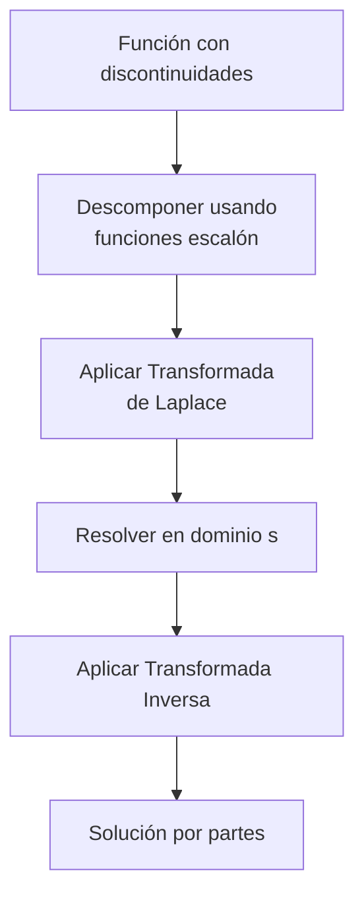

# Matemáticas para Ciencias Aplicadas IV - Ecuaciones Diferenciales de 2o Orden

## 3.5 Discontinuidades y funciones de impulso.

---

### 1. Introducción

En sistemas físicos reales, often encontramos fuerzas que actúan de forma discontinua o en intervalos muy cortos de tiempo. Estas situaciones se modelan mediante **funciones especiales** como la función escalón unitario y la función delta de Dirac.

### 2. Función Escalón Unitario (Heaviside)

#### 2.1 Definición

La función escalón unitario se define como:

$$ u(t - a) =  \begin{cases}  0 & \text{si } t < a \\\ 1 & \text{si } t \geq a  \end{cases} $$

#### 2.2 Transformada de Laplace

$$ \mathcal{L}\{u(t - a)\} = \frac{e^{-as}}{s}, \quad s > 0 $$

#### 2.3 Traslación en el Dominio del Tiempo

Si $\mathcal{L}\{f(t)\} = F(s)$, entonces:

$$ \mathcal{L}\{u(t - a)f(t - a)\} = e^{-as}F(s) $$

### 3. Función Delta de Dirac

#### 3.1 Definición como Límite

La función delta de Dirac puede interpretarse como el límite:

$$ \delta(t - a) = \lim_{\epsilon \to 0} \delta_\epsilon(t - a) $$

donde $\delta_\epsilon(t - a)$ es una función pulso de área 1 centrada en $t = a$.

#### 3.2 Propiedades Fundamentales

1. **Propiedad de filtro:**

   $$ \int_{-\infty}^{\infty} f(t)\delta(t - a)dt = f(a) $$

2. **Transformada de Laplace:**

   $$ \mathcal{L}\{\delta(t - a)\} = e^{-as}, \quad a \geq 0 $$

3. **Caso especial $(a = 0)$:**

   $$ \mathcal{L}\{\delta(t)\} = 1 $$

### 4. Representación de Funciones Discontinuas



#### 4.1 Ejemplo: Función Escalonada

La función:

$$ f(t) =  \begin{cases}  g(t) & \text{si } 0 \leq t < a \\\ h(t) & \text{si } t \geq a  \end{cases} $$

puede escribirse como:

$$ f(t) = g(t) + u(t - a)[h(t) - g(t)] $$

### 5. Solución de EDOs con Discontinuidades

#### 5.1 Metodología General

1. Expresar la función forcing en términos de funciones escalón
2. Aplicar transformada de Laplace
3. Resolver la ecuación algebraica resultante
4. Aplicar transformada inversa
5. Expresar la solución en forma piecewise

#### 5.2 Ejemplo: Sistema con Fuerza Discontinua

Resolver:

$$ \begin{cases} y'' + 4y = f(t) \\\ y(0) = 0, \quad y'(0) = 0 \end{cases} $$

donde

$$ f(t) =  \begin{cases}  0 & \text{si } 0 \leq t < \pi \\\ 1 & \text{si } t \geq \pi  \end{cases} $$

**Solución:**

1. Expresamos $f(t) = u(t - \pi)$
2. Aplicamos Laplace:

   $$ s^2Y(s) + 4Y(s) = \frac{e^{-\pi s}}{s} $$

3. Despejamos:
   
   $$ Y(s) = \frac{e^{-\pi s}}{s(s^2 + 4)} $$

4. Descomponemos en fracciones parciales:

   $$ \frac{1}{s(s^2 + 4)} = \frac{1}{4}\left(\frac{1}{s} - \frac{s}{s^2 + 4}\right) $$

5. Aplicamos transformada inversa:
   
   $$ y(t) = \frac{1}{4}u(t - \pi)[1 - \cos(2(t - \pi))] $$

### 6. Respuesta a Impulsos

#### 6.1 Función de Green

Para un sistema descrito por:

$$ ay'' + by' + cy = \delta(t) $$

la solución $g(t)$ con condiciones iniciales cero se llama **función de Green** o **respuesta al impulso**.

#### 6.2 Ejemplo: Sistema Masa-Resorte

Resolver:

$$ \begin{cases} y'' + 3y' + 2y = \delta(t - 1) \\\ y(0) = 0, \quad y'(0) = 0 \end{cases} $$

**Solución:**

1. Aplicamos Laplace:
   
   $$ (s^2 + 3s + 2)Y(s) = e^{-s} $$

2. Despejamos:
   
   $$ Y(s) = \frac{e^{-s}}{s^2 + 3s + 2} = \frac{e^{-s}}{(s + 1)(s + 2)} $$

3. Descomponemos:
   
   $$ \frac{1}{(s + 1)(s + 2)} = \frac{1}{s + 1} - \frac{1}{s + 2} $$

4. Aplicamos transformada inversa:
   
   $$ y(t) = u(t - 1)[e^{-(t - 1)} - e^{-2(t - 1)}] $$

### 7. Implementación Computacional (Python)

```python
import numpy as np
import matplotlib.pyplot as plt
import sympy as sp
from sympy.integrals.transforms import laplace_transform, inverse_laplace_transform

# Definir símbolos
t, s = sp.symbols('t s')
u = sp.Heaviside

# Ejemplo: y'' + 4y = u(t-π), y(0)=0, y'(0)=0
# Definir la ecuación
y = sp.Function('y')(t)
edo = sp.Eq(y.diff(t, t) + 4*y, u(t - sp.pi))

# Aplicar transformada de Laplace
laplace_edo = laplace_transform(edo.lhs - edo.rhs, t, s, noconds=True)

# Aplicar condiciones iniciales
laplace_edo = laplace_edo.subs({y.subs(t, 0): 0,
                               y.diff(t).subs(t, 0): 0,
                               laplace_transform(y, t, s, noconds=True): sp.Symbol('Y')})

# Resolver para Y(s)
Y_s = sp.solve(laplace_edo, sp.Symbol('Y'))[0]

# Aplicar transformada inversa
solucion = inverse_laplace_transform(Y_s, s, t)

# Simplificar la solución
solucion_simplified = sp.simplify(solucion)

print("Solución:", solucion_simplified)

# Graficar la solución
t_vals = np.linspace(0, 10, 1000)
y_vals = [solucion_simplified.subs(t, val).evalf() for val in t_vals]

plt.figure(figsize=(12, 6))
plt.plot(t_vals, y_vals)
plt.axvline(x=np.pi, color='r', linestyle='--', label='t = π')
plt.title('Respuesta del sistema $y\'\' + 4y = u(t-π)$')
plt.xlabel('t')
plt.ylabel('y(t)')
plt.legend()
plt.grid(True)
plt.show()
```

### 8. Aplicaciones Físicas

#### 8.1 Circuitos Eléctricos

- Voltajes aplicados de forma discontinua
- Descargas de condensadores
- Conmutación de circuitos

#### 8.2 Sistemas Mecánicos

- Impactos y golpes
- Fuerzas aplicadas por intervalos cortos
- Vibraciones inducidas por impulsos

#### 8.3 Teoría de Control

- Señales de control tipo pulso
- Respuesta a perturbaciones impulsivas
- Análisis de estabilidad

### 9. Ejercicios Propuestos

#### Ejercicio 1

Calcular la transformada de Laplace de:

- a) $f(t) = u(t-2)(t-2)^2$
- b) $f(t) = \delta(t-3) + u(t-1)$
- c) $f(t) = u(t-1)e^{2(t-1)}$

#### Ejercicio 2

Resolver:

$$ \begin{cases} y'' + y = \delta(t - \pi/2) \\\ y(0) = 0, \quad y'(0) = 1 \end{cases} $$

#### Ejercicio 3

Resolver:

$$ \begin{cases} y'' + 2y' + y = u(t-1) \\\ y(0) = 0, \quad y'(0) = 0 \end{cases} $$

#### Ejercicio 4

Para el sistema:

$$ \begin{cases} y'' + 4y' + 4y = \delta(t) \\\ y(0) = 0, \quad y'(0) = 0 \end{cases} $$

encontrar la función de Green $g(t)$.

#### Ejercicio 5

Implementar en Python la solución de:

$$ \begin{cases} y'' + y = u(t-2) - u(t-4) \\\ y(0) = 0, \quad y'(0) = 0 \end{cases} $$

y graficar la solución.

### 10. Referencias

**Bibliografía básica:**

1. Boyce, W., DiPrima, R. (2004). _Elementary Differential Equations and Boundary Value Problems_. Wiley. (Capítulo 6)
2. Edwards, C. H., Penney, D. E. (2002). _Ecuaciones diferenciales elementales y problemas con condiciones a la frontera_. Prentice Hall. (Capítulo 7)

**Bibliografía complementaria:**

1. Zill, D. G., Wright, W. S. (1995). _Differential Equations with Computer Lab Experiments_. PWS Publishing Company. (Capítulo 7)
2. Cooper, J. M. (1998). _Introduction to Partial Differential Equations with MatLab_. Birkhäuser. (Capítulo 4)

### 11. Consejos de Estudio

1. **Dominar primero** las transformadas de Laplace básicas
2. **Practicar la escritura** de funciones discontinuas usando escalones unitarios
3. **Entender el significado físico** de la función delta de Dirac
4. **Verificar soluciones** analizando el comportamiento en los puntos de discontinuidad
5. **Utilizar software** para visualizar soluciones y comprender el comportamiento del sistema
