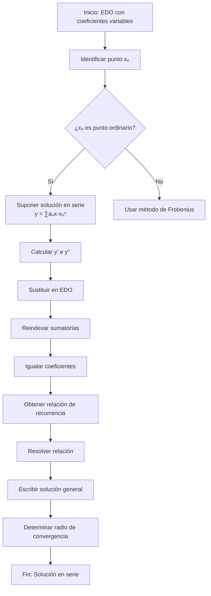

# Matemáticas para Ciencias Aplicadas IV - Ecuaciones diferenciales de 2o Orden con coeficientes variables

## 4.1 Solución en serie.

---

### 1. Introducción

Las ecuaciones diferenciales lineales de segundo orden con coeficientes variables tienen la forma general:

$$a(x)y'' + b(x)y' + c(x)y = 0$$

Cuando los coeficientes no son constantes, los métodos tradicionales (como coeficientes constantes) no siempre funcionan. El método de solución en series de potencias nos permite encontrar soluciones alrededor de puntos ordinarios.

### 2. Conceptos Fundamentales

#### 2.1. Puntos Ordinarios y Singulares

**Definición:** Un punto $x = x_0$ es **ordinario** si ambas funciones:

$$P(x) = \frac{b(x)}{a(x)} \quad \text{y} \quad Q(x) = \frac{c(x)}{a(x)}$$

son analíticas en $x_0.$ De lo contrario, $x_0$ es un **punto singular**.

#### 2.2. Series de Potencias

Una serie de potencias centrada en $x_0$ tiene la forma:

$$\sum_{n=0}^{\infty} a_n (x - x_0)^n = a_0 + a_1(x - x_0) + a_2(x - x_0)^2 + \cdots$$

#### 2.3. Radio de Convergencia

Para la serie $\sum a_n (x - x_0)^n,$ el radio de convergencia $R$ está dado por:

$$R = \frac{1}{\limsup_{n \to \infty} |a_n|^{1/n}}$$

o alternativamente por el criterio del cociente cuando existe:

$$R = \lim_{n \to \infty} \left| \frac{a_n}{a_{n+1}} \right|$$

### 3. Método de Solución por Series de Potencias

#### 3.1. Algoritmo General

```python
# Pseudocódigo para solución por series
1. Suponer solución: y = ∑ aₙ(x - x₀)ⁿ
2. Calcular y' = ∑ n·aₙ(x - x₀)ⁿ⁻¹
3. Calcular y'' = ∑ n(n-1)·aₙ(x - x₀)ⁿ⁻²
4. Sustituir en la ecuación diferencial
5. Igualar coeficientes de potencias iguales
6. Resolver la relación de recurrencia
7. Determinar radio de convergencia
```

#### 3.2. Ecuación de Legendre (Ejemplo Clásico)

La ecuación de Legendre:

$$(1 - x^2)y'' - 2xy' + λ(λ + 1)y = 0$$

Suponemos solución:

$$y = \sum_{n=0}^{\infty} a_n x^n$$

Sustituyendo obtenemos la relación de recurrencia:

$$a_{n+2} = \frac{[n(n+1) - λ(λ + 1)]}{(n+1)(n+2)} a_n$$

### 4. Ejemplo Resuelto Paso a Paso

**Resolver:** $y'' - xy = 0$ alrededor de $x_0 = 0$

**Paso 1:** Suponemos solución:

$$y = \sum_{n=0}^{\infty} a_n x^n$$

**Paso 2:** Calculamos derivadas:

$$y' = \sum_{n=1}^{\infty} n a_n x^{n-1}$$

$$y'' = \sum_{n=2}^{\infty} n(n-1) a_n x^{n-2}$$

**Paso 3:** Sustituimos en la ecuación:

$$\sum_{n=2}^{\infty} n(n-1) a_n x^{n-2} - x \sum_{n=0}^{\infty} a_n x^n = 0$$

**Paso 4:** Reindexamos la primera suma (k = n-2):

$$\sum_{k=0}^{\infty} (k+2)(k+1) a_{k+2} x^k - \sum_{n=0}^{\infty} a_n x^{n+1} = 0$$

**Paso 5:** Igualamos coeficientes:

Para $x^0:$ $2·1·a_2 = 0 \Rightarrow a_2 = 0$

Para $x^1:$ $3·2·a_3 - a_0 = 0 \Rightarrow a_3 = \frac{a_0}{6}$

Para $x^k$ $(k \geq 2):$ $(k+2)(k+1)a_{k+2} - a_{k-1} = 0$

**Paso 6:** Relación de recurrencia:

$$a_{k+2} = \frac{a_{k-1}}{(k+2)(k+1)}$$

**Solución final:**

$$y(x) = a_0 \left[1 + \frac{x^3}{6} + \frac{x^6}{180} + \cdots\right] + a_1 \left[x + \frac{x^4}{12} + \frac{x^7}{504} + \cdots\right]$$

### 5. Diagrama de Flujo del Método



### 6. Ejercicios Propuestos

#### Ejercicio 1

Resolver mediante series de potencias:

$$y'' + x^2y = 0$$

#### Ejercicio 2

Encontrar la solución general alrededor de x = 0 para:

$$(1 - x^2)y'' - xy' + 4y = 0$$

#### Ejercicio 3

Determinar el radio de convergencia de la solución en serie de:

$$y'' + e^xy' + y = 0$$

#### Ejercicio 4

Resolver el problema de valor inicial:

$$y'' - xy' + y = 0, \quad y(0) = 1, y'(0) = 0$$

#### Ejercicio 5

Encontrar los primeros 4 términos no nulos de la solución en serie para:

$$y'' + \sin(x)y = 0$$

### 7. Casos Especiales

#### 7.1. Ecuación de Airy

$$y'' - xy = 0$$

Tiene soluciones especiales llamadas funciones de Airy, importantes en óptica y mecánica cuántica.

#### 7.2. Ecuación de Chebyshev

$$(1 - x^2)y'' - xy' + n^2y = 0$$

Sus soluciones son los polinomios de Chebyshev.

### 8. Implementación Computacional

```python
import sympy as sp
from sympy import series, Function, dsolve

def solve_ode_series(ode, y0, yprime0, n_terms=6):
    """
    Resuelve EDO por método de series
    """
    x = sp.symbols('x')
    y = Function('y')(x)

    # Expansión en serie
    sol_series = sp.series(y, x, 0, n_terms).removeO()

    # Sustituir en la EDO
    ode_series = ode.series(x, 0, n_terms).removeO()

    # Resolver sistema de ecuaciones
    coeffs = sp.solve(ode_series.coeffs(), dict=True)

    return sol_series.subs(coeffs[0])
```

### 9. Referencias

#### Bibliografía Básica

1. Boyce, W., DiPrima, R. (2004). _Elementary Differential Equations and Boundary Value Problems_. Wiley.
   - Capítulo 5: Series Solutions of Second Order Linear Equations

2. Edwards, C. H., Penney, D. E. (2002). _Ecuaciones diferenciales elementales y problemas con condiciones a la frontera_. Prentice Hall.
   - Capítulo 8: Soluciones en series de potencias

#### Bibliografía Complementaria

3. Cooper, J. M. (1998). _Introduction to Partial Differential Equations with MatLab_. Birkhäuser.
4. Hubbard, J. H., West, B. H. (1995). _Differential Equations: A Dynamical Systems Approach_. Springer-Verlag.
5. Zill, D. G., Wright, W. S. (1995). _Differential Equations with Computer Lab Experiments_. PWS Publishing.

### 10. Consejos de Estudio

1. **Domina las series de potencias** antes de abordar el método
2. **Practica la reindexación** de sumatorias
3. **Verifica siempre** el radio de convergencia
4. **Usa software matemático** para comprobar resultados
5. **Comienza con ejemplos simples** antes de problemas complejos

### 11. Aplicaciones

Las soluciones en serie son fundamentales en:

- Mecánica cuántica (ecuación de Schrödinger)
- Óptica (difracción, propagación)
- Ingeniería (vibraciones, transferencia de calor)
- Economía (modelos dinámicos no lineales)
