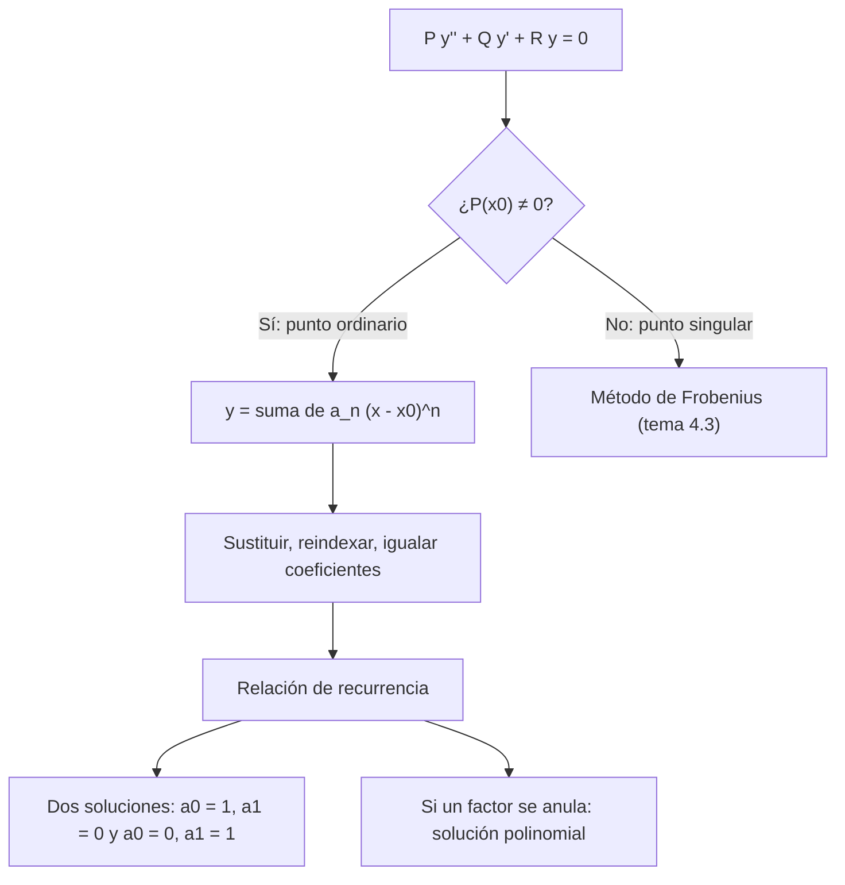

# Matemáticas para Ciencias Aplicadas IV - Ecuaciones diferenciales de 2o Orden con coeficientes variables

## 4.1 Solución en serie.

---

Cuando los coeficientes de una ecuación lineal de segundo orden son variables, en general no hay soluciones en términos de funciones elementales. Pero si los coeficientes son **analíticos** (se pueden escribir como series de potencias), las soluciones también lo son, y sus coeficientes se calculan uno tras otro con una **relación de recurrencia**. Así nacen las funciones especiales de la física matemática: Airy, Legendre, Hermite, Chebyshev, Bessel (tema 4.4). Este tema presenta el método alrededor de un **punto ordinario**; el tema 4.3 trata los puntos singulares.

### Puntos ordinarios y singulares

Se considera

$$ P(x)\, y'' + Q(x)\, y' + R(x)\, y = 0 $$

con $P,$ $Q$ y $R$ analíticas, típicamente polinomios. En forma estándar, $y'' + p(x)\, y' + q(x)\, y = 0$ con $p = Q/P$ y $q = R/P.$

**Definición.** $x_0$ es un **punto ordinario** si $p$ y $q$ son analíticas en $x_0;$ para coeficientes polinomiales, si $P(x_0) \neq 0.$ En otro caso es un **punto singular**.

**Teorema (Fuchs).** Si $x_0$ es un punto ordinario, la ecuación tiene dos soluciones linealmente independientes de la forma

$$ y = \sum_{n = 0}^{\infty} a_n (x - x_0)^n $$

con $a_0 = y(x_0)$ y $a_1 = y'(x_0)$ arbitrarios. El radio de convergencia de cada una es **al menos** el menor de los radios de convergencia de las series de $p$ y $q$ en $x_0.$ Para coeficientes polinomiales, es al menos la distancia de $x_0$ al cero más cercano de $P,$ **contando los ceros complejos**.

**Ejemplo.** $(1 + x^2)\, y'' + y = 0$ no tiene puntos singulares reales, pero $P = 1 + x^2$ se anula en $\pm i,$ a distancia 1 del origen. La serie alrededor de 0 converge al menos en $|x| \lt 1,$ y en general no más allá.

### El método

1. Proponer $y = \sum a_n x^n,$ tomando $x_0 = 0$ (si no, se traslada la variable), y derivar término a término: $y' = \sum n a_n x^{n - 1},$ $y'' = \sum n(n - 1) a_n x^{n - 2}.$
2. Sustituir y **reindexar** las sumas para que todas tengan $x^k.$
3. Igualar a cero el coeficiente de cada potencia de $x;$ se obtiene una **relación de recurrencia** que da $a_{k + 2}$ en términos de los anteriores.
4. Escribir las dos soluciones: la que tiene $a_0 = 1,$ $a_1 = 0$ y la que tiene $a_0 = 0,$ $a_1 = 1.$

### La ecuación de Airy

$$ y'' - x y = 0 $$

aparece en óptica (cerca de una cáustica) y en mecánica cuántica (una partícula en un campo uniforme). Todo punto es ordinario. Sustituyendo,

$$ \sum_{n = 2}^{\infty} n(n - 1) a_n x^{n - 2} - \sum_{n = 0}^{\infty} a_n x^{n + 1} = 0 $$

Con $k = n - 2$ en la primera y $k = n + 1$ en la segunda:

$$ 2a_2 + \sum_{k = 1}^{\infty} \big[ (k + 2)(k + 1)\, a_{k + 2} - a_{k - 1} \big] x^k = 0 $$

De aquí $a_2 = 0$ y

$$ a_{k + 2} = \frac{a_{k - 1}}{(k + 2)(k + 1)}, \qquad k \geq 1 $$

Los coeficientes avanzan de tres en tres: $a_3 = a_0/6,$ $a_6 = a_3/30 = a_0/180,$ $a_9 = a_0/12\,960,$ y $a_4 = a_1/12,$ $a_7 = a_1/504.$ Las dos soluciones son

$$ y_1 = 1 + \frac{x^3}{6} + \frac{x^6}{180} + \frac{x^9}{12\,960} + \cdots, \qquad y_2 = x + \frac{x^4}{12} + \frac{x^7}{504} + \cdots $$

y convergen para todo $x.$ La **función de Airy** $\text{Ai}(x)$ es la combinación $\text{Ai}(0)\, y_1 + \text{Ai}'(0)\, y_2$ que decae cuando $x \to \infty;$ para $x \lt 0$ oscila.

### Polinomios como soluciones

Cuando la recurrencia tiene un factor que se anula para algún $n,$ una de las series **se corta** y la solución es un polinomio. Así aparecen las familias clásicas de polinomios ortogonales:

| Ecuación | Recurrencia | Se corta cuando | Polinomios |
| --- | --- | --- | --- |
| Legendre: $(1 - x^2) y'' - 2x y' + \lambda(\lambda + 1) y = 0$ | $a_{n + 2} = \frac{n(n + 1) - \lambda(\lambda + 1)}{(n + 2)(n + 1)} a_n$ | $\lambda = n$ entero | $P_n(x)$ |
| Hermite: $y'' - 2x y' + 2k y = 0$ | $a_{n + 2} = \frac{2(n - k)}{(n + 2)(n + 1)} a_n$ | $k = n$ entero | $H_n(x)$ |
| Chebyshev: $(1 - x^2) y'' - x y' + m^2 y = 0$ | $a_{n + 2} = \frac{n^2 - m^2}{(n + 2)(n + 1)} a_n$ | $m = n$ entero | $T_n(x)$ |

La ecuación de Legendre aparece al resolver la ecuación de Laplace en coordenadas esféricas (tema 8.3); la de Hermite, en el oscilador armónico cuántico; los polinomios de Chebyshev, en aproximación numérica.



### Implementación en Python

El programa sustituye una serie con coeficientes desconocidos en la ecuación y despeja los coeficientes uno por uno igualando potencias; funciona también cuando los coeficientes de la ecuación no son polinomios, desarrollándolos en serie. Obtiene las series de Airy y compara la suma de 30 términos con la función de Airy de SciPy, encuentra soluciones polinomiales de las ecuaciones de Legendre y Hermite y resuelve los ejercicios.

```python
import sympy as sp
import numpy as np
from scipy.special import airy, eval_legendre

x = sp.symbols('x')

def serie(P, Q, R, a0, a1, N, x0=0):
    """Coeficientes de y = Σ a_n (x - x0)^n para P y'' + Q y' + R y = 0, igualando potencias.
    P, Q, R pueden ser polinomios o funciones analíticas (se desarrollan en serie)."""
    a = sp.symbols(f'a0:{N + 3}')
    y = sum(a[n] * (x - x0)**n for n in range(N + 3))
    expr = sp.expand(sp.series(P * sp.diff(y, x, 2) + Q * sp.diff(y, x) + R * y, x, x0, N + 1).removeO())
    valores = {a[0]: a0, a[1]: a1}
    for n in range(N + 1):
        coef = sp.expand(expr.coeff(x - x0 if x0 else x, n)).subs(valores)
        incognita = a[n + 2]
        valores[incognita] = sp.solve(coef, incognita)[0]
    return [sp.nsimplify(valores[a[n]]) for n in range(N + 1)]

def polinomio(coefs):
    return sum(c * x**n for n, c in enumerate(coefs))

c0, c1 = sp.symbols('c0 c1')
# Airy: y'' - x y = 0
print('Airy, y1 (a0 = 1, a1 = 0):', serie(1, 0, -x, 1, 0, 9))
print('Airy, y2 (a0 = 0, a1 = 1):', serie(1, 0, -x, 0, 1, 9))
# Comparación con Ai(x) = Ai(0) y1 + Ai'(0) y2
Ai0, dAi0, _, _ = airy(0)
y1 = polinomio(serie(1, 0, -x, 1, 0, 30))
y2 = polinomio(serie(1, 0, -x, 0, 1, 30))
for xv in [0.5, 1.0, 2.0]:
    aprox = float(Ai0 * y1.subs(x, xv) + dAi0 * y2.subs(x, xv))
    print(f'Ai({xv}): serie {aprox:.10f}  scipy {airy(xv)[0]:.10f}')

# Legendre con λ = 3: la serie impar se corta y da un polinomio proporcional a P3
coefs = serie(1 - x**2, -2 * x, 12, 0, 1, 8)
print('Legendre λ = 3, solución impar:', polinomio(coefs), '  P3 =', sp.expand(sp.legendre(3, x)))

# Ejercicios
print('ej. 1, y\'\' + x²y = 0:', polinomio(serie(1, 0, x**2, c0, c1, 9)))
print('ej. 2, (1 - x²)y\'\' - xy\' + 4y = 0, a0 = 1, a1 = 0:', polinomio(serie(1 - x**2, -x, 4, 1, 0, 6)))
print('ej. 3, y\'\' + e^x y\' + y = 0, a0 = 1, a1 = 0:', polinomio(serie(1, sp.exp(x), 1, 1, 0, 5)))
print('ej. 4, y\'\' - x y\' + y = 0, y(0) = 1, y\'(0) = 0:', polinomio(serie(1, -x, 1, 1, 0, 8)))
print('ej. 5, y\'\' + sin(x) y = 0, a0 = 1, a1 = 0:', polinomio(serie(1, 0, sp.sin(x), 1, 0, 6)))
# Hermite: y'' - 2x y' + 2k y = 0 con k = 4 da un polinomio proporcional a H4
print('Hermite k = 4:', polinomio(serie(1, -2 * x, 8, 1, 0, 6)), '  H4/12 =', sp.expand(sp.hermite(4, x) / 12))
```

Salida:

```text
Airy, y1 (a0 = 1, a1 = 0): [1, 0, 0, 1/6, 0, 0, 1/180, 0, 0, 1/12960]
Airy, y2 (a0 = 0, a1 = 1): [0, 1, 0, 0, 1/12, 0, 0, 1/504, 0, 0]
Ai(0.5): serie 0.2316936065  scipy 0.2316936065
Ai(1.0): serie 0.1352924163  scipy 0.1352924163
Ai(2.0): serie 0.0349241304  scipy 0.0349241304
Legendre λ = 3, solución impar: -5*x**3/3 + x   P3 = 5*x**3/2 - 3*x/2
ej. 1, y'' + x²y = 0: c0*x**8/672 - c0*x**4/12 + c0 + c1*x**9/1440 - c1*x**5/20 + c1*x
ej. 2, (1 - x²)y'' - xy' + 4y = 0, a0 = 1, a1 = 0: 1 - 2*x**2
ej. 3, y'' + e^x y' + y = 0, a0 = 1, a1 = 0: -x**5/40 + x**4/12 + x**3/6 - x**2/2 + 1
ej. 4, y'' - x y' + y = 0, y(0) = 1, y'(0) = 0: -x**8/2688 - x**6/240 - x**4/24 - x**2/2 + 1
ej. 5, y'' + sin(x) y = 0, a0 = 1, a1 = 0: x**6/180 + x**5/120 - x**3/6 + 1
Hermite k = 4: 4*x**4/3 - 4*x**2 + 1   H4/12 = 4*x**4/3 - 4*x**2 + 1
```

Las series de Airy reproducen la función de SciPy en diez decimales. Las soluciones polinomiales coinciden con los polinomios de Legendre y Hermite salvo un factor constante, que es una cuestión de normalización.

### Ejercicios Propuestos

1. **Recurrencia.** Encuentra la solución general en serie de $y'' + x^2 y = 0.$

2. **Chebyshev.** Resuelve en serie $(1 - x^2)\, y'' - x y' + 4y = 0$ alrededor de 0 y muestra que una de las soluciones es un polinomio.

3. **Coeficientes no polinomiales.** Encuentra los primeros términos de la solución de $y'' + e^x y' + y = 0$ con $y(0) = 1,$ $y'(0) = 0.$

4. **Valor inicial.** Resuelve en serie $y'' - x y' + y = 0,$ $y(0) = 1,$ $y'(0) = 0.$ ¿Hay una solución elemental?

5. **Radio de convergencia.** Sin resolver, da una cota inferior del radio de convergencia de las soluciones en serie de $(x^2 - 2x + 5)\, y'' + y = 0$ alrededor de $x_0 = 0$ y de $x_0 = 1.$

6. **Seno.** Encuentra los primeros términos de la solución de $y'' + \sin(x)\, y = 0,$ $y(0) = 1,$ $y'(0) = 0.$

### Soluciones

**Ejercicio 1.** La recurrencia es $a_2 = a_3 = 0$ y $a_{k + 2} = -\frac{a_{k - 2}}{(k + 2)(k + 1)},$ que avanza de cuatro en cuatro:

$$ y = c_0 \left( 1 - \frac{x^4}{12} + \frac{x^8}{672} - \cdots \right) + c_1 \left( x - \frac{x^5}{20} + \frac{x^9}{1440} - \cdots \right) $$

**Ejercicio 2.** Es Chebyshev con $m = 2:$ $a_{n + 2} = \frac{n^2 - 4}{(n + 2)(n + 1)} a_n.$ Con $a_0 = 1,$ $a_2 = -2$ y $a_4 = 0:$ la solución par es el polinomio $1 - 2x^2 = -T_2(x).$ La impar es una serie infinita.

**Ejercicio 3.** Desarrollando $e^x = 1 + x + x^2/2 + \cdots$ e igualando coeficientes, $y = 1 - \frac{x^2}{2} + \frac{x^3}{6} + \frac{x^4}{12} - \frac{x^5}{40} + \cdots$

**Ejercicio 4.** La recurrencia es $a_{n + 2} = \frac{(n - 1)}{(n + 2)(n + 1)} a_n.$ Con $a_0 = 1:$ $y = 1 - \frac{x^2}{2} - \frac{x^4}{24} - \frac{x^6}{240} - \cdots$ La otra solución sí es elemental: con $a_1 = 1,$ $a_3 = 0$ y la serie impar es simplemente $y = x.$

**Ejercicio 5.** Los ceros de $x^2 - 2x + 5$ son $1 \pm 2i.$ Desde 0 están a distancia $\sqrt{5},$ y desde 1 a distancia 2. Las series convergen al menos en $|x| \lt \sqrt{5}$ y $|x - 1| \lt 2,$ respectivamente.

**Ejercicio 6.** $y = 1 - \frac{x^3}{6} + \frac{x^5}{120} + \frac{x^6}{180} + \cdots,$ como da el programa.

### Referencias

1. Boyce, W. E., DiPrima, R. C., and Meade, D. B., _Elementary Differential Equations and Boundary Value Problems_. Wiley, 2017. Secciones 5.1 a 5.3.
2. Zill, D. G., _Ecuaciones diferenciales con aplicaciones de modelado_. Cengage, 2018. Secciones 6.1 y 6.2.
3. Simmons, G. F., _Ecuaciones diferenciales con aplicaciones y notas históricas_. McGraw-Hill, 1993. Capítulo 5.
4. Olver, F. W. J., et al. (eds.), _NIST Digital Library of Mathematical Functions_. dlmf.nist.gov, capítulos 9 y 18.
