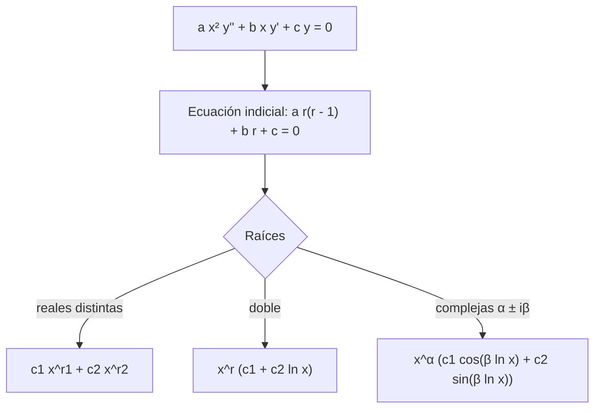

# Matemáticas para Ciencias Aplicadas IV - Ecuaciones diferenciales de 2o Orden con coeficientes variables

## 4.2 Ecuación de Euler.

---

La **ecuación de Euler** (o de Euler-Cauchy) es la ecuación con coeficientes variables más sencilla, y tiene una solución exacta tan simple como la de coeficientes constantes: basta cambiar exponenciales por potencias. Su importancia va más allá de ese caso: es el modelo de lo que pasa cerca de un **punto singular regular** (tema 4.3), y aparece al separar variables en problemas con simetría radial, como la ecuación de Laplace en un disco o en un anillo (tema 8.3).

### La ecuación y la ecuación indicial

$$ a x^2 y'' + b x y' + c y = 0 $$

con $a,$ $b,$ $c$ constantes y $a \neq 0.$ El origen es un punto singular: en forma estándar, $p = b/(ax)$ y $q = c/(ax^2)$ no están definidos en 0. Se trabaja en $x > 0;$ para $x \lt 0$ se reemplaza $x$ por $|x|.$

Como cada derivada viene multiplicada por la potencia de $x$ correspondiente, se prueba $y = x^r:$

$$ a x^2 \cdot r(r - 1) x^{r - 2} + b x \cdot r x^{r - 1} + c x^r = x^r \big[ a r(r - 1) + b r + c \big] = 0 $$

Así, $x^r$ es solución si y solo si $r$ es raíz de la **ecuación indicial**

$$ a r(r - 1) + b r + c = 0, \qquad \text{es decir} \qquad a r^2 + (b - a) r + c = 0 $$

Un error frecuente es usar $a r^2 + b r + c,$ la ecuación característica de coeficientes constantes: el término $-ar$ viene de $r(r - 1).$

### Los tres casos

| Raíces | Solución general en $x > 0$ |
| --- | --- |
| reales distintas $r_1,$ $r_2$ | $c_1 x^{r_1} + c_2 x^{r_2}$ |
| doble $r$ | $x^r (c_1 + c_2 \ln x)$ |
| complejas $\alpha \pm i\beta$ | $x^{\alpha} \big[ c_1 \cos(\beta \ln x) + c_2 \sin(\beta \ln x) \big]$ |

**Justificación: el cambio exponencial.** Con $x = e^t$ y $y(x) = z(t),$ la regla de la cadena da $x y' = z'$ y $x^2 y'' = z'' - z',$ donde $z' = dz/dt.$ La ecuación se convierte en

$$ a z'' + (b - a) z' + c z = 0 $$

que tiene coeficientes **constantes** y la misma ecuación característica que la indicial. Sus soluciones $e^{rt},$ $t e^{rt}$ y $e^{\alpha t} \cos \beta t$ (tema 3.3) se traducen, con $t = \ln x,$ en $x^r,$ $x^r \ln x$ y $x^\alpha \cos(\beta \ln x).$ Así quedan justificados el caso doble y el complejo. $\blacksquare$



**Ejemplos.**

- $x^2 y'' - 2x y' - 4y = 0:$ $r(r - 1) - 2r - 4 = r^2 - 3r - 4 = (r - 4)(r + 1),$ así que $y = c_1 x^4 + c_2 x^{-1}.$
- $x^2 y'' - 3x y' + 4y = 0:$ $r^2 - 4r + 4 = (r - 2)^2,$ así que $y = x^2 (c_1 + c_2 \ln x).$
- $x^2 y'' + x y' + y = 0:$ $r^2 + 1 = 0,$ así que $y = c_1 \cos(\ln x) + c_2 \sin(\ln x).$ Las soluciones oscilan infinitas veces cerca de $x = 0,$ cada vez más rápido.

**Comportamiento en el origen.** Las soluciones pueden ser no acotadas, como $x^{-1};$ tender a cero; o tener derivadas que explotan, como $\sqrt{x}.$ En un problema físico con el origen en el dominio, como el centro de un disco, se descartan las soluciones no acotadas: esa condición de regularidad sustituye a una condición de frontera.

### La ecuación no homogénea

Para $a x^2 y'' + b x y' + c y = g(x)$ hay dos caminos: variación de parámetros (tema 3.2), dividiendo antes entre $a x^2$ para tener la forma estándar, o el cambio $x = e^t,$ que la convierte en una ecuación de coeficientes constantes con fuerza $g(e^t),$ resoluble por coeficientes indeterminados si $g$ es una potencia de $x$ o un logaritmo.

**Ejemplo.** $x^2 y'' - 2x y' + 2y = x^3.$ La indicial $r^2 - 3r + 2$ tiene raíces 1 y 2. Probando $y_p = A x^3:$ $(6 - 6 + 2) A x^3 = x^3,$ así que $A = 1/2$ y $y = c_1 x + c_2 x^2 + \tfrac{1}{2} x^3.$

### Aplicaciones

**Temperatura en un anillo.** En un anillo $1 \leq \rho \leq 2$ con temperatura $u$ que solo depende del radio, la ecuación de Laplace en coordenadas polares (tema 8.1) se reduce a $\rho^2 u'' + \rho u' = 0,$ de Euler con indicial $r^2 = 0:$ $u = A + B \ln \rho.$ La temperatura varía como el **logaritmo** del radio, no linealmente.

**Separación de variables en polares.** Para $u(\rho, \theta) = R(\rho)\, \Theta(\theta),$ la parte radial de la ecuación de Laplace es $\rho^2 R'' + \rho R' - n^2 R = 0,$ de Euler con soluciones $\rho^n$ y $\rho^{-n}.$ En un disco se descarta $\rho^{-n}$ por no ser acotada en el centro.

**Esfuerzos en cilindros.** El desplazamiento radial en un cilindro de pared gruesa sometido a presión (problema de Lamé) cumple $\rho^2 w'' + \rho w' - w = 0,$ con soluciones $\rho$ y $1/\rho.$

### Implementación en Python

El programa resuelve ecuaciones de Euler a partir de la ecuación indicial, distinguiendo los tres casos, y verifica cada solución sustituyéndola. Muestra el cambio $x = e^t$ en un ejemplo y resuelve los ejercicios con valores iniciales, el no homogéneo y el del anillo.

```python
import sympy as sp

x = sp.symbols('x', positive=True)
t, r = sp.symbols('t r')
y = sp.Function('y')

def euler(a, b, c):
    """Solución general de a x² y'' + b x y' + c y = 0 en x > 0 a partir de la ecuación indicial."""
    raices = sp.roots(a * r * (r - 1) + b * r + c, r)
    C1, C2 = sp.symbols('C1 C2')
    if len(raices) == 1:                                   # raíz doble
        (r1,) = raices
        return raices, x**r1 * (C1 + C2 * sp.log(x))
    r1, r2 = raices
    if r1.is_real:
        return raices, C1 * x**r1 + C2 * x**r2
    al, be = sp.re(r1), abs(sp.im(r1))
    return raices, x**al * (C1 * sp.cos(be * sp.log(x)) + C2 * sp.sin(be * sp.log(x)))

def verifica(sol, a, b, c, g=0):
    return sp.simplify(a * x**2 * sol.diff(x, 2) + b * x * sol.diff(x) + c * sol - g) == 0

for nombre, (a, b, c) in [('x²y\'\' - 2xy\' - 4y = 0', (1, -2, -4)), ('x²y\'\' - 3xy\' + 4y = 0', (1, -3, 4)),
                          ('x²y\'\' + xy\' + y = 0', (1, 1, 1)), ('ej. 1: x²y\'\' + xy\' - 9y = 0', (1, 1, -9)),
                          ('ej. 2: x²y\'\' + 5xy\' + 4y = 0', (1, 5, 4)), ('ej. 3: x²y\'\' + xy\' + 4y = 0', (1, 1, 4)),
                          ('x²y\'\' + 3xy\' + 5y = 0', (1, 3, 5))]:
    raices, sol = euler(a, b, c)
    print(f'{nombre:32} raíces {list(raices)}  y = {sol}  verifica: {verifica(sol, a, b, c)}')

# Cambio x = e^t: la ecuación de Euler se vuelve de coeficientes constantes
z = sp.Function('z')
a, b, c = 1, -2, -4
constante = sp.Eq(a * z(t).diff(t, 2) + (b - a) * z(t).diff(t) + c * z(t), 0)
print('con x = e^t:', constante, ' ->', sp.dsolve(constante).rhs, ' -> regresando, x^4 y x^(-1)')

# Ejercicio 4: x² y'' + 3x y' + y = 0, y(1) = 1, y'(1) = 0
sol4 = sp.dsolve(sp.Eq(x**2 * y(x).diff(x, 2) + 3 * x * y(x).diff(x) + y(x), 0),
                 ics={y(1): 1, y(x).diff(x).subs(x, 1): 0}).rhs
print('ej. 4:', sp.simplify(sol4))

# Ejercicio 5: x² y'' - 2x y' + 2y = x³
sol5 = sp.dsolve(sp.Eq(x**2 * y(x).diff(x, 2) - 2 * x * y(x).diff(x) + 2 * y(x), x**3)).rhs
print('ej. 5:', sp.expand(sol5), '  verifica:', verifica(sol5, 1, -2, 2, x**3))

# Ejercicio 6: temperatura en un anillo 1 ≤ ρ ≤ 2 con u(1) = 100, u(2) = 0: ρ² u'' + ρ u' = 0
rho = sp.symbols('rho', positive=True)
u = sp.Function('u')
sol6 = sp.dsolve(sp.Eq(rho**2 * u(rho).diff(rho, 2) + rho * u(rho).diff(rho), 0), ics={u(1): 100, u(2): 0}).rhs
print('ej. 6: u(ρ) =', sp.expand(sp.expand_log(sol6, force=True)), '  u(1.5) ≈', sp.N(sol6.subs(rho, sp.Rational(3, 2)), 5))
```

Salida:

```text
x²y'' - 2xy' - 4y = 0            raíces [4, -1]  y = C1*x**4 + C2/x  verifica: True
x²y'' - 3xy' + 4y = 0            raíces [2]  y = x**2*(C1 + C2*log(x))  verifica: True
x²y'' + xy' + y = 0              raíces [-I, I]  y = C1*cos(log(x)) + C2*sin(log(x))  verifica: True
ej. 1: x²y'' + xy' - 9y = 0      raíces [-3, 3]  y = C1/x**3 + C2*x**3  verifica: True
ej. 2: x²y'' + 5xy' + 4y = 0     raíces [-2]  y = (C1 + C2*log(x))/x**2  verifica: True
ej. 3: x²y'' + xy' + 4y = 0      raíces [-2*I, 2*I]  y = C1*cos(2*log(x)) + C2*sin(2*log(x))  verifica: True
x²y'' + 3xy' + 5y = 0            raíces [-1 - 2*I, -1 + 2*I]  y = (C1*cos(2*log(x)) + C2*sin(2*log(x)))/x  verifica: True
con x = e^t: Eq(-4*z(t) - 3*Derivative(z(t), t) + Derivative(z(t), (t, 2)), 0)  -> C1*exp(-t) + C2*exp(4*t)  -> regresando, x^4 y x^(-1)
ej. 4: (log(x) + 1)/x
ej. 5: C1*x + C2*x**2 + x**3/2   verifica: True
ej. 6: u(ρ) = -100*log(rho)/log(2) + 100   u(1.5) ≈ 41.504
```

### Ejercicios Propuestos

1. **Raíces distintas.** Resuelve $x^2 y'' + x y' - 9y = 0.$

2. **Raíz doble.** Resuelve $x^2 y'' + 5x y' + 4y = 0.$

3. **Complejas.** Resuelve $x^2 y'' + x y' + 4y = 0$ y describe el comportamiento cerca de 0.

4. **Valor inicial.** Resuelve $x^2 y'' + 3x y' + y = 0,$ $y(1) = 1,$ $y'(1) = 0.$

5. **No homogénea.** Resuelve $x^2 y'' - 2x y' + 2y = x^3.$

6. **Anillo.** Encuentra la temperatura en el anillo $1 \leq \rho \leq 2$ con $u(1) = 100$ y $u(2) = 0.$ ¿Cuánto vale en $\rho = 1.5?$

### Soluciones

**Ejercicio 1.** $r(r - 1) + r - 9 = r^2 - 9:$ raíces $\pm 3,$ y $y = c_1 x^3 + c_2 x^{-3}.$

**Ejercicio 2.** $r^2 + 4r + 4 = (r + 2)^2:$ $y = x^{-2} (c_1 + c_2 \ln x).$

**Ejercicio 3.** $r^2 + 4 = 0:$ $y = c_1 \cos(2 \ln x) + c_2 \sin(2 \ln x).$ Cerca de 0, $\ln x \to -\infty$ y las soluciones oscilan infinitas veces con amplitud acotada, sin tener límite.

**Ejercicio 4.** $r^2 + 2r + 1 = (r + 1)^2:$ $y = x^{-1} (c_1 + c_2 \ln x).$ $y(1) = c_1 = 1,$ y $y' = x^{-2}(-c_1 - c_2 \ln x + c_2)$ da $y'(1) = -1 + c_2 = 0.$ Por lo tanto $y = \frac{1 + \ln x}{x}.$

**Ejercicio 5.** $y = c_1 x + c_2 x^2 + \tfrac{1}{2} x^3,$ como en el ejemplo del tema.

**Ejercicio 6.** $u = A + B \ln \rho$ con $A = 100$ y $100 + B \ln 2 = 0:$ $u = 100 \left( 1 - \frac{\ln \rho}{\ln 2} \right).$ En $\rho = 1.5,$ $u \approx 41.5,$ menos que el promedio lineal de 50: el calor se reparte en un área mayor hacia afuera.

### Referencias

1. Boyce, W. E., DiPrima, R. C., and Meade, D. B., _Elementary Differential Equations and Boundary Value Problems_. Wiley, 2017. Sección 5.4.
2. Zill, D. G., _Ecuaciones diferenciales con aplicaciones de modelado_. Cengage, 2018. Sección 4.7.
3. Edwards, C. H., and Penney, D. E., _Ecuaciones diferenciales y problemas con valores en la frontera_. Pearson, 2009. Sección 8.3.
4. Haberman, R., _Applied Partial Differential Equations_. Pearson, 2013. Sección 2.5.
