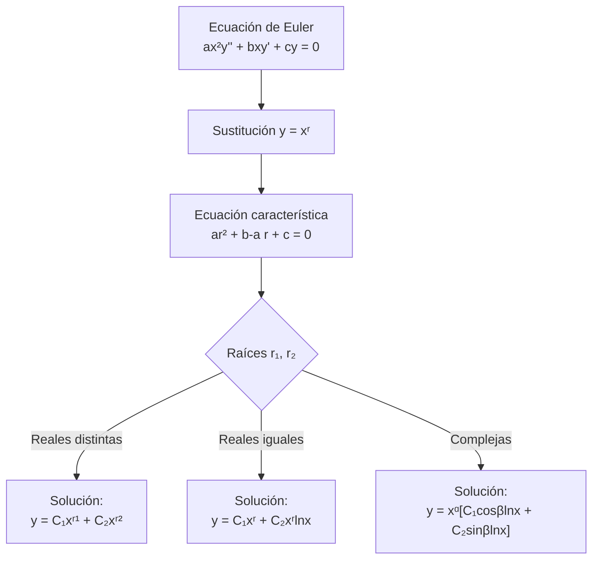

# Matemáticas para Ciencias Aplicadas IV - Ecuaciones diferenciales de 2o Orden con coeficientes variables

## 4.2 Ecuación de Euler.

---

### 1. Introducción a la Ecuación de Euler

La **ecuación de Euler** (también conocida como ecuación de Cauchy-Euler) es un tipo especial de ecuación diferencial lineal con coeficientes variables que puede resolverse mediante métodos algebraicos.

**Definición:** Una ecuación de Euler de segundo orden tiene la forma:

$$ax^2y'' + bxy' + cy = 0$$

donde $a,$ $b$ y $c$ son constantes reales y $a \neq 0.$

### 2. Método de Solución

#### 2.1. Sustitución y Ecuación Característica

Para resolver la ecuación de Euler, realizamos la sustitución:

$$y = x^r$$

Calculamos las derivadas:

$$y' = rx^{r-1}$$

$$y'' = r(r-1)x^{r-2}$$

Sustituyendo en la ecuación original:

$$ax^2[r(r-1)x^{r-2}] + bx[rx^{r-1}] + cx^r = 0$$

$$ar(r-1)x^r + brx^r + cx^r = 0$$

$$[ar(r-1) + br + c]x^r = 0$$

Como $x^r \neq 0,$ obtenemos la **ecuación característica**:

$$ar(r-1) + br + c = 0$$

$$ar^2 + (b - a)r + c = 0$$

#### 2.2. Casos de Solución

Dependiendo de las raíces de la ecuación característica, tenemos tres casos:

##### Caso 1: Raíces reales y distintas $(r_1 \neq r_2)$

$$y(x) = C_1x^{r_1} + C_2x^{r_2}$$

##### Caso 2: Raíces reales e iguales $(r_1 = r_2)$

$$y(x) = C_1x^{r_1} + C_2x^{r_1}\ln|x|$$

##### Caso 3: Raíces complejas conjugadas $(r = \alpha \pm i\beta)$

$$y(x) = x^{\alpha}[C_1\cos(\beta\ln|x|) + C_2\sin(\beta\ln|x|)]$$

### 3. Diagrama de Decisión para la Ecuación de Euler



### 4. Ejemplos Resueltos

#### Ejemplo 1: Raíces reales distintas

Resolver: $x^2y'' - 2xy' - 4y = 0$

**Solución:**
Sustitución: $y = x^r$
Ecuación característica: $r(r-1) - 2r - 4 = 0$

$$r^2 - 3r - 4 = 0$$

$$(r - 4)(r + 1) = 0$$

Raíces: $r_1 = 4,$ $r_2 = -1$

Solución general:

$$y(x) = C_1x^4 + C_2x^{-1}$$

#### Ejemplo 2: Raíces reales iguales

Resolver: $x^2y'' - 3xy' + 4y = 0$

**Solución:**
Ecuación característica: $r(r-1) - 3r + 4 = 0$

$$r^2 - 4r + 4 = 0$$

$$(r - 2)^2 = 0$$

Raíz doble: $r = 2$

Solución general:

$$y(x) = C_1x^2 + C_2x^2\ln|x|$$

#### Ejemplo 3: Raíces complejas

Resolver: $x^2y'' + xy' + y = 0$

**Solución:**
Ecuación característica: $r(r-1) + r + 1 = 0$

$$r^2 + 1 = 0$$

Raíces: $r = \pm i$ ( $\alpha = 0,$ $\beta = 1$ )

Solución general:

$$y(x) = C_1\cos(\ln|x|) + C_2\sin(\ln|x|)$$

### 5. Ecuación de Euler no Homogénea

Para ecuaciones no homogéneas de la forma:

$$ax^2y'' + bxy' + cy = f(x)$$

Se encuentra la solución complementaria $y_c$ (como antes) y una solución particular $y_p$ usando variación de parámetros o coeficientes indeterminados (si es aplicable).

### 6. Implementación Computacional

```python
import numpy as np
from sympy import symbols, Function, dsolve, Eq, exp, log, cos, sin

def solve_euler(a, b, c, f=0):
    """
    Resuelve la ecuación de Euler: ax²y'' + bxy' + cy = f(x)
    """
    x = symbols('x')
    y = Function('y')(x)

    # Ecuación característica
    char_eq = a*r**2 + (b - a)*r + c
    roots = np.roots([a, b-a, c])

    print(f"Ecuación característica: {char_eq} = 0")
    print(f"Raíces: {roots}")

    # Solución según el tipo de raíces
    if np.isreal(roots).all():
        if roots[0] == roots[1]:
            print("Raíces reales iguales")
            sol = f"C1*x^{roots[0]} + C2*x^{roots[0]}*ln|x|"
        else:
            print("Raíces reales distintas")
            sol = f"C1*x^{roots[0]} + C2*x^{roots[1]}"
    else:
        alpha = roots[0].real
        beta = roots[0].imag
        print("Raíces complejas conjugadas")
        sol = f"x^{alpha}*(C1*cos({beta}*ln|x|) + C2*sin({beta}*ln|x|))"

    return sol

# Ejemplo de uso
print(solve_euler(1, -2, -4))  # Para x²y'' - 2xy' - 4y = 0
```

### 7. Ejercicios Propuestos

#### Ejercicio 1

Resolver: $x^2y'' + 5xy' + 3y = 0$

#### Ejercicio 2

Resolver: $2x^2y'' + 5xy' + y = 0$

#### Ejercicio 3

Resolver: $x^2y'' - xy' + 2y = 0$

#### Ejercicio 4

Resolver el problema de valor inicial:

$$x^2y'' + 3xy' + y = 0, \quad y(1) = 1, y'(1) = 0$$

#### Ejercicio 5

Resolver la ecuación no homogénea:

$$x^2y'' - 2xy' + 2y = x^3$$

### 8. Transformación a Coeficientes Constantes

La ecuación de Euler puede transformarse en una ecuación con coeficientes constantes mediante la sustitución:

$$x = e^t \quad \text{(si } x > 0\text{)}$$

Derivadas:

$$\frac{dy}{dx} = \frac{dy}{dt}\frac{dt}{dx} = \frac{1}{x}\frac{dy}{dt}$$

$$\frac{d^2y}{dx^2} = \frac{1}{x^2}\left(\frac{d^2y}{dt^2} - \frac{dy}{dt}\right)$$

Sustituyendo en la ecuación de Euler:

$$a\frac{d^2y}{dt^2} + (b - a)\frac{dy}{dt} + cy = 0$$

### 9. Aplicaciones de la Ecuación de Euler

La ecuación de Euler aparece en diversos contextos:

- Problemas con simetría radial
- Teoría de potenciales
- Vibraciones de membranas circulares
- Problemas de contorno en coordenadas polares

### 10. Referencias Bibliográficas

#### Bibliografía Básica

1. Boyce, W., DiPrima, R. (2004). _Elementary Differential Equations and Boundary Value Problems_. Wiley.
   - Capítulo 5: Ecuaciones con coeficientes variables

2. Edwards, C. H., Penney, D. E. (2002). _Ecuaciones diferenciales elementales y problemas con condiciones a la frontera_. Prentice Hall.
   - Sección 3.7: Ecuaciones de Euler

#### Bibliografía Complementaria

3. Zill, D. G., Wright, W. S. (1995). _Differential Equations with Computer Lab Experiments_. PWS Publishing Company.
   - Capítulo 4: Ecuaciones diferenciales de orden superior

### 11. Consejos de Estudio

1. **Memoriza la ecuación característica** asociada a la ecuación de Euler
2. **Practica la identificación** del tipo de raíces y la forma correspondiente de la solución
3. **Verifica siempre el dominio** de la solución (x > 0 o x < 0)
4. **Aprende la transformación** a coeficientes constantes como método alternativo
5. **Resuelve problemas de valor inicial** para aplicar condiciones específicas

### 12. Soluciones a Ejercicios Propuestos (Bosquejo)

#### Ejercicio 1

Ecuación característica: $r^2 + 4r + 3 = 0$
Raíces: $r = -1, -3$
Solución: $y(x) = C_1x^{-1} + C_2x^{-3}$

#### Ejercicio 2

Ecuación característica: $2r^2 + 3r + 1 = 0$
Raíces: $r = -1, -1/2$
Solución: $y(x) = C_1x^{-1} + C_2x^{-1/2}$

#### Ejercicio 3

Ecuación característica: $r^2 - 2r + 2 = 0$
Raíces complejas: $r = 1 \pm i$
Solución: $y(x) = x[C_1\cos(\ln|x|) + C_2\sin(\ln|x|)]$
