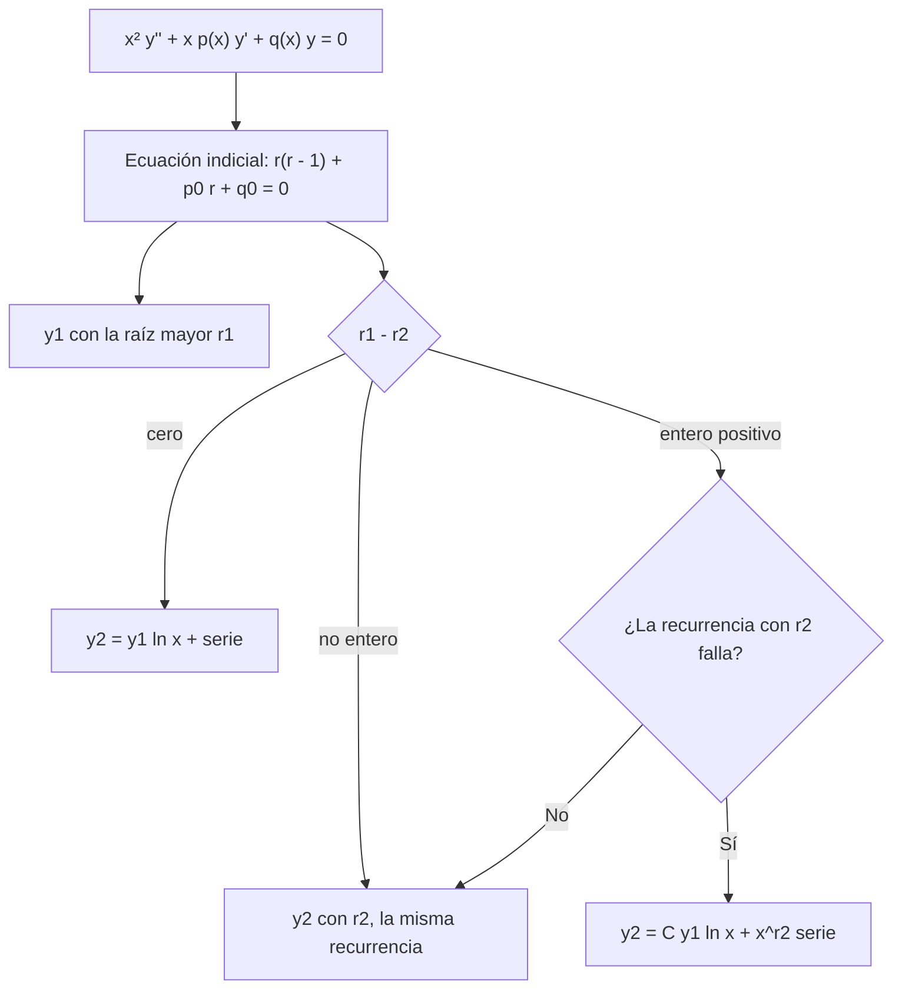

# Matemáticas para Ciencias Aplicadas IV - Ecuaciones diferenciales de 2o Orden con coeficientes variables

## 4.3 Puntos singulares regulares y método de Frobenius.

---

En un punto singular, las soluciones pueden no ser analíticas: la ecuación de Euler (tema 4.2) tiene soluciones como $x^{-1},$ $\sqrt{x}$ o $\ln x,$ que no son series de potencias en 0. Si la singularidad no es demasiado fuerte, el **método de Frobenius** (1873) encuentra soluciones de la forma $x^r$ multiplicada por una serie de potencias, combinando las dos ideas anteriores: la ecuación indicial de Euler para el comportamiento cerca del punto y la recurrencia de las series (tema 4.1) para lo demás. Es el método que produce las funciones de Bessel.

### Puntos singulares regulares

Para $y'' + p(x)\, y' + q(x)\, y = 0,$ un punto singular $x_0$ es **regular** si

$$ (x - x_0)\, p(x) \quad \text{y} \quad (x - x_0)^2\, q(x) $$

son analíticas en $x_0;$ si no, es **irregular**. La idea: $p$ puede tener a lo más un polo simple y $q$ un polo doble, como en la ecuación de Euler. Multiplicando por $x^2,$ con $x_0 = 0,$ la ecuación se escribe

$$ x^2 y'' + x\, \tilde{p}(x)\, y' + \tilde{q}(x)\, y = 0, \qquad \tilde{p}(x) = \sum p_k x^k, \quad \tilde{q}(x) = \sum q_k x^k $$

con $\tilde{p} = x p$ y $\tilde{q} = x^2 q$ analíticas. Cerca de 0 se parece a la ecuación de Euler $x^2 y'' + p_0 x y' + q_0 y = 0.$

**Ejemplos.** En la ecuación de Bessel $x^2 y'' + x y' + (x^2 - \nu^2) y = 0,$ el origen es singular regular con $\tilde{p} = 1$ y $\tilde{q} = x^2 - \nu^2.$ En $x^3 y'' + y = 0,$ $x^2 q = 1/x$ no es analítica: el origen es irregular y Frobenius no se aplica.

### El método de Frobenius

Se propone

$$ y = x^r \sum_{n = 0}^{\infty} a_n x^n = \sum_{n = 0}^{\infty} a_n x^{n + r}, \qquad a_0 \neq 0 $$

Sustituyendo y agrupando la potencia $x^{n + r}:$

$$ F(n + r)\, a_n + \sum_{k = 1}^{n} \big[ (n - k + r)\, p_k + q_k \big]\, a_{n - k} = 0, \qquad F(r) = r(r - 1) + p_0 r + q_0 $$

**Ecuación indicial.** Para $n = 0,$ como $a_0 \neq 0,$ se obtiene $F(r) = 0:$ la misma ecuación indicial que la ecuación de Euler asociada. Sus raíces $r_1 \geq r_2$ (si son reales) son los **exponentes** en la singularidad.

**Recurrencia.** Para $n \geq 1,$ se despeja $a_n$ dividiendo entre $F(n + r),$ que no se anula si $n + r$ no es raíz.

### Los tres casos

**Teorema (Frobenius).** Si 0 es un punto singular regular y las series de $\tilde{p}$ y $\tilde{q}$ convergen en $|x| \lt R,$ hay una solución $y_1 = x^{r_1} \sum a_n x^n$ que converge en $0 \lt x \lt R.$ La segunda depende de $r_1 - r_2:$

| Diferencia de las raíces | Segunda solución |
| --- | --- |
| no entera | $y_2 = x^{r_2} \sum b_n x^n,$ con la misma recurrencia |
| cero (raíz doble) | $y_2 = y_1 \ln x + x^{r_1} \sum_{n \geq 1} b_n x^n$ |
| entero positivo $N$ | $y_2 = C\, y_1 \ln x + x^{r_2} \sum b_n x^n,$ donde $C$ puede ser 0 |

En el tercer caso, con $r = r_2$ la recurrencia falla en $n = N,$ porque $F(N + r_2) = F(r_1) = 0.$ Si en ese paso el numerador también es cero, $b_N$ queda libre y no hace falta logaritmo, es decir, $C = 0;$ si no, el logaritmo es inevitable. La forma de la segunda solución se obtiene, por ejemplo, con reducción de orden (tema 3.2).



### Ejemplo: Bessel de orden 0

$x^2 y'' + x y' + x^2 y = 0.$ Aquí $p_0 = 1,$ $q_0 = 0,$ $q_2 = 1,$ y la indicial es $r(r - 1) + r = r^2 = 0:$ raíz doble $r = 0.$ La recurrencia queda $n^2 a_n + a_{n - 2} = 0,$ con $a_1 = 0,$ así que los impares se anulan y

$$ a_{2m} = -\frac{a_{2m - 2}}{(2m)^2} \quad \Rightarrow \quad J_0(x) = \sum_{m = 0}^{\infty} \frac{(-1)^m}{(m!)^2} \left( \frac{x}{2} \right)^{2m} = 1 - \frac{x^2}{4} + \frac{x^4}{64} - \frac{x^6}{2304} + \cdots $$

Es la **función de Bessel de orden 0**, que converge para todo $x.$ La segunda solución lleva $J_0(x) \ln x$ y es no acotada en 0: es la función de Bessel de segunda especie $Y_0$ (tema 4.4).

### Ejemplo: Bessel de orden 1/2

$x^2 y'' + x y' + (x^2 - \tfrac{1}{4}) y = 0.$ La indicial es $r^2 - \tfrac{1}{4} = 0,$ con $r = \pm \tfrac{1}{2},$ que difieren en el entero 1. La recurrencia es $\big[ (n + r)^2 - \tfrac{1}{4} \big] a_n = -a_{n - 2},$ que solo liga índices de la misma paridad; con $r = -\tfrac{1}{2}$ falla en $n = 1,$ pero ahí el numerador es cero, porque involucra a $a_{-1},$ que no existe; así que **no** hay logaritmo. Las soluciones son

$$ y_1 = x^{1/2} \left( 1 - \frac{x^2}{6} + \frac{x^4}{120} - \cdots \right) = \frac{\sin x}{\sqrt{x}}, \qquad y_2 = x^{-1/2} \left( 1 - \frac{x^2}{2} + \frac{x^4}{24} - \cdots \right) = \frac{\cos x}{\sqrt{x}} $$

### Implementación en Python

El programa implementa el método de Frobenius para ecuaciones $x^2 y'' + x \tilde{p}(x) y' + \tilde{q}(x) y = 0:$ calcula la ecuación indicial y, para cada raíz, los coeficientes con la recurrencia de arriba, detectando cuándo la segunda solución necesita un logaritmo. Lo aplica a la ecuación de Bessel y a los ejercicios, y compara la serie de $J_0$ y la de orden $1/2$ con las funciones de SciPy.

```python
import sympy as sp
import numpy as np
from scipy.special import j0, jv

x, r = sp.symbols('x r')

def frobenius(p, q, N):
    """Para x² y'' + x p(x) y' + q(x) y = 0 con p, q analíticas en 0:
    ecuación indicial y coeficientes a_n de y = x^r Σ a_n x^n para cada raíz (a0 = 1)."""
    P = sp.Poly(sp.series(p, x, 0, N + 1).removeO(), x)
    Q = sp.Poly(sp.series(q, x, 0, N + 1).removeO(), x)
    pk = [P.coeff_monomial(x**k) for k in range(N + 1)]
    qk = [Q.coeff_monomial(x**k) for k in range(N + 1)]
    F = lambda s: s * (s - 1) + pk[0] * s + qk[0]
    raices = sorted(sp.roots(sp.expand(F(r)), r).keys(), key=lambda z: -sp.re(z))
    resultado = {}
    for rho in raices:
        a = [sp.Integer(1)]
        for n in range(1, N + 1):
            denominador = F(n + rho)
            suma = sum(((n - k + rho) * pk[k] + qk[k]) * a[n - k] for k in range(1, n + 1))
            if denominador == 0:
                if sp.simplify(suma) != 0:
                    a = None                     # hace falta un logaritmo
                    break
                a.append(sp.Integer(0))          # a_n libre: se toma 0
                continue
            a.append(sp.simplify(-suma / denominador))
        resultado[rho] = a
    return sp.expand(F(r)), resultado

def mostrar(nombre, p, q, N=6):
    indicial, res = frobenius(p, q, N)
    print(f'{nombre}:  ecuación indicial {indicial} = 0')
    for rho, a in res.items():
        if a is None:
            print(f'   r = {rho}: la recurrencia falla, la segunda solución lleva logaritmo')
        else:
            print(f'   r = {rho}: y = x^({rho}) ·', sp.expand(sum(c * x**n for n, c in enumerate(a))))

mostrar('Bessel de orden 0, x²y\'\' + xy\' + x²y = 0', 1, x**2, 8)
mostrar('ej. 1, x²y\'\' + (sin x)y\' + xy = 0', sp.sin(x) / x, x, 4)
mostrar('ej. 2, 2x²y\'\' + xy\' - (x + 1)y = 0', sp.Rational(1, 2), -(x + 1) / 2, 4)
mostrar('ej. 3, x²y\'\' + x(x - 1)y\' + y = 0', x - 1, 1, 6)
mostrar('ej. 4, x²y\'\' + xy\' + (x² - 1/4)y = 0', 1, x**2 - sp.Rational(1, 4), 7)
mostrar('ej. 5, x²y\'\' + x(x² + 1)y\' - y = 0', x**2 + 1, -1, 6)
mostrar('Bessel de orden 1', 1, x**2 - 1, 6)

# J0 a partir de la serie de Frobenius, comparada con SciPy
_, res = frobenius(1, x**2, 40)
J0 = sum(c * x**n for n, c in enumerate(res[0]))
for xv in [1, 2.4048, 5]:
    print(f'J0({xv}): serie {float(J0.subs(x, xv)):.10f}  scipy {j0(xv):.10f}')
# Orden 1/2: la serie con r = 1/2 es sin(x)/√x
_, res = frobenius(1, x**2 - sp.Rational(1, 4), 12)
serie = sum(c * x**n for n, c in enumerate(res[sp.Rational(1, 2)]))
print('orden 1/2, r = 1/2: la serie es la de sin(x)/x:', sp.expand(sp.series(sp.sin(x) / x, x, 0, 13).removeO() - serie) == 0,
      '  √(2/π) sin(x)/√x en x = 2:', round(float(sp.sqrt(2 / sp.pi) * sp.sin(2) / sp.sqrt(2)), 10), ' scipy J_1/2(2):', round(jv(0.5, 2), 10))
```

Salida:

```text
Bessel de orden 0, x²y'' + xy' + x²y = 0:  ecuación indicial r**2 = 0
   r = 0: y = x^(0) · x**8/147456 - x**6/2304 + x**4/64 - x**2/4 + 1
ej. 1, x²y'' + (sin x)y' + xy = 0:  ecuación indicial r**2 = 0
   r = 0: y = x^(0) · 7*x**4/864 - 5*x**3/108 + x**2/4 - x + 1
ej. 2, 2x²y'' + xy' - (x + 1)y = 0:  ecuación indicial r**2 - r/2 - 1/2 = 0
   r = 1: y = x^(1) · x**4/83160 + x**3/1890 + x**2/70 + x/5 + 1
   r = -1/2: y = x^(-1/2) · -x**4/360 - x**3/18 - x**2/2 - x + 1
ej. 3, x²y'' + x(x - 1)y' + y = 0:  ecuación indicial r**2 - 2*r + 1 = 0
   r = 1: y = x^(1) · x**6/720 - x**5/120 + x**4/24 - x**3/6 + x**2/2 - x + 1
ej. 4, x²y'' + xy' + (x² - 1/4)y = 0:  ecuación indicial r**2 - 1/4 = 0
   r = 1/2: y = x^(1/2) · -x**6/5040 + x**4/120 - x**2/6 + 1
   r = -1/2: y = x^(-1/2) · -x**6/720 + x**4/24 - x**2/2 + 1
ej. 5, x²y'' + x(x² + 1)y' - y = 0:  ecuación indicial r**2 - 1 = 0
   r = 1: y = x^(1) · -5*x**6/3072 + x**4/64 - x**2/8 + 1
   r = -1: la recurrencia falla, la segunda solución lleva logaritmo
Bessel de orden 1:  ecuación indicial r**2 - 1 = 0
   r = 1: y = x^(1) · -x**6/9216 + x**4/192 - x**2/8 + 1
   r = -1: la recurrencia falla, la segunda solución lleva logaritmo
J0(1): serie 0.7651976866  scipy 0.7651976866
J0(2.4048): serie 0.0000132683  scipy 0.0000132683
J0(5): serie -0.1775967713  scipy -0.1775967713
orden 1/2, r = 1/2: la serie es la de sin(x)/x: True   √(2/π) sin(x)/√x en x = 2: 0.5130161366  scipy J_1/2(2): 0.5130161366
```

$J_0(2.4048) \approx 0:$ $2.4048$ es el primer cero de $J_0,$ que determina la frecuencia fundamental de un tambor circular (tema 6.5). La función de Bessel $J_{1/2}$ es $\sqrt{2/\pi}\, \sin(x)/\sqrt{x}.$

### Ejercicios Propuestos

1. **Clasificación.** Muestra que 0 es singular regular para $x^2 y'' + (\sin x)\, y' + x y = 0$ y encuentra la ecuación indicial.

2. **Raíces no enteras.** Resuelve por Frobenius $2x^2 y'' + x y' - (x + 1) y = 0.$

3. **Raíz doble.** Encuentra una solución de $x^2 y'' + x(x - 1) y' + y = 0$ y reconócela en forma cerrada.

4. **Bessel de orden 1/2.** Encuentra las dos soluciones de $x^2 y'' + x y' + (x^2 - \tfrac{1}{4}) y = 0.$

5. **Logaritmo.** Para $x^2 y'' + x(x^2 + 1) y' - y = 0,$ encuentra la ecuación indicial y decide si la segunda solución lleva logaritmo.

6. **Irregular.** Muestra que $x = 0$ es un punto singular irregular de $x^3 y'' + x y' - y = 0.$

### Soluciones

**Ejercicio 1.** $\tilde{p} = x \cdot \frac{\sin x}{x^2} = \frac{\sin x}{x} = 1 - \frac{x^2}{6} + \cdots$ y $\tilde{q} = x^2 \cdot \frac{x}{x^2} = x$ son analíticas. Con $p_0 = 1$ y $q_0 = 0,$ la indicial es $r^2 = 0,$ raíz doble: la segunda solución lleva logaritmo.

**Ejercicio 2.** Dividiendo entre 2: $p_0 = \tfrac{1}{2},$ $q_0 = -\tfrac{1}{2},$ y la indicial $r^2 - \tfrac{r}{2} - \tfrac{1}{2} = 0$ da $r = 1$ y $r = -\tfrac{1}{2},$ que no difieren en un entero. Las soluciones son $x \left( 1 + \frac{x}{5} + \frac{x^2}{70} + \cdots \right)$ y $x^{-1/2} \left( 1 - x - \frac{x^2}{2} - \cdots \right).$

**Ejercicio 3.** La indicial es $(r - 1)^2 = 0.$ Con $r = 1$ la recurrencia es $n^2 a_n = -n a_{n - 1},$ así que $a_n = (-1)^n/n!$ y $y_1 = x e^{-x}.$ La segunda es $y_1 \ln x$ más una serie.

**Ejercicio 4.** Son $\frac{\sin x}{\sqrt{x}}$ y $\frac{\cos x}{\sqrt{x}},$ como en el texto.

**Ejercicio 5.** $p_0 = 1,$ $q_0 = -1:$ $r^2 - 1 = 0,$ con $r = \pm 1,$ que difieren en 2. Con $r = -1,$ en $n = 2$ el denominador $F(1)$ es cero, pero el numerador vale $-1:$ hace falta logaritmo. La primera solución es $x \left( 1 - \frac{x^2}{8} + \frac{x^4}{64} - \cdots \right).$

**Ejercicio 6.** En forma estándar $p = 1/x^2$ y $x p = 1/x$ no es analítica en 0. Ni siquiera hace falta mirar $q.$

### Referencias

1. Boyce, W. E., DiPrima, R. C., and Meade, D. B., _Elementary Differential Equations and Boundary Value Problems_. Wiley, 2017. Secciones 5.5 a 5.8.
2. Zill, D. G., _Ecuaciones diferenciales con aplicaciones de modelado_. Cengage, 2018. Sección 6.3.
3. Simmons, G. F., _Ecuaciones diferenciales con aplicaciones y notas históricas_. McGraw-Hill, 1993. Secciones 29 a 32.
4. Teschl, G., _Ordinary Differential Equations and Dynamical Systems_. AMS, 2012. Sección 4.2.
