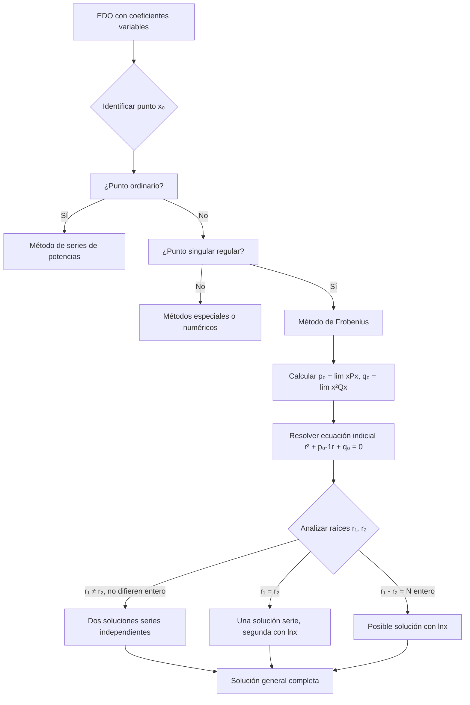

# Matemáticas para Ciencias Aplicadas IV - Ecuaciones diferenciales de 2o Orden con coeficientes variables

## 4.3 Puntos singulares regulares y método de Frobenius.

---

### 1. Introducción

Cuando los coeficientes de una ecuación diferencial de segundo orden son variables, no todos los puntos son adecuados para soluciones en serie de potencias. El **método de Frobenius** extiende el método de series de potencias para trabajar alrededor de **puntos singulares regulares**.

### 2. Puntos Ordinarios y Singulares

#### 2.1. Definiciones

**Ecuación general:**

$$y'' + P(x)y' + Q(x)y = 0$$

**Punto ordinario:** Un punto $x_0$ es ordinario si tanto $P(x)$ como $Q(x)$ son analíticas en $x_0$.

**Punto singular:** Un punto $x_0$ es singular si al menos una de las funciones $P(x)$ o $Q(x)$ no es analítica en $x_0$.

**Punto singular regular:** Un punto singular $x_0$ es regular si:

$$(x - x_0)P(x) \quad \text{y} \quad (x - x_0)^2Q(x)$$

son analíticas en $x_0$.

#### 2.2. Criterio para Puntos Singulares Regulares

Para la ecuación en forma estándar:

$$y'' + \frac{p(x)}{(x - x_0)}y' + \frac{q(x)}{(x - x_0)^2}y = 0$$

El punto $x_0$ es singular regular si $p(x)$ y $q(x)$ son analíticas en $x_0$.

### 3. Método de Frobenius

#### 3.1. Suposición Fundamental

Para un punto singular regular en $x = 0$, suponemos una solución de la forma:

$$y(x) = x^r \sum_{n=0}^{\infty} a_n x^n = \sum_{n=0}^{\infty} a_n x^{n+r}$$

donde $r$ es el **exponente característico** o **índice** de la solución.

#### 3.2. Ecuación Indicial

Al sustituir en la ecuación diferencial, obtenemos la **ecuación indicial**:

$$r(r - 1) + p_0 r + q_0 = 0$$

donde:

$$p_0 = \lim_{x \to 0} xP(x), \quad q_0 = \lim_{x \to 0} x^2Q(x)$$

#### 3.3. Casos de Solución

##### Caso 1: Raíces que no difieren en un entero

$$y_1(x) = x^{r_1} \sum_{n=0}^{\infty} a_n x^n, \quad y_2(x) = x^{r_2} \sum_{n=0}^{\infty} b_n x^n$$

##### Caso 2: Raíces iguales $(r_1 = r_2)$

$$y_1(x) = x^{r_1} \sum_{n=0}^{\infty} a_n x^n$$

$$y_2(x) = y_1(x) \ln x + x^{r_1} \sum_{n=1}^{\infty} b_n x^n$$

##### Caso 3: Raíces que difieren en un entero $(r_1 - r_2 = N)$

$$y_1(x) = x^{r_1} \sum_{n=0}^{\infty} a_n x^n$$

$$y_2(x) = k y_1(x) \ln x + x^{r_2} \sum_{n=0}^{\infty} b_n x^n$$

### 4. Diagrama del Método de Frobenius



### 5. Ejemplo Resuelto: Ecuación de Bessel

Resolver la ecuación de Bessel de orden cero:

$$x^2y'' + xy' + x^2y = 0$$

**Paso 1:** Forma estándar:

$$y'' + \frac{1}{x}y' + y = 0$$

**Paso 2:** Identificar punto singular:   $x = 0$ es punto singular regular pues:

$$xP(x) = 1 \quad \text{y} \quad x^2Q(x) = x^2$$

son analíticas en $x = 0$.

**Paso 3:** Suponer solución:

$$y = \sum_{n=0}^{\infty} a_n x^{n+r}$$

**Paso 4:** Sustituir en la ecuación:

$$\sum_{n=0}^{\infty} (n+r)(n+r-1)a_n x^{n+r} + \sum_{n=0}^{\infty} (n+r)a_n x^{n+r} + \sum_{n=0}^{\infty} a_n x^{n+r+2} = 0$$

**Paso 5:** Ecuación indicial ( coeficiente de $x^r$ ):

$$[r(r-1) + r]a_0 = 0 \Rightarrow r^2 = 0$$

Raíz doble: $r = 0$

**Paso 6:** Relación de recurrencia:

$$a_n = -\frac{a_{n-2}}{n^2} \quad \text{para } n \geq 2$$

**Solución:**

$$y(x) = a_0 \left[1 - \frac{x^2}{2^2} + \frac{x^4}{2^2 \cdot 4^2} - \frac{x^6}{2^2 \cdot 4^2 \cdot 6^2} + \cdots\right]$$

Esta es la **función de Bessel de primera especie de orden cero** $(J_0(x))$.

### 6. Implementación Computacional

```python
import sympy as sp
from sympy import symbols, Function, series, ln, Eq, solve

def metodo_frobenius(P, Q, punto=0, terminos=6):
    """
    Aplica el método de Frobenius para resolver EDOs
    con puntos singulares regulares
    """
    x = sp.symbols('x')
    r = sp.symbols('r')

    # Calcular p0 y q0
    p0 = sp.limit(x*P, x, punto)
    q0 = sp.limit(x**2*Q, x, punto)

    # Ecuación indicial
    ecuacion_indicial = r*(r-1) + p0*r + q0
    raices = solve(ecuacion_indicial, r)

    print(f"Ecuación indicial: {ecuacion_indicial} = 0")
    print(f"Raíces: {raices}")

    # Determinar el caso según las raíces
    if len(raices) == 1:
        print("Caso: Raíz doble")
        r_val = raices[0]
        # Implementar solución para raíz doble
    else:
        r1, r2 = raices
        if r1 == r2:
            print("Caso: Raíz doble")
        elif abs(r1 - r2).is_integer:
            print("Caso: Raíces que difieren en un entero")
        else:
            print("Caso: Raíces distintas que no difieren en entero")

    return raices

# Ejemplo de uso
x = sp.symbols('x')
P = 1/x  # Para ecuación de Bessel
Q = 1
metodo_frobenius(P, Q)
```

### 7. Ejercicios Propuestos

#### Ejercicio 1

Determinar si $x = 0$ es punto ordinario, singular regular o singular irregular para:

$$x^2y'' + (\sin x)y' + xy = 0$$

#### Ejercicio 2

Resolver usando el método de Frobenius:

$$2x^2y'' + xy' - (x + 1)y = 0$$

#### Ejercicio 3

Encontrar la ecuación indicial y las raíces para:

$$x^2y'' + x(x - 1)y' + y = 0$$

#### Ejercicio 4

Resolver la ecuación de Bessel de orden 1/2:

$$x^2y'' + xy' + \left(x^2 - \frac{1}{4}\right)y = 0$$

#### Ejercicio 5

Encontrar dos soluciones linealmente independientes para:

$$x^2y'' + x(x^2 + 1)y' - y = 0$$

### 8. Aplicaciones del Método de Frobenius

El método es crucial para resolver ecuaciones que aparecen en:

1. **Ecuación de Bessel:** Vibraciones de membranas circulares
2. **Ecuación de Legendre:** Potenciales en coordenadas esféricas
3. **Ecuación de Hermite:** Mecánica cuántica (oscilador armónico)
4. **Ecuación de Laguerre:** Átomos hidrogenoides

### 9. Referencias Bibliográficas

#### Bibliografía Básica

1. Boyce, W., DiPrima, R. (2004). _Elementary Differential Equations and Boundary Value Problems_. Wiley.
   - Capítulo 5: Series Solutions of Second Order Linear Equations

2. Edwards, C. H., Penney, D. E. (2002). _Ecuaciones diferenciales elementales y problemas con condiciones a la frontera_. Prentice Hall.
   - Sección 8.3: Puntos singulares regulares

#### Bibliografía Complementaria

3. Hubbard, J. H., West, B. H. (1995). _Differential Equations: A Dynamical Systems Approach_. Springer-Verlag.
   - Capítulo 4: Linear Systems

4. Zill, D. G., Wright, W. S. (1995). _Differential Equations with Computer Lab Experiments_. PWS Publishing.
   - Capítulo 6: Series Solutions

### 10. Consejos de Estudio

1. **Domina primero** el método de series de potencias para puntos ordinarios
2. **Practica la identificación** de puntos singulares regulares vs. irregulares
3. **Memoriza los tres casos** del método de Frobenius
4. **Verifica siempre** los límites para $p_0$ y $q_0$
5. **Comienza con ejemplos simples** antes de abordar ecuaciones más complejas

### 11. Soluciones a Ejercicios Propuestos (Bosquejo)

#### Ejercicio 1

$x = 0$ es punto singular regular pues:

$$xP(x) = \sin x \quad \text{y} \quad x^2Q(x) = x^2$$

son analíticas en $x = 0$.

#### Ejercicio 2

Ecuación indicial: $2r(r-1) + r - 1 = 0$
Raíces: $r = 1$, $r = -1/2$
Solución general:

$$y(x) = C_1 x \sum_{n=0}^{\infty} a_n x^n + C_2 x^{-1/2} \sum_{n=0}^{\infty} b_n x^n$$

#### Ejercicio 3

Ecuación indicial: $r(r-1) - r + 1 = 0$
$$r^2 - 2r + 1 = 0$$
Raíz doble: $r = 1$
