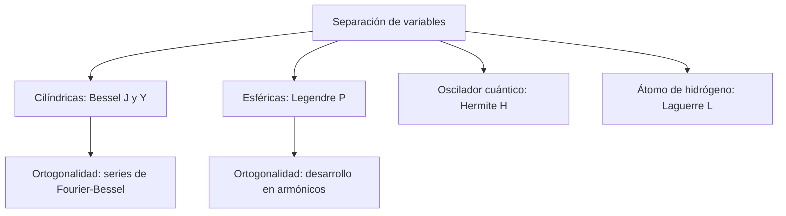

# Matemáticas para Ciencias Aplicadas IV - Ecuaciones diferenciales de 2o Orden con coeficientes variables

## 4.4 Funciones especiales.

---

Las **funciones especiales** son soluciones de ecuaciones diferenciales que aparecen una y otra vez en física e ingeniería, tan importantes que tienen nombre propio, tablas, propiedades conocidas y rutinas en todas las bibliotecas numéricas. Casi todas surgen al separar variables en las ecuaciones de onda, de calor o de Laplace en coordenadas no cartesianas (temas 6 a 8): las de **Bessel** en coordenadas cilíndricas, las de **Legendre** en esféricas; las de **Hermite** y **Laguerre** en mecánica cuántica. Este tema reúne sus definiciones y las propiedades que se usan en la práctica, en especial la **ortogonalidad**, que permite desarrollar funciones arbitrarias en series de ellas.

### La función Gamma

Las series de Bessel de orden no entero requieren extender el factorial:

$$ \Gamma(x) = \int_0^\infty t^{x - 1} e^{-t}\, dt, \qquad x > 0 $$

Integrando por partes, $\Gamma(x + 1) = x\, \Gamma(x),$ y como $\Gamma(1) = 1,$ se tiene $\Gamma(n + 1) = n!.$ Además $\Gamma(1/2) = \sqrt{\pi}$ (con el cambio $t = u^2$ queda la integral gaussiana). La relación $\Gamma(x) = \Gamma(x + 1)/x$ extiende $\Gamma$ a los negativos no enteros; en $0, -1, -2, \ldots$ tiene polos, y por eso $1/\Gamma(-n) = 0.$

### Funciones de Bessel

**La ecuación de Bessel** de orden $\nu \geq 0$ es

$$ x^2 y'' + x y' + (x^2 - \nu^2)\, y = 0 $$

Por Frobenius (tema 4.3), la indicial es $r^2 - \nu^2 = 0$ y la raíz $r = \nu$ da la **función de Bessel de primera especie**

$$ J_\nu(x) = \sum_{m = 0}^{\infty} \frac{(-1)^m}{m!\, \Gamma(m + \nu + 1)} \left( \frac{x}{2} \right)^{2m + \nu} $$

que converge para todo $x.$ Si $\nu$ no es entero, $J_{-\nu}$ es una segunda solución independiente. Si $\nu = n$ es entero, $J_{-n} = (-1)^n J_n,$ por los polos de $\Gamma,$ y la segunda solución es la de **segunda especie**,

$$ Y_\nu(x) = \frac{J_\nu(x) \cos \nu\pi - J_{-\nu}(x)}{\sin \nu\pi} $$

definida para $\nu$ entero como el límite. $Y_n$ tiene en 0 una singularidad logarítmica, que además es un polo si $n \geq 1,$ así que en problemas que incluyen el eje del cilindro se descarta.

**Comportamiento.** Cerca de 0, $J_\nu(x) \approx \frac{(x/2)^\nu}{\Gamma(\nu + 1)}.$ Para $x$ grande,

$$ J_\nu(x) \approx \sqrt{\frac{2}{\pi x}} \cos\left( x - \frac{\nu\pi}{2} - \frac{\pi}{4} \right) $$

oscilaciones como un coseno con amplitud que decae como $1/\sqrt{x}.$ Cada $J_\nu$ tiene infinitos ceros positivos $\alpha_{\nu, 1} \lt \alpha_{\nu, 2} \lt \cdots;$ los de $J_0$ son $2.4048,$ $5.5201,$ $8.6537,$ etc. Para $\nu = 1/2,$ $J_{1/2}(x) = \sqrt{2/(\pi x)}\, \sin x,$ una función elemental.

**Recurrencias.**

$$ \frac{d}{dx} \big[ x^\nu J_\nu(x) \big] = x^\nu J_{\nu - 1}(x), \qquad \frac{d}{dx} \big[ x^{-\nu} J_\nu(x) \big] = -x^{-\nu} J_{\nu + 1}(x) $$

Por ejemplo, $J_0' = -J_1$ y $\int x J_0(x)\, dx = x J_1(x).$

**Ortogonalidad.** Para un $\nu$ fijo, las funciones $J_\nu(\alpha_k x),$ con $\alpha_k$ los ceros de $J_\nu,$ son ortogonales en $[0, 1]$ con **peso** $x:$

$$ \int_0^1 x\, J_\nu(\alpha_j x)\, J_\nu(\alpha_k x)\, dx = \begin{cases} 0 & j \neq k \\ \frac{1}{2} J_{\nu + 1}(\alpha_k)^2 & j = k \end{cases} $$

Es la base de las **series de Fourier-Bessel**, con las que se describen las vibraciones de un tambor circular o la temperatura en un cilindro: los modos del tambor son $J_n(\alpha_{n,k} r/a) \cos n\theta$ y sus frecuencias son proporcionales a los ceros $\alpha_{n,k},$ que no son múltiplos entre sí. Por eso un tambor no tiene un sonido armónico como una cuerda.

### Polinomios ortogonales clásicos

Las ecuaciones de Legendre, Hermite y Laguerre tienen soluciones polinomiales para valores enteros del parámetro (tema 4.1). Cada familia es **ortogonal** con un peso en un intervalo y tiene una **fórmula de Rodrigues** y una **función generatriz**:

| Familia | Ecuación | Intervalo y peso | Rodrigues | Norma |
| --- | --- | --- | --- | --- |
| Legendre $P_n$ | $(1 - x^2) y'' - 2xy' + n(n + 1) y = 0$ | $[-1, 1],$ $1$ | $\frac{1}{2^n n!} \frac{d^n}{dx^n} (x^2 - 1)^n$ | $\frac{2}{2n + 1}$ |
| Hermite $H_n$ | $y'' - 2xy' + 2ny = 0$ | $\mathbb{R},$ $e^{-x^2}$ | $(-1)^n e^{x^2} \frac{d^n}{dx^n} e^{-x^2}$ | $2^n n! \sqrt{\pi}$ |
| Laguerre $L_n$ | $xy'' + (1 - x) y' + ny = 0$ | $[0, \infty),$ $e^{-x}$ | $\frac{e^x}{n!} \frac{d^n}{dx^n} (x^n e^{-x})$ | $1$ |
| Chebyshev $T_n$ | $(1 - x^2) y'' - xy' + n^2 y = 0$ | $[-1, 1],$ $\frac{1}{\sqrt{1 - x^2}}$ | $T_n(\cos \theta) = \cos n\theta$ | $\frac{\pi}{2}$ si $n \geq 1$ |

Los primeros polinomios de Legendre son $P_0 = 1,$ $P_1 = x,$ $P_2 = \frac{3x^2 - 1}{2}$ y $P_3 = \frac{5x^3 - 3x}{2}.$ Su función generatriz es

$$ \frac{1}{\sqrt{1 - 2xt + t^2}} = \sum_{n = 0}^{\infty} P_n(x)\, t^n $$

que explica su aparición en física: el potencial de una carga a distancia 1 del origen, visto desde un punto a distancia $r \lt 1$ con ángulo $\theta,$ es $\frac{1}{\sqrt{1 - 2r\cos\theta + r^2}} = \sum r^n P_n(\cos \theta),$ el **desarrollo multipolar**.

**Por qué son ortogonales.** Todas estas ecuaciones son de **Sturm-Liouville**: se escriben $(p y')' + q y = -\lambda w y.$ Para dos soluciones con $\lambda_m \neq \lambda_n,$ multiplicando cada ecuación por la otra solución, restando e integrando, los términos con $p$ se cancelan por las condiciones en los extremos, y queda $(\lambda_m - \lambda_n) \int w\, y_m y_n = 0.$ Es el mismo argumento que la ortogonalidad de los senos en las series de Fourier.

**Desarrollos.** Una función $f$ en $[-1, 1]$ se escribe $f = \sum c_n P_n$ con $c_n = \frac{2n + 1}{2} \int_{-1}^{1} f\, P_n\, dx,$ exactamente como una serie de Fourier.



### Implementación en Python

`scipy.special` evalúa todas estas funciones con alta precisión, y SymPy las maneja simbólicamente. El programa verifica propiedades de la función Gamma; construye los polinomios de Legendre con la fórmula de Rodrigues y comprueba que resuelven la ecuación, sus normas y su ortogonalidad; desarrolla $x^3$ en polinomios de Legendre y verifica la función generatriz; calcula la norma de $H_2$ y los ceros de $L_3;$ evalúa $J_{1.5}$ con la serie y comprueba numéricamente la ortogonalidad de Fourier-Bessel y una recurrencia.

```python
import sympy as sp
import numpy as np
from scipy import special, integrate

x, t = sp.symbols('x t')

# Función Gamma: Γ(n + 1) = n!, Γ(1/2) = √π
print('Γ(5) =', sp.gamma(5), '  Γ(1/2) =', sp.gamma(sp.Rational(1, 2)), '  Γ(x+1) = xΓ(x) en x = 2.5:',
      np.isclose(special.gamma(3.5), 2.5 * special.gamma(2.5)))

# Legendre: Rodrigues, ecuación y ortogonalidad
def legendre_rodrigues(n):
    return sp.expand(sp.diff((x**2 - 1)**n, x, n) / (2**n * sp.factorial(n)))
for n in range(5):
    Pn = legendre_rodrigues(n)
    ok = sp.simplify((1 - x**2) * Pn.diff(x, 2) - 2 * x * Pn.diff(x) + n * (n + 1) * Pn) == 0
    print(f'P{n} = {Pn}   resuelve Legendre: {ok}   ∫P{n}² = {sp.integrate(Pn**2, (x, -1, 1))}')
print('∫ P2 P3 =', sp.integrate(legendre_rodrigues(2) * legendre_rodrigues(3), (x, -1, 1)))
# Desarrollo de x³: c_n = (2n + 1)/2 ∫ x³ P_n
coefs = [sp.Rational(2 * n + 1, 2) * sp.integrate(x**3 * legendre_rodrigues(n), (x, -1, 1)) for n in range(5)]
print('x³ = Σ c_n P_n con c =', coefs)
# Función generatriz: 1/√(1 - 2xt + t²) = Σ P_n(x) t^n
gen = sp.series(1 / sp.sqrt(1 - 2 * x * t + t**2), t, 0, 4).removeO()
print('generatriz:', all(sp.expand(gen.coeff(t, n) - legendre_rodrigues(n)) == 0 for n in range(4)))

# Hermite: ortogonalidad con peso e^{-x²}; norma de H2
H2 = sp.hermite(2, x)
print('H2 =', H2, '  ∫ e^{-x²} H2² =', sp.integrate(sp.exp(-x**2) * H2**2, (x, -sp.oo, sp.oo)),
      '  fórmula 2^n n! √π =', 2**2 * 2 * sp.sqrt(sp.pi))

# Laguerre: ceros de L3
L3 = sp.expand(sp.assoc_laguerre(3, 0, x))
print('L3 =', L3, '  ceros:', [round(float(z), 6) for z in sp.Poly(L3, x).nroots()])

# Bessel: serie, ceros y ortogonalidad de J0(α_k x) con peso x en [0, 1]
def J(nu, xv, M=40):
    return sum((-1)**m / (special.factorial(m) * special.gamma(m + nu + 1)) * (xv / 2)**(2 * m + nu) for m in range(M))
print('J_1.5(3): serie', round(J(1.5, 3.0), 10), ' scipy', round(special.jv(1.5, 3.0), 10))
alfas = special.jn_zeros(0, 4)
print('ceros de J0:', np.round(alfas, 6))
G = [[integrate.quad(lambda s: s * special.j0(a * s) * special.j0(b * s), 0, 1)[0] for b in alfas[:3]] for a in alfas[:3]]
print('matriz ∫ x J0(α_i x) J0(α_j x) dx:\n', np.round(G, 8) + 0.0)
print('norma teórica J1(α)²/2:', np.round(special.j1(alfas[:3])**2 / 2, 8))
# Recurrencia: d/dx [x J1(x)] = x J0(x)
xv = 1.7; h = 1e-6
print('d/dx[x J1] = x J0 en 1.7:', np.isclose(((xv + h) * special.j1(xv + h) - (xv - h) * special.j1(xv - h)) / (2 * h), xv * special.j0(xv)))
```

Salida:

```text
Γ(5) = 24   Γ(1/2) = sqrt(pi)   Γ(x+1) = xΓ(x) en x = 2.5: True
P0 = 1   resuelve Legendre: True   ∫P0² = 2
P1 = x   resuelve Legendre: True   ∫P1² = 2/3
P2 = 3*x**2/2 - 1/2   resuelve Legendre: True   ∫P2² = 2/5
P3 = 5*x**3/2 - 3*x/2   resuelve Legendre: True   ∫P3² = 2/7
P4 = 35*x**4/8 - 15*x**2/4 + 3/8   resuelve Legendre: True   ∫P4² = 2/9
∫ P2 P3 = 0
x³ = Σ c_n P_n con c = [0, 3/5, 0, 2/5, 0]
generatriz: True
H2 = 4*x**2 - 2   ∫ e^{-x²} H2² = 8*sqrt(pi)   fórmula 2^n n! √π = 8*sqrt(pi)
L3 = -x**3/6 + 3*x**2/2 - 3*x + 1   ceros: [0.415775, 2.29428, 6.289945]
J_1.5(3): serie 0.4777182151  scipy 0.4777182151
ceros de J0: [ 2.404826  5.520078  8.653728 11.791534]
matriz ∫ x J0(α_i x) J0(α_j x) dx:
 [[0.13475706 0.         0.        ]
 [0.         0.05789007 0.        ]
 [0.         0.         0.03684318]]
norma teórica J1(α)²/2: [0.13475706 0.05789007 0.03684318]
d/dx[x J1] = x J0 en 1.7: True
```

La matriz de integrales es diagonal y su diagonal coincide con $\frac{1}{2} J_1(\alpha_k)^2:$ la ortogonalidad con peso $x$ se cumple numéricamente.

### Ejercicios Propuestos

1. **Legendre.** Verifica que $P_2(x) = \frac{1}{2}(3x^2 - 1)$ resuelve la ecuación de Legendre con $n = 2$ y que es ortogonal a $P_0$ y a $P_1.$

2. **Bessel.** Usando los primeros términos de la serie, verifica que $J_0$ satisface la ecuación de Bessel de orden 0 hasta $x^4.$

3. **Hermite.** Calcula $\int_{-\infty}^{\infty} e^{-x^2} H_2(x)^2\, dx.$

4. **Laguerre.** Encuentra los ceros de $L_3(x).$

5. **Desarrollo.** Escribe $x^3$ como combinación de polinomios de Legendre.

6. **Gamma.** Calcula $\Gamma(5/2)$ y $J_{1/2}$ a partir de la serie.

### Soluciones

**Ejercicio 1.** $P_2'' = 3,$ $P_2' = 3x:$ $(1 - x^2) \cdot 3 - 2x \cdot 3x + 6 \cdot \frac{3x^2 - 1}{2} = 3 - 3x^2 - 6x^2 + 9x^2 - 3 = 0.$ $\int_{-1}^{1} P_2\, dx = \left[ \frac{x^3 - x}{2} \right]_{-1}^{1} = 0,$ y $\int x P_2\, dx = 0$ por ser impar el integrando.

**Ejercicio 2.** Con $J_0 = 1 - \frac{x^2}{4} + \frac{x^4}{64} - \cdots,$ $x^2 J_0'' + x J_0' = -x^2 + \frac{x^4}{4} - \cdots$ y $x^2 J_0 = x^2 - \frac{x^4}{4} + \cdots:$ la suma se anula hasta $x^4.$

**Ejercicio 3.** $H_2 = 4x^2 - 2,$ y la integral vale $2^2 \cdot 2! \cdot \sqrt{\pi} = 8\sqrt{\pi}.$

**Ejercicio 4.** $L_3 = 1 - 3x + \frac{3}{2} x^2 - \frac{1}{6} x^3,$ con ceros $0.4158,$ $2.2943$ y $6.2899.$ Son los nodos de la cuadratura de Gauss-Laguerre de tres puntos.

**Ejercicio 5.** $x^3 = \frac{2}{5} P_3 + \frac{3}{5} P_1:$ en efecto, $\frac{2}{5} \cdot \frac{5x^3 - 3x}{2} + \frac{3}{5} x = x^3.$

**Ejercicio 6.** $\Gamma(5/2) = \frac{3}{2} \cdot \frac{1}{2} \cdot \Gamma(1/2) = \frac{3\sqrt{\pi}}{4}.$ Para $J_{1/2},$ usando $\Gamma(m + 3/2) = \frac{(2m + 1)!}{4^m m!} \cdot \frac{\sqrt{\pi}}{2},$ la serie se reduce a $\sqrt{\frac{2}{\pi x}} \sum \frac{(-1)^m x^{2m + 1}}{(2m + 1)!} = \sqrt{\frac{2}{\pi x}} \sin x.$

### Referencias

1. Olver, F. W. J., et al. (eds.), _NIST Digital Library of Mathematical Functions_. dlmf.nist.gov, capítulos 5, 10 y 18.
2. Boyce, W. E., DiPrima, R. C., and Meade, D. B., _Elementary Differential Equations and Boundary Value Problems_. Wiley, 2017. Sección 5.7.
3. Lebedev, N. N., _Special Functions and Their Applications_. Dover, 1972.
4. Arfken, G. B., Weber, H. J., and Harris, F. E., _Mathematical Methods for Physicists_. Academic Press, 2013. Capítulos 13 a 18.
