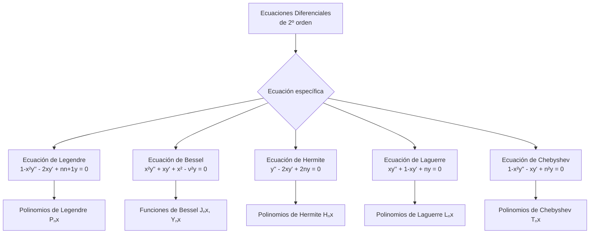

# Matemáticas para Ciencias Aplicadas IV - Ecuaciones diferenciales de 2o Orden con coeficientes variables

## 4.4 Funciones especiales.

---

### 1. Introducción a las Funciones Especiales

Las **funciones especiales** son soluciones particulares de ecuaciones diferenciales lineales de segundo orden con coeficientes variables que aparecen frecuentemente en problemas de física e ingeniería. Estas funciones forman familias ortogonales y tienen propiedades matemáticas muy útiles.

### 2. Ecuaciones Diferenciales que Generan Funciones Especiales

#### 2.1. Forma General de las Ecuaciones

La mayoría de las funciones especiales satisfacen ecuaciones de la forma:

$$P(x)y'' + Q(x)y' + R(x)y = 0$$

donde $P(x),$ $Q(x)$ y $R(x)$ son polinomios.

#### 2.2. Clasificación por Tipo de Ecuación



### 3. Polinomios de Legendre

#### 3.1. Ecuación de Legendre

$$(1 - x^2)y'' - 2xy' + n(n + 1)y = 0, \quad -1 \leq x \leq 1$$

#### 3.2. Fórmula de Rodrigues

$$P_n(x) = \frac{1}{2^n n!} \frac{d^n}{dx^n} [(x^2 - 1)^n]$$

#### 3.3. Primeros Polinomios de Legendre

- $P_0(x) = 1$
- $P_1(x) = x$
- $P_2(x) = \frac{1}{2}(3x^2 - 1)$
- $P_3(x) = \frac{1}{2}(5x^3 - 3x)$

#### 3.4. Ortogonalidad

$$\int_{-1}^{1} P_m(x)P_n(x)dx = \frac{2}{2n + 1}\delta_{mn}$$

### 4. Funciones de Bessel

#### 4.1. Ecuación de Bessel

$$x^2y'' + xy' + (x^2 - \nu^2)y = 0, \quad \nu \geq 0$$

#### 4.2. Función de Bessel de Primera Especie

$$J_\nu(x) = \sum_{m=0}^{\infty} \frac{(-1)^m}{m!\Gamma(m + \nu + 1)} \left(\frac{x}{2}\right)^{2m + \nu}$$

#### 4.3. Función de Bessel de Segunda Especie

$$Y_\nu(x) = \frac{J_\nu(x)\cos(\nu\pi) - J_{-\nu}(x)}{\sin(\nu\pi)}$$

#### 4.4. Relaciones de Recurrencia

$$\frac{d}{dx}[x^\nu J_\nu(x)] = x^\nu J_{\nu-1}(x)$$

$$\frac{d}{dx}[x^{-\nu} J_\nu(x)] = -x^{-\nu} J_{\nu+1}(x)$$

### 5. Polinomios de Hermite

#### 5.1. Ecuación de Hermite

$$y'' - 2xy' + 2ny = 0, \quad -\infty < x < \infty$$

#### 5.2. Fórmula de Rodrigues

$$H_n(x) = (-1)^n e^{x^2} \frac{d^n}{dx^n} (e^{-x^2})$$

#### 5.3. Primeros Polinomios de Hermite

- $H_0(x) = 1$
- $H_1(x) = 2x$
- $H_2(x) = 4x^2 - 2$
- $H_3(x) = 8x^3 - 12x$

#### 5.4. Ortogonalidad con Peso

$$\int_{-\infty}^{\infty} e^{-x^2} H_m(x)H_n(x)dx = 2^n n! \sqrt{\pi} \delta_{mn}$$

### 6. Polinomios de Laguerre

#### 6.1. Ecuación de Laguerre

$$xy'' + (1 - x)y' + ny = 0, \quad x \geq 0$$

#### 6.2. Fórmula de Rodrigues

$$L_n(x) = \frac{e^x}{n!} \frac{d^n}{dx^n} (x^n e^{-x})$$

#### 6.3. Primeros Polinomios de Laguerre

- $L_0(x) = 1$
- $L_1(x) = 1 - x$
- $L_2(x) = \frac{1}{2}(x^2 - 4x + 2)$
- $L_3(x) = \frac{1}{6}(-x^3 + 9x^2 - 18x + 6)$

### 7. Implementación Computacional

```python
import numpy as np
import matplotlib.pyplot as plt
from scipy.special import legendre, jv, hermite, eval_laguerre

# Función para graficar polinomios de Legendre
def graficar_polinomios_legendre(n_max=4):
    x = np.linspace(-1, 1, 400)
    plt.figure(figsize=(10, 6))

    for n in range(n_max + 1):
        p = legendre(n)
        y = p(x)
        plt.plot(x, y, label=f'$P_{n}(x)$')

    plt.title('Polinomios de Legendre')
    plt.xlabel('x')
    plt.ylabel('$P_n(x)$')
    plt.legend()
    plt.grid(True)
    plt.show()

# Función para graficar funciones de Bessel
def graficar_funciones_bessel(orden_max=2):
    x = np.linspace(0, 10, 400)
    plt.figure(figsize=(10, 6))

    for nu in range(orden_max + 1):
        j = jv(nu, x)
        plt.plot(x, j, label=f'$J_{nu}(x)$')

    plt.title('Funciones de Bessel de Primera Especie')
    plt.xlabel('x')
    plt.ylabel('$J_\\nu(x)$')
    plt.legend()
    plt.grid(True)
    plt.show()

# Ejemplo de uso
graficar_polinomios_legendre()
graficar_funciones_bessel()
```

### 8. Ejercicios Propuestos

#### Ejercicio 1

Demostrar que $P_2(x) = \frac{1}{2}(3x^2 - 1)$ satisface la ecuación de Legendre para $n = 2.$

#### Ejercicio 2

Verificar que $J_0(x)$ satisface la ecuación de Bessel para $\nu = 0$ usando los primeros tres términos de la serie.

#### Ejercicio 3

Calcular la norma al cuadrado de $H_2(x)$ usando la propiedad de ortogonalidad.

#### Ejercicio 4

Encontrar los ceros de $L_3(x)$ en el intervalo $[0, 10].$

#### Ejercicio 5

Expandir la función $f(x) = x^3$ en términos de polinomios de Legendre en el intervalo $[-1, 1].$

### 9. Aplicaciones de las Funciones Especiales

#### 9.1. Física Matemática

- **Potencial electrostático:** Polinomios de Legendre
- **Vibraciones de membrana:** Funciones de Bessel
- **Oscilador armónico cuántico:** Polinomios de Hermite
- **Átomo de hidrógeno:** Polinomios de Laguerre

#### 9.2. Ingeniería

- **Procesamiento de señales:** Polinomios de Chebyshev
- **Transmisión de calor:** Funciones de Bessel
- **Teoría de control:** Polinomios de Legendre

### 10. Propiedades Generales de las Funciones Especiales

#### 10.1. Ortogonalidad

La mayoría de las funciones especiales forman familias ortogonales con respecto a alguna función peso $w(x):$

$$\int_{a}^{b} \phi_m(x)\phi_n(x)w(x)dx = \delta_{mn}c_n$$

#### 10.2. Relaciones de Recurrencia

Cumplen relaciones de recurrencia que permiten calcular polinomios de orden superior a partir de los de orden inferior.

#### 10.3. Función Generatriz

Todas tienen una función generatriz asociada:

$$G(x, t) = \sum_{n=0}^{\infty} \phi_n(x)t^n$$

### 11. Referencias Bibliográficas

#### Bibliografía Básica

1. Boyce, W., DiPrima, R. (2004). _Elementary Differential Equations and Boundary Value Problems_. Wiley.
   - Capítulo 5: Series Solutions of Second Order Linear Equations

2. Edwards, C. H., Penney, D. E. (2002). _Ecuaciones diferenciales elementales y problemas con condiciones a la frontera_. Prentice Hall.
   - Capítulo 8: Soluciones en series de potencias

#### Bibliografía Complementaria

3. Arfken, G. B., Weber, H. J. (2005). _Mathematical Methods for Physicists_. Academic Press.
   - Capítulos 12-15: Funciones especiales

4. Andrews, L. C. (1985). _Special Functions for Engineers and Applied Mathematicians_. Macmillan.

### 12. Consejos de Estudio

1. **Enfócate en comprender** las propiedades de ortogonalidad de cada familia
2. **Memoriza las ecuaciones diferenciales** que generan cada función especial
3. **Practica el cálculo** de los primeros polinomios de cada familia
4. **Visualiza las funciones** usando software matemático
5. **Relaciona cada función** con sus aplicaciones físicas
