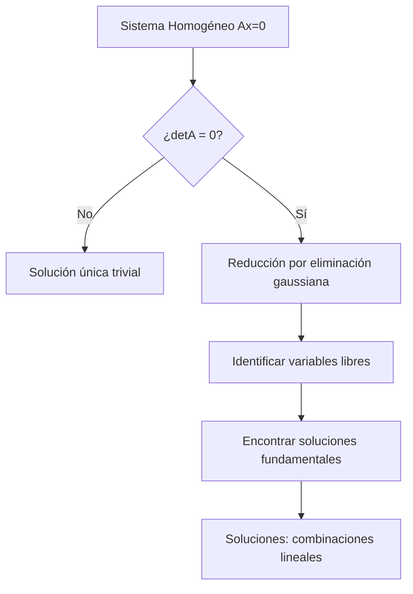

# Matemáticas para Ciencias Aplicadas IV - Sistemas de Ecuaciones

## 5.1 Sistemas de ecuaciones lineales homogéneos.

---

Los sistemas de ecuaciones lineales homogéneos son fundamentales en el estudio de ecuaciones diferenciales y tienen aplicaciones en diversas áreas de la ciencia e ingeniería. En esta guía exploraremos sus propiedades, métodos de solución y aplicaciones.

### Definición Formal

Un **sistema de ecuaciones lineales homogéneo** es un sistema de la forma:

$$ \begin{cases} a_{11}x_1 + a_{12}x_2 + \cdots + a_{1n}x_n = 0 \\\ a_{21}x_1 + a_{22}x_2 + \cdots + a_{2n}x_n = 0 \\\ \vdots \\\ a_{m1}x_1 + a_{m2}x_2 + \cdots + a_{mn}x_n = 0 \end{cases} $$

Que en forma matricial se expresa como:

$$A\mathbf{x} = \mathbf{0}$$

Donde:

- $A$ es una matriz $m \times n$ de coeficientes
- $\mathbf{x}$ es el vector columna de variables $(x_1, x_2, \ldots, x_n)^T$
- $\mathbf{0}$ es el vector nulo

### Propiedades Fundamentales

#### Teorema 1: Solución Trivial

Todo sistema homogéneo tiene al menos la **solución trivial**:

$$\mathbf{x} = \mathbf{0}$$

#### Teorema 2: Superposición

Si $\mathbf{x}_1$ y $\mathbf{x}_2$ son soluciones, entonces cualquier combinación lineal también es solución:

$$c_1\mathbf{x}_1 + c_2\mathbf{x}_2 \quad \text{es solución para cualquier } c_1, c_2 \in \mathbb{R}$$

#### Teorema 3: Dimensión del Espacio Solución

Para una matriz $A$ de $m \times n$ con rango $r,$ la dimensión del espacio solución es:

$$\dim(\text{Sol}) = n - r$$

### Métodos de Solución

#### 1. Eliminación Gaussiana

```python
# Pseudocódigo para resolver sistema homogéneo
def resolver_homogeneo(A):
    # Reducir a forma escalonada
    forma_escalonada = gauss_elimination(A)

    # Identificar variables libres y básicas
    variables_libres = n - rango(A)

    # Encontrar soluciones fundamentales
    soluciones = []
    for i in range(variables_libres):
        solucion = encontrar_solucion_particular(forma_escalonada, i)
        soluciones.append(solucion)

    return soluciones
```

#### 2. Uso de Determinantes (Sistemas Cuadrados)

Para $A$ de $n \times n:$

- Si $\det(A) \neq 0:$ Solución única trivial
- Si $\det(A) = 0:$ Infinitas soluciones no triviales

#### 3. Valores y Vectores Propios

Para sistemas de ecuaciones diferenciales lineales homogéneos:

$$\mathbf{x}' = A\mathbf{x}$$

La solución general es:

$$\mathbf{x}(t) = c_1e^{\lambda_1 t}\mathbf{v}_1 + c_2e^{\lambda_2 t}\mathbf{v}_2 + \cdots + c_ne^{\lambda_n t}\mathbf{v}_n$$

### Ejemplos Resueltos

#### Ejemplo 1: Sistema 2×2

Resolver el sistema:

$$ \begin{cases} 2x + 3y = 0 \\\ 4x + 6y = 0 \end{cases} $$

**Solución:**
La matriz aumentada es:

$$ \left(\begin{array}{cc|c} 2 & 3 & 0 \\\ 4 & 6 & 0 \end{array}\right) $$

Reduciendo:

$$ \left(\begin{array}{cc|c} 1 & 1.5 & 0 \\\ 0 & 0 & 0 \end{array}\right) $$

Solución: $x = -1.5t,$ $y = t$ para cualquier $t \in \mathbb{R}$

#### Ejemplo 2: Sistema 3×3

Resolver:

$$ \begin{cases} x + y + z = 0 \\\ 2x - y + 3z = 0 \\\ x + 4y - z = 0 \end{cases} $$

**Solución:**
Matriz de coeficientes:

$$ \begin{pmatrix} 1 & 1 & 1 \\\ 2 & -1 & 3 \\\ 1 & 4 & -1 \end{pmatrix} $$

Determinante: $\det(A) = 0$ (verificar), por tanto hay soluciones no triviales.

### Aplicaciones en Ecuaciones Diferenciales

#### Sistema Masa-Resorte

Para un sistema de dos masas acopladas:

$$ \begin{cases} m_1x_1'' = -k_1x_1 + k_2(x_2 - x_1) \\\ m_2x_2'' = -k_2(x_2 - x_1) \end{cases} $$

Buscar soluciones de la forma $x_i = A_i e^{i\omega t}$

#### Diagrama de Flujo para Resolución



### Ejercicios Propuestos

#### Ejercicio 1

Resolver el sistema:

$$ \begin{cases} 3x - 2y + z = 0 \\\ x + y - z = 0 \\\ 2x - 3y + 2z = 0 \end{cases} $$

#### Ejercicio 2

Encontrar la dimensión del espacio solución para:

$$ \begin{pmatrix} 1 & 2 & -1 & 3 \\\ 2 & 4 & -2 & 6 \\\ -1 & -2 & 1 & -3 \end{pmatrix} \mathbf{x} = \mathbf{0} $$

#### Ejercicio 3

Para el sistema de ecuaciones diferenciales:

$$ \begin{cases} x' = 2x - y \\\ y' = -x + 2y \end{cases} $$

Encontrar la solución general usando el método de valores propios.

### Referencias

#### Bibliografía Básica

1. **Boice, W., DiPrima, R.** (2004). _Elementary Differential Equations and Boundary Value Problems_. Wiley, New York. (Capítulo 7)
2. **Edwards, C. H., Penney, D. E.** (2002). _Ecuaciones diferenciales elementales y problemas con condiciones a la frontera_. Prentice Hall, México. (Sección 5.2)

#### Bibliografía Complementaria

1. **Cooper, J. M.** (1998). _Introduction to Partial Differential Equations with MatLab_. Birkhäuser, Boston.
2. **Hubbard, J. H., West, B. H.** (1995). _Differential Equations: A Dynamical Systems Approach_. Springer-Verlag, Berlin.
3. **Zill, D. G., Wright, W. S.** (1995). _Differential Equations with Computer Lab Experiments_. PWS Publishing Company, Boston.

### Consejos de Estudio

1. **Domina el álgebra lineal**: Los conceptos de espacios vectoriales, bases y dimensión son cruciales.
2. **Practica con ejemplos**: Resuelve sistemas de diferentes tamaños y con distintas características.
3. **Usa software**: Verifica tus resultados con herramientas como MATLAB, Python o calculadoras matriciales.
4. **Relaciona conceptos**: Conecta los sistemas homogéneos con aplicaciones físicas reales.
