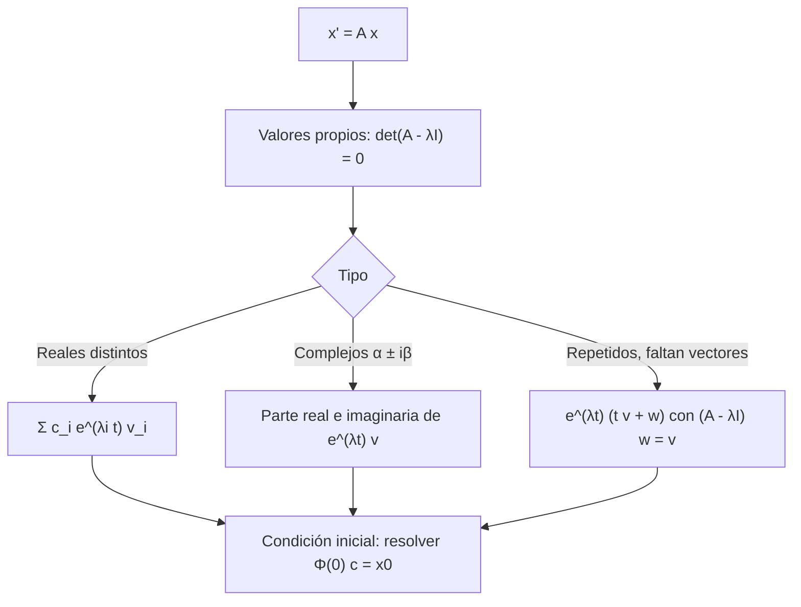

# Matemáticas para Ciencias Aplicadas IV - Sistemas de Ecuaciones

## 5.1 Sistemas de ecuaciones lineales homogéneos.

---

Muchos fenómenos involucran varias cantidades que cambian a la vez y se influyen entre sí: las concentraciones en tanques conectados, las posiciones de masas unidas por resortes, las poblaciones de especies que compiten, las corrientes en las mallas de un circuito. Se modelan con **sistemas de ecuaciones diferenciales**. Este tema trata los sistemas lineales homogéneos con coeficientes constantes, $\mathbf{x}' = A\mathbf{x},$ que se resuelven con los **valores y vectores propios** de la matriz $A:$ el álgebra lineal se combina con las ecuaciones diferenciales.

### Sistemas de primer orden

Un sistema lineal de primer orden es

$$ \mathbf{x}'(t) = A(t)\, \mathbf{x}(t) + \mathbf{f}(t), \qquad \mathbf{x} = \begin{pmatrix} x_1 \\ \vdots \\ x_n \end{pmatrix} $$

Es **homogéneo** si $\mathbf{f} = \mathbf{0}.$ Toda ecuación de orden $n$ se convierte en un sistema de primer orden: para $y'' + p y' + q y = 0$ se toma $x_1 = y,$ $x_2 = y',$ y queda

$$ \begin{pmatrix} x_1 \\ x_2 \end{pmatrix}' = \begin{pmatrix} 0 & 1 \\ -q & -p \end{pmatrix} \begin{pmatrix} x_1 \\ x_2 \end{pmatrix} $$

Por eso los sistemas generalizan todo lo anterior, y es la forma en que los resuelven los métodos numéricos (tema 2.3).

### La teoría general

Las propiedades del tema 3.2 se trasladan casi sin cambios:

- **Existencia y unicidad.** Si $A(t)$ es continua en un intervalo $I,$ para cada $t_0 \in I$ y cada $\mathbf{x}_0$ hay una única solución con $\mathbf{x}(t_0) = \mathbf{x}_0,$ definida en todo $I.$
- **Superposición.** Las combinaciones lineales de soluciones del sistema homogéneo son soluciones.
- **Dimensión.** Las soluciones de un sistema homogéneo de $n$ ecuaciones forman un espacio vectorial de dimensión $n.$ Un **conjunto fundamental** son $n$ soluciones independientes $\mathbf{x}^{(1)}, \ldots, \mathbf{x}^{(n)};$ la matriz $\Phi(t)$ que las tiene como columnas es una **matriz fundamental**, y la solución general es $\mathbf{x} = \Phi(t)\, \mathbf{c}.$
- **Wronskiano.** $W(t) = \det \Phi(t)$ es idénticamente cero o nunca cero, por la fórmula de Abel $W' = (\operatorname{tr} A)\, W.$

### Coeficientes constantes: el método de los valores propios

Para $\mathbf{x}' = A\mathbf{x}$ con $A$ constante, se prueba $\mathbf{x} = e^{\lambda t}\, \mathbf{v}.$ Sustituyendo, $\lambda e^{\lambda t} \mathbf{v} = e^{\lambda t} A\mathbf{v},$ es decir,

$$ A\mathbf{v} = \lambda \mathbf{v} $$

$e^{\lambda t} \mathbf{v}$ es solución si y solo si $\lambda$ es un **valor propio** de $A$ y $\mathbf{v}$ un **vector propio** asociado. Los valores propios son las raíces del polinomio característico $\det(A - \lambda I) = 0.$

**Valores propios reales distintos.** Si $\lambda_1, \ldots, \lambda_n$ son distintos, sus vectores propios son independientes y

$$ \mathbf{x}(t) = c_1 e^{\lambda_1 t} \mathbf{v}_1 + \cdots + c_n e^{\lambda_n t} \mathbf{v}_n $$

**Ejemplo.** $x' = 2x - y,$ $y' = -x + 2y.$ $\det \begin{pmatrix} 2 - \lambda & -1 \\ -1 & 2 - \lambda \end{pmatrix} = (\lambda - 1)(\lambda - 3).$ Para $\lambda = 1,$ $\mathbf{v} = (1, 1);$ para $\lambda = 3,$ $\mathbf{v} = (1, -1).$ La solución general es $\mathbf{x} = c_1 e^t (1, 1) + c_2 e^{3t} (1, -1).$ Con $\mathbf{x}(0) = (1, 0),$ $c_1 = c_2 = \tfrac{1}{2}.$

**Valores propios complejos.** Si $\lambda = \alpha + i\beta$ con vector propio $\mathbf{v} = \mathbf{a} + i\mathbf{b},$ la solución compleja $e^{\lambda t} \mathbf{v}$ tiene parte real e imaginaria que son dos soluciones **reales** independientes:

$$ \mathbf{x}^{(1)} = e^{\alpha t} (\mathbf{a} \cos \beta t - \mathbf{b} \sin \beta t), \qquad \mathbf{x}^{(2)} = e^{\alpha t} (\mathbf{a} \sin \beta t + \mathbf{b} \cos \beta t) $$

Son oscilaciones con amplitud $e^{\alpha t}:$ espirales en el plano de fases (tema 5.3).

**Valores propios repetidos.** Si $\lambda$ tiene multiplicidad 2 pero un solo vector propio $\mathbf{v}$ (la matriz no es **diagonalizable**), la segunda solución es

$$ \mathbf{x}^{(2)} = e^{\lambda t} (t\, \mathbf{v} + \mathbf{w}), \qquad (A - \lambda I)\, \mathbf{w} = \mathbf{v} $$

donde $\mathbf{w}$ es un **vector propio generalizado**. Es el análogo de $t e^{rt}$ en la raíz doble (tema 3.3).

### La matriz exponencial

La solución de $\mathbf{x}' = A\mathbf{x},$ $\mathbf{x}(0) = \mathbf{x}_0$ se puede escribir como en el caso escalar:

$$ \mathbf{x}(t) = e^{At}\, \mathbf{x}_0, \qquad e^{At} = I + At + \frac{(At)^2}{2!} + \frac{(At)^3}{3!} + \cdots $$

La serie converge para toda matriz, y derivándola término a término $\frac{d}{dt} e^{At} = A\, e^{At}.$ Si $A = P D P^{-1}$ con $D$ diagonal, $e^{At} = P\, e^{Dt} P^{-1},$ con $e^{Dt}$ diagonal de entradas $e^{\lambda_i t}:$ el método de los valores propios es el cálculo de $e^{At}.$ Para matrices no diagonalizables se usa la forma de Jordan.



### Aplicaciones

**Tanques conectados.** Dos tanques de 100 L y 200 L intercambian agua a 10 L/min en cada sentido, sin entradas ni salidas externas. Si $x_1$ y $x_2$ son las cantidades de sal,

$$ x_1' = -\frac{x_1}{10} + \frac{x_2}{20}, \qquad x_2' = \frac{x_1}{10} - \frac{x_2}{20} $$

Los valores propios son $0$ y $-3/20.$ El valor propio cero corresponde al **equilibrio**: la sal se reparte en proporción a los volúmenes. El otro mide la rapidez del mezclado: la diferencia decae como $e^{-3t/20},$ con constante de tiempo de unos 6.7 minutos.

**Modos normales.** Dos masas iguales unidas entre sí y a dos paredes por tres resortes iguales cumplen $\mathbf{x}'' = K\mathbf{x}$ con $K = \begin{pmatrix} -2 & 1 \\ 1 & -2 \end{pmatrix},$ tomando $k/m = 1.$ Proponiendo $\mathbf{x} = \mathbf{v} \cos \omega t$ se obtiene $K\mathbf{v} = -\omega^2 \mathbf{v}:$ los valores propios $-1$ y $-3$ dan las frecuencias $1$ y $\sqrt{3}.$ El modo lento, $\mathbf{v} = (1, 1),$ mueve las masas juntas; el rápido, $\mathbf{v} = (1, -1),$ las mueve en sentidos opuestos. Todo movimiento es una superposición de los dos.

### Implementación en Python

El programa calcula con SymPy los valores y vectores propios y la matriz exponencial $e^{At}$ para matrices con valores propios reales distintos, complejos y repetidos, resuelve los problemas de valor inicial, verifica cada solución sustituyéndola, analiza los tanques y los modos normales, y compara $e^{A} \mathbf{x}_0$ (con `scipy.linalg.expm`) con una integración numérica.

```python
import sympy as sp
import numpy as np
from scipy.integrate import solve_ivp
from scipy.linalg import expm

t = sp.symbols('t', real=True)

def resolver(A, x0=None):
    """Solución de x' = A x por valores y vectores propios; con x0, la del problema de valor inicial."""
    A = sp.Matrix(A)
    print('A =', A.tolist())
    for valor, mult, vectores in A.eigenvects():
        print(f'   λ = {valor} (multiplicidad {mult}), vectores propios {[list(v) for v in vectores]}')
    Phi = sp.simplify((A * t).exp())               # matriz exponencial e^{At}
    if x0 is not None:
        sol = sp.simplify(Phi * sp.Matrix(x0))
        print('   x(t) =', [sp.simplify(c) for c in sol])
        assert sp.simplify(sol.diff(t) - A * sol) == sp.zeros(A.shape[0], 1)
    return Phi

# Ejercicio 3: x' = 2x - y, y' = -x + 2y (valores propios reales distintos)
resolver([[2, -1], [-1, 2]], [1, 0])
# Valores propios complejos: x' = -x + 2y, y' = -2x - y
resolver([[-1, 2], [-2, -1]], [1, 0])
# Valor propio repetido con un solo vector propio: x' = 3x + y, y' = 3y
resolver([[3, 1], [0, 3]], [1, 1])

# Dos tanques: entre ellos circula agua; x1' = -x1/10 + x2/20, x2' = x1/10 - x2/20 (100 L y 200 L)
A = [[-sp.Rational(1, 10), sp.Rational(1, 20)], [sp.Rational(1, 10), -sp.Rational(1, 20)]]
resolver(A, [30, 0])

# Masas y resortes: m1 = m2 = 1, k1 = k2 = k3 = 1; x'' = K x con K = [[-2, 1], [1, -2]]
K = sp.Matrix([[-2, 1], [1, -2]])
print('modos normales: valores propios de K =', K.eigenvals(), '-> frecuencias', [sp.sqrt(-l) for l in K.eigenvals()])

# Comprobación numérica: e^{At} x0 frente a solve_ivp
An = np.array([[2.0, -1.0], [-1.0, 2.0]])
num = solve_ivp(lambda t, x: An @ x, [0, 1], [1, 0], rtol=1e-11, atol=1e-12)
print('e^{A} x0 =', np.round(expm(An) @ [1, 0], 8), '  solve_ivp:', np.round(num.y[:, -1], 8))
```

Salida:

```text
A = [[2, -1], [-1, 2]]
   λ = 1 (multiplicidad 1), vectores propios [[1, 1]]
   λ = 3 (multiplicidad 1), vectores propios [[-1, 1]]
   x(t) = [(exp(2*t) + 1)*exp(t)/2, (1 - exp(2*t))*exp(t)/2]
A = [[-1, 2], [-2, -1]]
   λ = -1 - 2*I (multiplicidad 1), vectores propios [[I, 1]]
   λ = -1 + 2*I (multiplicidad 1), vectores propios [[-I, 1]]
   x(t) = [exp(-t)*cos(2*t), -exp(-t)*sin(2*t)]
A = [[3, 1], [0, 3]]
   λ = 3 (multiplicidad 2), vectores propios [[1, 0]]
   x(t) = [(t + 1)*exp(3*t), exp(3*t)]
A = [[-1/10, 1/20], [1/10, -1/20]]
   λ = -3/20 (multiplicidad 1), vectores propios [[-1, 1]]
   λ = 0 (multiplicidad 1), vectores propios [[1/2, 1]]
   x(t) = [10 + 20*exp(-3*t/20), 20 - 20*exp(-3*t/20)]
modos normales: valores propios de K = {-1: 1, -3: 1} -> frecuencias [1, sqrt(3)]
e^{A} x0 = [11.40190938 -8.68362755]   solve_ivp: [11.40190938 -8.68362755]
```

SymPy elige los vectores propios con otra normalización, por ejemplo $(-1, 1)$ en lugar de $(1, -1);$ cualquier múltiplo sirve.

### Ejercicios Propuestos

1. **Reducción.** Escribe $y'' + 3y' + 2y = 0$ como sistema de primer orden y verifica que los valores propios de la matriz son las raíces características.

2. **Reales distintos.** Resuelve $x' = x + 2y,$ $y' = 3x + 2y.$

3. **Valor inicial.** Resuelve $x' = 2x - y,$ $y' = -x + 2y$ con $x(0) = 1,$ $y(0) = 0.$

4. **Complejos.** Resuelve $x' = -x + 2y,$ $y' = -2x - y$ con $x(0) = 1,$ $y(0) = 0,$ y describe la trayectoria.

5. **Repetido.** Resuelve $x' = 3x + y,$ $y' = 3y$ con $x(0) = y(0) = 1.$

6. **Tanques.** En el problema de los tanques, con 30 kg de sal inicialmente en el primero y agua pura en el segundo, ¿cuánta sal hay en cada uno a largo plazo y cuándo la diferencia con el equilibrio es menor que el $1\,\%$ de la inicial?

### Soluciones

**Ejercicio 1.** $x_1 = y,$ $x_2 = y':$ $A = \begin{pmatrix} 0 & 1 \\ -2 & -3 \end{pmatrix},$ con $\det(A - \lambda I) = \lambda^2 + 3\lambda + 2,$ el polinomio característico de la ecuación: raíces $-1$ y $-2.$

**Ejercicio 2.** $\det \begin{pmatrix} 1 - \lambda & 2 \\ 3 & 2 - \lambda \end{pmatrix} = \lambda^2 - 3\lambda - 4 = (\lambda - 4)(\lambda + 1).$ Para $\lambda = 4,$ $\mathbf{v} = (2, 3);$ para $\lambda = -1,$ $\mathbf{v} = (1, -1).$ $\mathbf{x} = c_1 e^{4t} (2, 3) + c_2 e^{-t} (1, -1).$

**Ejercicio 3.** $x = \frac{e^t + e^{3t}}{2},$ $y = \frac{e^t - e^{3t}}{2},$ como da el programa.

**Ejercicio 4.** $\lambda = -1 \pm 2i;$ la solución es $x = e^{-t} \cos 2t,$ $y = -e^{-t} \sin 2t:$ una espiral que gira en sentido horario y se cierra hacia el origen.

**Ejercicio 5.** $\lambda = 3$ doble con un solo vector propio $(1, 0).$ La solución es $x = (1 + t) e^{3t},$ $y = e^{3t}.$

**Ejercicio 6.** $x_1 = 10 + 20 e^{-3t/20},$ $x_2 = 20 - 20 e^{-3t/20}:$ a largo plazo 10 kg y 20 kg. La diferencia con el equilibrio es $20 e^{-3t/20},$ que es menor que $0.2$ (el $1\,\%$ de 20) cuando $t > \frac{20}{3} \ln 100 \approx 30.7$ minutos.

### Referencias

1. Boyce, W. E., DiPrima, R. C., and Meade, D. B., _Elementary Differential Equations and Boundary Value Problems_. Wiley, 2017. Secciones 7.1 a 7.8.
2. Zill, D. G., _Ecuaciones diferenciales con aplicaciones de modelado_. Cengage, 2018. Capítulo 8.
3. Hirsch, M. W., Smale, S., and Devaney, R. L., _Differential Equations, Dynamical Systems, and an Introduction to Chaos_. Academic Press, 2013. Capítulos 2 a 6.
4. Strang, G., _Differential Equations and Linear Algebra_. Wellesley-Cambridge Press, 2014. Capítulo 6.
