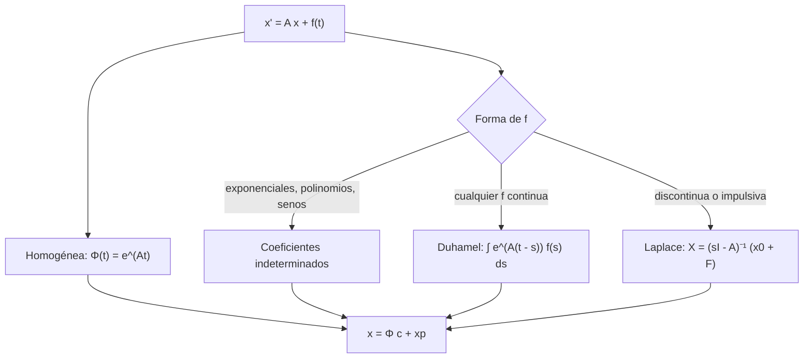

# Matemáticas para Ciencias Aplicadas IV - Sistemas de Ecuaciones

## 5.2 Sistema de ecuaciones lineales no homogéneos.

---

Un sistema **no homogéneo** $\mathbf{x}' = A\mathbf{x} + \mathbf{f}(t)$ describe un sistema sometido a influencias externas: fuentes en un circuito, entradas de sustancia en tanques, fuerzas sobre masas acopladas. Como en las ecuaciones escalares (temas 1.2 y 3.2), la solución general es la del sistema homogéneo más una solución particular. Este tema presenta las tres formas de encontrar esa particular: coeficientes indeterminados, variación de parámetros (en su forma de **fórmula de Duhamel** con la matriz exponencial) y la transformada de Laplace.

### Estructura de la solución

**Teorema.** Si $\Phi(t)$ es una matriz fundamental del sistema homogéneo $\mathbf{x}' = A\mathbf{x}$ (tema 5.1) y $\mathbf{x}_p$ es una solución particular de $\mathbf{x}' = A\mathbf{x} + \mathbf{f},$ toda solución es

$$ \mathbf{x}(t) = \Phi(t)\, \mathbf{c} + \mathbf{x}_p(t) $$

**Demostración.** La diferencia de dos soluciones del sistema no homogéneo resuelve el homogéneo, y toda solución de este es $\Phi\, \mathbf{c}.$ $\blacksquare$

### Variación de parámetros y la fórmula de Duhamel

Se busca $\mathbf{x}_p = \Phi(t)\, \mathbf{u}(t).$ Sustituyendo, $\Phi' \mathbf{u} + \Phi \mathbf{u}' = A \Phi \mathbf{u} + \mathbf{f},$ y como $\Phi' = A\Phi,$ queda $\Phi\, \mathbf{u}' = \mathbf{f},$ es decir $\mathbf{u}' = \Phi^{-1} \mathbf{f}.$ Así,

$$ \mathbf{x}_p(t) = \Phi(t) \int \Phi(t)^{-1}\, \mathbf{f}(t)\, dt $$

Con coeficientes constantes y $\Phi(t) = e^{At},$ usando $(e^{At})^{-1} = e^{-At}$ y $e^{At} e^{-As} = e^{A(t - s)},$ la solución del problema con $\mathbf{x}(0) = \mathbf{x}_0$ es la **fórmula de Duhamel**:

$$ \mathbf{x}(t) = e^{At}\, \mathbf{x}_0 + \int_0^t e^{A(t - s)}\, \mathbf{f}(s)\, ds $$

El primer término es la evolución libre del estado inicial; el segundo suma los efectos de las entradas en cada instante $s,$ propagadas durante el tiempo $t - s.$ Es la versión matricial de la convolución con la respuesta al impulso (tema 3.5). La fórmula funciona para cualquier $\mathbf{f}$ continua.

### Coeficientes indeterminados

Si $\mathbf{f}$ está formada por polinomios, exponenciales, senos y cosenos con coeficientes **vectoriales**, se propone $\mathbf{x}_p$ de la misma forma con vectores por determinar. Por ejemplo, para $\mathbf{f} = \mathbf{b}\, e^{\mu t}$ con $\mu$ que **no** es valor propio de $A,$ se propone $\mathbf{x}_p = \mathbf{a}\, e^{\mu t},$ y sustituyendo,

$$ (\mu I - A)\, \mathbf{a} = \mathbf{b} $$

que tiene solución única porque $\mu I - A$ es invertible. Con $\mu = 0$ (entrada constante) se obtiene $\mathbf{a} = -A^{-1}\mathbf{b}:$ el **equilibrio** del sistema.

**Resonancia.** Si $\mu$ es valor propio de $A,$ el sistema puede no tener solución y hay que proponer $\mathbf{x}_p = (\mathbf{a}\, t + \mathbf{c})\, e^{\mu t},$ con **dos** vectores desconocidos; a diferencia del caso escalar, no basta con $\mathbf{a}\, t\, e^{\mu t}.$

### Transformada de Laplace

Transformando componente a componente, con $\mathbf{X}(s) = \mathcal{L}\{\mathbf{x}\},$

$$ s\mathbf{X} - \mathbf{x}_0 = A\mathbf{X} + \mathbf{F}(s) \quad \Rightarrow \quad \mathbf{X}(s) = (sI - A)^{-1} \big( \mathbf{x}_0 + \mathbf{F}(s) \big) $$

La matriz $(sI - A)^{-1}$ es la transformada de $e^{At},$ y sus polos son los valores propios de $A.$ Es el método preferido en ingeniería de control, donde $(sI - A)^{-1}$ conduce a la **matriz de transferencia** del sistema.



### Ejemplos

**Entrada constante.** $x' = -2x + y + 3,$ $y' = x - 2y,$ con $x(0) = y(0) = 0.$ Los valores propios de $A = \begin{pmatrix} -2 & 1 \\ 1 & -2 \end{pmatrix}$ son $-1$ y $-3,$ y el equilibrio es $-A^{-1} (3, 0) = (2, 1).$ La solución es

$$ x = 2 - \tfrac{3}{2} e^{-t} - \tfrac{1}{2} e^{-3t}, \qquad y = 1 - \tfrac{3}{2} e^{-t} + \tfrac{1}{2} e^{-3t} $$

un **transitorio** que decae y un **estado estacionario** constante. Es el comportamiento de dos tanques conectados con una entrada constante de sal, o de un circuito con una batería.

**Resonancia vectorial.** $x' = 2x - y + e^t,$ $y' = -x + 2y + \cos t,$ con $x(0) = y(0) = 0.$ Los valores propios son 1 y 3, y la entrada $e^t (1, 0)$ tiene exponente 1, que es valor propio: aparece $t\, e^t.$ Por Duhamel,

$$ x = \tfrac{1}{2} t e^t + \tfrac{1}{10} e^{3t} + \tfrac{1}{5} \sin t - \tfrac{1}{10} \cos t, \qquad y = \tfrac{1}{2} t e^t + \tfrac{1}{2} e^t - \tfrac{1}{10} e^{3t} + \tfrac{3}{10} \sin t - \tfrac{2}{5} \cos t $$

### Implementación en Python

El programa implementa la fórmula de Duhamel con SymPy (la matriz exponencial y la integral de la convolución, expandiendo antes para que las integrales sean inmediatas), verifica cada resultado sustituyéndolo en el sistema, resuelve un caso por coeficientes indeterminados y compara con una integración numérica.

```python
import sympy as sp
import numpy as np
from scipy.integrate import solve_ivp

t, s = sp.symbols('t s', real=True)

def duhamel(A, f, x0):
    """x(t) = e^{At} x0 + ∫_0^t e^{A(t - s)} f(s) ds (variación de parámetros)."""
    A = sp.Matrix(A)
    E = lambda tau: (A * tau).exp()
    integrando = (E(t - s) * sp.Matrix(f).subs(t, s)).applyfunc(lambda g: sp.expand(sp.powsimp(sp.expand(g))))
    integral = integrando.applyfunc(lambda g: sp.integrate(g, (s, 0, t)))
    x = sp.simplify(E(t) * sp.Matrix(x0) + integral)
    residuo = sp.simplify(x.diff(t) - A * x - sp.Matrix(f))
    assert residuo == sp.zeros(A.shape[0], 1)
    return [sp.simplify(c) for c in x]

# Ejemplo: forzamiento constante, x' = -2x + y + 3, y' = x - 2y (transitorio y equilibrio)
print('forzamiento constante:', duhamel([[-2, 1], [1, -2]], [3, 0], [0, 0]))

# Ejercicio: x' = 2x - y + e^t, y' = -x + 2y + cos t; e^t resuena con el valor propio 1
x = duhamel([[2, -1], [-1, 2]], [sp.exp(t), sp.cos(t)], [0, 0])
print('x(t) =', sp.expand(x[0]))
print('y(t) =', sp.expand(x[1]))

# Coeficientes indeterminados: x' = A x + (0, e^{2t}), sin resonancia (valores propios 1 y 3)
a, b = sp.symbols('a b')
A = sp.Matrix([[2, -1], [-1, 2]])
xp = sp.Matrix([a, b]) * sp.exp(2 * t)
sol = sp.solve(list(xp.diff(t) - A * xp - sp.Matrix([0, sp.exp(2 * t)])), [a, b])
print('particular para (0, e^{2t}):', sol, '-> x_p =', (sp.Matrix([a, b]) * sp.exp(2 * t)).subs(sol).T)

# Con forzamiento constante y valores propios negativos, todo tiende al equilibrio -A^{-1} f
A = sp.Matrix([[-2, 1], [1, -2]])
print('equilibrio del primer ejemplo: -A^{-1} f =', list(-A.inv() * sp.Matrix([3, 0])))

# Comprobación numérica del ejercicio en t = 1
num = solve_ivp(lambda t, X: [2 * X[0] - X[1] + np.exp(t), -X[0] + 2 * X[1] + np.cos(t)], [0, 1], [0, 0], rtol=1e-11, atol=1e-12)
print('en t = 1: fórmula', [round(float(c.subs(t, 1)), 8) for c in x], '  numérico', np.round(num.y[:, -1], 8).tolist())
```

Salida:

```text
forzamiento constante: [2 - 3*exp(-t)/2 - exp(-3*t)/2, 1 - 3*exp(-t)/2 + exp(-3*t)/2]
x(t) = t*exp(t)/2 + exp(3*t)/10 + sin(t)/5 - cos(t)/10
y(t) = t*exp(t)/2 - exp(3*t)/10 + exp(t)/2 + 3*sin(t)/10 - 2*cos(t)/5
particular para (0, e^{2t}): {a: 1, b: 0} -> x_p = Matrix([[exp(2*t), 0]])
equilibrio del primer ejemplo: -A^{-1} f = [2, 1]
en t = 1: fórmula [3.48195857, 0.74604851]   numérico [3.48195857, 0.74604851]
```

### Ejercicios Propuestos

1. **Equilibrio.** Para $\mathbf{x}' = A\mathbf{x} + \mathbf{b}$ con $\mathbf{b}$ constante y $A$ invertible, demuestra que $\mathbf{x}^* = -A^{-1}\mathbf{b}$ es una solución constante y que $\mathbf{y} = \mathbf{x} - \mathbf{x}^*$ cumple $\mathbf{y}' = A\mathbf{y}.$

2. **Coeficientes indeterminados.** Encuentra una solución particular de $x' = 2x - y,$ $y' = -x + 2y + e^{2t}.$

3. **Duhamel.** Resuelve $x' = 2x - y + e^t,$ $y' = -x + 2y + \cos t$ con $x(0) = y(0) = 0.$

4. **Laplace.** Resuelve con transformada de Laplace $x' = y,$ $y' = -x + 1,$ con $x(0) = y(0) = 0,$ e interpreta el resultado como un oscilador con una fuerza constante.

5. **Estabilidad del equilibrio.** Para el primer ejemplo del tema, ¿se alcanza el equilibrio $(2, 1)$ para cualquier condición inicial? ¿Qué pasaría si un valor propio fuera positivo?

### Soluciones

**Ejercicio 1.** $A\mathbf{x}^* + \mathbf{b} = -\mathbf{b} + \mathbf{b} = \mathbf{0} = (\mathbf{x}^*)'.$ Y $\mathbf{y}' = \mathbf{x}' = A\mathbf{x} + \mathbf{b} = A(\mathbf{y} + \mathbf{x}^*) + \mathbf{b} = A\mathbf{y}.$

**Ejercicio 2.** 2 no es valor propio (son 1 y 3). Con $\mathbf{x}_p = \mathbf{a}\, e^{2t},$ $(2I - A)\mathbf{a} = (0, 1)$ es $\begin{pmatrix} 0 & 1 \\ 1 & 0 \end{pmatrix} \mathbf{a} = (0, 1),$ así que $\mathbf{a} = (1, 0)$ y $\mathbf{x}_p = (e^{2t}, 0),$ como da el programa.

**Ejercicio 3.** Es el segundo ejemplo del tema; el programa lo obtiene con Duhamel y lo confirma numéricamente en $t = 1.$

**Ejercicio 4.** $sX = Y,$ $sY = -X + 1/s,$ de donde $X = \frac{1}{s(s^2 + 1)} = \frac{1}{s} - \frac{s}{s^2 + 1}$ y $x = 1 - \cos t,$ $y = \sin t.$ La fuerza constante desplaza el equilibrio a $x = 1,$ y la masa oscila alrededor de él sin amortiguamiento.

**Ejercicio 5.** Sí: por el ejercicio 1, la diferencia con el equilibrio resuelve el sistema homogéneo, cuyas soluciones son combinaciones de $e^{-t}$ y $e^{-3t},$ que tienden a cero. Si algún valor propio fuera positivo, casi todas las condiciones iniciales se alejarían del equilibrio: sería **inestable** (tema 5.3).

### Referencias

1. Boyce, W. E., DiPrima, R. C., and Meade, D. B., _Elementary Differential Equations and Boundary Value Problems_. Wiley, 2017. Sección 7.9.
2. Zill, D. G., _Ecuaciones diferenciales con aplicaciones de modelado_. Cengage, 2018. Secciones 7.6 y 8.3.
3. Hirsch, M. W., Smale, S., and Devaney, R. L., _Differential Equations, Dynamical Systems, and an Introduction to Chaos_. Academic Press, 2013. Capítulo 6.
4. Ogata, K., _Ingeniería de control moderna_. Pearson, 2010. Capítulo 9.
