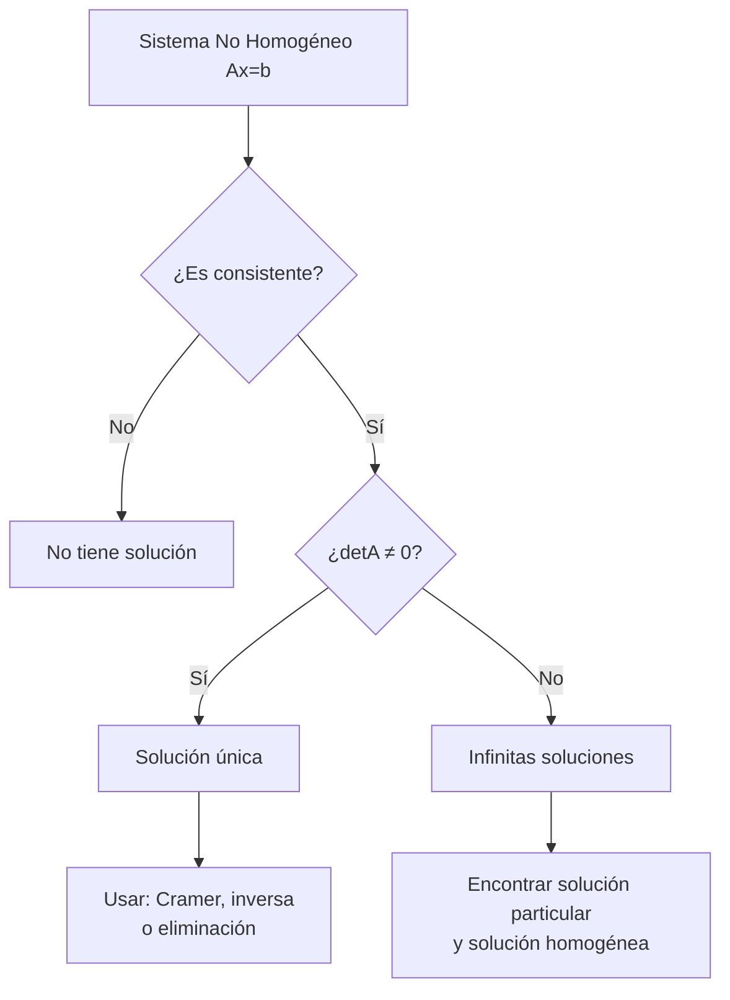

# Matemáticas para Ciencias Aplicadas IV - Sistemas de Ecuaciones

## 5.2 Sistema de ecuaciones lineales no homogéneos.

---

Los sistemas de ecuaciones lineales no homogéneos son fundamentales en el modelado de fenómenos físicos y problemas de ingeniería donde existen fuerzas externas o entradas al sistema. Su estudio es esencial para comprender el comportamiento completo de sistemas dinámicos.

### Definición Formal

Un **sistema de ecuaciones lineales no homogéneo** es un sistema de la forma:

$$ \begin{cases} a_{11}x_1 + a_{12}x_2 + \cdots + a_{1n}x_n = b_1 \\\ a_{21}x_1 + a_{22}x_2 + \cdots + a_{2n}x_n = b_2 \\\ \vdots \\\ a_{m1}x_1 + a_{m2}x_2 + \cdots + a_{mn}x_n = b_m \end{cases} $$

Que en forma matricial se expresa como:

$$A\mathbf{x} = \mathbf{b}$$

Donde:

- $A$ es una matriz $m \times n$ de coeficientes
- $\mathbf{x}$ es el vector columna de variables $(x_1, x_2, \ldots, x_n)^T$
- $\mathbf{b}$ es el vector de términos independientes $(b_1, b_2, \ldots, b_m)^T$ con $\mathbf{b} \neq \mathbf{0}$

### Relación con Sistemas Homogéneos

#### Teorema Fundamental

La solución general de un sistema no homogéneo $A\mathbf{x} = \mathbf{b}$ puede expresarse como:

$$\mathbf{x} = \mathbf{x}_p + \mathbf{x}_h$$

Donde:

- $\mathbf{x}_p$ es una **solución particular** del sistema no homogéneo
- $\mathbf{x}_h$ es la **solución general** del sistema homogéneo asociado $A\mathbf{x} = \mathbf{0}$

#### Teorema de Existencia y Unicidad

Para una matriz $A$ de $n \times n:$

- El sistema $A\mathbf{x} = \mathbf{b}$ tiene solución única si y solo si $\det(A) \neq 0$
- Si $\det(A) = 0,$ el sistema puede tener infinitas soluciones o ninguna

### Métodos de Solución

#### 1. Eliminación Gaussiana (Matriz Ampliada)

```python
# Pseudocódigo para resolver sistema no homogéneo
def resolver_no_homogeneo(A, b):
    # Crear matriz ampliada [A|b]
    M = ampliar_matriz(A, b)

    # Reducir a forma escalonada reducida
    M_escalonada = gauss_jordan(M)

    # Verificar consistencia
    if sistema_inconsistente(M_escalonada):
        return "No hay solución"

    # Encontrar solución particular
    x_p = encontrar_solucion_particular(M_escalonada)

    # Encontrar solución homogénea
    x_h = resolver_sistema_homogeneo(A)

    return x_p, x_h
```

#### 2. Regla de Cramer (Sistemas Cuadrados)

Para $A$ de $n \times n$ con $\det(A) \neq 0:$

$$x_i = \frac{\det(A_i)}{\det(A)}$$

Donde $A_i$ es la matriz $A$ con la columna i-ésima reemplazada por $\mathbf{b}.$

#### 3. Método de la Matriz Inversa

Si $A$ es invertible:

$$\mathbf{x} = A^{-1}\mathbf{b}$$

#### 4. Variación de Parámetros (Para Sistemas de EDOs)

Para $\mathbf{x}' = A\mathbf{x} + \mathbf{b}(t):$

$$\mathbf{x}(t) = \Phi(t)\mathbf{c} + \Phi(t)\int \Phi^{-1}(t)\mathbf{b}(t)dt$$

Donde $\Phi(t)$ es la matriz fundamental del sistema homogéneo.

### Ejemplos Resueltos

#### Ejemplo 1: Sistema 2×2

Resolver el sistema:

$$ \begin{cases} 2x + 3y = 7 \\\ 4x - y = 1 \end{cases} $$

**Solución:**
Forma matricial:

$$ \begin{pmatrix} 2 & 3 \\\ 4 & -1 \end{pmatrix} \begin{pmatrix} x \\\ y \end{pmatrix} = \begin{pmatrix} 7 \\\ 1 \end{pmatrix} $$

Determinante: $\det(A) = (2)(-1) - (3)(4) = -2 - 12 = -14 \neq 0$

Solución única:

$$ x = \frac{\det\begin{pmatrix} 7 & 3 \\\ 1 & -1 \end{pmatrix}}{\det(A)} = \frac{-7-3}{-14} = \frac{-10}{-14} = \frac{5}{7} $$

$$ y = \frac{\det\begin{pmatrix} 2 & 7 \\\ 4 & 1 \end{pmatrix}}{\det(A)} = \frac{2-28}{-14} = \frac{-26}{-14} = \frac{13}{7} $$

#### Ejemplo 2: Sistema 3×3 con Infinitas Soluciones

Resolver:

$$ \begin{cases} x + y + z = 4 \\\ 2x + 2y + z = 6 \\\ x + y + 2z = 6 \end{cases} $$

**Solución:**
Matriz ampliada:

$$ \left(\begin{array}{ccc|c} 1 & 1 & 1 & 4 \\\ 2 & 2 & 1 & 6 \\\ 1 & 1 & 2 & 6 \end{array}\right) $$

Reducción por Gauss:

$$ \left(\begin{array}{ccc|c} 1 & 1 & 1 & 4 \\\ 0 & 0 & -1 & -2 \\\ 0 & 0 & 1 & 2 \end{array}\right) \rightarrow \left(\begin{array}{ccc|c} 1 & 1 & 0 & 2 \\\ 0 & 0 & 1 & 2 \\\ 0 & 0 & 0 & 0 \end{array}\right) $$

Solución: $x = 2 - t,$ $y = t,$ $z = 2$ (infinitas soluciones)

### Aplicaciones en Ecuaciones Diferenciales

#### Sistema Masa-Resorte con Fuerza Externa

Para un sistema de dos masas con fuerza externa $F(t):$

$$ \begin{cases} m_1x_1'' = -k_1x_1 + k_2(x_2 - x_1) + F_1(t) \\\ m_2x_2'' = -k_2(x_2 - x_1) + F_2(t) \end{cases} $$

#### Circuitos Eléctricos RLC con Fuente

Ecuación diferencial no homogénea:

$$L\frac{d^2q}{dt^2} + R\frac{dq}{dt} + \frac{1}{C}q = E(t)$$

#### Diagrama de Flujo para Resolución



### Ejercicios Propuestos

#### Ejercicio 1

Resolver el sistema:

$$ \begin{cases} 3x - 2y + z = 8 \\\ 2x + y - 3z = -1 \\\ x + 4y - 2z = 7 \end{cases} $$

#### Ejercicio 2

Determinar para qué valores de $k$ el sistema tiene solución única, infinitas soluciones o ninguna solución:

$$ \begin{cases} x + 2y - z = 3 \\\ 2x - y + 3z = 1 \\\ x + 7y - 6z = k \end{cases} $$

#### Ejercicio 3

Resolver el sistema de ecuaciones diferenciales:

$$ \begin{cases} x' = 2x - y + e^t \\\ y' = -x + 2y + \cos t \end{cases} $$

### Referencias

#### Bibliografía Básica

1. **Boice, W., DiPrima, R.** (2004). _Elementary Differential Equations and Boundary Value Problems_. Wiley, New York. (Capítulos 7 y 9)
2. **Edwards, C. H., Penney, D. E.** (2002). _Ecuaciones diferenciales elementales y problemas con condiciones a la frontera_. Prentice Hall, México. (Sección 5.6)

#### Bibliografía Complementaria

1. **Cooper, J. M.** (1998). _Introduction to Partial Differential Equations with MatLab_. Birkhäuser, Boston. (Capítulo 3)
2. **Hubbard, J. H., West, B. H.** (1995). _Differential Equations: A Dynamical Systems Approach_. Springer-Verlag, Berlin. (Sección 4.5)
3. **Zill, D. G., Wright, W. S.** (1995). _Differential Equations with Computer Lab Experiments_. PWS Publishing Company, Boston. (Capítulo 8)

### Consejos de Estudio

1. **Domina primero los sistemas homogéneos**: La solución de sistemas no homogéneos depende del entendimiento de sus homogéneos asociados.
2. **Practica la eliminación gaussiana**: Es el método más general y aplicable a cualquier sistema.
3. **Verifica tus soluciones**: Sustituye siempre tus resultados en las ecuaciones originales.
4. **Usa software para verificación**: MATLAB, Python o calculadoras matriciales pueden ayudarte a confirmar resultados.
5. **Relaciona con aplicaciones físicas**: Comprende el significado físico de los términos no homogéneos en diferentes contextos.
