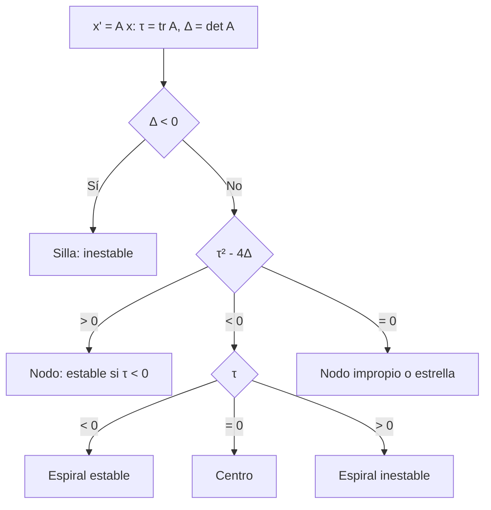

# Matemáticas para Ciencias Aplicadas IV - Sistemas de Ecuaciones

## 5.3 Interpretación geométrica y aplicaciones.

---

Un sistema de dos ecuaciones $x' = f(x, y),$ $y' = g(x, y)$ asigna a cada punto del plano un vector velocidad, y sus soluciones son curvas que siguen esos vectores. El plano $(x, y)$ es el **plano de fases**, las curvas son **trayectorias** u **órbitas** y su dibujo es el **retrato de fases**. Para los sistemas lineales $\mathbf{x}' = A\mathbf{x},$ la forma del retrato depende solo de los valores propios de $A,$ y se clasifica en unos pocos tipos que bastan para entender también el comportamiento local de los sistemas no lineales (tema 5.4). Este tema hace esa clasificación y la aplica.

### El plano de fases

- Un **punto de equilibrio** (o crítico) es un punto donde el campo se anula; ahí la solución es constante. Para $\mathbf{x}' = A\mathbf{x}$ con $\det A \neq 0,$ el único equilibrio es el origen.
- Por el teorema de existencia y unicidad (tema 2.1), **dos trayectorias no se cruzan**: por cada punto pasa una sola.
- Las rectas que pasan por el origen en la dirección de un vector propio real son **invariantes**: si $A\mathbf{v} = \lambda\mathbf{v},$ la solución $e^{\lambda t} \mathbf{v}$ se queda en esa recta, acercándose al origen si $\lambda \lt 0$ y alejándose si $\lambda > 0.$
- Las **isoclinas nulas** son las curvas donde $x' = 0$ (el campo es vertical) o $y' = 0$ (horizontal); ayudan a dibujar el retrato a mano.

### Clasificación de los sistemas lineales

Para $A$ de $2 \times 2,$ los valores propios satisfacen $\lambda^2 - \tau \lambda + \Delta = 0,$ con $\tau = \operatorname{tr} A$ y $\Delta = \det A.$ El tipo de equilibrio depende de $\tau,$ $\Delta$ y el discriminante $\tau^2 - 4\Delta:$

| Valores propios | Condición | Tipo | Comportamiento |
| --- | --- | --- | --- |
| reales de signos opuestos | $\Delta \lt 0$ | **silla** | casi todas las trayectorias se alejan; dos rectas entran |
| reales negativos | $\Delta > 0,$ $\tau \lt 0,$ $\tau^2 > 4\Delta$ | **nodo estable** | todas entran al origen, tangentes al vector propio lento |
| reales positivos | $\Delta > 0,$ $\tau > 0,$ $\tau^2 > 4\Delta$ | **nodo inestable** | todas salen |
| complejos, parte real negativa | $\tau \lt 0,$ $\tau^2 \lt 4\Delta$ | **espiral estable** | giran acercándose |
| complejos, parte real positiva | $\tau > 0,$ $\tau^2 \lt 4\Delta$ | **espiral inestable** | giran alejándose |
| imaginarios puros | $\tau = 0,$ $\Delta > 0$ | **centro** | elipses cerradas: oscilaciones periódicas |
| repetido | $\tau^2 = 4\Delta$ | **nodo impropio** o **estrella** | entran o salen por una o todas las direcciones |

**Estabilidad.** El origen es **asintóticamente estable** si todas las soluciones tienden a él: ocurre si y solo si **todos los valores propios tienen parte real negativa**, es decir, $\tau \lt 0$ y $\Delta > 0.$ Es **estable** (pero no asintóticamente) en el centro: las trayectorias que empiezan cerca se quedan cerca sin acercarse. En los demás casos es **inestable**.



**Sentido de giro.** En las espirales y centros, el sentido se lee en un punto cualquiera: si en $(1, 0)$ la componente $y'$ es positiva, se gira en sentido antihorario.

### Aplicaciones

**El oscilador en el plano de fases.** $m x'' + c x' + k x = 0$ es el sistema $x' = v,$ $v' = -\frac{k}{m} x - \frac{c}{m} v,$ con $\tau = -c/m$ y $\Delta = k/m > 0.$ Sin amortiguamiento es un **centro** (elipses de energía constante); subamortiguado, una **espiral estable**; con amortiguamiento crítico, un **nodo impropio**; sobreamortiguado, un **nodo estable**. La clasificación del tema 3.3 es un caso particular de esta.

**Tanques en serie.** El tanque 1 se vacía hacia el tanque 2, que se vacía hacia afuera: $x_1' = -k_1 x_1,$ $x_2' = k_1 x_1 - k_2 x_2.$ La matriz es triangular con valores propios $-k_1$ y $-k_2:$ nodo estable, toda la sustancia termina saliendo. La concentración del segundo tanque primero sube y luego baja, como la de un medicamento en la sangre tras pasar por el estómago (modelo farmacocinético de dos compartimentos).

**Amor y odio.** Strogatz propuso, medio en broma, modelar los sentimientos $R$ y $J$ de Romeo y Julieta con $R' = aJ,$ $J' = -bR:$ Romeo la quiere más cuanto más lo quiere ella, y Julieta se enfría cuando él se entusiasma. Es un centro: un ciclo eterno de amor y desamor.

**Competencia lineal.** En modelos lineales de dos especies o dos empresas, una **silla** indica que el equilibrio de coexistencia es inestable: una de las dos termina dominando según las condiciones iniciales, y la recta estable de la silla separa los dos destinos.

### Implementación en Python

El programa clasifica el origen según la traza y el determinante, y lo confirma integrando numéricamente una trayectoria desde $(1, 0.5):$ mide cómo cambia la distancia al origen y cuántas vueltas da (negativas en sentido horario). Después clasifica el oscilador amortiguado según $c$ y el sistema de tanques en serie.

```python
import numpy as np
from scipy.integrate import solve_ivp

def clasificar(A):
    """Tipo de punto crítico del origen para x' = A x según la traza y el determinante."""
    A = np.array(A, dtype=float)
    tr, det = np.trace(A), np.linalg.det(A)
    disc = tr**2 - 4 * det
    if abs(det) < 1e-12:
        return 'degenerado (det = 0): una recta de equilibrios'
    if det < 0:
        return 'silla (inestable)'
    if abs(tr) < 1e-12:
        return 'centro (estable, no asintóticamente)'
    estab = 'asintóticamente estable' if tr < 0 else 'inestable'
    if disc > 1e-12:
        return f'nodo {estab}'
    if disc < -1e-12:
        return f'espiral {estab}'
    return f'nodo impropio {estab}'

def trayectoria(A, x0, T):
    A = np.array(A, dtype=float)
    s = solve_ivp(lambda t, x: A @ x, [0, T], x0, rtol=1e-9, max_step=0.01)
    r = np.hypot(s.y[0], s.y[1])
    angulo = np.unwrap(np.arctan2(s.y[1], s.y[0]))
    vueltas = (angulo[-1] - angulo[0]) / (2 * np.pi)
    return r[0], r[-1], vueltas

ejemplos = {
    'x\' = 2x - y, y\' = -x + 2y': [[2, -1], [-1, 2]],
    'x\' = -2x + y, y\' = x - 2y': [[-2, 1], [1, -2]],
    'x\' = x + 2y, y\' = 3x + 2y': [[1, 2], [3, 2]],
    'x\' = -x + 2y, y\' = -2x - y': [[-1, 2], [-2, -1]],
    'x\' = y, y\' = -x': [[0, 1], [-1, 0]],
    'x\' = 0.1x + y, y\' = -x + 0.1y': [[0.1, 1], [-1, 0.1]],
    'x\' = -x + y, y\' = -y': [[-1, 1], [0, -1]],
}
for nombre, A in ejemplos.items():
    ev = ', '.join(f'{z.real:g}' if abs(z.imag) < 1e-12 else f'{z.real:g}{z.imag:+g}i' for z in sorted(np.linalg.eigvals(A), key=lambda z: (z.real, z.imag)))
    r0, r1, v = trayectoria(A, [1.0, 0.5], 3)
    print(f'{nombre:30} λ = {ev:12} {clasificar(A):40} |x| {r0:.2f} -> {r1:9.3g}, vueltas {v:+.2f}')

# Masa-resorte amortiguado en el plano de fases: x' = v, v' = -k x - c v
for c in [0, 1, 4, 5]:
    print(f'resorte con k = 4, c = {c}:', clasificar([[0, 1], [-4, -c]]))

# Tanques en serie con salida: x1' = -x1/5, x2' = x1/5 - x2/10 (solo valores propios negativos)
print('tanques en serie:', clasificar([[-0.2, 0], [0.2, -0.1]]), ' valores propios -0.2 y -0.1')
```

Salida:

```text
x' = 2x - y, y' = -x + 2y      λ = 1, 3         nodo inestable                           |x| 1.12 ->  2.86e+03, vueltas -0.20
x' = -2x + y, y' = x - 2y      λ = -3, -1       nodo asintóticamente estable             |x| 1.12 ->    0.0528, vueltas +0.05
x' = x + 2y, y' = 3x + 2y      λ = -1, 4        silla (inestable)                        |x| 1.12 ->  1.76e+05, vueltas +0.08
x' = -x + 2y, y' = -2x - y     λ = -1-2i, -1+2i espiral asintóticamente estable          |x| 1.12 ->    0.0557, vueltas -0.95
x' = y, y' = -x                λ = 0-1i, 0+1i   centro (estable, no asintóticamente)     |x| 1.12 ->      1.12, vueltas -0.48
x' = 0.1x + y, y' = -x + 0.1y  λ = 0.1-1i, 0.1+1i espiral inestable                        |x| 1.12 ->      1.51, vueltas -0.48
x' = -x + y, y' = -y           λ = -1, -1       nodo impropio asintóticamente estable    |x| 1.12 ->     0.127, vueltas -0.04
resorte con k = 4, c = 0: centro (estable, no asintóticamente)
resorte con k = 4, c = 1: espiral asintóticamente estable
resorte con k = 4, c = 4: nodo impropio asintóticamente estable
resorte con k = 4, c = 5: nodo asintóticamente estable
tanques en serie: nodo asintóticamente estable  valores propios -0.2 y -0.1
```

Las espirales dan casi una vuelta en 3 unidades de tiempo (frecuencia 2) o media vuelta (frecuencia 1), mientras que los nodos y la silla apenas giran. En el centro la distancia al origen no cambia después de media vuelta, porque las órbitas son circunferencias.

### Ejercicios Propuestos

1. **Clasificación.** Clasifica el origen para $x' = 2x - y,$ $y' = -x + 2y$ y para $x' = x + 2y,$ $y' = 3x + 2y.$

2. **Espiral.** Para $x' = -x + 2y,$ $y' = -2x - y,$ determina el tipo, la estabilidad y el sentido de giro.

3. **Plano traza-determinante.** ¿Para qué valores de $a$ el sistema $x' = ax + y,$ $y' = -x + ay$ tiene un centro, una espiral estable o una inestable?

4. **Oscilador.** Clasifica el equilibrio de $x'' + c x' + 4x = 0$ para $c = 0, 1, 4, 5.$

5. **Silla.** Para $x' = x + 2y,$ $y' = 3x + 2y,$ encuentra las rectas invariantes y las condiciones iniciales cuyas soluciones tienden al origen.

6. **Dos compartimentos.** En $x_1' = -0.2 x_1,$ $x_2' = 0.2 x_1 - 0.1 x_2$ con $x_1(0) = 100,$ $x_2(0) = 0,$ ¿en qué instante es máxima $x_2?$

### Soluciones

**Ejercicio 1.** El primero tiene $\tau = 4,$ $\Delta = 3,$ $\tau^2 - 4\Delta = 4 > 0:$ nodo inestable (valores propios 1 y 3). El segundo tiene $\Delta = -4 \lt 0:$ silla (valores propios $-1$ y 4).

**Ejercicio 2.** $\tau = -2,$ $\Delta = 5,$ $\tau^2 - 4\Delta = -16:$ espiral estable, con valores propios $-1 \pm 2i.$ En $(1, 0),$ $y' = -2 \lt 0:$ gira en sentido horario.

**Ejercicio 3.** $\tau = 2a,$ $\Delta = a^2 + 1 > 0,$ $\tau^2 - 4\Delta = -4 \lt 0:$ siempre complejos. Centro si $a = 0,$ espiral estable si $a \lt 0,$ inestable si $a > 0.$ Al cruzar $a = 0$ la estabilidad cambia: es el inicio de una **bifurcación de Hopf** en los sistemas no lineales.

**Ejercicio 4.** Centro, espiral estable, nodo impropio estable y nodo estable, como en la salida del programa.

**Ejercicio 5.** Para $\lambda = 4,$ $\mathbf{v} = (2, 3);$ para $\lambda = -1,$ $\mathbf{v} = (1, -1).$ Las rectas invariantes son $y = \tfrac{3}{2} x$ y $y = -x.$ Solo las condiciones iniciales sobre $y = -x$ dan soluciones que tienden al origen; las demás se alejan siguiendo, a la larga, la dirección $(2, 3).$

**Ejercicio 6.** $x_1 = 100 e^{-0.2t}$ y $x_2 = 200 (e^{-0.1t} - e^{-0.2t}).$ Derivando, $x_2' = 0$ cuando $e^{-0.1t} = 2e^{-0.2t},$ es decir $t = 10 \ln 2 \approx 6.93,$ con $x_2 = 50.$

### Referencias

1. Boyce, W. E., DiPrima, R. C., and Meade, D. B., _Elementary Differential Equations and Boundary Value Problems_. Wiley, 2017. Secciones 7.5 a 7.8 y 9.1.
2. Strogatz, S. H., _Nonlinear Dynamics and Chaos_. CRC Press, 2015. Capítulo 5.
3. Hirsch, M. W., Smale, S., and Devaney, R. L., _Differential Equations, Dynamical Systems, and an Introduction to Chaos_. Academic Press, 2013. Capítulos 3 y 4.
4. Blanchard, P., Devaney, R. L., and Hall, G. R., _Ecuaciones diferenciales_. Thomson, 1999. Capítulo 3.
