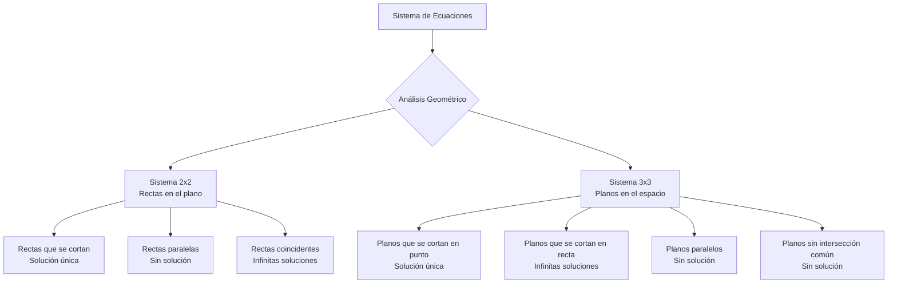
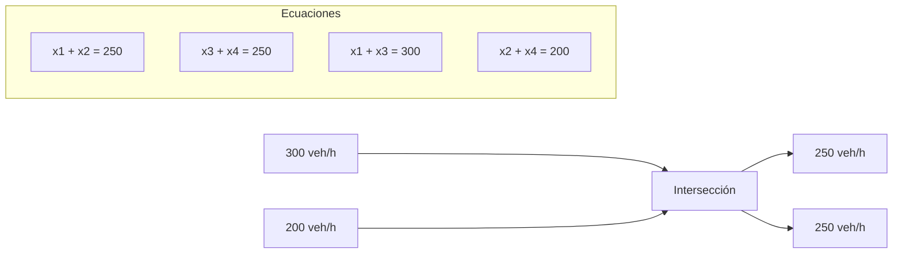

# Matemáticas para Ciencias Aplicadas IV - Sistemas de Ecuaciones

## 5.3 Interpretación geométrica y aplicaciones.

---

La interpretación geométrica de sistemas de ecuaciones proporciona una comprensión visual poderosa que conecta el álgebra lineal con la geometría y las aplicaciones prácticas en ciencias e ingeniería. Esta guía explora las representaciones geométricas de sistemas lineales y sus diversas aplicaciones.

### Interpretación Geométrica de Sistemas Lineales

#### Sistemas 2×2: Rectas en el Plano

Un sistema de dos ecuaciones con dos incógnitas:

$$ \begin{cases} a_{11}x + a_{12}y = b_1 \\\ a_{21}x + a_{22}y = b_2 \end{cases} $$

Cada ecuación representa una recta en el plano $\mathbb{R}^2$. Las soluciones corresponden a los puntos de intersección:

- **Solución única**: Las rectas se intersecan en un punto
- **Infinitas soluciones**: Las rectas son coincidentes
- **Sin solución**: Las rectas son paralelas

#### Sistemas 3×3: Planos en el Espacio

Un sistema de tres ecuaciones con tres incógnitas:

$$ \begin{cases} a_{11}x + a_{12}y + a_{13}z = b_1 \\\ a_{21}x + a_{22}y + a_{23}z = b_2 \\\ a_{31}x + a_{32}y + a_{33}z = b_3 \end{cases} $$

Cada ecuación representa un plano en $\mathbb{R}^3$. Las soluciones pueden ser:

- **Solución única**: Tres planos que se intersecan en un punto
- **Infinitas soluciones**: Planos que se intersecan en una recta o son coincidentes
- **Sin solución**: Planos paralelos o que no tienen intersección común

### Visualización de Configuraciones Geométricas



### Aplicaciones Prácticas

#### 1. Análisis de Circuitos Eléctricos

**Leyes de Kirchhoff** generan sistemas de ecuaciones lineales:

- **Ley de nodos**: $\sum I = 0$
- **Ley de mallas**: $\sum V = 0$

**Ejemplo**: Circuito con dos mallas

$$ \begin{cases} ( R_1 + R_2 ) I_1 - R_2 I_2 = V_1 \\\ - R_2 I_1 + ( R_2 + R_3 ) I_2 = -V_2 \end{cases} $$

#### 2. Estática y Análisis Estructural

Equilibrio de fuerzas en estructuras:

$$ \sum F_x = 0, \quad \sum F_y = 0, \quad \sum M = 0 $$

**Ejemplo**: Armadura plana

```python
# Cálculo de fuerzas en nodos
def equilibrio_nodo(fuerzas, angulos):
    """
    Resuelve ecuaciones de equilibrio en un nodo
    ΣFx = 0, ΣFy = 0
    """
    ecuaciones = []
    for i, (f, theta) in enumerate(zip(fuerzas, angulos)):
        ecuaciones.append(f * np.cos(theta))  # Componente x
        ecuaciones.append(f * np.sin(theta))  # Componente y
    return np.linalg.solve(matriz_coeficientes, ecuaciones)
```

#### 3. Balance de Materia y Energía

En ingeniería química, los balances generan sistemas lineales:

**Balance de materia**:

`Entrada = Salida + Acumulación`

**Ejemplo**: Sistema de mezclado

$$ \begin{cases} F_1 + F_2 = F_3 \\\ x_1F_1 + x_2F_2 = x_3F_3 \end{cases} $$

#### 4. Modelado de Tráfico Vehicular

Flujo en intersecciones:

$$ Flujo\ de\ entrada = Flujo\ de\ salida $$

**Ejemplo**: Intersección de cuatro vías



#### 5. Óptica y Diseño de Lentes

Sistemas de ecuaciones para trayectoria de rayos:

$$ \begin{pmatrix} x_2 \\\ \theta_2 \end{pmatrix} = \begin{pmatrix} 1 & d \\\ 0 & 1 \end{pmatrix} \begin{pmatrix} 1 & 0 \\\ -\frac{1}{f} & 1 \end{pmatrix} \begin{pmatrix} x_1 \\\ \theta_1 \end{pmatrix} $$

### Ejemplos Resueltos

#### Ejemplo 1: Intersección de Rectas

Determinar geométricamente el sistema:

$$ \begin{cases} 2x + 3y = 6 \\\ 4x + 6y = 12 \end{cases} $$

**Solución**: Las dos ecuaciones representan la misma recta $(y = -\frac{2}{3}x + 2)$, por lo tanto hay infinitas soluciones.

#### Ejemplo 2: Análisis de Circuito

Resolver para las corrientes $I_1$ e $I_2$:

$$ \begin{cases} 10I_1 + 5(I_1 - I_2) = 20 \\\ 5(I_2 - I_1) + 15I_2 = 0 \end{cases} $$

**Solución simplificada**:

$$ \begin{cases} 15I_1 - 5I_2 = 20 \\\ -5I_1 + 20I_2 = 0 \end{cases} $$

Solución: $I_1 = 1.6A$, $I_2 = 0.4A$

### Ejercicios Propuestos

#### Ejercicio 1

Analizar geométricamente y resolver:

$$ \begin{cases} x - 2y = 3 \\\ 2x - 4y = 6 \end{cases} $$

#### Ejercicio 2

En el siguiente circuito, calcular las corrientes $I_1$, $I_2$, $I_3$:

```
      R1 = 2Ω      R2 = 3Ω
V1 = 10V ----> I1 ----> I2 ---->
                 |       |
                 R3 = 4Ω
                 |       |
                 <---- I3 <----
```

#### Ejercicio 3

En una refinería, tres crudos A, B, C con octanajes 85, 90, 95 respectivamente, se mezclan para producir gasolina de 89 y 92 octanos. Plantear el sistema de ecuaciones para determinar las proporciones.

### Implementación Computacional

```python
import numpy as np
import matplotlib.pyplot as plt
from mpl_toolkits.mplot3d import Axes3D

def visualizar_sistema_2x2(a1, b1, c1, a2, b2, c2):
    """Visualiza un sistema de 2 ecuaciones con 2 incógnitas"""
    x = np.linspace(-10, 10, 400)

    # Ecuación 1: a1*x + b1*y = c1
    y1 = (c1 - a1*x) / b1 if b1 != 0 else None

    # Ecuación 2: a2*x + b2*y = c2
    y2 = (c2 - a2*x) / b2 if b2 != 0 else None

    plt.figure(figsize=(8, 6))
    if y1 is not None:
        plt.plot(x, y1, label=f'{a1}x + {b1}y = {c1}')
    if y2 is not None:
        plt.plot(x, y2, label=f'{a2}x + {b2}y = {c2}')

    plt.xlabel('x')
    plt.ylabel('y')
    plt.legend()
    plt.grid(True)
    plt.axis('equal')
    plt.show()

# Ejemplo de uso
visualizar_sistema_2x2(2, 3, 6, 4, 6, 12)
```

### Referencias

#### Bibliografía Básica

1. **Boice, W., DiPrima, R.** (2004). _Elementary Differential Equations and Boundary Value Problems_. Wiley, New York. (Capítulo 7 - Aplicaciones físicas)
2. **Edwards, C. H., Penney, D. E.** (2002). _Ecuaciones diferenciales elementales y problemas con condiciones a la frontera_. Prentice Hall, México. (Sección 5.6 - Aplicaciones)

#### Bibliografía Complementaria

1. **Cooper, J. M.** (1998). _Introduction to Partial Differential Equations with MatLab_. Birkhäuser, Boston. (Capítulo 3 - Modelado)
2. **Hubbard, J. H., West, B. H.** (1995). _Differential Equations: A Dynamical Systems Approach_. Springer-Verlag, Berlin. (Sección 4.5 - Interpretación geométrica)
3. **Zill, D. G., Wright, W. S.** (1995). _Differential Equations with Computer Lab Experiments_. PWS Publishing Company, Boston. (Capítulo 8 - Aplicaciones)

### Consejos de Estudio

1. **Visualiza siempre**: Dibuja las representaciones geométricas de los sistemas
2. **Relaciona con aplicaciones reales**: Conecta cada concepto con problemas prácticos
3. **Usa software de visualización**: GeoGebra, MATLAB o Python para representaciones 3D
4. **Practica con problemas aplicados**: Resuelve problemas de diversas áreas
5. **Comprende el significado físico**: Interpreta qué representan las variables en cada contexto
