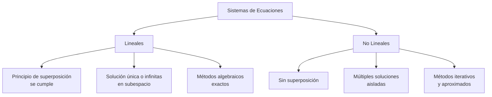
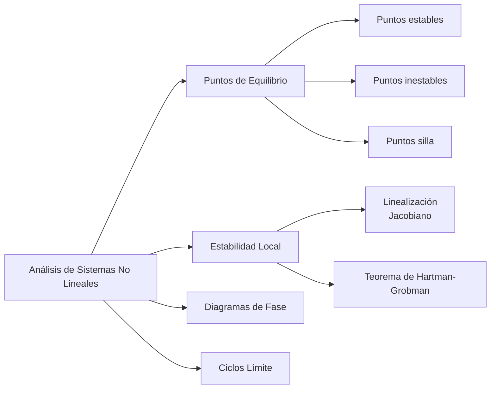

# Matemáticas para Ciencias Aplicadas IV - Sistemas de Ecuaciones

## 5.4 Introducción a sistemas no lineales.

---

Los sistemas no lineales representan la mayoría de los fenómenos físicos reales, donde las relaciones entre variables no siguen proporciones constantes. Su estudio es esencial para modelar comportamientos complejos en ingeniería, física, biología y economía.

### Definición Formal

Un **sistema de ecuaciones no lineal** es un conjunto de ecuaciones donde al menos una ecuación no es lineal. Formalmente:

$$ \begin{cases} f_1(x_1, x_2, \ldots, x_n) = 0 \\\ f_2(x_1, x_2, \ldots, x_n) = 0 \\\ \vdots \\\ f_m(x_1, x_2, \ldots, x_n) = 0 \end{cases} $$

donde al menos una $f_i$ es una función no lineal de sus variables.

#### Características Fundamentales

- **No cumplen el principio de superposición**: $f(a\mathbf{x} + b\mathbf{y}) \neq af(\mathbf{x}) + bf(\mathbf{y})$
- **Pueden tener múltiples soluciones aisladas**
- **Exhiben comportamientos complejos**: ciclos límite, caos, bifurcaciones

### Diferencias entre Sistemas Lineales y No Lineales



### Tipos de No Linealidades Comunes

#### 1. No Linealidades Polinómicas

$$f(x) = a_nx^n + a_{n-1}x^{n-1} + \cdots + a_1x + a_0$$

#### 2. No Linealidades Trigonométricas

$$f(x, y) = \sin(x) + \cos(y)$$

#### 3. No Linealidades Exponenciales

$$f(x) = e^{ax} + b$$

#### 4. No Linealidades Racionales

$$f(x, y) = \frac{x^2 + y^2}{xy + 1}$$

### Métodos de Solución

#### 1. Método de Newton-Raphson para Sistemas

Para el sistema $\mathbf{F}(\mathbf{x}) = \mathbf{0},$ la iteración:

$$\mathbf{x}^{(k+1)} = \mathbf{x}^{(k)} - J^{-1}(\mathbf{x}^{(k)}) \mathbf{F}(\mathbf{x}^{(k)})$$

donde $J$ es la matriz jacobiana:

$$J(\mathbf{x}) = \begin{pmatrix} \frac{\partial f_1}{\partial x_1} & \cdots & \frac{\partial f_1}{\partial x_n} \\\ \vdots & \ddots & \vdots \\\ \frac{\partial f_m}{\partial x_1} & \cdots & \frac{\partial f_m}{\partial x_n} \end{pmatrix}$$

#### 2. Método de Punto Fijo

Transformar el sistema a forma $\mathbf{x} = \mathbf{G}(\mathbf{x})$ e iterar:

$$\mathbf{x}^{(k+1)} = \mathbf{G}(\mathbf{x}^{(k)})$$

#### 3. Métodos de Continuación (Homotopía)

Transformar gradualmente un problema simple en el complejo:

$$H(\mathbf{x}, t) = t\mathbf{F}(\mathbf{x}) + (1-t)\mathbf{G}(\mathbf{x}) = \mathbf{0}$$

### Implementación Computacional

```python
import numpy as np
from scipy.optimize import fsolve

def sistema_no_lineal(variables):
    x, y = variables
    ecuacion1 = x**2 + y**2 - 25  # Circunferencia: x² + y² = 25
    ecuacion2 = np.exp(x) - y - 1  # Exponencial: eˣ - y = 1
    return [ecuacion1, ecuacion2]

# Solución numérica
solucion = fsolve(sistema_no_lineal, [2, 3])  # Estimación inicial [2, 3]
print(f"Solución: x = {solucion[0]:.4f}, y = {solucion[1]:.4f}")

# Cálculo del Jacobiano
def jacobiano(variables):
    x, y = variables
    return np.array([
        [2*x, 2*y],      # Derivadas de la primera ecuación
        [np.exp(x), -1]  # Derivadas de la segunda ecuación
    ])
```

### Ejemplos Resueltos

#### Ejemplo 1: Intersección de Circunferencia y Recta

Resolver:

$$ \begin{cases} x^2 + y^2 = 25 \\\ y = 2x + 1 \end{cases} $$

**Solución**: Sustitución $y = 2x + 1$ en la primera ecuación:

$$x^2 + (2x + 1)^2 = 25$$

$$5x^2 + 4x - 24 = 0$$

Soluciones: $x = 2, -2.4; y = 5, -3.8$

#### Ejemplo 2: Sistema Trigonométrico

Resolver:

$$ \begin{cases} \sin(x) + \cos(y) = 0.5 \\\ x^2 + y^2 = 1 \end{cases} $$

**Solución numérica**: Usando Newton-Raphson con estimación inicial $(0.5, 0.5)$

### Aplicaciones en Ecuaciones Diferenciales

#### Sistema Depredador-Presa (Lotka-Volterra)

$$ \begin{cases} \frac{dx}{dt} = \alpha x - \beta xy \\\ \frac{dy}{dt} = \delta xy - \gamma y \end{cases} $$

#### Péndulo No Lineal

$$\frac{d^2\theta}{dt^2} + \frac{g}{L}\sin(\theta) = 0$$

#### Circuitos No Lineales

Sistema con diodos o transistores donde $I = I_0(e^{V/V_T} - 1)$

### Análisis Cualitativo de Sistemas No Lineales

#### Diagramas de Fase



#### Linealización alrededor de Puntos de Equilibrio

Para $\mathbf{x}' = \mathbf{f}(\mathbf{x}),$ con punto de equilibrio $\mathbf{x}_0$ donde $\mathbf{f}(\mathbf{x}_0) = 0:$

$$\mathbf{z}' = J(\mathbf{x}_0)\mathbf{z}$$

donde $\mathbf{z} = \mathbf{x} - \mathbf{x}_0$ y $J$ es el jacobiano.

### Ejercicios Propuestos

#### Ejercicio 1

Resolver analíticamente el sistema:

$$ \begin{cases} x^2 - y = 3 \\\ x + y = 5 \end{cases} $$

#### Ejercicio 2

Encontrar los puntos de equilibrio y analizar su estabilidad para:

$$ \begin{cases} \frac{dx}{dt} = x(1 - y) \\\ \frac{dy}{dt} = y(x - 1) \end{cases} $$

#### Ejercicio 3

Implementar el método de Newton-Raphson para resolver:

$$ \begin{cases} x^3 + y^3 = 28 \\\ e^x + \ln(y+1) = 5 \end{cases} $$

con estimación inicial $(2, 2).$

### Referencias

#### Bibliografía Básica

1. **Boice, W., DiPrima, R.** (2004). _Elementary Differential Equations and Boundary Value Problems_. Wiley, New York. (Capítulo 9 - Sistemas no lineales)
2. **Edwards, C. H., Penney, D. E.** (2002). _Ecuaciones diferenciales elementales y problemas con condiciones a la frontera_. Prentice Hall, México. (Sección 6.2 - Sistemas no lineales)

#### Bibliografía Complementaria

1. **Cooper, J. M.** (1998). _Introduction to Partial Differential Equations with MatLab_. Birkhäuser, Boston. (Capítulo 5 - No linealidades)
2. **Hubbard, J. H., West, B. H.** (1995). _Differential Equations: A Dynamical Systems Approach_. Springer-Verlag, Berlin. (Capítulo 6 - Sistemas no lineales)
3. **Zill, D. G., Wright, W. S.** (1995). _Differential Equations with Computer Lab Experiments_. PWS Publishing Company, Boston. (Capítulo 9 - Modelos no lineales)

### Consejos de Estudio

1. **Domina primero los sistemas lineales**: Son la base para entender la linealización
2. **Practica con métodos numéricos**: La mayoría de sistemas no lineales requieren solución numérica
3. **Visualiza las soluciones**: Usa software para graficar funciones y trayectorias
4. **Comprende la física del problema**: ayuda a elegir métodos de solución apropiados
5. **Analiza la estabilidad**: Es crucial para entender el comportamiento a largo plazo
