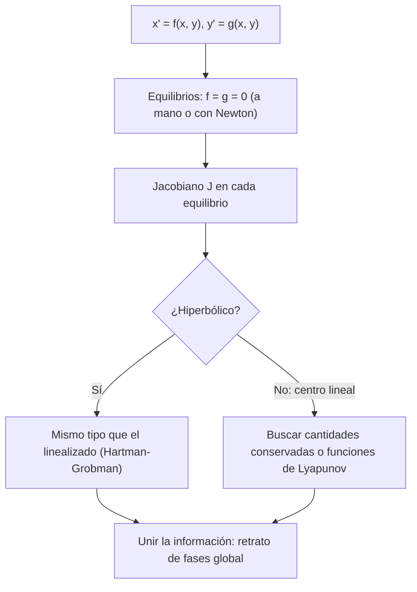

# Matemáticas para Ciencias Aplicadas IV - Sistemas de Ecuaciones

## 5.4 Introducción a sistemas no lineales.

---

Casi todos los sistemas reales son **no lineales**: las poblaciones que se comen entre sí, el péndulo para ángulos grandes, las reacciones químicas, los circuitos con diodos. En general no se pueden resolver con fórmulas, pero se puede entender mucho de su comportamiento sin resolverlos: encontrar los **equilibrios**, aproximar el sistema cerca de cada uno por un sistema lineal (tema 5.3) y unir esa información local. Este tema presenta ese análisis cualitativo, los métodos para encontrar equilibrios (que son sistemas de ecuaciones algebraicas no lineales) y fenómenos que los sistemas lineales no tienen, como los **ciclos límite**.

### Sistemas autónomos y equilibrios

Se estudian sistemas **autónomos** (sin $t$ explícito)

$$ x' = f(x, y), \qquad y' = g(x, y) $$

Un **equilibrio** es un punto $(x^*, y^*)$ con $f(x^*, y^*) = g(x^*, y^*) = 0.$ Encontrarlos requiere resolver un sistema **algebraico** no lineal, que puede tener varias soluciones o ninguna. A veces se resuelve a mano (factorizando, sustituyendo); en general, numéricamente.

**Método de Newton para sistemas.** Para $\mathbf{F}(\mathbf{z}) = \mathbf{0},$ se linealiza en la aproximación actual y se resuelve el sistema lineal:

$$ J(\mathbf{z}_k)\, \Delta \mathbf{z} = -\mathbf{F}(\mathbf{z}_k), \qquad \mathbf{z}_{k + 1} = \mathbf{z}_k + \Delta \mathbf{z} $$

donde $J$ es la matriz jacobiana de $\mathbf{F}.$ Si la aproximación inicial es buena y $J$ es invertible en la solución, converge **cuadráticamente**: el número de cifras correctas se duplica en cada paso. Lejos de la solución puede no converger; por eso se combina con buenas estimaciones iniciales o con métodos de continuación.

### Linealización

Cerca de un equilibrio, por Taylor, $f(x, y) \approx f_x (x - x^*) + f_y (y - y^*)$ y lo mismo para $g.$ Con $\mathbf{u} = (x - x^*, y - y^*),$ el sistema se aproxima por el **sistema linealizado**

$$ \mathbf{u}' = J\, \mathbf{u}, \qquad J = \begin{pmatrix} f_x & f_y \\ g_x & g_y \end{pmatrix}_{(x^*, y^*)} $$

**Teorema de Hartman-Grobman (versión práctica).** Si ningún valor propio de $J$ tiene parte real cero (equilibrio **hiperbólico**), el retrato de fases del sistema no lineal cerca del equilibrio es como el del linealizado: silla, nodo o espiral, con la misma estabilidad.

**Casos dudosos.** Si la linealización es un **centro** (valores propios imaginarios puros), los términos no lineales deciden: el equilibrio puede ser un centro verdadero, una espiral estable o una inestable. Hay que usar otros argumentos, como una cantidad conservada.

### Ejemplos clásicos

**Depredador y presa (Lotka-Volterra, 1925-1926).** Con presas $x$ y depredadores $y$ (en unidades adecuadas),

$$ x' = x(1 - y), \qquad y' = y(x - 1) $$

Las presas crecen solas y son comidas; los depredadores mueren sin presas y crecen al comerlas. Los equilibrios son $(0, 0)$ y $(1, 1).$ En $(0, 0),$ $J = \text{diag}(1, -1):$ silla. En $(1, 1),$ $J = \begin{pmatrix} 0 & -1 \\ 1 & 0 \end{pmatrix}:$ centro de la linealización, caso dudoso. Pero la función

$$ V(x, y) = x - \ln x + y - \ln y $$

se **conserva**: $\frac{dV}{dt} = \left(1 - \frac{1}{x}\right) x' + \left(1 - \frac{1}{y}\right) y' = (x - 1)(1 - y) + (y - 1)(x - 1) = 0.$ Las órbitas son curvas de nivel de $V,$ que son cerradas alrededor de $(1, 1):$ las poblaciones **oscilan periódicamente**, con los depredadores siguiendo a las presas con un retraso.

**Especies en competencia.** $x' = x(3 - x - 2y),$ $y' = y(2 - x - y).$ Hay cuatro equilibrios: $(0, 0)$ nodo inestable, $(3, 0)$ y $(0, 2)$ nodos estables, y $(1, 1)$ silla. La coexistencia es inestable: según las condiciones iniciales, una especie extingue a la otra (**exclusión competitiva**), y las dos trayectorias que entran a la silla separan las dos cuencas de atracción.

**El péndulo.** $\theta'' + \gamma \theta' + \sin \theta = 0$ es $x' = y,$ $y' = -\sin x - \gamma y.$ Los equilibrios son $(k\pi, 0).$ En $(0, 0)$ (colgando) $J = \begin{pmatrix} 0 & 1 \\ -1 & -\gamma \end{pmatrix}:$ espiral estable si $\gamma > 0,$ centro si $\gamma = 0$ (y, por la conservación de la energía, un centro verdadero). En $(\pi, 0)$ (invertido) $J = \begin{pmatrix} 0 & 1 \\ 1 & -\gamma \end{pmatrix},$ con $\det J = -1:$ silla, siempre inestable.

**Ciclos límite.** La ecuación de **van der Pol**, $x'' - \mu(1 - x^2) x' + x = 0,$ modela un circuito con amortiguamiento negativo para amplitudes pequeñas y positivo para grandes. El origen es una espiral inestable, pero las trayectorias no escapan: todas se acercan a una única órbita cerrada aislada, un **ciclo límite**, de amplitud cercana a 2. Un sistema lineal no puede tener ciclos límite: sus órbitas cerradas (en un centro) vienen en familias, nunca aisladas. Es el modelo de los osciladores autosostenidos, como el latido del corazón o un circuito oscilador.



### Implementación en Python

El programa resuelve el sistema algebraico del ejercicio 1 exactamente y el del ejercicio 3 con el método de Newton. Después encuentra los equilibrios de los sistemas del tema con SymPy y los clasifica con el jacobiano, comprueba numéricamente que la cantidad $V$ de Lotka-Volterra se conserva a lo largo de una órbita y muestra que en el oscilador de van der Pol trayectorias que empiezan dentro y fuera llegan al mismo ciclo límite.

```python
import numpy as np
import sympy as sp
from scipy.integrate import solve_ivp

x, y = sp.symbols('x y', real=True)

def newton(F, J, z0, tol=1e-12, max_iter=50):
    z = np.array(z0, dtype=float)
    for k in range(max_iter):
        paso = np.linalg.solve(J(*z), -F(*z))
        z = z + paso
        if np.linalg.norm(paso) < tol:
            return z, k + 1
    raise RuntimeError('no converge')

# Ejercicio 1: x² - y = 3, x + y = 5 (exacto: x² + x - 8 = 0)
print('ej. 1 exacto:', sp.solve([x**2 - y - 3, x + y - 5], [x, y]))
# Ejercicio 3 con Newton desde (2, 2)
F = sp.Matrix([x**3 + y**3 - 28, sp.exp(x) + sp.log(y + 1) - 5])
Fn = sp.lambdify((x, y), F, 'numpy'); Jn = sp.lambdify((x, y), F.jacobian([x, y]), 'numpy')
z, it = newton(lambda a, b: np.array(Fn(a, b), dtype=float).ravel(), lambda a, b: np.array(Jn(a, b), dtype=float), [2, 2])
print(f'ej. 3 Newton: x = {z[0]:.10f}, y = {z[1]:.10f} en {it} iteraciones; residuo {np.abs(np.array(Fn(*z), dtype=float)).max():.1e}')

def analizar(nombre, f, g):
    """Equilibrios de x' = f, y' = g y clasificación de la linealización."""
    J = sp.Matrix([f, g]).jacobian([x, y])
    print(nombre)
    for p in sp.solve([f, g], [x, y], dict=True):
        A = J.subs(p)
        tr, det = A.trace(), A.det()
        ev = list(A.eigenvals().keys())
        if det < 0: tipo = 'silla'
        elif tr == 0: tipo = 'centro de la linealización (caso dudoso)'
        elif tr**2 - 4 * det < 0: tipo = 'espiral ' + ('estable' if tr < 0 else 'inestable')
        else: tipo = 'nodo ' + ('estable' if tr < 0 else 'inestable')
        print(f'   ({p[x]}, {p[y]}): J = {A.tolist()}, λ = {ev}  ->  {tipo}')

analizar('ej. 2, Lotka-Volterra x\' = x(1 - y), y\' = y(x - 1)', x * (1 - y), y * (x - 1))
analizar('competencia x\' = x(3 - x - 2y), y\' = y(2 - x - y)', x * (3 - x - 2 * y), y * (2 - x - y))
analizar('péndulo amortiguado x\' = y, y\' = -sin x - y/2 (cerca de 0 y π)', y, -sp.sin(x) - y / 2)

# Lotka-Volterra: V = x - ln x + y - ln y se conserva, así que las órbitas son cerradas
s = solve_ivp(lambda t, z: [z[0] * (1 - z[1]), z[1] * (z[0] - 1)], [0, 30], [2, 1], rtol=1e-11, atol=1e-12, dense_output=True)
V = lambda a, b: a - np.log(a) + b - np.log(b)
vals = V(*s.y)
print(f'Lotka-Volterra: V varía entre {vals.min():.10f} y {vals.max():.10f} a lo largo de la órbita')

# Van der Pol: x'' - μ(1 - x²)x' + x = 0 tiene un ciclo límite de amplitud cercana a 2
for x0 in [0.1, 4.0]:
    s = solve_ivp(lambda t, z: [z[1], (1 - z[0]**2) * z[1] - z[0]], [0, 60], [x0, 0], rtol=1e-9, max_step=0.05)
    tramo = s.t > 40
    print(f'van der Pol (μ = 1) desde x = {x0}: amplitud final {np.abs(s.y[0][tramo]).max():.4f}')
```

Salida:

```text
ej. 1 exacto: [(-1/2 + sqrt(33)/2, 11/2 - sqrt(33)/2), (-sqrt(33)/2 - 1/2, sqrt(33)/2 + 11/2)]
ej. 3 Newton: x = 1.2876956274, y = 2.9573519422 en 7 iteraciones; residuo 3.6e-15
ej. 2, Lotka-Volterra x' = x(1 - y), y' = y(x - 1)
   (0, 0): J = [[1, 0], [0, -1]], λ = [1, -1]  ->  silla
   (1, 1): J = [[0, -1], [1, 0]], λ = [-I, I]  ->  centro de la linealización (caso dudoso)
competencia x' = x(3 - x - 2y), y' = y(2 - x - y)
   (0, 0): J = [[3, 0], [0, 2]], λ = [3, 2]  ->  nodo inestable
   (0, 2): J = [[-1, 0], [-2, -2]], λ = [-1, -2]  ->  nodo estable
   (1, 1): J = [[-1, -2], [-1, -1]], λ = [-sqrt(2) - 1, -1 + sqrt(2)]  ->  silla
   (3, 0): J = [[-3, -6], [0, -1]], λ = [-1, -3]  ->  nodo estable
péndulo amortiguado x' = y, y' = -sin x - y/2 (cerca de 0 y π)
   (0, 0): J = [[0, 1], [-1, -1/2]], λ = [-1/4 - sqrt(15)*I/4, -1/4 + sqrt(15)*I/4]  ->  espiral estable
   (pi, 0): J = [[0, 1], [1, -1/2]], λ = [-sqrt(17)/4 - 1/4, -1/4 + sqrt(17)/4]  ->  silla
Lotka-Volterra: V varía entre 2.3068528194 y 2.3068528194 a lo largo de la órbita
van der Pol (μ = 1) desde x = 0.1: amplitud final 2.0086
van der Pol (μ = 1) desde x = 4.0: amplitud final 2.0086
```

El valor de $V$ es constante hasta la décima cifra: la órbita es cerrada. En van der Pol, partiendo de una amplitud de $0.1$ o de $4,$ la oscilación termina con la misma amplitud, $2.0086:$ el ciclo límite no depende de la condición inicial, a diferencia de las órbitas de un centro.

### Ejercicios Propuestos

1. **Sistema algebraico.** Resuelve exactamente $x^2 - y = 3,$ $x + y = 5.$

2. **Lotka-Volterra.** Encuentra los equilibrios de $x' = x(1 - y),$ $y' = y(x - 1)$ y analiza su estabilidad.

3. **Newton.** Resuelve con el método de Newton $x^3 + y^3 = 28,$ $e^x + \ln(y + 1) = 5,$ partiendo de $(2, 2).$

4. **Competencia.** Encuentra y clasifica los equilibrios de $x' = x(3 - x - 2y),$ $y' = y(2 - x - y).$

5. **Péndulo.** Muestra que la energía $E = \tfrac{1}{2} y^2 - \cos x$ se conserva para $x' = y,$ $y' = -\sin x,$ y que disminuye si se añade el término $-\gamma y$ con $\gamma > 0.$

6. **Casos dudosos.** Para $x' = -y + x(x^2 + y^2),$ $y' = x + y(x^2 + y^2),$ muestra que la linealización en el origen es un centro, pero que en coordenadas polares $r' = r^3,$ de modo que el origen es una espiral inestable.

### Soluciones

**Ejercicio 1.** De la segunda, $y = 5 - x;$ sustituyendo, $x^2 + x - 8 = 0,$ así que $x = \frac{-1 \pm \sqrt{33}}{2}$ y $y = 5 - x:$ dos soluciones, $(2.372, 2.628)$ y $(-3.372, 8.372).$

**Ejercicio 2.** $(0, 0)$ es una silla; $(1, 1)$ tiene linealización de centro, y la cantidad conservada $V$ demuestra que es un centro verdadero rodeado de órbitas periódicas.

**Ejercicio 3.** Converge en 7 iteraciones a $x \approx 1.28770,$ $y \approx 2.95735,$ con residuo del orden de $10^{-15}.$

**Ejercicio 4.** $(0, 0)$ nodo inestable; $(3, 0)$ y $(0, 2)$ nodos estables; $(1, 1),$ con valores propios $-1 \pm \sqrt{2},$ silla.

**Ejercicio 5.** $E' = y y' + \sin x \cdot x' = y(-\sin x) + y \sin x = 0.$ Con amortiguamiento, $E' = y(-\sin x - \gamma y) + y \sin x = -\gamma y^2 \leq 0:$ la energía decrece, y el péndulo termina en reposo. $E$ es una **función de Lyapunov**.

**Ejercicio 6.** En el origen $J = \begin{pmatrix} 0 & -1 \\ 1 & 0 \end{pmatrix},$ un centro. Con $r^2 = x^2 + y^2,$ $r r' = x x' + y y' = (x^2 + y^2)^2 = r^4,$ así que $r' = r^3 > 0:$ las trayectorias se alejan girando. El término cúbico, invisible para la linealización, decide la estabilidad.

### Referencias

1. Strogatz, S. H., _Nonlinear Dynamics and Chaos_. CRC Press, 2015. Capítulos 6 y 7.
2. Boyce, W. E., DiPrima, R. C., and Meade, D. B., _Elementary Differential Equations and Boundary Value Problems_. Wiley, 2017. Capítulo 9.
3. Hirsch, M. W., Smale, S., and Devaney, R. L., _Differential Equations, Dynamical Systems, and an Introduction to Chaos_. Academic Press, 2013. Capítulos 8 a 11.
4. Burden, R. L., Faires, J. D., and Burden, A. M., _Análisis numérico_. Cengage, 2017. Sección 10.2.
