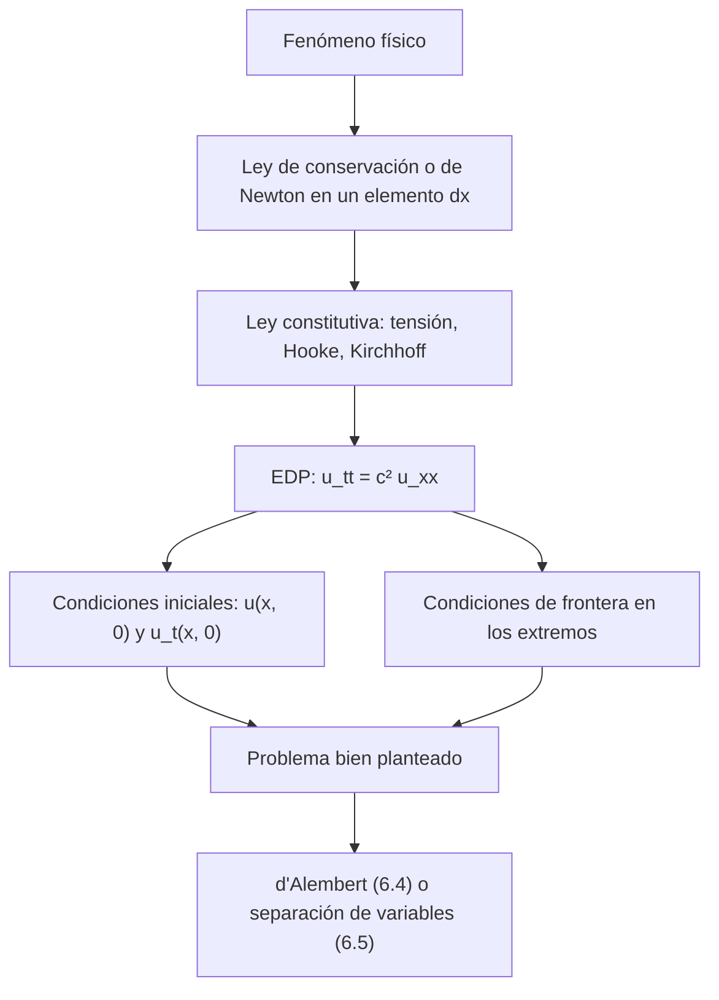

# Matemáticas para Ciencias Aplicadas IV - Ecuaciones de Tipo Hiperbólico

## 6.1 Problemas que conducen a ecuaciones de tipo hiperbólico.

---

Las ecuaciones en derivadas parciales (EDP) de segundo orden se dividen en tres tipos, **hiperbólicas**, **parabólicas** y **elípticas**, que corresponden a tres clases de fenómenos: la propagación de ondas, la difusión y los estados de equilibrio. Este bloque (temas 6.1 a 6.5) trata las hiperbólicas, cuyo modelo es la **ecuación de onda**. Este primer tema explica la clasificación, muestra cómo las **características** reducen una ecuación hiperbólica a una forma canónica y presenta los problemas físicos que conducen a ella: cuerdas, barras, membranas, sonido y líneas de transmisión.

### Clasificación de las EDP de segundo orden

Una EDP lineal de segundo orden en dos variables tiene la forma

$$ A u_{xx} + B u_{xy} + C u_{yy} + D u_x + E u_y + F u = G $$

con coeficientes que pueden depender de $(x, y).$ Su tipo en cada punto lo decide el **discriminante** de la parte principal, como en las cónicas $A x^2 + B xy + C y^2 = 1:$

| Discriminante | Tipo | Ejemplo | Fenómeno |
| --- | --- | --- | --- |
| $B^2 - 4AC > 0$ | hiperbólica | $u_{tt} = c^2 u_{xx}$ | ondas: propagación con velocidad finita |
| $B^2 - 4AC = 0$ | parabólica | $u_t = k u_{xx}$ | difusión: calor, concentraciones |
| $B^2 - 4AC \lt 0$ | elíptica | $u_{xx} + u_{yy} = 0$ | equilibrio: potenciales, estados estacionarios |

Si los coeficientes son variables, el tipo puede cambiar de una región a otra: la ecuación de **Tricomi** $y\, u_{xx} + u_{yy} = 0,$ que aparece en el vuelo transónico, es elíptica para $y > 0$ e hiperbólica para $y \lt 0.$ El tipo determina qué condiciones adicionales tienen sentido: una ecuación hiperbólica pide **condiciones iniciales** (posición y velocidad) y de frontera; una elíptica, solo condiciones de frontera.

### Características y forma canónica

Para una ecuación hiperbólica con coeficientes constantes, se buscan nuevas variables $\xi = y - m x$ en las que desaparezcan los términos $u_{\xi\xi}.$ Por la regla de la cadena, el coeficiente de $u_{\xi\xi}$ es $A m^2 - B m + C,$ así que $m$ debe ser raíz de la **ecuación característica**

$$ A m^2 - B m + C = 0 $$

Si $B^2 - 4AC > 0$ hay dos raíces reales distintas $m_1$ y $m_2,$ y con $\xi = y - m_1 x,$ $\eta = y - m_2 x$ la parte principal se reduce a un múltiplo de $u_{\xi\eta}:$ es la **forma canónica** $u_{\xi\eta} = (\text{términos de menor orden}).$ Las rectas $\xi = \text{cte}$ y $\eta = \text{cte}$ son las **características**: las curvas por las que viaja la información.

**Ejemplo.** $u_{xx} + 4 u_{xy} + 3 u_{yy} = 0$ tiene $m^2 - 4m + 3 = 0,$ con raíces 1 y 3. Con $\xi = y - 3x$ y $\eta = y - x,$ la ecuación es $u_{\xi\eta} = 0,$ cuya solución general es $u = F(y - 3x) + G(y - x)$ con $F$ y $G$ arbitrarias.

**La ecuación de onda.** $u_{tt} = c^2 u_{xx}$ tiene características $x - ct = \text{cte}$ y $x + ct = \text{cte},$ y su solución general es

$$ u(x, t) = F(x - ct) + G(x + ct) $$

la suma de una onda que viaja a la derecha y otra a la izquierda, ambas con velocidad $c$ y sin cambiar de forma. Es la **solución de d'Alembert**, que se desarrolla en el tema 6.4.

### Problemas físicos que conducen a la ecuación de onda

**Cuerda vibrante.** Una cuerda con tensión $T$ y densidad lineal $\rho,$ con desplazamientos transversales pequeños $u(x, t),$ cumple $u_{tt} = c^2 u_{xx}$ con $c = \sqrt{T/\rho}.$ La deducción, a partir de la segunda ley de Newton en un trozo de cuerda, está en el tema 6.2.

**Barra elástica.** Los desplazamientos longitudinales de una barra con módulo de Young $E$ y densidad $\rho$ cumplen la misma ecuación con $c = \sqrt{E/\rho}$ (tema 6.3). Es la velocidad del sonido en el sólido: unos 5 km/s en el acero.

**Membrana.** Una membrana tensa (un tambor) con desplazamiento $u(x, y, t)$ cumple la ecuación de onda bidimensional

$$ u_{tt} = c^2 (u_{xx} + u_{yy}) $$

**Sonido.** En un gas, las pequeñas variaciones de presión cumplen $p_{tt} = c^2 \nabla^2 p,$ donde $c = \sqrt{\gamma P_0 / \rho_0}$ es la velocidad del sonido, unos 343 m/s en el aire a 20 °C.

**Líneas de transmisión.** Un cable con resistencia $R,$ inductancia $L,$ capacidad $C$ y conductancia de fuga $G$ por unidad de longitud cumple, por las leyes de Kirchhoff en un tramo $dx,$

$$ -V_x = L I_t + R I, \qquad -I_x = C V_t + G V $$

Derivando la primera respecto a $x$ y sustituyendo $I_x$ de la segunda se elimina la corriente y se obtiene la **ecuación del telegrafista**:

$$ V_{xx} = LC\, V_{tt} + (RC + GL)\, V_t + RG\, V $$

Es hiperbólica: en las variables $(x, t)$ su parte principal es $V_{xx} - LC\, V_{tt},$ con discriminante $4LC > 0.$ Si la línea no tiene pérdidas, $R = G = 0,$ queda la ecuación de onda con velocidad $1/\sqrt{LC},$ cercana a la de la luz en los cables coaxiales. Con pérdidas, la señal se atenúa y se deforma al avanzar, que es lo que Heaviside estudió para los cables telegráficos submarinos.



### El problema de la cuerda con extremos fijos

El problema típico es

$$ u_{tt} = c^2 u_{xx}, \qquad u(0, t) = u(L, t) = 0, \qquad u(x, 0) = f(x), \qquad u_t(x, 0) = g(x) $$

Por separación de variables (tema 6.5), su solución es

$$ u(x, t) = \sum_{n = 1}^{\infty} \left[ A_n \cos \frac{n\pi c t}{L} + B_n \sin \frac{n\pi c t}{L} \right] \sin \frac{n\pi x}{L} $$

con $A_n = \frac{2}{L} \int_0^L f(x) \sin \frac{n\pi x}{L}\, dx$ y $B_n = \frac{2}{n\pi c} \int_0^L g(x) \sin \frac{n\pi x}{L}\, dx.$ Cada término es un **modo normal**: una forma fija $\sin(n\pi x/L)$ que oscila con frecuencia $f_n = \frac{nc}{2L}.$

**Ejemplo.** Con $L = \pi,$ $c = 1,$ $f(x) = \sin 3x$ y $g = 0,$ solo hay un modo: $A_3 = 1$ y todos los demás coeficientes son cero, así que $u(x, t) = \cos(3t) \sin(3x).$ La cuerda vibra con dos nodos interiores, en $x = \pi/3$ y $x = 2\pi/3,$ que no se mueven nunca.

### Implementación en Python

El programa clasifica varias ecuaciones por su discriminante, comprueba la forma canónica del ejemplo y la solución de d'Alembert, verifica la solución del ejercicio 1, calcula los coeficientes del ejercicio 2 midiendo cuánto se aproxima la serie truncada al dato inicial, y deduce simbólicamente la ecuación del telegrafista.

```python
import sympy as sp

x, y, t, c = sp.symbols("x y t c", real=True)
F, G = sp.Function("F"), sp.Function("G")


def tipo(A, B, C):
    d = sp.simplify(B**2 - 4 * A * C)
    if d.is_positive:
        return d, "hiperbólica"
    if d.is_zero:
        return d, "parabólica"
    if d.is_negative:
        return d, "elíptica"
    return d, "depende del punto"


# Coeficientes (A, B, C) de A u_xx + B u_xy + C u_yy (en la onda y el calor, y = t)
ejemplos = [
    ("onda u_tt = 4 u_xx", -4, 0, 1),
    ("calor u_t = k u_xx", 1, 0, 0),
    ("Laplace u_xx + u_yy = 0", 1, 0, 1),
    ("u_xx + 4 u_xy + 3 u_yy = 0", 1, 4, 3),
    ("u_xx + 2 u_xy + u_yy = 0", 1, 2, 1),
    ("Tricomi y u_xx + u_yy = 0", y, 0, 1),
]
print("Clasificación por el discriminante B² - 4AC")
for nombre, A, B, C in ejemplos:
    d, tp = tipo(sp.sympify(A), sp.sympify(B), sp.sympify(C))
    print(f"   {nombre:30s} B² - 4AC = {str(d):5s} -> {tp}")

# Características de u_xx + 4 u_xy + 3 u_yy = 0: A m² - B m + C = 0 con m = dy/dx
m = sp.symbols("m")
pend = sp.solve(m**2 - 4 * m + 3, m)
print("pendientes de las características:", pend)
u = F(y - 3 * x) + G(y - x)
res = sp.simplify(sp.diff(u, x, 2) + 4 * sp.diff(u, x, y) + 3 * sp.diff(u, y, 2))
print("u = F(y - 3x) + G(y - x) en la ecuación:", res)

# d'Alembert (ejercicio 3)
u = F(x - c * t) + G(x + c * t)
print("ejercicio 3, u_tt - c² u_xx =", sp.simplify(sp.diff(u, t, 2) - c**2 * sp.diff(u, x, 2)))

# Ejercicio 1: L = 2, c = 3, u(x, 0) = 0.1 sin(πx), u_t(x, 0) = 0
L1, c1 = 2, 3
u1 = sp.Rational(1, 10) * sp.sin(sp.pi * x) * sp.cos(3 * sp.pi * t)
print("ejercicio 1: u =", u1)
print("   ecuación:", sp.simplify(sp.diff(u1, t, 2) - c1**2 * sp.diff(u1, x, 2)),
      " extremos:", u1.subs(x, 0), u1.subs(x, L1),
      " u(x,0) - f:", sp.simplify(u1.subs(t, 0) - sp.sin(sp.pi * x) / 10),
      " u_t(x,0):", sp.diff(u1, t).subs(t, 0))
print("   período: 2L/(n c) con n = 2:", sp.Rational(2 * L1, 2 * c1), "s")

# Ejercicio 2: L = 1, u(x, 0) = x(1 - x)
n = sp.symbols("n", integer=True, positive=True)
An = sp.simplify(2 * sp.integrate(x * (1 - x) * sp.sin(n * sp.pi * x), (x, 0, 1)))
print("ejercicio 2: A_n =", An)
print("   primeros:", [An.subs(n, k) for k in range(1, 6)])
f = lambda xx: xx * (1 - xx)
serie = lambda xx, N: sum(float(An.subs(n, k)) * sp.sin(k * sp.pi * xx) for k in range(1, N + 1))
for N in (1, 3, 9):
    err = max(abs(f(p / 20) - float(serie(sp.Rational(p, 20), N))) for p in range(21))
    print(f"   N = {N}: error máximo de la serie truncada en t = 0: {err:.2e}")

# Ecuación del telegrafista a partir de las ecuaciones de la línea
R, Lh, Cc, Gg = sp.symbols("R L C G", positive=True)
V, I = sp.Function("V")(x, t), sp.Function("I")(x, t)
# -V_x = L I_t + R I,  -I_x = C V_t + G V
Ix = -(Cc * sp.diff(V, t) + Gg * V)
# derivar la primera respecto a x y sustituir I_x (y su derivada en t)
Vxx = -(Lh * sp.diff(Ix, t) + R * Ix)
tele = Lh * Cc * sp.diff(V, t, 2) + (R * Cc + Gg * Lh) * sp.diff(V, t) + R * Gg * V
print("telegrafista, V_xx - [LC V_tt + (RC + GL) V_t + RG V] =", sp.simplify(Vxx - tele))
```

Salida:

```text
Clasificación por el discriminante B² - 4AC
   onda u_tt = 4 u_xx             B² - 4AC = 16    -> hiperbólica
   calor u_t = k u_xx             B² - 4AC = 0     -> parabólica
   Laplace u_xx + u_yy = 0        B² - 4AC = -4    -> elíptica
   u_xx + 4 u_xy + 3 u_yy = 0     B² - 4AC = 4     -> hiperbólica
   u_xx + 2 u_xy + u_yy = 0       B² - 4AC = 0     -> parabólica
   Tricomi y u_xx + u_yy = 0      B² - 4AC = -4*y  -> depende del punto
pendientes de las características: [1, 3]
u = F(y - 3x) + G(y - x) en la ecuación: 0
ejercicio 3, u_tt - c² u_xx = 0
ejercicio 1: u = sin(pi*x)*cos(3*pi*t)/10
   ecuación: 0  extremos: 0 0  u(x,0) - f: 0  u_t(x,0): 0
   período: 2L/(n c) con n = 2: 2/3 s
ejercicio 2: A_n = 4*(1 - (-1)**n)/(pi**3*n**3)
   primeros: [8/pi**3, 0, 8/(27*pi**3), 0, 8/(125*pi**3)]
   N = 1: error máximo de la serie truncada en t = 0: 1.04e-02
   N = 3: error máximo de la serie truncada en t = 0: 2.80e-03
   N = 9: error máximo de la serie truncada en t = 0: 3.20e-04
telegrafista, V_xx - [LC V_tt + (RC + GL) V_t + RG V] = 0
```

Los coeficientes del ejercicio 2 decrecen como $1/n^3,$ así que bastan pocos términos: con 9 términos (5 no nulos) el error ya es del orden de $10^{-4}.$

### Ejercicios Propuestos

1. **Cuerda de 2 m.** Una cuerda de 2 m con extremos fijos y $c = 3$ m/s parte del reposo con $u(x, 0) = 0.1 \sin(\pi x).$ Encuentra $u(x, t)$ y el período de la vibración.

2. **Dato parabólico.** Resuelve $u_{tt} = c^2 u_{xx}$ en $[0, 1]$ con extremos fijos, $u(x, 0) = x(1 - x)$ y $u_t(x, 0) = 0.$

3. **Ondas viajeras.** Demuestra que $u(x, t) = f(x - ct) + g(x + ct)$ satisface la ecuación de onda para cualesquiera $f$ y $g$ dos veces derivables.

4. **Membrana circular.** Plantea el problema de valores iniciales y de frontera para las vibraciones de una membrana circular de radio $R$ fija en su borde.

5. **Clasificación.** Clasifica $u_{xx} + 2u_{xy} + u_{yy} = 0,$ $u_{xx} - x\, u_{yy} = 0$ y la ecuación del telegrafista.

### Soluciones

**Ejercicio 1.** $f(x) = 0.1 \sin(\pi x) = 0.1 \sin \frac{2\pi x}{L}$ es el modo $n = 2,$ así que $u(x, t) = 0.1 \sin(\pi x) \cos(3\pi t).$ El período es $\frac{2\pi}{3\pi} = \frac{2}{3}$ s, como confirma el programa.

**Ejercicio 2.** $A_n = \frac{4(1 - (-1)^n)}{\pi^3 n^3},$ que vale $\frac{8}{\pi^3 n^3}$ para $n$ impar y 0 para $n$ par; $B_n = 0.$ Así,

$$ u(x, t) = \frac{8}{\pi^3} \sum_{n \text{ impar}} \frac{1}{n^3} \sin(n\pi x) \cos(n\pi c t) $$

Los modos pares faltan porque $f$ es simétrica respecto a $x = 1/2,$ y $\sin(n\pi x)$ es antisimétrica respecto a ese punto cuando $n$ es par.

**Ejercicio 3.** Con $\xi = x - ct,$ $u_t = -c f'(\xi) + c g'(x + ct)$ y $u_{tt} = c^2 f''(\xi) + c^2 g''(x + ct),$ mientras que $u_{xx} = f''(\xi) + g''(x + ct).$ Por lo tanto $u_{tt} = c^2 u_{xx}.$

**Ejercicio 4.** En coordenadas polares, $u_{tt} = c^2 \left( u_{rr} + \frac{1}{r} u_r + \frac{1}{r^2} u_{\theta\theta} \right)$ para $0 \leq r \lt R,$ con $u(R, \theta, t) = 0,$ $u$ acotada en $r = 0,$ $u$ periódica en $\theta$ con período $2\pi,$ y datos $u(r, \theta, 0) = f(r, \theta),$ $u_t(r, \theta, 0) = g(r, \theta).$ Al separar variables aparecen las funciones de Bessel, y las frecuencias de un tambor no son múltiplos enteros de la fundamental, por eso no tiene una altura musical tan definida como una cuerda.

**Ejercicio 5.** La primera tiene $B^2 - 4AC = 0:$ parabólica. La segunda tiene $B^2 - 4AC = 4x:$ hiperbólica para $x > 0$ y elíptica para $x \lt 0.$ La del telegrafista es hiperbólica, con discriminante $4LC > 0.$

### Referencias

1. Boyce, W. E., DiPrima, R. C., and Meade, D. B., _Elementary Differential Equations and Boundary Value Problems_. Wiley, 2017. Capítulo 10.
2. Edwards, C. H., and Penney, D. E., _Ecuaciones diferenciales y problemas con valores en la frontera_. Pearson, 2009. Capítulo 9.
3. Strauss, W. A., _Partial Differential Equations: An Introduction_. Wiley, 2008. Capítulos 1 y 2.
4. Tijonov, A. N., y Samarski, A. A., _Ecuaciones de la física matemática_. Mir, 1980. Capítulos 1 y 2.
