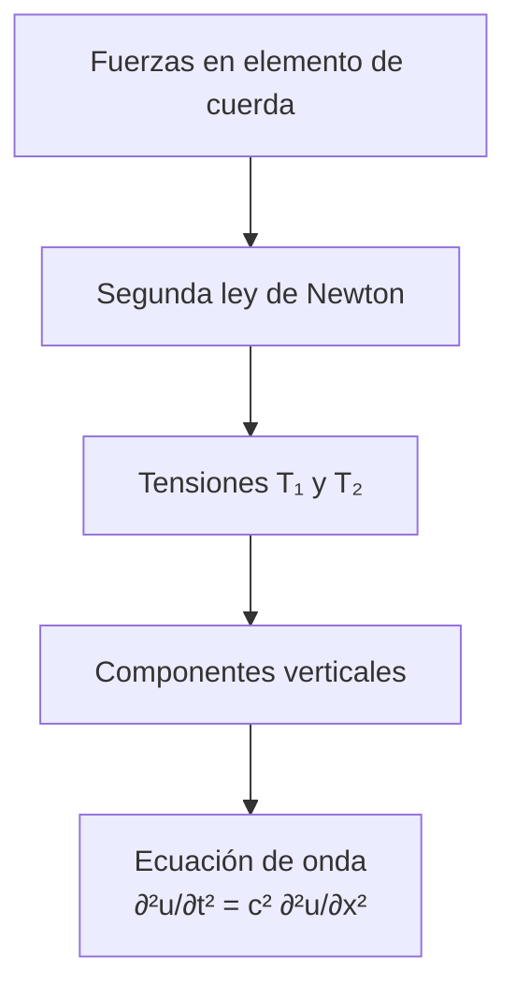
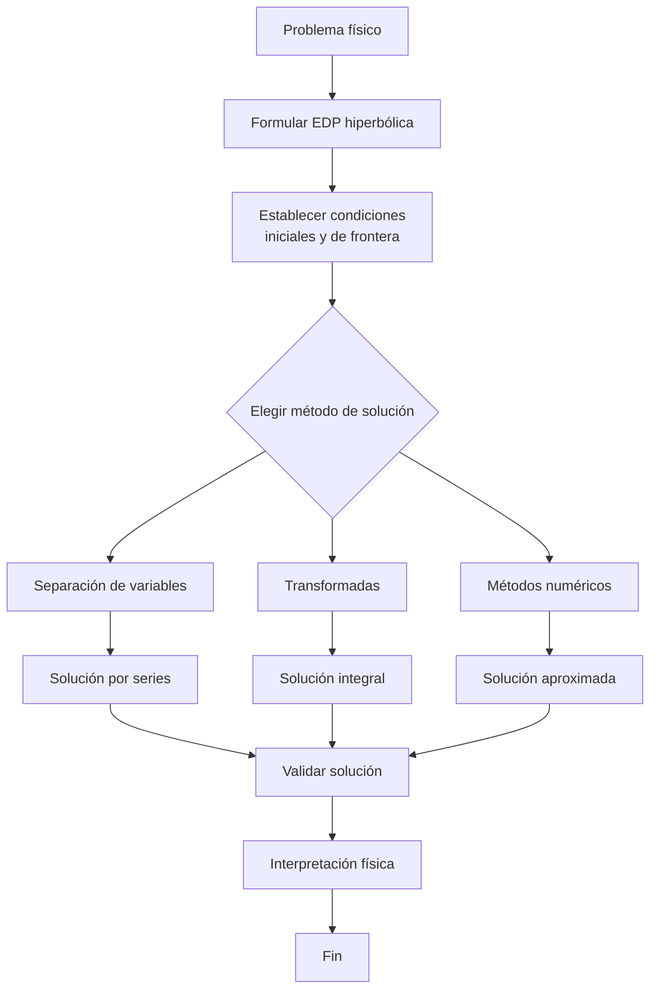

# Matemáticas para Ciencias Aplicadas IV - Ecuaciones de Tipo Hiperbólico

## 6.1 Problemas que conducen a ecuaciones de tipo hiperbólico.

---

### 1. Introducción a las Ecuaciones Hiperbólicas

Las ecuaciones diferenciales parciales (EDP) de tipo hiperbólico son fundamentales para modelar fenómenos de propagación de ondas en diversos campos de la física e ingeniería.

**Definición:** Una EDP de segundo orden es de tipo hiperbólico si su discriminante satisface:

$$B^2 - 4AC > 0$$

donde A, B, C son los coeficientes de la forma general:

$$A\frac{\partial^2 u}{\partial x^2} + B\frac{\partial^2 u}{\partial x \partial y} + C\frac{\partial^2 u}{\partial y^2} + \cdots = 0$$

### 2. La Ecuación de Onda Unidimensional

El problema clásico que conduce a una ecuación hiperbólica es la **ecuación de onda**:

#### 2.1. Derivación de la Ecuación de Onda

Consideremos una cuerda elástica tensa de longitud L:



La ecuación resultante es:

$$\frac{\partial^2 u}{\partial t^2} = c^2 \frac{\partial^2 u}{\partial x^2}$$

donde $c = \sqrt{\frac{T}{\rho}}$ es la velocidad de propagación de la onda.

#### 2.2. Condiciones Iniciales y de Frontera

**Condiciones iniciales:**

- Posición inicial: $u(x,0) = f(x)$
- Velocidad inicial: $\frac{\partial u}{\partial t}(x,0) = g(x)$

**Condiciones de frontera típicas:**

- Extremos fijos: $u(0,t) = 0$, $u(L,t) = 0$
- Extremos libres u otras condiciones

### 3. Problemas Físicos que Conducen a Ecuaciones Hiperbólicas

#### 3.1. Vibración de Membranas

Para una membrana elástica:

$$\frac{\partial^2 u}{\partial t^2} = c^2 \left( \frac{\partial^2 u}{\partial x^2} + \frac{\partial^2 u}{\partial y^2} \right)$$

#### 3.2. Transmisión de Señales en Líneas de Transmisión

Ecuaciones del telegrafista:

$$\frac{\partial^2 V}{\partial x^2} = LC\frac{\partial^2 V}{\partial t^2} + (RC + GL)\frac{\partial V}{\partial t} + RGV$$

#### 3.3. Ondas Sonoras en Fluidos

Ecuación de onda para la presión:

$$\frac{\partial^2 p}{\partial t^2} = c^2 \nabla^2 p$$

donde $c$ es la velocidad del sonido.

### 4. Solución por Separación de Variables

#### 4.1. Método de Separación de Variables

Suponiendo $u(x,t) = X(x)T(t)$, sustituimos en la ecuación de onda:

$$X(x)T''(t) = c^2 X''(x)T(t)$$

$$\frac{T''(t)}{c^2 T(t)} = \frac{X''(x)}{X(x)} = -\lambda$$

#### 4.2. Solución General

La solución general para extremos fijos es:

$$u(x,t) = \sum_{n=1}^{\infty} \left[ A_n \cos\left(\frac{n\pi c t}{L}\right) + B_n \sin\left(\frac{n\pi c t}{L}\right) \right] \sin\left(\frac{n\pi x}{L}\right)$$

donde:

$$A_n = \frac{2}{L} \int_0^L f(x) \sin\left(\frac{n\pi x}{L}\right) dx$$

$$B_n = \frac{2}{n\pi c} \int_0^L g(x) \sin\left(\frac{n\pi x}{L}\right) dx$$

### 5. Ejemplo Resuelto

**Problema:** Una cuerda de longitud L = π, con c = 1, tiene posición inicial $u(x,0) = \sin(3x)$ y velocidad inicial cero. Encuentre la solución.

**Solución:**

1. Condiciones: $f(x) = \sin(3x)$, $g(x) = 0$
2. Coeficientes:
   - $A_n = 0$ para n ≠ 3, $A_3 = 1$
   - $B_n = 0$ para todo n
3. Solución:

   $$u(x,t) = \cos(3t)\sin(3x)$$

### 6. Código Python para Visualización

```python
import numpy as np
import matplotlib.pyplot as plt
from matplotlib.animation import FuncAnimation

# Parámetros
L = np.pi
c = 1
n_points = 100
x = np.linspace(0, L, n_points)

# Solución para u(x,t) = cos(3t)sin(3x)
def u(x, t):
    return np.cos(3*t) * np.sin(3*x)

# Configuración de la animación
fig, ax = plt.subplots()
line, = ax.plot(x, u(x, 0))
ax.set_ylim(-1.5, 1.5)
ax.set_xlabel('Posición x')
ax.set_ylabel('Desplazamiento u(x,t)')
ax.set_title('Vibración de una cuerda')

def animate(t):
    line.set_ydata(u(x, t/10))
    return line,

ani = FuncAnimation(fig, animate, frames=200, interval=50)
plt.show()
```

### 7. Ejercicios Propuestos

#### Ejercicio 1

Una cuerda de 2 metros de longitud tiene sus extremos fijos. Si se le da un desplazamiento inicial de $u(x,0) = 0.1\sin(\pi x)$ y se suelta desde el reposo, encuentre la solución $u(x,t)$. (c = 3 m/s)

#### Ejercicio 2

Resuelva la ecuación de onda con condiciones:

- $u(x,0) = x(1-x)$
- $\frac{\partial u}{\partial t}(x,0) = 0$
- $u(0,t) = u(1,t) = 0$

#### Ejercicio 3

Demuestre que la función $u(x,t) = f(x-ct) + g(x+ct)$ satisface la ecuación de onda unidimensional, donde f y g son funciones dos veces diferenciables.

#### Ejercicio 4

Una membrana circular de radio R está fija en su borde. Plantee el problema de valores iniciales y de frontera para sus vibraciones.

### 8. Diagrama de Flujo: Solución de Problemas Hiperbólicos



### 9. Referencias

#### Bibliografía Básica:

1. **Boice, W., DiPrima, R.** (2004). _Elementary Differential Equations and Boundary Value Problems_. Wiley, New York. (Capítulo 10)
2. **Edwards, C. H., Penney, D. E.** (2002). _Ecuaciones diferenciales elementales y problemas con condiciones a la frontera_. Prentice Hall, México. (Capítulo 12)

#### Bibliografía Complementaria:

1. **Cooper, J. M.** (1998). _Introduction to Partial Differential Equations with MatLab_. Birkhäuser, Boston. (Capítulo 4)
2. **Hubbard, J. H., West, B. H.** (1995). _Differential Equations: A Dynamical Systems Approach_. Springer-Verlag, Berlin. (Sección 8.4)
3. **Zill, D. G., Wright, W. S.** (1995). _Differential Equations with Computer Lab Experiments_. PWS Publishing Company, Boston. (Capítulo 13)

### 10. Aplicaciones Prácticas

Las ecuaciones hiperbólicas modelan:

- Propagación de ondas sísmicas
- Vibraciones de estructuras
- Transmisión de señales electromagnéticas
- Ondas sonoras y acústica
- Dinámica de fluidos compresibles
