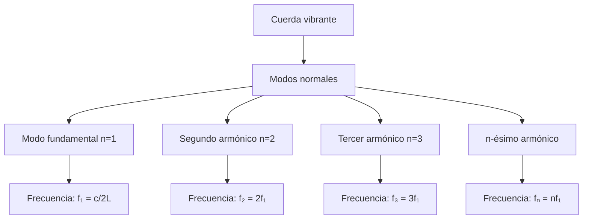

# Matemáticas para Ciencias Aplicadas IV - Ecuaciones de Tipo Hiperbólico

## 6.2 Oscilaciones transversales de una cuerda.

---

### 1. Introducción

Las oscilaciones transversales de una cuerda representan uno de los problemas fundamentales que conducen a ecuaciones diferenciales parciales de tipo hiperbólico. Este fenómeno físico es modelado por la **ecuación de onda**, que describe cómo se propagan las perturbaciones a través de la cuerda.

### 2. Modelación Física del Problema

#### 2.1. Suposiciones del Modelo

- Cuerda perfectamente flexible
- Densidad lineal constante $(\rho)$
- Tensión constante $(T)$
- Pequeñas oscilaciones (ángulos pequeños)
- Fuerzas externas despreciables
- Movimiento exclusivamente transversal

### 3. Derivación de la Ecuación de Onda

Consideremos un elemento infinitesimal de cuerda de longitud $\Delta s$:

#### 3.1. Fuerzas Verticales Netas

La fuerza vertical neta es:

$$F_y = T \sin(\theta + \Delta\theta) - T \sin\theta$$

Para ángulos pequeños $(\theta \ll 1)$, $\sin\theta \approx \tan\theta = \frac{\partial u}{\partial x}$:

$$F_y \approx T \left[ \left( \frac{\partial u}{\partial x} \right)_{x+\Delta x} - \left( \frac{\partial u}{\partial x} \right)_x \right]$$

#### 3.2. Segunda Ley de Newton

Aplicando $F = ma$ en la dirección vertical:

$$T \left[ \left( \frac{\partial u}{\partial x} \right)_{x+\Delta x} - \left( \frac{\partial u}{\partial x} \right)_x \right] = \rho \Delta x \frac{\partial^2 u}{\partial t^2}$$

Dividiendo entre $\Delta x$ y tomando el límite cuando $\Delta x \to 0$:

$$T \frac{\partial^2 u}{\partial x^2} = \rho \frac{\partial^2 u}{\partial t^2}$$

#### 3.3. Ecuación de Onda Resultante

$$\frac{\partial^2 u}{\partial t^2} = c^2 \frac{\partial^2 u}{\partial x^2}$$
donde $c = \sqrt{\frac{T}{\rho}}$ es la **velocidad de propagación de la onda**.

### 4. Condiciones Iniciales y de Frontera

#### 4.1. Condiciones Iniciales

- **Posición inicial**: $u(x,0) = f(x)$
- **Velocidad inicial**: $\frac{\partial u}{\partial t}(x,0) = g(x)$

#### 4.2. Condiciones de Frontera Comunes

1. **Extremos fijos**: $u(0,t) = 0$, $u(L,t) = 0$
2. **Extremos libres**: $\frac{\partial u}{\partial x}(0,t) = 0$, $\frac{\partial u}{\partial x}(L,t) = 0$
3. **Combinaciones mixtas**

### 5. Solución por Separación de Variables

#### 5.1. Método de Separación

Suponemos $u(x,t) = X(x)T(t)$ y sustituimos en la ecuación de onda:

$$X(x)T''(t) = c^2 X''(x)T(t)$$

$$\frac{T''(t)}{c^2 T(t)} = \frac{X''(x)}{X(x)} = -\lambda$$

#### 5.2. Problema Espacial (Autovalor)

$$X''(x) + \lambda X(x) = 0$$

Con condiciones de frontera $X(0) = X(L) = 0$, obtenemos:

- **Autovalores**: $\lambda_n = \left( \frac{n\pi}{L} \right)^2$
- **Autofunciones**: $X_n(x) = \sin\left( \frac{n\pi x}{L} \right)$

#### 5.3. Problema Temporal

$$T''(t) + c^2 \lambda_n T(t) = 0$$

Solución:

$$T_n(t) = A_n \cos\left( \frac{n\pi c t}{L} \right) + B_n \sin\left( \frac{n\pi c t}{L} \right)$$

#### 5.4. Solución General

$$u(x,t) = \sum_{n=1}^{\infty} \left[ A_n \cos\left( \frac{n\pi c t}{L} \right) + B_n \sin\left( \frac{n\pi c t}{L} \right) \right] \sin\left( \frac{n\pi x}{L} \right)$$

#### 5.5. Coeficientes de Fourier

$$A_n = \frac{2}{L} \int_0^L f(x) \sin\left( \frac{n\pi x}{L} \right) dx$$

$$B_n = \frac{2}{n\pi c} \int_0^L g(x) \sin\left( \frac{n\pi x}{L} \right) dx$$

### 6. Ejemplo Resuelto

**Problema:** Cuerda de longitud $L = \pi$, $c = 1$, con condiciones:

- $u(x,0) = \sin(3x)$
- $\frac{\partial u}{\partial t}(x,0) = 0$
- $u(0,t) = u(\pi,t) = 0$

**Solución:**

1. Calculamos coeficientes:
   - $A_n = \frac{2}{\pi} \int_0^\pi \sin(3x) \sin(nx) dx = \delta_{n3}$ (delta de Kronecker)
   - $B_n = 0$ para todo $n$
2. Solución:

   $$u(x,t) = \cos(3t) \sin(3x)$$

### 7. Visualización de Modos Normales

```python
import numpy as np
import matplotlib.pyplot as plt
from matplotlib.animation import FuncAnimation

# Parámetros
L = np.pi
c = 1
n_points = 200
x = np.linspace(0, L, n_points)

# Función para el n-ésimo modo normal
def modo_normal(x, t, n):
    return np.cos(n*c*t) * np.sin(n*x)

# Configuración de la figura
fig, ax = plt.subplots(figsize=(10, 6))
ax.set_xlim(0, L)
ax.set_ylim(-1.5, 1.5)
ax.set_xlabel('Posición x')
ax.set_ylabel('Desplazamiento u(x,t)')
ax.set_title('Oscilaciones Transversales de una Cuerda - Modo n=3')
ax.grid(True)

line, = ax.plot(x, modo_normal(x, 0, 3))
time_text = ax.text(0.02, 0.95, '', transform=ax.transAxes)

def animate(t):
    line.set_ydata(modo_normal(x, t/10, 3))
    time_text.set_text(f'Tiempo = {t/10:.2f} s')
    return line, time_text

ani = FuncAnimation(fig, animate, frames=200, interval=50, blit=True)
plt.show()
```

### 8. Energía de la Cuerda Vibrante

#### 8.1. Energía Cinética

$$E_c(t) = \frac{1}{2} \int_0^L \rho \left( \frac{\partial u}{\partial t} \right)^2 dx$$

#### 8.2. Energía Potencial

$$E_p(t) = \frac{1}{2} \int_0^L T \left( \frac{\partial u}{\partial x} \right)^2 dx$$

#### 8.3. Conservación de Energía

Para una cuerda ideal sin amortiguamiento:

$$\frac{d}{dt}[E_c(t) + E_p(t)] = 0$$

### 9. Ejercicios Propuestos

#### Ejercicio 1

Una cuerda de 2 metros de longitud tiene sus extremos fijos. Si se le da un desplazamiento inicial de $u(x,0) = 0.1\sin(\pi x)$ y se suelta desde el reposo, encuentre la solución $u(x,t)$. ( $c = 3$ m/s )

#### Ejercicio 2

Resuelva la ecuación de onda con condiciones:

- $u(x,0) = x(1-x)$
- $\frac{\partial u}{\partial t}(x,0) = 0$
- $u(0,t) = u(1,t) = 0$

#### Ejercicio 3

Demuestre que para una cuerda con extremos fijos, la energía total se conserva.

#### Ejercicio 4

Una cuerda de guitarra de 0.65 m de longitud vibra con una frecuencia fundamental de 329.63 Hz (mi4). Calcule la velocidad de propagación de ondas en la cuerda.

### 10. Diagrama de Modos Normales



### 11. Aplicaciones

- Instrumentos musicales
- Ingeniería estructural (análisis de vibraciones)
- Telecomunicaciones (fibras ópticas)
- Geofísica (ondas sísmicas)

### 12. Referencias

#### Bibliografía Básica:

1. **Boice, W., DiPrima, R.** (2004). _Elementary Differential Equations and Boundary Value Problems_. Wiley, New York. (Capítulo 10)
2. **Edwards, C. H., Penney, D. E.** (2002). _Ecuaciones diferenciales elementales y problemas con condiciones a la frontera_. Prentice Hall, México. (Capítulo 12)

#### Bibliografía Complementaria:

1. **Cooper, J. M.** (1998). _Introduction to Partial Differential Equations with MatLab_. Birkhäuser, Boston. (Capítulo 4)
2. **Hubbard, J. H., West, B. H.** (1995). _Differential Equations: A Dynamical Systems Approach_. Springer-Verlag, Berlin. (Sección 8.4)
3. **Zill, D. G., Wright, W. S.** (1995). _Differential Equations with Computer Lab Experiments_. PWS Publishing Company, Boston. (Capítulo 13)
