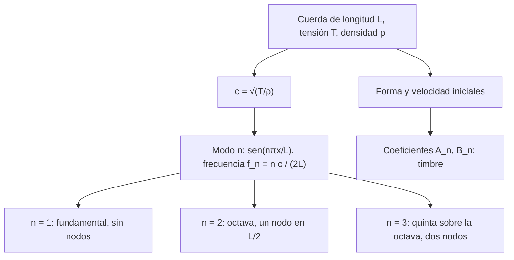

# Matemáticas para Ciencias Aplicadas IV - Ecuaciones de Tipo Hiperbólico

## 6.2 Oscilaciones transversales de una cuerda.

---

La cuerda vibrante es el ejemplo con el que d'Alembert (1747), Euler y Daniel Bernoulli descubrieron la ecuación de onda y discutieron, por primera vez, si una función arbitraria se puede escribir como suma de senos, la pregunta que llevó a Fourier a sus series. Este tema deduce la ecuación a partir de la segunda ley de Newton, plantea las condiciones iniciales y de frontera, resuelve el problema por modos normales, demuestra la **conservación de la energía** y explica de dónde salen los armónicos que dan su timbre a los instrumentos de cuerda.

### Deducción de la ecuación

**Hipótesis del modelo.**

- La cuerda es perfectamente flexible: solo transmite fuerza a lo largo de su tangente, con tensión $T.$
- Es homogénea, con densidad lineal $\rho$ (kg/m) constante.
- Los desplazamientos $u(x, t)$ son **verticales y pequeños**: la pendiente $u_x$ es mucho menor que 1.
- Se desprecian el peso y el rozamiento con el aire.

**Deducción.** Se considera el trozo de cuerda entre $x$ y $x + \Delta x,$ y sea $\theta(x)$ el ángulo de la tangente con la horizontal. Como no hay movimiento horizontal, las componentes horizontales de la tensión se equilibran: $T \cos\theta$ es la misma en ambos extremos y, para ángulos pequeños, $T \cos\theta \approx T$ es constante. La fuerza vertical neta es

$$ T \sin\theta(x + \Delta x) - T \sin\theta(x) \approx T \big( u_x(x + \Delta x, t) - u_x(x, t) \big) $$

usando $\sin\theta \approx \tan\theta = u_x$ para ángulos pequeños. La masa del trozo es $\rho\, \Delta x$ y su aceleración $u_{tt},$ así que por la segunda ley de Newton

$$ \rho\, \Delta x\, u_{tt} = T \big( u_x(x + \Delta x, t) - u_x(x, t) \big) $$

Dividiendo entre $\Delta x$ y haciendo $\Delta x \to 0:$

$$ u_{tt} = c^2 u_{xx}, \qquad c = \sqrt{\frac{T}{\rho}} $$

$c$ tiene unidades de velocidad: es la velocidad con que viajan las perturbaciones a lo largo de la cuerda. Una cuerda más tensa o más ligera transmite las ondas más rápido.

**Variantes.** Si se toma en cuenta el peso, aparece un término $-g$ a la derecha; si hay rozamiento proporcional a la velocidad, un término $-2b\, u_t;$ y una fuerza externa por unidad de masa $F(x, t)$ se suma a la derecha.

### Condiciones iniciales y de frontera

La ecuación es de segundo orden en $t,$ así que hacen falta dos **condiciones iniciales**: la forma inicial $u(x, 0) = f(x)$ y la velocidad inicial $u_t(x, 0) = g(x).$ En los extremos se imponen **condiciones de frontera**:

| Extremo | Condición | Significado |
| --- | --- | --- |
| fijo | $u = 0$ | la cuerda está atada |
| libre | $u_x = 0$ | un anillo sin rozamiento que desliza por una varilla vertical: no hay fuerza vertical |
| elástico | $T u_x + k u = 0$ | atado a un resorte de constante $k$ |

Una cuerda **pulsada** (guitarra, arpa) parte del reposo con una forma triangular; una cuerda **golpeada** (piano) parte de la posición de equilibrio con una velocidad inicial concentrada donde golpea el martillo.

### Solución por modos normales

Para extremos fijos en $x = 0$ y $x = L,$ la separación de variables $u = X(x)\, T(t)$ (tema 6.5) da el problema de valores propios $X'' + \lambda X = 0,$ $X(0) = X(L) = 0,$ cuyas soluciones son

$$ \lambda_n = \left( \frac{n\pi}{L} \right)^2, \qquad X_n(x) = \sin \frac{n\pi x}{L}, \qquad n = 1, 2, 3, \ldots $$

y la solución general es la superposición de modos normales

$$ u(x, t) = \sum_{n = 1}^{\infty} \left[ A_n \cos \omega_n t + B_n \sin \omega_n t \right] \sin \frac{n\pi x}{L}, \qquad \omega_n = \frac{n\pi c}{L} $$

con $A_n = \frac{2}{L} \int_0^L f(x) \sin \frac{n\pi x}{L}\, dx$ y $B_n = \frac{2}{\omega_n L} \int_0^L g(x) \sin \frac{n\pi x}{L}\, dx.$

**Armónicos.** El modo $n$ vibra con frecuencia $f_n = \frac{n c}{2L} = n f_1:$ todas son múltiplos enteros de la **fundamental** $f_1 = \frac{1}{2L} \sqrt{T/\rho},$ y por eso la cuerda produce un sonido de altura bien definida. Esta fórmula, la **ley de Mersenne**, explica cómo se afina un instrumento: acortar la cuerda (pisar un traste), tensarla (girar la clavija) o usar una cuerda más ligera suben la frecuencia. El modo $n$ tiene $n - 1$ **nodos** interiores, puntos que no se mueven.



### Ejemplo: la cuerda pulsada

Si la cuerda se levanta una altura $h$ en el punto $x = a$ y se suelta desde el reposo, $f$ es un triángulo y $g = 0.$ Integrando por partes en cada tramo,

$$ A_n = \frac{2 h L^2}{\pi^2 n^2\, a (L - a)} \sin \frac{n\pi a}{L}, \qquad B_n = 0 $$

Dos consecuencias se oyen:

- Los coeficientes decrecen como $1/n^2:$ los armónicos altos son débiles y el sonido es suave. Una cuerda golpeada con un martillo duro tiene más armónicos y suena más brillante.
- Si se pulsa en $a = L/m,$ los armónicos múltiplos de $m$ **desaparecen**, porque $\sin(n\pi/m) = 0.$ Pulsar en el centro elimina todos los pares y da un sonido hueco; pulsar cerca del puente realza los agudos.

### Conservación de la energía

La energía de la cuerda es la cinética más la potencial elástica, que es el trabajo de la tensión para estirarla:

$$ E(t) = \frac{1}{2} \int_0^L \left( \rho\, u_t^2 + T u_x^2 \right) dx $$

**Teorema.** Si los extremos están fijos (o libres), $E(t)$ es constante.

**Demostración.** Derivando bajo la integral y usando $\rho\, u_{tt} = T u_{xx},$

$$ E'(t) = \int_0^L \left( \rho\, u_t u_{tt} + T u_x u_{xt} \right) dx = T \int_0^L \left( u_t u_{xx} + u_x u_{xt} \right) dx = T \int_0^L \frac{\partial}{\partial x} (u_t u_x)\, dx = T \big[ u_t u_x \big]_0^L $$

Con extremos fijos, $u = 0$ en los extremos para todo $t,$ así que $u_t = 0$ ahí; con extremos libres, $u_x = 0.$ En ambos casos $E'(t) = 0.$ $\blacksquare$

**Unicidad.** Una consecuencia es que el problema tiene **solución única**: si $u_1$ y $u_2$ son soluciones con los mismos datos, su diferencia $w$ tiene datos iniciales nulos, así que su energía es 0 en $t = 0$ y, por conservarse, para todo $t.$ Como el integrando es no negativo, $w_t = w_x = 0,$ $w$ es constante, y vale 0 porque se anula en los extremos.

**Energía por modos.** Por la ortogonalidad de los senos, la energía se reparte entre los modos sin interacción: el modo $n$ con amplitud $A_n$ lleva una energía $E_n = \frac{T \pi^2 n^2}{4L} A_n^2,$ y $E = \sum E_n.$

### Implementación en Python

El programa obtiene con SymPy los coeficientes de la cuerda pulsada, comprueba numéricamente para una cuerda concreta que la energía total se mantiene mientras se transforma entre cinética y potencial, calcula cómo se reparte entre los armónicos y resuelve los ejercicios 2 y 4.

```python
import numpy as np
import sympy as sp

# Coeficientes de la cuerda pulsada a una altura h en x = a
x = sp.symbols("x", positive=True)
n = sp.symbols("n", integer=True, positive=True)
L, h, a = sp.symbols("L h a", positive=True)
s = sp.sin(n * sp.pi * x / L)
An = sp.simplify(2 / L * (sp.integrate(h * x / a * s, (x, 0, a))
                          + sp.integrate(h * (L - x) / (L - a) * s, (x, a, L))))
print("cuerda pulsada en x = a: A_n =", An)
print("pulsada en el centro:   A_n =", sp.simplify(An.subs(a, L / 2)))

# Cuerda concreta: L = 1 m, rho = 0.01 kg/m, T = 100 N, h = 5 mm, pulsada en el centro
Lv, rho, T, hv = 1.0, 0.01, 100.0, 0.005
c = np.sqrt(T / rho)
print(f"c = {c:.1f} m/s, f1 = c/(2L) = {c / (2 * Lv):.1f} Hz")
N = 400
k = np.arange(1, N + 1)
A = 8 * hv / (np.pi**2 * k**2) * np.sin(k * np.pi / 2)
xs = np.linspace(0, Lv, 4001)


def energia(t):
    w = k * np.pi * c / Lv
    ut = -(A * w * np.sin(w * t)) @ np.sin(np.outer(k, xs) * np.pi / Lv)
    ux = (A * k * np.pi / Lv * np.cos(w * t)) @ np.cos(np.outer(k, xs) * np.pi / Lv)
    cin = 0.5 * rho * np.trapezoid(ut**2, xs)
    pot = 0.5 * T * np.trapezoid(ux**2, xs)
    return cin, pot


print("energía exacta 2 T h² / L =", 2 * T * hv**2 / Lv, "J")
for t in (0.0, 0.0013, 0.0025, 0.004):
    cin, pot = energia(t)
    print(f"   t = {t:.4f} s: cinética {cin:.6f}  potencial {pot:.6f}  total {cin + pot:.6f}")

En = T * (k * np.pi) ** 2 * A**2 / (4 * Lv)
print("fracción de la energía en los modos 1, 3, 5, 7:",
      [round(float(e), 4) for e in (En / En.sum())[[0, 2, 4, 6]]])

# Pulsada en a = L/5: los armónicos múltiplos de 5 no suenan
A5 = [float(An.subs({L: 1, h: 1, a: sp.Rational(1, 5), n: m})) for m in range(1, 11)]
print("pulsada en L/5, A_1..A_10:", [f"{v:.4f}" for v in A5])

# Golpe de martillo (ejercicio 2): u(x,0) = 0, u_t = v0 en [0.4, 0.6], L = 1, c = 100
v0 = 1.0
Bn = sp.simplify(2 / (n * sp.pi * 100) * sp.integrate(v0 * sp.sin(n * sp.pi * x), (x, sp.Rational(2, 5), sp.Rational(3, 5))))
print("martillo: B_n =", Bn)
print("   B_1..B_4:", [f"{float(Bn.subs(n, m)):.3e}" for m in range(1, 5)])

# Guitarra (ejercicio 4)
Lg, f1 = 0.65, 329.63
print(f"guitarra: c = 2 L f1 = {2 * Lg * f1:.2f} m/s")
```

Salida:

```text
cuerda pulsada en x = a: A_n = 2*L**2*h*sin(pi*a*n/L)/(pi**2*a*n**2*(L - a))
pulsada en el centro:   A_n = 8*h*sin(pi*n/2)/(pi**2*n**2)
c = 100.0 m/s, f1 = c/(2L) = 50.0 Hz
energía exacta 2 T h² / L = 0.005 J
   t = 0.0000 s: cinética 0.000000  potencial 0.004995  total 0.004995
   t = 0.0013 s: cinética 0.001297  potencial 0.003697  total 0.004995
   t = 0.0025 s: cinética 0.002497  potencial 0.002497  total 0.004995
   t = 0.0040 s: cinética 0.003997  potencial 0.000997  total 0.004995
fracción de la energía en los modos 1, 3, 5, 7: [0.8114, 0.0902, 0.0325, 0.0166]
pulsada en L/5, A_1..A_10: ['0.7444', '0.3011', '0.1338', '0.0465', '0.0000', '-0.0207', '-0.0246', '-0.0188', '-0.0092', '0.0000']
martillo: B_n = 0.02*(cos(2*pi*n/5) - cos(3*pi*n/5))/(pi**2*n**2)
   B_1..B_4: ['1.252e-03', '0.000e+00', '-3.643e-04', '0.000e+00']
guitarra: c = 2 L f1 = 428.52 m/s
```

La energía total no cambia en el tiempo; la pequeña diferencia con el valor exacto, $0.005$ J, se debe a que la serie se truncó en 400 términos. Al pulsar en el centro, el 81 % de la energía va a la fundamental, y al pulsar en $L/5$ los armónicos 5 y 10 tienen coeficiente cero.

### Ejercicios Propuestos

1. **Cuerda pulsada.** Una cuerda de longitud $L$ se levanta una altura $h$ en el centro y se suelta. Encuentra $u(x, t)$ y comprueba que la energía total es $2Th^2/L.$

2. **Cuerda golpeada.** Una cuerda de piano de 1 m con $c = 100$ m/s está en reposo y en equilibrio cuando un martillo le da una velocidad $v_0 = 1$ m/s en el tramo $0.4 \leq x \leq 0.6.$ Encuentra los coeficientes de la solución.

3. **Energía.** Demuestra que la energía total de una cuerda con extremos fijos se conserva, y que con rozamiento, $\rho\, u_{tt} = T u_{xx} - 2b\rho\, u_t$ con $b > 0,$ disminuye.

4. **Guitarra.** Una cuerda de guitarra de 0.65 m vibra con frecuencia fundamental 329.63 Hz (mi4). Calcula la velocidad de propagación de las ondas en la cuerda. ¿Dónde hay que pisarla para que suene una octava más alta?

5. **Afinación.** Si se aumenta la tensión de una cuerda un 10 %, ¿cuánto cambia su frecuencia fundamental?

### Soluciones

**Ejercicio 1.** Con $a = L/2,$ $A_n = \frac{8h}{\pi^2 n^2} \sin \frac{n\pi}{2},$ que es 0 para $n$ par y $\pm \frac{8h}{\pi^2 n^2}$ para $n$ impar, y

$$ u(x, t) = \frac{8h}{\pi^2} \left[ \sin \frac{\pi x}{L} \cos \frac{\pi c t}{L} - \frac{1}{9} \sin \frac{3\pi x}{L} \cos \frac{3\pi c t}{L} + \frac{1}{25} \sin \frac{5\pi x}{L} \cos \frac{5\pi c t}{L} - \cdots \right] $$

En $t = 0$ la energía es solo potencial: $u_x = \pm 2h/L,$ así que $E = \frac{1}{2} T \left( \frac{2h}{L} \right)^2 L = \frac{2Th^2}{L}.$ Sumando por modos se obtiene lo mismo, usando $\sum_{n \text{ impar}} \frac{1}{n^2} = \frac{\pi^2}{8}.$

**Ejercicio 2.** $A_n = 0$ y $B_n = \frac{2 v_0}{\pi^2 n^2 c} \left( \cos \frac{2n\pi}{5} - \cos \frac{3n\pi}{5} \right),$ que con los datos es $\frac{0.02}{\pi^2 n^2} \left( \cos \frac{2n\pi}{5} - \cos \frac{3n\pi}{5} \right).$ Los pares se anulan porque el golpe es simétrico respecto al centro. La solución es $u = \sum B_n \sin(n\pi x) \sin(100 n\pi t).$

**Ejercicio 3.** La conservación está demostrada en el tema. Con rozamiento, $E'(t) = \int_0^L u_t (\rho\, u_{tt} - T u_{xx})\, dx = -2b\rho \int_0^L u_t^2\, dx \leq 0.$

**Ejercicio 4.** $c = 2 L f_1 = 2(0.65)(329.63) \approx 428.52$ m/s. Para doblar la frecuencia hay que reducir a la mitad la longitud vibrante: pisar en el traste 12, a 32.5 cm del puente.

**Ejercicio 5.** $f_1$ es proporcional a $\sqrt{T},$ así que se multiplica por $\sqrt{1.1} \approx 1.0488:$ sube casi un 5 %, un poco menos de un semitono (que es un 5.95 %).

### Referencias

1. Boyce, W. E., DiPrima, R. C., and Meade, D. B., _Elementary Differential Equations and Boundary Value Problems_. Wiley, 2017. Sección 10.7.
2. Strauss, W. A., _Partial Differential Equations: An Introduction_. Wiley, 2008. Secciones 1.3 y 2.2.
3. Tijonov, A. N., y Samarski, A. A., _Ecuaciones de la física matemática_. Mir, 1980. Capítulo 2.
4. Fletcher, N. H., and Rossing, T. D., _The Physics of Musical Instruments_. Springer, 1998. Capítulo 2.
