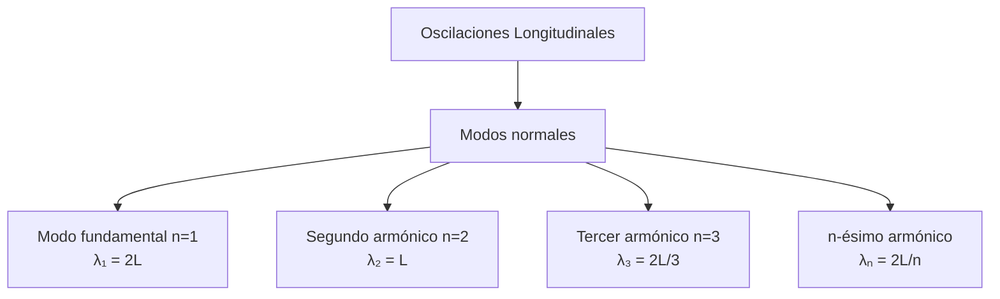

# Matemáticas para Ciencias Aplicadas IV - Ecuaciones de Tipo Hiperbólico

## 6.3 Oscilaciones longitudinales de barras y cuerdas.

---

### 1. Introducción a las Oscilaciones Longitudinales

Las oscilaciones longitudinales son vibraciones donde las partículas del material se mueven **paralelamente** a la dirección de propagación de la onda. Este fenómeno ocurre en barras elásticas, resortes y cuerdas cuando se someten a compresión y tensión alternadas.

### 2. Modelación Física del Problema

#### 2.1. Suposiciones del Modelo

- Material elástico lineal (obedece la ley de Hooke)
- Sección transversal constante $(A)$
- Densidad constante $(\rho)$
- Pequeñas deformaciones
- Fuerzas externas despreciables

### 3. Derivación de la Ecuación de Onda Longitudinal

#### 3.1. Ley de Hooke para Medios Continuos

La tensión $\sigma$ es proporcional a la deformación $\varepsilon:$

$$\sigma = E \varepsilon$$

donde $E$ es el **módulo de Young** del material.

#### 3.2. Deformación Longitudinal

La deformación en un punto $x$ es:

$$\varepsilon(x,t) = \frac{\partial u}{\partial x}$$

donde $u(x,t)$ es el desplazamiento longitudinal.

#### 3.3. Fuerza Neta en un Elemento

Para un elemento de longitud $\Delta x:$

$$F_{\text{neta}} = A[\sigma(x+\Delta x) - \sigma(x)] = A \frac{\partial \sigma}{\partial x} \Delta x$$

#### 3.4. Segunda Ley de Newton

$$A \frac{\partial \sigma}{\partial x} \Delta x = \rho A \Delta x \frac{\partial^2 u}{\partial t^2}$$

Sustituyendo $\sigma = E \frac{\partial u}{\partial x}:$

$$\frac{\partial^2 u}{\partial t^2} = \frac{E}{\rho} \frac{\partial^2 u}{\partial x^2}$$

#### 3.5. Ecuación de Onda Longitudinal

$$\frac{\partial^2 u}{\partial t^2} = c^2 \frac{\partial^2 u}{\partial x^2}$$

donde $c = \sqrt{\frac{E}{\rho}}$ es la **velocidad de onda longitudinal**.

### 4. Condiciones de Frontera e Iniciales

#### 4.1. Condiciones Comunes

1. **Extremo fijo**: $u(0,t) = 0$
2. **Extremo libre**: $\frac{\partial u}{\partial x}(0,t) = 0$
3. **Extremo con masa attached**: Combinación de condiciones

#### 4.2. Condiciones Iniciales

- Desplazamiento inicial: $u(x,0) = f(x)$
- Velocidad inicial: $\frac{\partial u}{\partial t}(x,0) = g(x)$

### 5. Solución por Separación de Variables

#### 5.1. Método de Separación

Suponemos $u(x,t) = X(x)T(t):$

$$X(x)T''(t) = c^2 X''(x)T(t)$$

$$\frac{T''(t)}{c^2 T(t)} = \frac{X''(x)}{X(x)} = -\lambda$$

#### 5.2. Problema de Autovalores

Para extremos fijos ( $u(0,t) = u(L,t) = 0$ ):

- Autovalores: $\lambda_n = \left( \frac{n\pi}{L} \right)^2$
- Autofunciones: $X_n(x) = \sin\left( \frac{n\pi x}{L} \right)$

#### 5.3. Solución General

$$u(x,t) = \sum_{n=1}^{\infty} \left[ A_n \cos\left( \frac{n\pi c t}{L} \right) + B_n \sin\left( \frac{n\pi c t}{L} \right) \right] \sin\left( \frac{n\pi x}{L} \right)$$

#### 5.4. Coeficientes de Fourier

$$A_n = \frac{2}{L} \int_0^L f(x) \sin\left( \frac{n\pi x}{L} \right) dx$$

$$B_n = \frac{2}{n\pi c} \int_0^L g(x) \sin\left( \frac{n\pi x}{L} \right) dx$$

### 6. Modos Normales de Vibración

#### 6.1. Frecuencias Naturales

$$f_n = \frac{n}{2L} \sqrt{\frac{E}{\rho}} \quad \text{para } n = 1, 2, 3, \ldots$$

#### 6.2. Longitudes de Onda

$$\lambda_n = \frac{2L}{n}$$

#### 6.3. Diagrama de Modos Normales



### 7. Ejemplo Resuelto: Barra de Aluminio

**Problema:** Una barra de aluminio de 1 m de longitud ($E = 70$ GPa, $\rho = 2700$ kg/m³) está fija en ambos extremos. Si se deforma inicialmente según $u(x,0) = 0.01 \sin(\pi x)$ y se suelta desde el reposo, encuentre la solución.

**Solución:**

1. Velocidad de onda: $c = \sqrt{\frac{70 \times 10^9}{2700}} \approx 5091.5$ m/s
2. Coeficientes:
   - $A_n = 0.01 \delta_{n1}$ (delta de Kronecker)
   - $B_n = 0$ para todo $n$
3. Solución:

   $$u(x,t) = 0.01 \cos\left( \frac{\pi c t}{L} \right) \sin(\pi x)$$

### 8. Código para Visualización

```python
import numpy as np
import matplotlib.pyplot as plt
from matplotlib.animation import FuncAnimation

# Parámetros
L = 1.0  # longitud
E = 70e9  # módulo de Young (Pa)
rho = 2700  # densidad (kg/m³)
c = np.sqrt(E/rho)  # velocidad de onda

# Configuración
n_points = 200
x = np.linspace(0, L, n_points)

# Modo fundamental
def modo_longitudinal(x, t, n):
    return 0.01 * np.cos(n*np.pi*c*t/L) * np.sin(n*np.pi*x/L)

# Animación
fig, ax = plt.subplots(figsize=(10, 6))
ax.set_xlim(0, L)
ax.set_ylim(-0.015, 0.015)
ax.set_xlabel('Posición x (m)')
ax.set_ylabel('Desplazamiento u(x,t) (m)')
ax.set_title('Oscilaciones Longitudinales - Modo Fundamental')
ax.grid(True)

line, = ax.plot(x, modo_longitudinal(x, 0, 1))
time_text = ax.text(0.02, 0.95, '', transform=ax.transAxes)

def animate(t):
    line.set_ydata(modo_longitudinal(x, t/1000, 1))
    time_text.set_text(f'Tiempo = {t/1000:.3f} s\nFrecuencia = {c/(2*L):.1f} Hz')
    return line, time_text

ani = FuncAnimation(fig, animate, frames=200, interval=50, blit=True)
plt.show()
```

### 9. Energía en las Vibraciones Longitudinales

#### 9.1. Energía Cinética

$$E_c(t) = \frac{1}{2} \int_0^L \rho A \left( \frac{\partial u}{\partial t} \right)^2 dx$$

#### 9.2. Energía Potencial

$$E_p(t) = \frac{1}{2} \int_0^L E A \left( \frac{\partial u}{\partial x} \right)^2 dx$$

#### 9.3. Conservación de Energía

$$\frac{d}{dt}[E_c(t) + E_p(t)] = 0$$

### 10. Aplicaciones Prácticas

- Diseño de estructuras sismorresistentes
- Análisis de vibraciones en máquinas
- Ingeniería acústica (instrumentos musicales)
- Ultrasonido y pruebas no destructivas
- Sistemas de suspensión automotriz

### 11. Ejercicios Propuestos

#### Ejercicio 1

Una barra de acero ( $E = 200$ GPa, $\rho = 7850$ kg/m³ ) de 2 m de longitud tiene ambos extremos fijos. Determine las primeras tres frecuencias naturales de vibración longitudinal.

#### Ejercicio 2

Resuelva la ecuación de onda longitudinal para una barra con:

- Extremo izquierdo fijo: $u(0,t) = 0$
- Extremo derecho libre: $\frac{\partial u}{\partial x}(L,t) = 0$
- Condiciones iniciales: $u(x,0) = x(L-x),$ $\frac{\partial u}{\partial t}(x,0) = 0$

#### Ejercicio 3

Demuestre que la energía total se conserva en las vibraciones longitudinales de una barra elástica.

#### Ejercicio 4

Una cuerda metálica de 0.5 m de longitud y 1 mm de diámetro se somete a una tensión de 100 N. Compare las frecuencias de vibración transversal y longitudinal ( $E = 100$ GPa, $\rho = 5000$ kg/m³ ).

### 12. Comparación con Oscilaciones Transversales

| Aspecto     | Transversales        | Longitudinales       |
| ----------- | -------------------- | -------------------- |
| Dirección   | Perpendicular        | Paralela             |
| Velocidad   | $c = \sqrt{T/\rho}$  | $c = \sqrt{E/\rho}$  |
| Deformación | Cambio de forma      | Compresión/expansión |
| Energía     | Cinética + potencial | Cinética + potencial |

### 13. Referencias

#### Bibliografía Básica:

1. **Boice, W., DiPrima, R.** (2004). _Elementary Differential Equations and Boundary Value Problems_. Wiley, New York. (Capítulo 10)
2. **Edwards, C. H., Penney, D. E.** (2002). _Ecuaciones diferenciales elementales y problemas con condiciones a la frontera_. Prentice Hall, México. (Capítulo 12)

#### Bibliografía Complementaria:

1. **Cooper, J. M.** (1998). _Introduction to Partial Differential Equations with MatLab_. Birkhäuser, Boston. (Capítulo 4)
2. **Hubbard, J. H., West, B. H.** (1995). _Differential Equations: A Dynamical Systems Approach_. Springer-Verlag, Berlin. (Sección 8.4)
3. **Zill, D. G., Wright, W. S.** (1995). _Differential Equations with Computer Lab Experiments_. PWS Publishing Company, Boston. (Capítulo 13)
