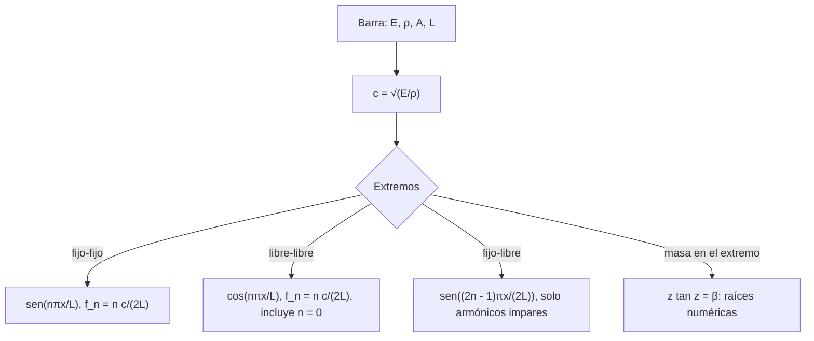

# Matemáticas para Ciencias Aplicadas IV - Ecuaciones de Tipo Hiperbólico

## 6.3 Oscilaciones longitudinales de barras y cuerdas.

---

En las oscilaciones **longitudinales** las partículas del medio se mueven en la misma dirección en que viaja la onda: el material se comprime y se estira. Así viaja el sonido en los sólidos, los líquidos y los gases, y así vibran una barra golpeada en su extremo, un resorte largo o la columna de aire de una flauta. Este tema deduce la ecuación de onda longitudinal a partir de la ley de Hooke, estudia las condiciones de frontera (extremo fijo, libre o con una masa) y sus modos, y compara las ondas longitudinales con las transversales del tema 6.2.

### Deducción de la ecuación

**Hipótesis.** Una barra recta de sección $A,$ densidad $\rho$ y módulo de Young $E,$ todos constantes. Cada sección transversal, que en reposo está en la posición $x,$ se desplaza a $x + u(x, t)$ a lo largo del eje, y las secciones se mantienen planas. Los desplazamientos son pequeños, de modo que el material es elástico lineal.

**Deformación y esfuerzo.** El trozo que en reposo ocupa $[x, x + \Delta x]$ ocupa después $[x + u(x), x + \Delta x + u(x + \Delta x)],$ así que su alargamiento relativo, la **deformación unitaria**, es

$$ \varepsilon = \frac{u(x + \Delta x, t) - u(x, t)}{\Delta x} \to u_x(x, t) $$

Por la **ley de Hooke**, el esfuerzo (fuerza por unidad de área) es $\sigma = E \varepsilon = E u_x,$ y la fuerza que la parte derecha de la barra ejerce sobre la izquierda en la sección $x$ es $E A\, u_x(x, t),$ positiva si la barra está estirada.

**Segunda ley de Newton.** El trozo $[x, x + \Delta x]$ tiene masa $\rho A\, \Delta x,$ y la fuerza neta sobre él es la diferencia de las fuerzas en sus extremos:

$$ \rho A\, \Delta x\, u_{tt} = E A \big( u_x(x + \Delta x, t) - u_x(x, t) \big) $$

Dividiendo entre $\Delta x$ y tomando el límite,

$$ u_{tt} = c^2 u_{xx}, \qquad c = \sqrt{\frac{E}{\rho}} $$

Es la misma ecuación que la de la cuerda, con el módulo de Young en el papel de la tensión. Si la sección o el material varían con $x,$ la deducción da $\rho A\, u_{tt} = \big( E A\, u_x \big)_x,$ una ecuación de onda con coeficientes variables.

| | Transversales (cuerda) | Longitudinales (barra) |
| --- | --- | --- |
| movimiento | perpendicular a la cuerda | a lo largo de la barra |
| fuerza restauradora | tensión $T$ | elasticidad $E A$ |
| velocidad | $\sqrt{T / \rho_{\text{lineal}}}$ | $\sqrt{E / \rho}$ |
| valores típicos | cientos de m/s | miles de m/s: 5 100 en el aluminio, 5 050 en el acero |

### Condiciones de frontera

| Extremo | Condición | Motivo |
| --- | --- | --- |
| fijo (empotrado) | $u = 0$ | la sección no se mueve |
| libre | $u_x = 0$ | no hay fuerza: $E A u_x = 0$ |
| unido a un resorte | $E A u_x(L) = -k u(L)$ | el resorte ejerce la fuerza |
| con una masa $M$ | $E A u_x(L) = -M u_{tt}(L)$ | segunda ley para la masa |

### Modos normales

Separando variables, $X'' + \mu^2 X = 0,$ y las condiciones de frontera deciden los valores de $\mu$ y la frecuencia $f = \frac{c\mu}{2\pi}:$

| Extremos | Modos $X_n$ | Frecuencias $f_n$ |
| --- | --- | --- |
| fijo y fijo | $\sin \frac{n\pi x}{L}$ | $\frac{n c}{2L},$ $n = 1, 2, \ldots$ |
| libre y libre | $\cos \frac{n\pi x}{L}$ | $\frac{n c}{2L},$ $n = 0, 1, \ldots$ |
| fijo y libre | $\sin \frac{(2n - 1)\pi x}{2L}$ | $\frac{(2n - 1) c}{4L},$ $n = 1, 2, \ldots$ |

En la barra libre-libre, el modo $n = 0$ con frecuencia cero es un movimiento rígido: la barra entera se traslada. En la barra fija-libre solo hay **armónicos impares**, y su fundamental es la mitad que la de la barra fija-fija: se comporta como media barra fija-fija, porque el extremo libre es un plano de simetría. Lo mismo ocurre en los tubos de aire: un tubo cerrado por un extremo (clarinete) tiene solo armónicos impares, y uno abierto por ambos (flauta), todos.

**Demostración (fijo-libre).** $X(0) = 0$ da $X = \sin \mu x,$ y $X'(L) = \mu \cos \mu L = 0$ exige $\mu L = \frac{(2n - 1)\pi}{2}.$ $\blacksquare$

**Masa en el extremo.** Si la barra está fija en $x = 0$ y tiene una masa $M$ en $x = L,$ con $X = \sin \mu x$ y $\omega = c\mu$ la condición $E A\, X'(L) = M \omega^2 X(L)$ queda, llamando $z = \mu L$ y $\beta = \frac{\rho A L}{M}$ (masa de la barra entre la masa añadida),

$$ z \tan z = \beta $$

una ecuación **trascendente** cuyas raíces se calculan numéricamente. Las frecuencias ya no son múltiplos de la fundamental. Si la masa es muy grande, $\beta$ es pequeño, $\tan z \approx z$ y $z \approx \sqrt{\beta},$ de donde $\omega \approx \sqrt{\frac{E A}{M L}}:$ la barra se comporta como un resorte de constante $k = E A / L$ sin masa, con la masa $M$ en su extremo. Si la masa es muy pequeña, $z \to \pi/2$ y se recupera la barra fija-libre.



### Energía

La energía de la barra es

$$ E_{\text{tot}}(t) = \frac{1}{2} \int_0^L \left( \rho A\, u_t^2 + E A\, u_x^2 \right) dx $$

cinética más energía elástica de deformación. Igual que para la cuerda, $E_{\text{tot}}'(t) = E A \big[ u_t u_x \big]_0^L,$ que es cero si cada extremo es fijo, donde $u_t = 0,$ o libre, donde $u_x = 0.$ Con un resorte en el extremo se conserva la energía total de la barra **más** la del resorte, $\frac{1}{2} k u(L, t)^2.$

### Ejemplo resuelto

Una barra de aluminio de 1 m, con $E = 70$ GPa y $\rho = 2700$ kg/m³, fija en ambos extremos se deforma con $u(x, 0) = 0.01 \sin(\pi x)$ (en metros) y se suelta desde el reposo. La velocidad es $c = \sqrt{70 \times 10^9 / 2700} \approx 5091.8$ m/s. El dato inicial ya es el primer modo, así que $A_1 = 0.01,$ los demás coeficientes son cero y

$$ u(x, t) = 0.01 \sin(\pi x) \cos(\pi c t) $$

La barra vibra a $f_1 = c/2 \approx 2546$ Hz, un sonido agudo: las barras metálicas de un carillón o un triángulo suenan alto porque $c$ es grande.

### Implementación en Python

El programa calcula las velocidades y frecuencias de los ejemplos, obtiene con SymPy los coeficientes de la barra fija-libre del ejercicio 2 (y comprueba la ortogonalidad de sus modos), mide la convergencia de esa serie, resuelve la ecuación trascendente de la barra con masa para varios valores de $\beta$ y compara las ondas transversales y longitudinales del ejercicio 4.

```python
import numpy as np
import sympy as sp
from scipy.optimize import brentq

# Ejemplo: barra de aluminio de 1 m con extremos fijos
E, rho, L = 70e9, 2700, 1.0
c = np.sqrt(E / rho)
print(f"aluminio: c = {c:.1f} m/s, f1 = c/(2L) = {c / (2 * L):.1f} Hz")

# Ejercicio 1: acero de 2 m, fijo-fijo
E, rho, L = 200e9, 7850, 2.0
c = np.sqrt(E / rho)
print(f"acero: c = {c:.1f} m/s; fijo-fijo f1, f2, f3 =",
      ", ".join(f"{n * c / (2 * L):.1f}" for n in (1, 2, 3)), "Hz")
print("        fijo-libre f1, f2, f3 =",
      ", ".join(f"{(2 * n - 1) * c / (4 * L):.1f}" for n in (1, 2, 3)), "Hz")

# Ejercicio 2: fijo en 0, libre en L, u(x,0) = x(L - x), u_t(x,0) = 0
x, Ls = sp.symbols("x L", positive=True)
n = sp.symbols("n", integer=True, positive=True)
mu = (2 * n - 1) * sp.pi / (2 * Ls)
An = sp.simplify(2 / Ls * sp.integrate(x * (Ls - x) * sp.sin(mu * x), (x, 0, Ls)))
print("fijo-libre, A_n =", An)
print("   con L = 1, A_1..A_4:", [f"{float(An.subs({Ls: 1, n: k})):.5f}" for k in range(1, 5)])
# ortogonalidad de las funciones propias sen(mu_n x) en [0, L]
orto = sp.integrate(sp.sin(mu.subs(n, 1) * x) * sp.sin(mu.subs(n, 2) * x), (x, 0, Ls))
print("   ∫ X_1 X_2 dx =", sp.simplify(orto))
f = lambda xx: xx * (1 - xx)
xs = np.linspace(0, 1, 201)
for N in (2, 10, 50):
    s = sum(float(An.subs({Ls: 1, n: k})) * np.sin((2 * k - 1) * np.pi * xs / 2) for k in range(1, N + 1))
    print(f"   N = {N}: error máximo en [0, 0.9]: {np.max(np.abs(s - f(xs))[xs <= 0.9]):.2e},"
          f" valor de la serie en x = 1: {s[-1]:.4f}")

# Barra fija en 0 con una masa M en x = L: mu L tan(mu L) = beta, beta = rho A L / M
print("barra con masa en el extremo: raíces de z tan z = beta (z = mu L)")
for beta in (0.01, 1.0, 100.0):
    raices = [brentq(lambda z: z * np.tan(z) - beta, k * np.pi + 1e-12, k * np.pi + np.pi / 2 - 1e-12)
              for k in range(3)]
    print(f"   beta = {beta:6.2f}: z = " + ", ".join(f"{r:.4f}" for r in raices)
          + f"   (sqrt(beta) = {np.sqrt(beta):.4f})")

# Ejercicio 4: alambre de 0.5 m, 1 mm de diámetro, T = 100 N, E = 100 GPa, rho = 5000
L, d, T, E, rho = 0.5, 1e-3, 100.0, 100e9, 5000.0
A = np.pi * d**2 / 4
ct, cl = np.sqrt(T / (rho * A)), np.sqrt(E / rho)
print(f"alambre: transversal c = {ct:.1f} m/s, f1 = {ct / (2 * L):.1f} Hz;"
      f" longitudinal c = {cl:.1f} m/s, f1 = {cl / (2 * L):.1f} Hz; cociente {cl / ct:.1f}")
```

Salida:

```text
aluminio: c = 5091.8 m/s, f1 = c/(2L) = 2545.9 Hz
acero: c = 5047.5 m/s; fijo-fijo f1, f2, f3 = 1261.9, 2523.8, 3785.7 Hz
        fijo-libre f1, f2, f3 = 630.9, 1892.8, 3154.7 Hz
fijo-libre, A_n = 8*L**2*(2*(-1)**n*pi*n - (-1)**n*pi + 4)/(pi**3*(8*n**3 - 12*n**2 + 6*n - 1))
   con L = 1, A_1..A_4: ['0.22148', '0.12829', '-0.02417', '0.01955']
   ∫ X_1 X_2 dx = 0
   N = 2: error máximo en [0, 0.9]: 3.31e-02, valor de la serie en x = 1: 0.0932
   N = 10: error máximo en [0, 0.9]: 3.68e-03, valor de la serie en x = 1: 0.0202
   N = 50: error máximo en [0, 0.9]: 2.31e-04, valor de la serie en x = 1: 0.0041
barra con masa en el extremo: raíces de z tan z = beta (z = mu L)
   beta =   0.01: z = 0.0998, 3.1448, 6.2848   (sqrt(beta) = 0.1000)
   beta =   1.00: z = 0.8603, 3.4256, 6.4373   (sqrt(beta) = 1.0000)
   beta = 100.00: z = 1.5552, 4.6658, 7.7764   (sqrt(beta) = 10.0000)
alambre: transversal c = 159.6 m/s, f1 = 159.6 Hz; longitudinal c = 4472.1 m/s, f1 = 4472.1 Hz; cociente 28.0
```

La serie del ejercicio 2 converge bien en el interior pero lentamente cerca de $x = L,$ porque el dato $x(L - x)$ no cumple la condición del extremo libre: $u_x(L) = -L \neq 0.$ Para $\beta = 0.01$ la primera raíz es casi $\sqrt{\beta},$ el límite de resorte con masa; para $\beta = 100$ es casi $\pi/2 \approx 1.5708,$ el de la barra fija-libre.

### Ejercicios Propuestos

1. **Frecuencias del acero.** Una barra de acero de 2 m, con $E = 200$ GPa y $\rho = 7850$ kg/m³, tiene ambos extremos fijos. Calcula sus tres primeras frecuencias naturales de vibración longitudinal. ¿Y si un extremo es libre?

2. **Barra fija-libre.** Resuelve $u_{tt} = c^2 u_{xx}$ con $u(0, t) = 0,$ $u_x(L, t) = 0,$ $u(x, 0) = x(L - x)$ y $u_t(x, 0) = 0.$

3. **Energía.** Demuestra que la energía total se conserva en las vibraciones longitudinales de una barra con extremos fijos o libres.

4. **Transversal contra longitudinal.** Un alambre metálico de 0.5 m y 1 mm de diámetro está tenso a 100 N y fijo en sus extremos, con $E = 100$ GPa y $\rho = 5000$ kg/m³. Compara las frecuencias fundamentales de vibración transversal y longitudinal.

5. **Masa en el extremo.** Una barra fija en $x = 0$ lleva en $x = L$ una masa igual a la suya, es decir, $\beta = 1.$ Calcula su frecuencia fundamental en términos de $c/L$ y compárala con la de la barra fija-libre.

### Soluciones

**Ejercicio 1.** $c = \sqrt{200 \times 10^9 / 7850} \approx 5047.5$ m/s y $f_n = n c / (2L):$ 1261.9, 2523.8 y 3785.7 Hz. Con un extremo libre, $f_n = (2n - 1) c / (4L):$ 630.9, 1892.8 y 3154.7 Hz.

**Ejercicio 2.** Con $\mu_n = \frac{(2n - 1)\pi}{2L}$ y $B_n = 0,$

$$ u(x, t) = \sum_{n = 1}^{\infty} A_n \sin(\mu_n x) \cos(c \mu_n t), \qquad A_n = \frac{8 L^2 \big( 4 + (-1)^n (2n - 1)\pi \big)}{\pi^3 (2n - 1)^3} $$

Para $L = 1,$ $A_1 \approx 0.2215,$ $A_2 \approx 0.1283,$ $A_3 \approx -0.0242.$

**Ejercicio 3.** $E_{\text{tot}}' = \int_0^L \left( \rho A u_t u_{tt} + E A u_x u_{xt} \right) dx = E A \int_0^L (u_t u_x)_x\, dx = E A \big[ u_t u_x \big]_0^L = 0,$ porque en cada extremo se anula $u_t$ (fijo) o $u_x$ (libre).

**Ejercicio 4.** La sección es $A = \pi d^2 / 4 \approx 7.85 \times 10^{-7}$ m² y la densidad lineal $\rho A \approx 3.93 \times 10^{-3}$ kg/m. Transversal: $c = \sqrt{T / (\rho A)} \approx 159.6$ m/s y $f_1 \approx 159.6$ Hz. Longitudinal: $c = \sqrt{E/\rho} \approx 4472$ m/s y $f_1 \approx 4472$ Hz, 28 veces más alta. Por eso, al pulsar un alambre, lo que se oye es la vibración transversal.

**Ejercicio 5.** La primera raíz de $z \tan z = 1$ es $z \approx 0.8603,$ así que $\omega_1 = 0.8603\, c/L,$ frente a $\frac{\pi}{2} \frac{c}{L} \approx 1.5708\, c/L$ sin masa: la masa añadida baja la frecuencia fundamental casi a la mitad.

### Referencias

1. Tijonov, A. N., y Samarski, A. A., _Ecuaciones de la física matemática_. Mir, 1980. Capítulo 2.
2. Graff, K. F., _Wave Motion in Elastic Solids_. Dover, 1991. Capítulo 2.
3. Kinsler, L. E., Frey, A. R., Coppens, A. B., and Sanders, J. V., _Fundamentals of Acoustics_. Wiley, 2000. Capítulo 3.
4. Boyce, W. E., DiPrima, R. C., and Meade, D. B., _Elementary Differential Equations and Boundary Value Problems_. Wiley, 2017. Capítulo 10.
